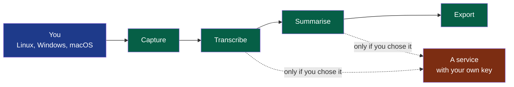

# Wholeheard

**Be in the meeting. The minutes write themselves — and never leave your machine.**

Wholeheard records a conversation, transcribes it and writes its minutes on Linux, Windows and macOS — four steps, each usable alone and with the provider you choose, on your machine by default — for people who want to keep control of their data and of their costs.

> Installing or updating the foundation this project is built on:
> [`.nstack/handbook/INSTALL.md`](.nstack/handbook/INSTALL.md). Delete this line when it no longer serves.

## What it is



**Legend** — blue: you, on your own machine · green: Wholeheard's four steps, each usable
alone · red: what is outside your machine, reached only when you choose it.

No bot joins your meeting and no account is asked for. **You tell the other participants
that you are recording**: Wholeheard shows them nothing.

## Install it

On Fedora and Ubuntu, from a package built from this repository — none is published yet, and
nothing on Windows or macOS (macOS is [cycle 04](docs/project/cycles/04-wholeheard-on-macos.md)):

```bash
nstack release                                        # Fedora: every program, then the rpm
sudo dnf install ./dist/install/wholeheard-*.x86_64.rpm

WHOLEHEARD_TARGET=ubuntu-24.04 nstack release         # Ubuntu: built in its container, then the .deb
sudo apt install ./dist/install/wholeheard_*_amd64.deb
```

Needs `podman` ([`modules/install`](modules/install/)). Ubuntu's package is being tried on a
colleague's machine.

| What runs | Its page |
|---|---|
| Wholeheard, started with your session: a small window to record, and a call in another application offered to be recorded; the window lists your meetings and what they weigh, shows one's minutes beside its transcript, plays it with its words following, frees space to the system's trash, from where it comes back, and holds the settings — each step's model, fetched on your word | [`modules/shell`](modules/shell/) |
| A recording, from a terminal: `wholeheard-capture record <folder>` | [`modules/capture`](modules/capture/) |
| The transcript of a session, on the machine: `wholeheard-transcription <session> --model <file>` | [`modules/transcription`](modules/transcription/) |
| The minutes of a transcript, from the provider you chose: `wholeheard-summary <session> --provider <address> --model <name>` | [`modules/summary`](modules/summary/) |

Each source is kept as your system delivers it, at its own rate and channels, in 24 bits —
about 2 GB an hour on a laptop ([ADR-0004](docs/adr/0004-the-audio-as-recorded-is-kept-everything-else-is-derived.md)).
**Known**: the engine on the machine still writes a few words where nobody speaks, and on a
lively meeting misses or mishears about one word in four.

## Contribute

[`CONTRIBUTING.md`](CONTRIBUTING.md) — how a change is proposed, verified and merged here.

## Licence

GPL-3.0 ([`LICENSE`](LICENSE)). Built from source, Wholeheard is free on every system; the
signed builds for macOS and Windows are what is sold ([PDR-0001](docs/pdr/0001-wholeheard-open-on-linux-paid-on-macos-and-windows.md)).

## Decisions

| What | Where |
|---|---|
| Who it is for, and when it is finished | [`docs/project/`](docs/project/) — the charter and the cycles |
| What the product must do, and why | [`docs/pdr/`](docs/pdr/) |
| How it is built, and why | [`docs/adr/`](docs/adr/) |
| Its modules, and the contracts between them | [`modules/`](modules/) |
