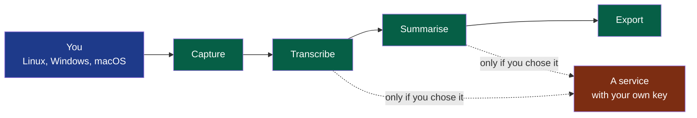

# Summit

Summit records a conversation, transcribes it and writes its minutes on Linux, Windows and macOS — four steps, each usable alone and with the provider you choose, on your machine by default — for people who want to keep control of their data and of their costs.

> Installing or updating the foundation this project is built on:
> [`.nstack/handbook/INSTALL.md`](.nstack/handbook/INSTALL.md). Delete this line when it no longer serves.

## What it is

**Legend** — blue: you, on your own machine · green: Summit's four steps, each usable
alone · red: what is outside your machine, reached only when you choose it.

No bot joins your meeting and no account is asked for. **You tell the other participants
that you are recording**: Summit shows them nothing.

## Run it

On Fedora, built from this repository — no installer yet, and nothing on Windows or macOS:

| What runs | How | Its page |
|---|---|---|
| Summit in the tray: start and stop a recording from its menu or a shortcut, told by notifications | `nstack run shell` | [`modules/shell`](modules/shell/) |
| A recording, from a terminal | `summit-capture record <folder>` | [`modules/capture`](modules/capture/) |
| The transcript of a session, on the machine | `summit-transcription <session> --model <file>` | [`modules/transcription`](modules/transcription/) |
| The minutes of a transcript, from the provider you chose | `summit-summary <session> --provider <address> --model <name>` | [`modules/summary`](modules/summary/) |

**Known, and being worked on**: taken on loudspeakers, a meeting's transcript repeats one
party under the other's name. The second cycle (from 14 October 2026) rebuilds the audio on
a firmer base: [`docs/project/cycles/`](docs/project/cycles/), [ADR-0004](docs/adr/0004-the-audio-as-recorded-is-kept-everything-else-is-derived.md).

## Contribute

[`CONTRIBUTING.md`](CONTRIBUTING.md) — how a change is proposed, verified and merged here.

## Decisions

| What | Where |
|---|---|
| Who it is for, and when it is finished | [`docs/project/`](docs/project/) — the charter and the cycles |
| What the product must do, and why | [`docs/pdr/`](docs/pdr/) |
| How it is built, and why | [`docs/adr/`](docs/adr/) |
| Its modules, and the contracts between them | [`modules/`](modules/) |
