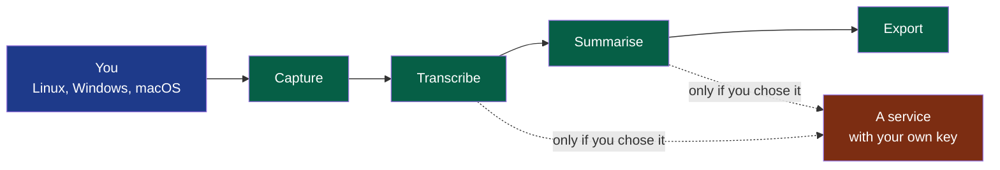

# Summit

Summit records a conversation, transcribes it and writes its minutes on Linux, Windows and macOS — four steps, each usable alone and with the provider you choose, on your machine by default — for people who want to keep control of their data and of their costs.

> Installing or updating the foundation this project is built on:
> [`.nstack/handbook/INSTALL.md`](.nstack/handbook/INSTALL.md). Delete this line when it no longer serves.

## What it is

**Legend** — blue: you, on your own machine · green: Summit's four steps, each usable
alone · red: what is outside your machine, reached only when you choose it.

No bot joins your meeting and no account is asked for. **You tell the other participants
that you are recording**: Summit shows them nothing.

## Run it

Nothing runs yet. The first cycle (13 to 27 October 2026) delivers a first recorded meeting, with its
transcript and its minutes, on the three systems: [`docs/project/cycles/`](docs/project/cycles/).

## Contribute

[`CONTRIBUTING.md`](CONTRIBUTING.md) — how a change is proposed, verified and merged here.

## Decisions

| What | Where |
|---|---|
| Who it is for, and when it is finished | [`docs/project/`](docs/project/) — the charter and the cycles |
| What the product must do, and why | [`docs/pdr/`](docs/pdr/) |
| How it is built, and why | [`docs/adr/`](docs/adr/) |
| Its modules, and the contracts between them | [`modules/`](modules/) |
