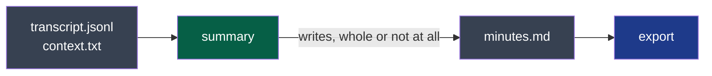

# minutes — version 1

A session's minutes are one text file a person reads as it is — highlights, actions, key
points — that says what made it, and that exists only when it is whole.



**Legend** — green: the producer · grey: files in the session's folder · blue: the consumer.

## What it carries

`minutes.md` in the session's folder: UTF-8, Markdown, opening on a front matter.

| Front matter | Meaning |
|---|---|
| `contract` | `minutes/v1` |
| `made` | When, ISO 8601 with the local offset |
| `provider` | The host that answered, or `local` — never a key |
| `model` | The model's name, as the provider knows it |
| `context` | The text the provider received with the transcript, or `null` |

Its keys and their values, as each line reads: [`front-matter.schema.json`](front-matter.schema.json).

Then exactly three sections of second level, in this order, their titles in the meeting's
language:

| Section | Holds |
|---|---|
| 1. Highlights | A few sentences: what the meeting was for and what came out of it |
| 2. Actions | A list; each item says **what**, **who** and **by when**, in that order, separated by ` — ` |
| 3. Key points | A list: decisions, figures, dates, what stays open |

- **What the meeting did not settle is said**, in the meeting's language: *not specified*, or
  that it was proposed and not accepted. An empty section says that there is none.
- **Whole or absent.** The file appears under its name only once it is complete; a provider
  that fails leaves the minutes that were there, or none.
- **Made again replaces.** There is one `minutes.md`; the one before is not kept by this
  contract.

## What it never does

- It never promises that an action is right: it is a model's reading of a transcript. Who
  and by when may be wrong; the user reads them against the meeting.
- It never carries the transcript, the audio, a key, or a path of the machine.
- Its sections' titles are never a fixed text: a consumer finds a section by its place, not
  by its name.

## Examples

Valid:

```markdown
---
contract: minutes/v1
made: 2026-10-13T15:12:40+02:00
provider: local
model: mistral
context: null
---

## Points forts

La date de l'événement est fixée au jeudi 3 juin, avec le 10 en seconde date.

## Actions

- Contacter les trois intervenants et le comité scientifique — Alexandre — 26 avril
- Pré-réserver les salles — non précisé — non précisé

## Points clés

- Réponse des intervenants attendue pour le 26 avril ; un plan B reste à trouver.
```

To refuse: a file without the front matter or naming another `contract`; fewer or more than
three sections of second level.
