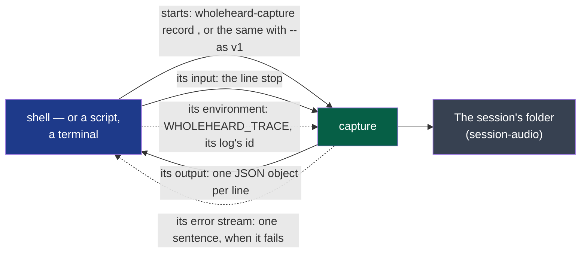

# recording — version 1

What the program that records says while it records, and how it is told to stop: one line of
text per event, for whoever started it.



**Legend** — green: the producer · blue: whoever started it, the consumer · grey: what the
recording leaves, described by `session-audio`.

The lines are the same whichever version of `session-audio` the recording leaves: in the
second, what `record` writes unasked, the program still names its sources `me` and `others`,
where the folder's tracks are `local` and `remote`; `--as v1` leaves the first.

**For a machine**: [`event.schema.json`](./event.schema.json) says what a line of the output
is — and is what the project's comparator judges a change to this version by (ADR-0005). The
order of the events, and what each means, are said here and nowhere else.

## What it carries

**The output**: UTF-8, one JSON object per line, nothing else. Each has `event`:

| `event` | Other fields | Says |
|---|---|---|
| `unavailable` | `source`: `me` or `others`; `reason`: a sentence, free: for a person or a log, no consumer reads a meaning from its words | This source could not be opened: in a session of `session-audio/v2` it has no track — in one of `session-audio/v1`, its file is silence. Said before `started`; the other source is still recorded. It is not always for good: *A microphone that waits*, below |
| `started` | `folder`: the session's folder, a path; `sources`: for `me` and `others`, the name the system gave it, or `unavailable` | The recording runs, and `session.json` is in the folder. **Once**, and first unless `unavailable` came before |
| `silent` | `source`; `nothing`: `true` when not one sample other than an exact zero came — optional | This source has given no sound for ten seconds. Said once per silence. `nothing`: the device delivers nothing at all — no microphone at rest gives exact zeros —, not a quiet room (#361); absent, unknown |
| `heard` | `source` | A source that was said `silent` gives sound again |
| `level` | `source`; `level`: how loud it is now, from 0 (silence) to 1 (the loudest it can be), a number | About ten times a second for each source being recorded, after `started` and before `stopped`: for a meter that moves as sound comes (cycle 03, D22) |
| `device` | `source`; `device`: the name the system gives the device, or `null` | This source is now recorded from another device: the user chose another default, or the one recorded was taken away and the system named another — or, for `others`, a call plays on an output other than the default, or left it for the default (cycle 04, D41). Its track goes on, in the form it opened with (`session-audio`). `null`: the system names no device for it, and nothing comes from it until a `device` names one. Said at each change, after `started` and before `stopped`; of a source said `unavailable`, only once it has a stream: *A microphone that waits*, below |
| `stopped` | `folder`; `seconds`: the recording's length, a number | The session's files are whole and `session.json` says `stopped`. **Last**, and only when the recording was stopped as below |

**Stopping**: the line `stop` on the program's input, an interrupt or a termination signal.
All three end the same way: `stopped`, then the program ends well. Closing its input stops
nothing.

**Failing**: the program ends in failure with one sentence on its error stream, and no
`stopped`. Before `started`, nothing was recorded; after it, the folder holds what
`session-audio` promises of a recording ended by a crash.

**Its log**: the program logs what it does ([ADR-0007](../../../docs/adr/0007-each-program-logs-what-it-does-never-what-was-said.md)),
at `info`, under an id of its own, in the user's folder for logs — on Linux
`$XDG_STATE_HOME/wholeheard/logs`, or `~/.local/state/wholeheard/logs`; on macOS
`~/Library/Logs/Wholeheard`; on Windows `%LOCALAPPDATA%\Wholeheard\logs`. There it also removes
the day files written more than fourteen days ago, then the oldest until the folder weighs
under 50 MB — every program's day files, nothing else.
Whoever starts it may set, in its environment:

- `WHOLEHEARD_TRACE` — the making's id: ASCII letters, digits and dashes, 64 at most. Any other value
  is replaced by an id of the run's own, without a word;
- `WHOLEHEARD_LOG` — `off`, `error`, `warn`, `info`, `debug` or `trace`, in lower case; a value
  holding `=` is read as a `tracing` filter, for whoever knows them; any other value is `info`. Turned `off`, the log leaves nothing: no file, no day file removed;
- `WHOLEHEARD_LOG_DIR` — an absolute folder; a relative one is ignored. A folder that cannot be
  made or written leaves no log, and changes nothing else.

None is required. None, and no state of the log, changes a line of the output, the error stream
or what the program leaves — with one exception: a run that crosses midnight UTC while the
next day's file cannot be created has the logging library say so once on the error stream.
The log is not what the program leaves. What the log holds is not this
contract: it is read by people, never by a consumer.

## What it never does

- It never says anything of what was said: a `level` is how loud, not what — it was added for
  the meter of the small window (cycle 03, D22), as additive as the comparator allows: a consumer
  of this version already ignores an `event` it does not know.
- It never says `stopped` for a recording that was killed: the consumer learns it from the
  program's end, and from a `session.json` without `stopped`.
- It never prints anything but these lines on its output: a consumer may refuse a line that
  is not one — and must ignore a field or an `event` it does not know, so that a second
  version can add one.
- It never ends because its consumer did: a consumer that is gone — its end of the output
  closed — stops nothing. **A consumer that keeps the output open reads it**: the system holds
  some 1,700 unread events, and the program waits on the next one.

**A source that becomes unavailable during the recording** — a headset unplugged — is said by
`device` when the system names another default for it, which it records from then on, and by
`device` with `null` when it names none: nothing comes from that source then, and its track
holds zeros, as a silence of the capture (`session-audio`), until a `device` names one again
(cycle 01, D3's fifth criterion; cycle 03, D31). `device` was added in cycle 03, as `level` was:
a consumer of this version already ignores an `event` it does not know.

**A microphone that waits** (cycle 05, D66; [ADR-0015](../../../docs/adr/0015-the-local-side-records-the-microphone-the-call-holds-passively.md)):
`me` may be said `unavailable` because nothing may open its microphone yet, a headset's that a
stream would switch to another profile. No track, no `level`, while it waits. When it is taken,
by a call or as the default input changes, `device` names it, and the source is then recorded as
any other. When the call lets go, `device` with `null`, its track holding zeros, until a `device`
names one again: as often as calls come, and for as long as the recording lasts. Never taken, it
stays what `unavailable` says. A recording that leaves `session-audio/v1` (`--as v1`) does none of
this.

**A consumer must accept** that sequence: `unavailable` is what was true at the start, `started`'s
`sources` does not change, and what `me` records now is the last `device`. `null` says that nothing
comes from the source, never why: not that the computer has no microphone left. The change is
additive for a consumer that reads each line for itself, as this page has always asked; this page
said before that `device` was never said of a source said `unavailable`.

## Examples

Valid — a recording where nothing plays for a while, stopped by the line `stop`:

```text
{"event":"started","folder":"<sessions-folder>/2026-10-13_14-05","sources":{"me":"Digital Microphone","others":"Speaker"}}
{"event":"level","source":"me","level":0.42}
{"event":"silent","source":"others"}
{"event":"heard","source":"others"}
{"event":"device","source":"me","device":"Headset Microphone"}
{"event":"stopped","folder":"<sessions-folder>/2026-10-13_14-05","seconds":1912.4}
```

Valid — the microphone refused, the meeting still recorded:

```text
{"event":"unavailable","source":"me","reason":"the system names no default device"}
{"event":"started","folder":"<sessions-folder>/2026-10-13_14-05","sources":{"me":"unavailable","others":"Speaker"}}
```

Valid — a microphone that waits, taken by a call, let go, taken again, let go:

```text
{"event":"unavailable","source":"me","reason":"the default input is a Bluetooth headset's: the microphone waits for a call to take it"}
{"event":"started","folder":"<sessions-folder>/2026-10-13_14-05","sources":{"me":"unavailable","others":"Speaker"}}
{"event":"device","source":"me","device":"Headset Microphone"}
{"event":"device","source":"me","device":null}
{"event":"device","source":"me","device":"Headset Microphone"}
{"event":"device","source":"me","device":null}
{"event":"stopped","folder":"<sessions-folder>/2026-10-13_14-05","seconds":70.1}
```

To refuse: a line that is not a JSON object with an `event`.
