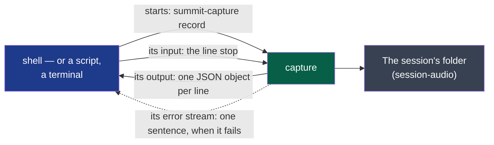

# recording — version 1

What the program that records says while it records, and how it is told to stop: one line of
text per event, for whoever started it.



**Legend** — green: the producer · blue: whoever started it, the consumer · grey: what the
recording leaves, described by `session-audio`.

## What it carries

**The output**: UTF-8, one JSON object per line, nothing else. Each has `event`:

| `event` | Other fields | Says |
|---|---|---|
| `unavailable` | `source`: `me` or `others`; `reason`: a sentence | This source could not be opened: its file will be silence. Said before `started`; the other source is still recorded |
| `started` | `folder`: the session's folder, a path; `sources`: for `me` and `others`, the name the system gave it, or `unavailable` | The recording runs, and `session.json` is in the folder. **Once**, and first unless `unavailable` came before |
| `silent` | `source` | This source has given no sound for ten seconds. Said once per silence |
| `heard` | `source` | A source that was said `silent` gives sound again |
| `stopped` | `folder`; `seconds`: the recording's length, a number | The two files are whole and `session.json` says `stopped`. **Last**, and only when the recording was stopped as below |

**Stopping**: the line `stop` on the program's input, an interrupt or a termination signal.
All three end the same way: `stopped`, then the program ends well. Closing its input stops
nothing.

**Failing**: the program ends in failure with one sentence on its error stream, and no
`stopped`. Before `started`, nothing was recorded; after it, the folder holds what
`session-audio` promises of a recording ended by a crash.

## What it never does

- It never says how loud a source is, nor anything of what was said.
- It never says `stopped` for a recording that was killed: the consumer learns it from the
  program's end, and from a `session.json` without `stopped`.
- It never prints anything but these lines on its output: a consumer may refuse a line that
  is not one — and must ignore a field or an `event` it does not know, so that a second
  version can add one.
- It never ends because its consumer did: a consumer that is gone — its end of the output
  closed — stops nothing. **A consumer that keeps the output open reads it**: the system holds
  some 1,700 unread events, and the program waits on the next one.

**Open before `stable`**: whether a source that becomes unavailable *during* the recording —
a headset unplugged — is said by `silent` alone, as today, or by an event of its own (cycle
01, D3's fifth criterion).

## Examples

Valid — a recording where nothing plays for a while, stopped by the line `stop`:

```text
{"event":"started","folder":"<sessions-folder>/2026-10-13_14-05","sources":{"me":"Digital Microphone","others":"Speaker"}}
{"event":"silent","source":"others"}
{"event":"heard","source":"others"}
{"event":"stopped","folder":"<sessions-folder>/2026-10-13_14-05","seconds":1912.4}
```

Valid — the microphone refused, the meeting still recorded:

```text
{"event":"unavailable","source":"me","reason":"the system names no default device"}
{"event":"started","folder":"<sessions-folder>/2026-10-13_14-05","sources":{"me":"unavailable","others":"Speaker"}}
```

To refuse: a line that is not a JSON object with an `event`.
