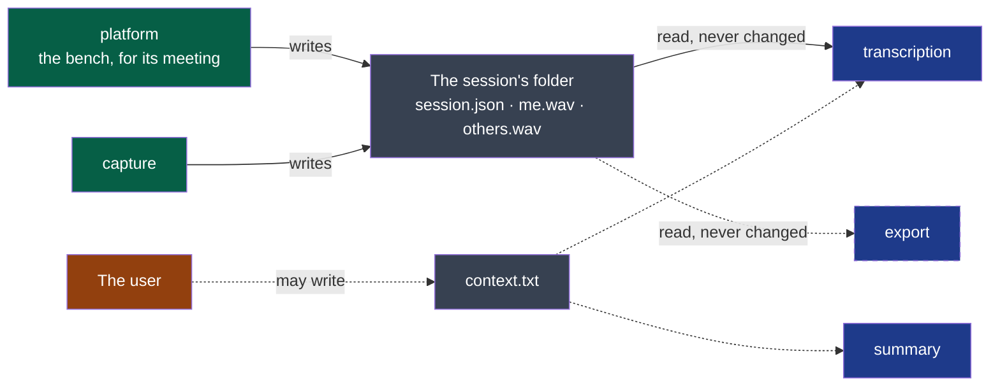

# session-audio — version 1

A session's folder holds the sound of a meeting as two files, one per party, that can be read
while they are still being written and after a crash.



**Legend** — green: the producer · grey: files on the machine · blue: consumers · orange: the
user. Dotted: optional. Dashed box: a consumer that is planned, and
reads nothing yet.

## What it carries

**For a machine**: [`session.schema.json`](./session.schema.json) says what `session.json` is — and it is what the project's
comparator judges a change to this version by (ADR-0005). What it does not say — the
sound in the files, the shape of an instant, what an absent `stopped` means — is said here
and nowhere else.

**The folder.** One session, one folder, named by the local day and hour the recording
started: `2026-10-13_14-05`. A second session in the same minute takes `-2`. Everything a
session is lives in it; nothing in it points outside it.

| File | Written by | Holds |
|---|---|---|
| `session.json` | `capture`, at the start, and once more at the stop | The fields below |
| `me.wav` | `capture`, while recording | The user's microphone |
| `others.wav` | `capture`, while recording | What the user hears from the meeting |
| `context.txt` | The user, at any time; optional | A few lines of plain text, UTF-8, handed to the steps that follow |
| `confidential` | The shell, on the user's word; optional | Nothing: an empty file. Present, it asks that the meeting be transcribed and summarised on this computer alone. Only the shell reads it, and chooses who transcribes and who writes accordingly; the steps that follow need not read it |
| `language` | The shell, on the user's word; optional | One line, UTF-8: the language the meeting is spoken in, a code of ISO 639-1 — `fr`, `en`. Absent, the language is detected or the settings' default is used. Only the shell reads it, and tells the transcription the language spoken; the steps that follow need not read it |

**`session.json`**, UTF-8:

| Field | Type | Meaning |
|---|---|---|
| `contract` | string | `session-audio/v1` |
| `started` | string | When sample 0 of both files was heard: ISO 8601 with the local offset |
| `stopped` | string, absent while recording | When the recording was stopped. **Absent means: still recording, or ended by a crash** |
| `sources` | object | For `me` and for `others`: `device`, the name the system gave the source |

**The two audio files**: WAV, PCM, 16-bit, one channel, 16,000 samples per second — 115 MB
an hour each.

- **The same clock.** Sample 0 of both files is the same instant, `started`, to within a
  tenth of a second; a source that delivers nothing is written as zeros, so the two files
  stay the same length.
- **Centred.** A source that rests away from zero is brought back to it: silence is zeros,
  to within a thousandth of full scale.
- **Readable while written.** What was heard more than five seconds ago is in the file. A
  reader **ignores the lengths in the WAV header** and reads to the end of the file: they are
  true only once `stopped` is written.
- **Only grows.** A sample once written never changes.

## What it never does

- It never promises that a file holds a voice: a permission refused or an output moved
  elsewhere gives zeros. A consumer treats a silent file as silence, not as an error.
- It never promises that `me` is free of the others' voices: loudspeakers the microphone
  hears are in it.
- It never holds the audio in another format, another rate, or more channels; nor a file a
  consumer wrote. Consumers read this folder's three files and write their own beside them.
- `context.txt` is never written, read or changed by `capture`.

**Open before `stable`** *(to confirm on D3's first trial)*: whether 16 kHz in one channel is
enough for a user who listens again; whether a file ended by a crash opens in a standard
player as it is, or is repaired at the next launch.

## Examples

Valid, while recording:

```text
2026-10-13_14-05/
  session.json     {"contract": "session-audio/v1", "started": "2026-10-13T14:05:12+02:00",
                    "sources": {"me": {"device": "Digital Microphone"},
                                "others": {"device": "Speaker"}}}
  me.wav           16-bit PCM, 1 channel, 16000 Hz, growing
  others.wav       16-bit PCM, 1 channel, 16000 Hz, growing
```

To refuse: a folder whose `session.json` is missing or names another `contract`; an audio
file in two channels or at 48,000 Hz — a consumer says so and stops, it does not convert.
