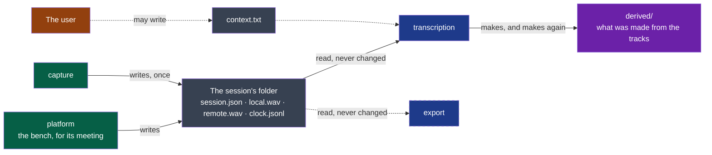

# session-audio — version 2

A session's folder holds the sound of a meeting as each source delivered it — one track per
source, never changed once written — and the session's clock beside them
([ADR-0004](../../../docs/adr/0004-the-audio-as-recorded-is-kept-everything-else-is-derived.md)).



**Legend** — green: the producer · grey: what a session keeps, the source of truth · blue:
consumers · purple: what consumers make from the tracks, deleted and made again without
loss · orange: the user. Dotted: optional. Dashed box: a consumer that is planned, and
reads nothing yet.

## What it carries

**For a machine**: [`session.schema.json`](./session.schema.json) says what `session.json` is, and
[`clock.schema.json`](./clock.schema.json) what a line of `clock.jsonl` is — and they are what the project's
comparator judges a change to this version by (ADR-0005). What they do not say — the
sound in the files, the shape of an instant, what an absent `stopped` means — is said here
and nowhere else.

**The folder** is named as in version 1: the local day and hour the recording started,
`2026-10-14_14-05`, then `-2` for a second session in the same minute.

| File | Written by | Holds |
|---|---|---|
| `session.json` | `capture`, at the start, at each change of device, when a track is gained, and once more at the stop | The fields below |
| `local.wav` | `capture`, while recording | What the microphone delivered: one person, or a room — and the loudspeakers, when there is no headset |
| `remote.wav` | `capture`, while recording | What the machine played: one person, or several |
| `clock.jsonl` | `capture`, while recording | Where each track's samples are on the session's clock |
| `context.txt` | The user, at any time; optional | A few lines of plain text, UTF-8, handed to the steps that follow |
| `confidential` | The shell, on the user's word; optional | Nothing: an empty file. Present, it asks that the meeting be transcribed and summarised on this computer alone. Only the shell reads it, and chooses who transcribes and who writes accordingly; the steps that follow need not read it |
| `language` | The shell, on the user's word; optional | One line, UTF-8: the language the meeting is spoken in, a code of ISO 639-1 — `fr`, `en`. Absent, or a line that is not one such code, the meeting names no language of its own. Only the shell reads it, and tells the transcription the language spoken; the steps that follow need not read it |
| `derived/` | Consumers; optional | Whatever they make from the tracks. Not described here: nothing in it is a source |

**`session.json`**, UTF-8:

| Field | Type | Meaning |
|---|---|---|
| `contract` | string | `session-audio/v2` |
| `started` | string | The instant 0 of the session's clock: ISO 8601 with the local offset |
| `stopped` | string, absent while recording | When the recording was stopped. **Absent means: still recording, or ended by a crash** |
| `tracks` | object | For each track the session holds — `local`, `remote` — `device`: the name the system gave the source when the recording started, or when its track was gained (*A track gained later*); `changed`, when the source was recorded from another device after it: each change, in order, as `at`, seconds on the session's clock as `clock.jsonl`'s, and `device`, the name of the device from then on — `null` when the system named none, the call let go of the microphone or its stream failed: **a gap**, nothing coming from the source (*What a consumer reads*). A source that could not be opened has **no entry and no file**, unless it gains a track later |

**A track** is a WAV file, PCM, 24 bits, at the sample rate and with the channels its source
delivered — read from the file's own header, never assumed: 48,000 samples a second in two
channels on one machine, 44,100 in one on another. Its **source** is the stream the system
opened for it when the recording started, or when it gained its track: the sound the system delivers, which is the
device's own as far as the system leaves it so.

- **As delivered.** Nothing in a track was resampled, mixed down, centred, faded, cleaned of
  an echo or brought to a level by the capture. A source that rests away from zero rests away
  from zero in its track. What the system does before it delivers is the system's: this was
  true before a change of device was named, and is said here since one is.
- **One form, whatever the device.** A track keeps the rate and channels its source opened
  with, from its first frame to its last. Recorded from another device during the meeting
  (`changed`), the source delivers that device's sound converted by the system to its form. On
  Linux, PipeWire did, measured on 2026-10-20 on virtual devices: a microphone of one channel
  at 16,000 samples a second, and an output of six channels at 44,100, each into a track of two
  channels at 48,000, with no gap. A reader who needs a device's own form reads which device
  it was in `changed`.
- **Within what 24 bits hold.** A sample the source delivered beyond full scale is written
  at full scale; one that was no number, as zero.
- **Written once.** A sample a track holds never changes, and no program — the producer
  included — rewrites a track after the recording. One case apart: what the system refused
  to write part-way — a disk full for a moment — is taken back at once, so that a track only
  ever holds whole frames; a reader that saw those bytes for an instant saw nothing a track
  held.
- **Whole frames.** A track holds a whole number of frames; the last one of a recording cut
  by a crash may be missing bytes, and is not sound.
- **Readable while written.** What was heard more than five seconds ago is in the file. A
  reader finds the audio by the file's chunks, **ignores the lengths in the header** and
  reads to the end of the file: they are true only once `stopped` is written, and never for
  a track longer than a WAV header can say.

**`clock.jsonl`**: UTF-8, one JSON object per line, appended while recording. A last line
cut by a crash is ignored. Two kinds of line:

| Line | Fields | Meaning |
|---|---|---|
| A point | `track`, `sample`, `at` | The frame `sample` of `track` — counted from 0, one frame holding one sample per channel — was heard `at` seconds after `started` |
| A silence | `track`, `silence`: `[from, to]` | The frames `from` up to, not including, `to` were **not delivered by the source**: the capture wrote zeros there, to keep the track on the clock |

- **A point for the first frame a source delivers**, then at least every ten seconds while
  it delivers, for the first frame after each silence — and for any frame heard elsewhere
  than the points before it put it: a source that stopped for a moment, too short for zeros,
  is placed again when it comes back. A track that opens on a silence has its first point
  after it.
- **An instant is when the system handed the frame to the capture**, on one clock for all
  the tracks. What a device adds before that — the time a sound takes from a microphone to
  the program, or from the program to a loudspeaker — is not in it: whoever needs two
  tracks placed to the sample measures what is left between them.
- **A silence may be said before its zeros are in the track**: a recording killed between
  the two leaves a clock that names frames the track does not hold. Never the reverse.
- **`at` may be a little below zero**: a frame the system had already heard when the session
  started.
- **From the points a reader gets** where a track starts on the session's clock, its true
  rate — how many frames a second it really holds, which is how far two tracks drift apart —
  and, with the silences, which zeros are the room's and which are the capture's.
- **A track is not placed by its length.** Two tracks of one session start at different
  instants and may hold different numbers of frames a second; only the clock says which
  frame of one is the same instant as which frame of the other.

**A track gained later** (cycle 05, D66): the local source, not opened at the start because its
microphone waited or was refused, may gain its track during the recording, as the graph changes: a
call takes a microphone, or the default input changes.

- **Its file** appears once it has a track, in the form negotiated then, and that form holds from
  its first frame to its last. Its frames from 0 up to that moment, `n`, are zeros of the capture:
  the clock says them, as `silence: [0, n]`. The file and that line come before the entry in
  `tracks`, so a track named there has its file.
- **Its first point** comes with its first sound, at `n` when that comes within 1.5 s. Later, another
  `silence` precedes it, and it is at a later frame. On a stop before the first sound, it has none.
- **Its entry**: a track gained during a recording is in `session.json` when gained, before `device`
  names it; its first device is no `changed`. Each later `changed` is as above.

**What a consumer reads**, for where a track holds sound and where it does not:

- **`clock.jsonl`'s silences say which frames the capture wrote**, on any track, and only those. A
  reader places a frame by the points around it, whatever the track's first frames hold, never by
  the file's length or its date.
- **`changed` with `device: null` says when a gap began, on the clock**: not a device moved. Under
  1.5 s, it leaves no `silence`: the next point alone shows it. Longer, it leaves zeros that stop
  0.5 to 1.5 s of frames short of the clock, and frames after a gap are read from the point that
  follows it, never counted from the start.
- **The entry after it names a stream that received its format** (`recording/v1`): sound may come
  later, zeros going on. The point after it says when sound came back.
- **`tracks` is read at the end**: while recording, a source without an entry may yet gain one. With
  `stopped` written, a source without an entry never had a track.

## What it never does

- It never promises that a track holds a voice: a permission refused gives no track, an
  output moved elsewhere gives zeros. A consumer treats an absent or silent track as a side
  that said nothing, not as an error.
- It never promises that a track is one person, nor that `local` is free of what `remote`
  played.
- It never promises a rate, a number of channels, or that two tracks share them.
- It never holds a file made from the tracks beside them: that is `derived/`.
- `context.txt` is never written, read or changed by `capture`.

A recording killed while `session.json` is replaced may leave a `session.json.part` beside
it: it is not part of the session, and no reader reads it.

**Open before `stable`** *(to confirm on real devices, cycle 02's D9)*: how far the instants
of two tracks are from each other when their sources are two devices on two clocks — on one
sound server with one device they moved by a ten-thousandth of a second, measured on
2026-10-13; whether `device` can be the name the system shows the user rather than the one
a sound library gives its default; whether real devices — a Bluetooth headset among them — are
converted as the virtual ones were, and what macOS and Windows do when the device changes;
whether a track is compressed without loss once the recording has stopped, which would be a
third version.

## Examples

Valid, while recording:

```text
2026-10-14_14-05/
  session.json     {"contract": "session-audio/v2", "started": "2026-10-14T14:05:12+02:00",
                    "tracks": {"local": {"device": "Digital Microphone"},
                               "remote": {"device": "Speaker"}}}
  local.wav        24-bit PCM, 2 channels, 48000 Hz, growing
  remote.wav       24-bit PCM, 2 channels, 48000 Hz, growing
  clock.jsonl      {"track": "remote", "sample": 0, "at": 0.021}
                   {"track": "local", "sample": 0, "at": 0.034}
                   {"track": "remote", "silence": [96000, 240000]}
                   {"track": "local", "sample": 480000, "at": 10.0341}
                   {"track": "remote", "sample": 480000, "at": 10.0209}
```

Valid, a microphone that could not be opened: `tracks` holds `remote` alone, the folder has
no `local.wav`, and `clock.jsonl` no line for `local`.

Valid, a microphone that waited, at 48,000 samples a second, taken by a call at 30 seconds, let go at
39, given its format at 42.6 and sound at 43, let go at 50 and taken at 51, then stopped; the lines of `local`
alone:

```json
{"contract": "session-audio/v2", "started": "2026-10-14T14:05:12+02:00", "stopped": "2026-10-14T14:06:07+02:00",
 "tracks": {"local": {"device": "Headset Microphone",
                      "changed": [{"at": 39.0, "device": null},
                                  {"at": 42.6, "device": "Headset Microphone"},
                                  {"at": 50.0, "device": null},
                                  {"at": 51.0, "device": "Headset Microphone"}]},
            "remote": {"device": "Speaker"}}}
```

```text
{"track": "local", "silence": [0, 1440000]}
{"track": "local", "sample": 1440000, "at": 30.012}
{"track": "local", "sample": 1680000, "at": 35.012}
{"track": "local", "silence": [1871424, 1957824]}
{"track": "local", "silence": [1957824, 2008224]}
{"track": "local", "sample": 2008224, "at": 43.012}
{"track": "local", "sample": 2248224, "at": 48.012}
{"track": "local", "sample": 2343648, "at": 51.012}
```

To refuse: a folder whose `session.json` is missing or names another `contract`; a track
named in `tracks` whose file is missing; a track that is not PCM in 24 bits — a consumer
says so and stops.

## From version 1

| Version 1 | Version 2 |
|---|---|
| `me.wav`, `others.wav` — named for a person | `local.wav`, `remote.wav` — named for a source |
| 16 bits, one channel, 16,000 samples a second: what an engine needs | 24 bits, the source's channels and rate: what was heard |
| Centred, its opening faded | As delivered |
| Both files start at `started` and have the same length | Each track is placed by `clock.jsonl` |
| Zeros where a source gave nothing, unsaid | The same zeros, said |
| A source that cannot be opened is a file of zeros | It has no track |

A session of version 1 stays what it is: it is never converted, and a program that reads
both says which one it read.
