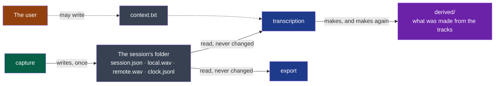

# session-audio — version 2

A session's folder holds the sound of a meeting as each source delivered it — one track per
source, never changed once written — and the session's clock beside them
([ADR-0004](../../../docs/adr/0004-the-audio-as-recorded-is-kept-everything-else-is-derived.md)).



**Legend** — green: the producer · grey: what a session keeps, the source of truth · blue:
consumers · purple: what consumers make from the tracks, deleted and made again without
loss · orange: the user. Dotted: optional.

## What it carries

**The folder** is named as in version 1: the local day and hour the recording started,
`2026-10-14_14-05`, then `-2` for a second session in the same minute.

| File | Written by | Holds |
|---|---|---|
| `session.json` | `capture`, at the start, and once more at the stop | The fields below |
| `local.wav` | `capture`, while recording | What the microphone delivered: one person, or a room — and the loudspeakers, when there is no headset |
| `remote.wav` | `capture`, while recording | What the machine played: one person, or several |
| `clock.jsonl` | `capture`, while recording | Where each track's samples are on the session's clock |
| `context.txt` | The user, at any time; optional | A few lines of plain text, UTF-8, handed to the steps that follow |
| `derived/` | Consumers; optional | Whatever they make from the tracks. Not described here: nothing in it is a source |

**`session.json`**, UTF-8:

| Field | Type | Meaning |
|---|---|---|
| `contract` | string | `session-audio/v2` |
| `started` | string | The instant 0 of the session's clock: ISO 8601 with the local offset |
| `stopped` | string, absent while recording | When the recording was stopped. **Absent means: still recording, or ended by a crash** |
| `tracks` | object | For each track the session holds — `local`, `remote` — `device`: the name the system gave the source. A source that could not be opened has **no entry and no file** |

**A track** is a WAV file, PCM, 24 bits, at the sample rate and with the channels its source
delivered — read from the file's own header, never assumed: 48,000 samples a second in two
channels on one machine, 44,100 in one on another.

- **As delivered.** Nothing in a track was resampled, mixed down, centred, faded, cleaned of
  an echo or brought to a level. A source that rests away from zero rests away from zero in
  its track.
- **Written once.** A sample once written never changes, and no program — the producer
  included — rewrites a track after the recording.
- **Readable while written.** What was heard more than five seconds ago is in the file. A
  reader finds the audio by the file's chunks, **ignores the lengths in the header** and
  reads to the end of the file: they are true only once `stopped` is written, and never for
  a track longer than a WAV header can say.

**`clock.jsonl`**: UTF-8, one JSON object per line, appended while recording. A last line
cut by a crash is ignored. Two kinds of line:

| Line | Fields | Meaning |
|---|---|---|
| A point | `track`, `sample`, `at` | The frame `sample` of `track` — counted from 0, one frame holding one sample per channel — was heard `at` seconds after `started` |
| A silence | `track`, `silence`: `[from, to]` | The frames `from` up to, not including, `to` were **not delivered by the source**: the capture wrote zeros there, to keep the track on the clock |

- **A point at least every ten seconds** for each track, the first for frame 0.
- **From the points a reader gets** where a track starts on the session's clock, its true
  rate — how many frames a second it really holds, which is how far two tracks drift apart —
  and, with the silences, which zeros are the room's and which are the capture's.
- **A track is not placed by its length.** Two tracks of one session start at different
  instants and may hold different numbers of frames a second; only the clock says which
  frame of one is the same instant as which frame of the other.

## What it never does

- It never promises that a track holds a voice: a permission refused gives no track, an
  output moved elsewhere gives zeros. A consumer treats an absent or silent track as a side
  that said nothing, not as an error.
- It never promises that a track is one person, nor that `local` is free of what `remote`
  played.
- It never promises a rate, a number of channels, or that two tracks share them.
- It never holds a file made from the tracks beside them: that is `derived/`.
- `context.txt` is never written, read or changed by `capture`.

**Open before `stable`** *(to confirm on the first recordings, cycle 02's D9)*: how close a
point is to the instant its frame was really heard — the system's own time where it gives
one, the arrival of the sound otherwise; what a session records when the user changes
device during a meeting; whether a track is compressed without loss once the recording has
stopped, which would be a third version.

## Examples

Valid, while recording:

```text
2026-10-14_14-05/
  session.json     {"contract": "session-audio/v2", "started": "2026-10-14T14:05:12+02:00",
                    "tracks": {"local": {"device": "Digital Microphone"},
                               "remote": {"device": "Speaker"}}}
  local.wav        24-bit PCM, 2 channels, 48000 Hz, growing
  remote.wav       24-bit PCM, 2 channels, 48000 Hz, growing
  clock.jsonl      {"track": "remote", "sample": 0, "at": 0.021}
                   {"track": "local", "sample": 0, "at": 0.034}
                   {"track": "remote", "silence": [96000, 240000]}
                   {"track": "local", "sample": 480000, "at": 10.0341}
                   {"track": "remote", "sample": 480000, "at": 10.0209}
```

Valid, a microphone that could not be opened: `tracks` holds `remote` alone, the folder has
no `local.wav`, and `clock.jsonl` no line for `local`.

To refuse: a folder whose `session.json` is missing or names another `contract`; a track
named in `tracks` whose file is missing; a track that is not PCM in 24 bits — a consumer
says so and stops.

## From version 1

| Version 1 | Version 2 |
|---|---|
| `me.wav`, `others.wav` — named for a person | `local.wav`, `remote.wav` — named for a source |
| 16 bits, one channel, 16,000 samples a second: what an engine needs | 24 bits, the source's channels and rate: what was heard |
| Centred, its opening faded | As delivered |
| Both files start at `started` and have the same length | Each track is placed by `clock.jsonl` |
| Zeros where a source gave nothing, unsaid | The same zeros, said |
| A source that cannot be opened is a file of zeros | It has no track |

A session of version 1 stays what it is: it is never converted, and a program that reads
both says which one it read.
