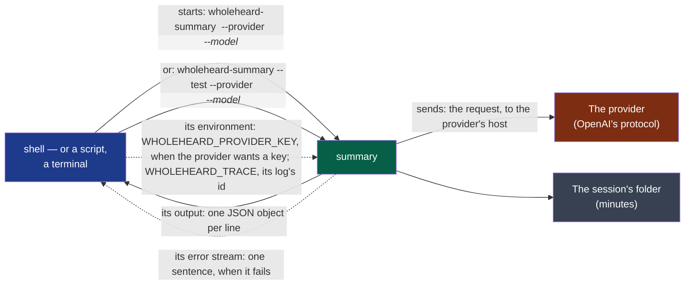

# summarising — version 1

What the program that writes the minutes says while it works, how it is given a key, and how
it is asked whether a model answers: one line of text per event, for whoever started it.



**Legend** — green: the producer · blue: whoever started it, the consumer · brown: what it
contacts, off the machine unless the address is on it · grey: what it leaves, described by
`minutes`.

**For a machine**: [`event.schema.json`](./event.schema.json) says what a line of the output
is — and is what the project's comparator judges a change to this version by (ADR-0005). The
order of the events, and what each means, are said here and nowhere else.

## How it is started

- **Minutes**: `wholeheard-summary <session-folder> --provider <address> --model <name>`, the two
  options in either order. It reads the folder's `transcript.jsonl` (`transcript/v1`) and its
  `context.txt`, when there is one, and writes the folder's `minutes.md` (`minutes/v1`).
- **A test**: `wholeheard-summary --test --provider <address> --model <name>`, the options in either
  order. It sends one sentence of its own — nothing of a meeting — and writes nothing.
- **The key**, when the provider wants one, is in its environment as `WHOLEHEARD_PROVIDER_KEY`,
  never in its arguments. It is sent to the provider's host and written nowhere: not on the
  output, not on the error stream, not in the minutes.
- **The address** speaks OpenAI's protocol (`…/v1`); it is followed nowhere else — no
  redirection, no proxy named by the environment.

## What it carries

**The output**: UTF-8, one JSON object per line, nothing else. Each has `event`:

| `event` | Other fields | Says |
|---|---|---|
| `sending` | `host`: who receives the request, as the minutes name it — `local` for an address of this machine, else the host's name or address in lower case, without its port; `model`; `characters`: how many the request holds, a whole number | Said **before** anything leaves the machine, once, and first |
| `written` | `file`: the minutes' path | The minutes are whole in the folder. **Last**, minutes only |
| `answered` | `host`; `model` | The model answered the test's sentence. **Last**, a test only |
| `failed` | `code`: the cause, one of the codes below, on one line | The program is ending in failure. **Last**, minutes or a test |

**Failing**: the program ends in failure with one sentence on its error stream, starting
`wholeheard-summary: `, and no `written` or `answered`. When the cause is one a person acts on
differently, the output's last line says it first: `failed`, with its `code`. Otherwise no line
says it, and the sentence alone does.

| `code` | The cause | What a person does |
|---|---|---|
| `provider.unreachable` | The provider could not be reached, or did not answer in time | Check that it runs, or the network, then try again |
| `provider.refused_key` | The provider refused the key (HTTP 401 or 403) | Give the provider's key again |
| `provider.no_credit` | The provider refused for lack of credit (HTTP 402) | Add credit with the provider |
| `provider.unknown_model` | The provider does not know this model or this address (HTTP 404) | Choose the model or the address again |
| `provider.failed` | Any other refusal by the provider, or an answer it cut short, sent elsewhere, or left unreadable or empty | Try again later |
| `answer.not_minutes` | The provider answered, and what it wrote is not minutes (`minutes/v1`) | Try again, or choose another model |
| `transcript.unusable` | The session has no transcript this version reads | Make the transcript again |
| `transcript.no_speech` | The transcript holds no speech: there is nothing to write minutes of | Nothing: check the recording |
| `settings.invalid` | The address, the model's name or the key cannot be used as given | Correct them where they were chosen |
| `minutes.unwritable` | The minutes could not be written in the session's folder | Free space, or check the folder |

A consumer reads a code this page does not list as no code: a later code is added here, never
a new version for it. Whatever fails, the transcript is untouched
and the minutes that were there are still there — nothing half-written is left behind. Before
`sending`, nothing left the machine.

**Its log**: the program logs what it does ([ADR-0007](../../../docs/adr/0007-each-program-logs-what-it-does-never-what-was-said.md)),
at `info`, under an id of its own, in the user's folder for logs — on Linux
`$XDG_STATE_HOME/wholeheard/logs`, or `~/.local/state/wholeheard/logs`; on macOS
`~/Library/Logs/Wholeheard`; on Windows `%LOCALAPPDATA%\Wholeheard\logs`. There it also removes
the day files written more than fourteen days ago, then the oldest until the folder weighs
under 50 MB — every program's day files, nothing else.
Whoever starts it may set, in its environment:

- `WHOLEHEARD_TRACE` — the making's id: ASCII letters, digits and dashes, 64 at most. Any other value
  is replaced by an id of the run's own, without a word;
- `WHOLEHEARD_LOG` — `off`, `error`, `warn`, `info`, `debug` or `trace`, in lower case; a value
  holding `=` is read as a `tracing` filter, for whoever knows them; any other value is `info`. Turned `off`, the log leaves nothing: no file, no day file removed;
- `WHOLEHEARD_LOG_DIR` — an absolute folder; a relative one is ignored. A folder that cannot be
  made or written leaves no log, and changes nothing else.

None is required. None, and no state of the log, changes a line of the output, the error stream
or what the program leaves — with one exception: a run that crosses midnight UTC while the
next day's file cannot be created has the logging library say so once on the error stream.
The log is not what the program leaves. What the log holds is not this
contract: it is read by people, never by a consumer.

## What it never does

- It never prints the key, nor the provider's answer, on its output or its error stream.
- It never prints anything but these lines on its output: a consumer may refuse a line that is
  not one — and must ignore a field or an `event` it does not know, so that a second version
  can add one.
- It never sends without saying `sending` first: what cannot be said first is not sent.

**Open before `stable`**: whether a consumer is told when the provider starts answering — a
long making, minutes on a laptop's processor, says nothing between `sending` and `written`.

## Examples

Valid — minutes made by an online provider:

```text
{"event":"sending","host":"openrouter.ai","model":"anthropic/claude-sonnet-5.5","characters":48210}
{"event":"written","file":"<session-folder>/minutes.md"}
```

Valid — a test of a model on this machine:

```text
{"event":"sending","host":"local","model":"mistral","characters":31}
{"event":"answered","host":"local","model":"mistral"}
```

To refuse: a line that is not a JSON object with an `event`.
