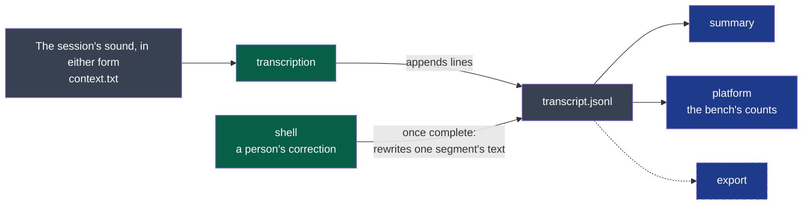

# transcript — version 1

A session's transcript is a file of timestamped segments, each naming who spoke, that only
grows while it is made: read at any moment, it is true up to its last line. Once complete, a
person who listens may correct a segment's text in it (ADR-0014).



**Legend** — green: the producers — the step, then the shell for a person's correction · grey: files in the session's folder · blue: consumers ·
dashed: a consumer that is planned, and reads nothing yet.

**For a machine**: [`line.schema.json`](./line.schema.json) says what a line is — and is what
the project's comparator judges a change to this version by (ADR-0005). The order of the
lines, that they are only ever added while the transcript is made, and that a segment ends after
it starts, are said here and nowhere else.

## What it carries

`transcript.jsonl` in the session's folder: UTF-8, one JSON object per line, each line ended
by a line feed. Lines are only ever added while it is made; once complete, a person's correction
may rewrite a segment's `text` (below). Every line has a `type`.

| `type` | When | Fields |
|---|---|---|
| `header` | First line, once | `contract`: `transcript/v1` · `engine` and `model`: what transcribed · `language`: the language asked for, or `null` when detected · `context`: the text the engine received, or `null` |
| `segment` | Each stretch of speech | `speaker`: `me` or `others` · `track`: the track it was heard on, `local` for `me`, `remote` for `others` · `voice`: which voice within the track, `null` until voices are told apart · `start` and `end`: seconds from the session's `started`, to the hundredth · `text`: what was said, one line · `edited`, optional: when a person corrected `text`, RFC 3339 with its offset |
| `covered` | After each span is done | `speaker` · `until`: seconds; every segment of that speaker that starts before `until` is in the file |
| `complete` | Last line, once | `duration`: seconds of audio transcribed |

- **Order.** Lines come in the order they were made, not the order of the meeting: a reader
  that wants the meeting sorts the segments by `start`.
- **A segment is known by `speaker` and `start`.** No two segments share both.
- **Who spoke is two questions** (ADR-0004, rule 6): which track — certain, `track`; which
  voice within it — estimated, `voice`. `null` is a voice not told: no producer of this
  version tells voices apart yet, and once one does, `null` still says the voice of that
  segment could not be told. A voice told is a label of one line, the same for one voice
  throughout a transcript, and a label of its track only: `1` on `local` and `1` on `remote`
  are two voices. It names no one. A segment may carry neither field — those written before
  they were — and its track is then its `speaker`'s.
- **Running the step again adds nothing already there**: it starts, for each speaker, from
  the last `covered`.
- **No `complete` line means not finished** — still running, or stopped. The lines there are
  true all the same.
- **A correction, once complete** (ADR-0014). After its `complete` line, and never while it is made
  again, the shell may rewrite one segment's `text` on the user's word and set its `edited` to when:
  the file replaced whole — written beside, then renamed —, its lines in the same order, nothing else
  changed. A reader reads the text as it finds it; `edited` absent is the text as heard.

## A test of a service

`wholeheard-transcription --test --provider <address> --model <name>` writes no transcript: it sends
a second of a sound of its own and reads the answer. Passed, it exits 0 and says nothing. Failed, it
ends in failure with one sentence on its error stream, starting `wholeheard-transcription: `, for
the log, and its output's last line says the cause when a person acts on it differently, as
`{"event": "failed", "code": "provider.no_times"}`; otherwise no line says it, and the sentence alone does: a refusal in the service's own words (HTTP 400), wrong arguments.

| `code` | The cause | What a person does |
|---|---|---|
| `provider.unreachable` | The service could not be reached | Check that it runs, or the network, then try again |
| `provider.too_slow` | The service did not answer in time | Try again later |
| `provider.refused_key` | The service refused the key (HTTP 401 or 403) | Give the service's key again |
| `provider.no_credit` | The service refused for lack of credit (HTTP 402) | Add credit with the service |
| `provider.too_many` | The service refused for too many requests, or a quota used up (HTTP 429) | Wait, or check the plan with the service |
| `provider.down` | The service answered that it is failing (HTTP 500 to 599) | Try again later |
| `provider.unknown_model` | The service does not know this model or this address (HTTP 404) | Choose the model or the address again |
| `provider.no_times` | The service's answer gives no times for its segments, or it refused the request (HTTP 400) without saying why, as one that gives none does | Choose a model that gives each segment's times |
| `provider.failed` | Any other refusal by the service, or an answer it left unreadable | Try again later |
| `settings.invalid` | The address or the model's name cannot be used as given | Correct them where they were chosen |

A consumer reads a code this page does not list as no code: a later code is added here, never a new
version for it.

## What it never does

- It never rewrites or removes a line while it is made. Once complete, it never removes one, and
  rewrites one only for a person's correction of its `text` — a better transcript by an engine is
  another file, made again from the audio.
- It never names a person: `me` is whoever recorded, `others` is everyone else, however many
  they are.
- It never promises that the segments of `me` and `others` do not overlap: people speak at
  once.
- A reader never relies on a line that does not end with a line feed — it was being written —
  and never fails on a `type` or a field it does not know: it skips it.

## Examples

Valid, and not finished:

```json
{"type": "header", "contract": "transcript/v1", "engine": "whisper.cpp", "model": "large-v3-turbo", "language": "fr", "context": "Quatre personnes, réunion d'organisation."}
{"type": "segment", "speaker": "others", "start": 0.0, "end": 3.2, "text": "Du coup j'ai besoin que l'on confirme la date."}
{"type": "segment", "speaker": "me", "track": "local", "voice": null, "start": 3.4, "end": 5.1, "text": "Première semaine de juin, je pense."}
{"type": "covered", "speaker": "others", "until": 30.0}
```

To refuse: a file whose first line is not a `header` of `transcript/v1`; a `segment` whose
`speaker` is neither `me` nor `others`, whose `track` is neither `local` nor `remote` or not its
speaker's, or whose `end` is before its `start`.
