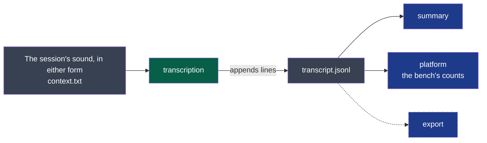

# transcript — version 1

A session's transcript is a file of timestamped segments, each naming who spoke, that only
grows: read at any moment, it is true up to its last line.



**Legend** — green: the producer · grey: files in the session's folder · blue: consumers ·
dashed: a consumer that is planned, and reads nothing yet.

**For a machine**: [`line.schema.json`](./line.schema.json) says what a line is — and is what
the project's comparator judges a change to this version by (ADR-0005). The order of the
lines, that they are only ever added, and that a segment ends after it starts, are said here
and nowhere else.

## What it carries

`transcript.jsonl` in the session's folder: UTF-8, one JSON object per line, each line ended
by a line feed. Lines are only ever added. Every line has a `type`.

| `type` | When | Fields |
|---|---|---|
| `header` | First line, once | `contract`: `transcript/v1` · `engine` and `model`: what transcribed · `language`: the language asked for, or `null` when detected · `context`: the text the engine received, or `null` |
| `segment` | Each stretch of speech | `speaker`: `me` or `others` · `start` and `end`: seconds from the session's `started`, to the hundredth · `text`: what was said, one line |
| `covered` | After each span is done | `speaker` · `until`: seconds; every segment of that speaker that starts before `until` is in the file |
| `complete` | Last line, once | `duration`: seconds of audio transcribed |

- **Order.** Lines come in the order they were made, not the order of the meeting: a reader
  that wants the meeting sorts the segments by `start`.
- **A segment is known by `speaker` and `start`.** No two segments share both.
- **Running the step again adds nothing already there**: it starts, for each speaker, from
  the last `covered`.
- **No `complete` line means not finished** — still running, or stopped. The lines there are
  true all the same.

## What it never does

- It never rewrites or removes a line. A better transcript is another file, made again from
  the audio — never this one edited.
- It never names a person: `me` is whoever recorded, `others` is everyone else, however many
  they are.
- It never promises that the segments of `me` and `others` do not overlap: people speak at
  once.
- A reader never relies on a line that does not end with a line feed — it was being written —
  and never fails on a `type` or a field it does not know: it skips it.

## Examples

Valid, and not finished:

```json
{"type": "header", "contract": "transcript/v1", "engine": "whisper.cpp", "model": "large-v3-turbo", "language": "fr", "context": "Quatre personnes, réunion d'organisation."}
{"type": "segment", "speaker": "others", "start": 0.0, "end": 3.2, "text": "Du coup j'ai besoin que l'on confirme la date."}
{"type": "segment", "speaker": "me", "start": 3.4, "end": 5.1, "text": "Première semaine de juin, je pense."}
{"type": "covered", "speaker": "others", "until": 30.0}
```

To refuse: a file whose first line is not a `header` of `transcript/v1`; a `segment` whose
`speaker` is neither `me` nor `others`, or whose `end` is before its `start`.
