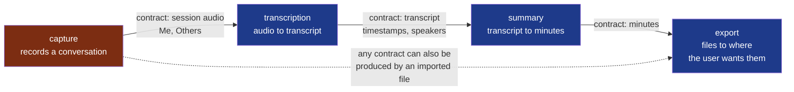

# ADR-0001 — Split Summit into four modules, one per step

- **Status**: Accepted
- **Date**: 2026-10-12
- **Decision makers**: the decider, `@napkinstack-admin`
- **Scope**: project
- **Reversibility**: costly — merging modules back means rewriting what crosses their contracts

---

**Legend** — red: the module that holds other people's voices, `standard` now and
`critical` before the repository is opened · blue: `standard` · arrows: the only way one
module knows another — a contract, which is a file of the session. None of the three
contracts is written yet.

## Context

Summit's charter was accepted on 2026-10-12 with a first cycle of six deliverables. The idea
file describes four steps — capture, transcribe, summarise, export — and makes their
independence a principle: each has its own provider and settings, and can be run alone, on
the output of the step before or on an imported file.

## Problem

How many modules does Summit start with?

## Constraints

- One builder, with agents; two weeks; three operating systems (charter).
- Each step must be usable alone and must accept an imported file in place of the step
  before it (idea file, principle 2 and §6).
- No technology is chosen yet: the stack is another decision, after the cycle's first spike.

---

## Prior art

**Dominant convention of the field:** start with one module and split when a boundary has
shown itself — this project's own handbook says so (`docs/os/02-modules.md` §3), and it is
the common advice for a new codebase.

**References examined:**

| Reference | What it does | What we keep from it |
|---|---|---|
| This framework's handbook, `docs/os/02-modules.md` §3 | "Never create artificially small modules"; a decision tree that refuses a split when the capability is not coherent, cannot be tested alone, or has no owner | The test each of the four must pass, below |
| The Unix pipeline — small programs, each doing one thing, joined by a plain format | A step is replaceable because what it reads and writes is a file anyone can produce | The session's files as the contracts: a step neither knows nor cares who wrote its input |
| The idea file, §6, "Import et export entre les étapes" | A corrected transcript, re-imported, replaces the original for the next step | The requirement that makes the boundary real rather than decorative |

**Why the convention is not enough:** the boundaries are not guessed here, they are the
product. "Each step can be run alone, with its own provider, on an imported file" is a
feature a user sees; a single module would have to rebuild the same four seams inside
itself, with nothing checking them.

---

## Options considered

### Option 1 — One module

The least ceremony on day one. The four steps become internal layers; nothing stops one
from reaching into another, and "run alone on an imported file" is tested by discipline.

### Option 2 — Two modules: `capture`, and `minutes` for the rest

Proposed by the framer. Isolates the one module whose failure harms other people, and keeps
transcription and summary together until they pull apart.

### Option 3 — Four modules, one per step

Each step is a module with its contract. Four manifests, three contracts, and a pull request
per module: the most ceremony, paid by one person.

### Option 4 — Do nothing

Not available: the cycle's deliverables each name a module.

---

## Decision

**Option 3**, by the decider: "on découpe les 4 modules".

| Module | Capability | Tested alone? | Criticality, and why not the value beside it |
|---|---|---|---|
| `capture` | Records the audio sources of a conversation into a session | Yes: it produces audio files | `standard`. Not `prototype`: it records real meetings. Not `critical`, although it holds other people's voices and the handbook says `critical` for personal data: three users who agreed, a private repository. **It becomes `critical` before the repository is opened** (charter, risks) |
| `transcription` | Turns the audio of a session into a timestamped transcript | Yes: on any audio file | `standard`. Not `high`: a failed transcript loses nothing, the audio is kept and the step is run again |
| `summary` | Writes the minutes of a transcript | Yes: on any text | `standard`, for the same reason |
| `export` | Delivers the files of a session to where the user wants them | Yes: on any session folder | `standard`. It is where data leaves the machine: it is the first to be raised when a destination outside the machine is added |

All four have one owner, `NapkinStack/maintainers`, and are user-facing.

### Deviation from the convention

The handbook advises against splitting on day one. The user value that justifies it is
observable: a user can run one step alone on a file from elsewhere. It is observed in the
first cycle — D4 on an audio file Summit did not record, D5 on a text it did not transcribe.

---

## Success criterion

> We will consider this was the right call if, **by the end of the second cycle**, a step
> has been replaced or run alone on an imported file **without a change in another module**
> — and if fewer than one pull request in five needed the `cross-module` label.

If the criterion is not met: the modules that always change together are merged, starting
with `transcription` and `summary`.

---

## Consequences

**Positive:** the product's second principle is enforced by the boundaries check rather than
remembered; `capture` can be raised to `critical` without the three others paying for it.

**Negative and accepted debt:** four manifests and three contracts for one builder; a change
that crosses two steps costs an expand/contract sequence; four test sheets where two would
have done.

**Impacts on other modules or contracts:** three contracts to write with the first cycle's
deliverables — the session's audio, its transcript, its minutes.

**Rule to automate:** none new. The boundaries check already refuses a module that reads
another's code or an undeclared contract.

---

## Rejected alternatives

- **One module**: rejected by the decider; see the deviation above.
- **Two modules** (the framer's proposal): it protects `capture` but leaves "summarise a text
  that was never transcribed here" to discipline.
