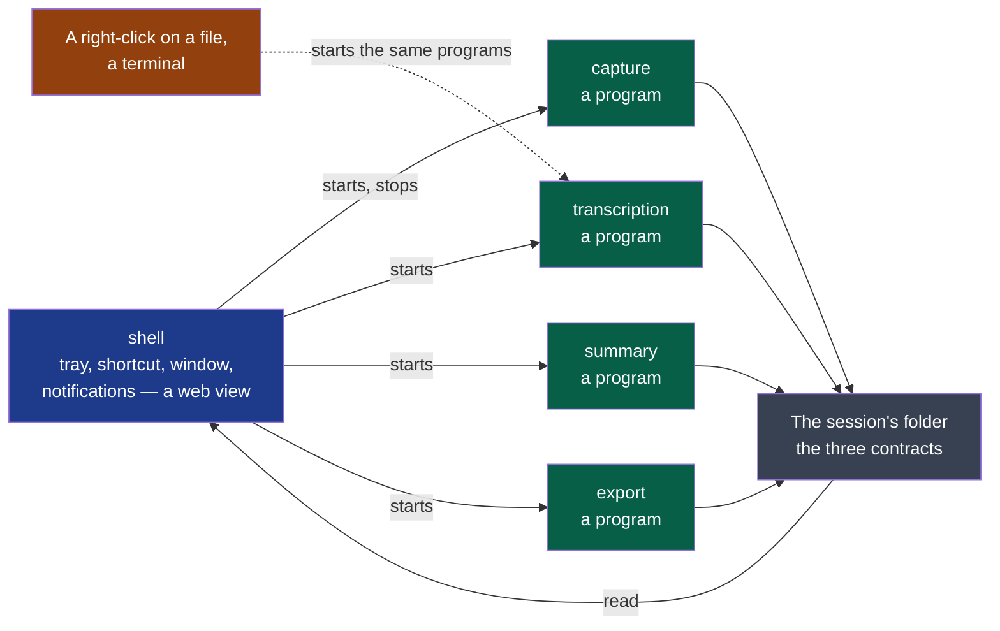

# ADR-0002 — A Rust core of programs that run alone, and a web-view shell that starts them

- **Status**: Proposed
- **Date**: 2026-10-12
- **Decision makers**: the decider, `@napkinstack-admin`
- **Scope**: project
- **Reversibility**: costly for the core — it is rewritten; easy for the shell — it holds no
  step, and is replaced without touching one

---

**Legend** — green: a step, a program that runs with no window · blue: the shell, which holds
no step · grey: files on the machine, the only thing two programs share · orange: another
way to start a step, with no shell at all.

## Context

The first spike of cycle 01 asked whether one application can show a tray icon, answer a
global shortcut and write the microphone and the system's sound as two files. On Fedora it
answered yes, with two probes written in Rust — one on an audio library, one on a web-view
toolkit — and the conditions the cycle records. The decider had named another candidate,
Flutter, and two weights: the interface first, and software of quality. D3 to D6 are ready
and cannot start before the technology is settled.

## Problem

With what is Summit built, and how do its four modules become one application without
reading each other's code?

## Constraints

- One builder with agents, on Fedora; Windows and macOS are built by the forge and tried by
  two colleagues (charter). No budget: no signing certificate.
- Four modules that know each other only through the session's files (ADR-0001); the
  boundaries check refuses a module that imports another's code.
- Each step runs alone, on a file from elsewhere, and from a right-click with no window
  (idea file, principle 2 and §8).
- The audio is never lost: a failure of anything else must not stop a recording (cycle 01,
  second orientation).
- Under GNOME on Wayland a global shortcut exists only through the desktop's portal, for an
  installed application, and a window comes forward only with the portal's token (cycle 01,
  D1).

---

## Prior art

**Dominant convention of the field:** a desktop application is one process — the interface
toolkit is the application, and its features are libraries inside it. The two nearest
products follow it, with the stack proposed here: Meetily, "built with Tauri", "a Rust-based
backend"; Anarlog, "Tauri v2 desktop app: React and TypeScript UI, Rust backend".

**References examined** — read on 2026-10-12, in full in cycle 01, *D1 — what was read before
the probe*:

| Reference | What it does | What we keep from it |
|---|---|---|
| [cpal](https://github.com/RustAudio/cpal), read | One audio library with a host per system: PipeWire, WASAPI, CoreAudio — "loopback recording requires 14.6+" | The capture, with the same code on the three systems. **Proven on Fedora only**: a real call, two files, on both ways of opening the output |
| [Tauri v2](https://v2.tauri.app/learn/system-tray/), read | A web view of the system's own, a tray, plugins; a Rust process behind it | The shell. On Fedora: window, theme and font followed; tray with an extension; the shortcut through the portal, not through its plugin |
| [ashpd](https://docs.rs/ashpd/latest/ashpd/desktop/global_shortcuts/index.html), read | A Rust wrapper of the desktop portals | The global shortcut and its activation token under Wayland: fired 6 times of 6, raised the window 2 times of 2 |
| Flutter, its [tray](https://pub.dev/packages/tray_manager) and [shortcut](https://pub.dev/packages/hotkey_manager) packages, and two packages for the system's sound — *secondary* | Draws every pixel itself; the shortcut package needs an X11 library; the sound packages are at version 0.0.2, or without macOS and Linux | Nothing for the core. Kept in reserve for the shell alone |
| The Unix pipeline, and ADR-0001 | Small programs joined by a plain format | Each step a program; the session's folder as the only thing shared |

**Why the convention is not enough:** one process means the shell imports the four modules'
code — what ADR-0001 forbids — and a crash of the interface or of a model stops the
recording with it.

---

## Options considered

### Option 1 — Flutter for everything

One toolkit, already on the decider's workstation, an interface identical on the three
systems. The capture is native code written by hand in three languages; a step with no
window is a second program anyway; the shortcut under Wayland has no known path.

### Option 2 — One Tauri application, the four modules as libraries inside it

The field's convention, and the least code. The shell reads every module's code: the
boundaries of ADR-0001 become decorative, and the recording dies with the window.

### Option 3 — A Rust core of four programs, and a Tauri shell that starts them

Each module builds a program that runs alone. A fifth module, `shell`, holds the tray, the
shortcut, the window and the notifications; it starts the programs and reads the session's
folder. More moving parts: five builds, and processes to supervise.

### Option 4 — Do nothing

Not available: D3 cannot start.

---

## Decision

**Option 3.** Three arguments settled it, each observed rather than hoped:

1. **The hard part is the system's sound, and one library answered for it** on the system
   where the nearest products are weakest. With Flutter it is three native implementations.
2. **A step that runs alone is the product's second principle and its file context menu** —
   and it is what makes the boundaries real: the shell cannot reach into a step it only
   starts.
3. **Resilience comes with it**: the recording is a process of its own. The window, a model
   or a provider can fail beside it.

What it fixes, and what it leaves open:

| Fixed here | Left to its own decision |
|---|---|
| Rust for the four modules; each builds one program, usable from a terminal | The transcription engine inside `transcription` — D2's probe used a Python one; a native one is not tried |
| `cpal` for the capture, PipeWire host on Linux | The audio format on disk: the `session-audio` contract proposes one, D3's first trial confirms it |
| A fifth module, `shell`: Tauri v2, its page a static file — no JavaScript toolchain until a screen needs one | How the shell is told of a step's progress: a contract of its own, written with D3 |
| On Linux, the shortcut and the window's activation through the portal (`ashpd`), not the toolkit's plugin | Packaging per system, and what an unsigned build costs each colleague |
| Flutter kept as the fallback **for the shell only** | — |

### Deviation from the convention

- **Expected user value**: a recording that survives whatever else fails; "transcribe" and
  "summarise" on any file, from the file manager, with Summit's window closed.
- **How we will observe it**: D3's second criterion, tried twice — the shell's process
  killed during a recording, then the capture's: nothing recorded is lost either time; D4
  run from a terminal on an audio file Summit did not record.

---

## Success criterion

> We will consider this was the right call if, **by the end of cycle 01 (2026-10-27)**, D3
> is accepted on Fedora with the capture's code holding **no branch written for one
> system**, and if the first Windows and macOS builds record two files of a real call
> **without a line of capture code added for them**.

If the criterion is not met: the system that fails gets its own capture behind the same
contract — the core's other programs do not move — and if it is the shell that fails, the
shell alone is rewritten with the fallback.

---

## Consequences

**Positive:** the four modules stay independent by construction; the recording is isolated
from every other failure; one language for the core; every step is scriptable.

**Negative and accepted debt:** a fifth module and five builds for one builder; processes to
start, watch and stop, where function calls would do; a web view to try on three engines —
WebKitGTK, WebKit, Chromium; no Rust toolchain was on the workstation before the spike.

**Impacts on other modules or contracts:** a module `shell` to create, user-facing,
`standard`; the four modules declare `commands` once they hold code; a fourth contract —
what a step says while it runs — to write with D3.

**Rule to automate:** none new. The boundaries check already refuses a module that imports
another; the security rule 1 — no host the user did not configure — still owes its test.

---

## Rejected alternatives

- **Flutter for everything**: the capture and the Wayland shortcut have no proven path; the
  interface's quality, the decider's first weight, is not what was at risk.
- **One Tauri application with four libraries**: it is what the nearest products do, and it
  turns ADR-0001 into a folder layout.
- **Electron**: not examined beyond its size — it ships a browser where the system has one,
  and answers none of the three hard parts differently.
