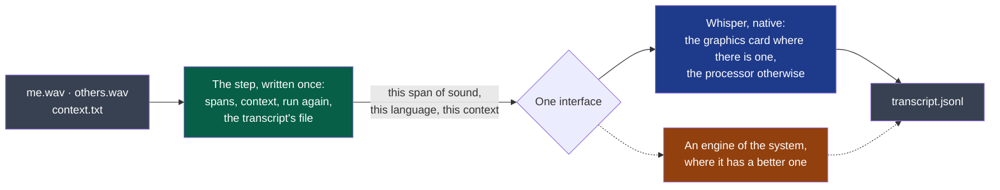

# ADR-0003 — Transcribe behind one interface, with a native Whisper on the graphics card for Fedora

- **Status**: Accepted
- **Read on 2026-10-26, a day before its date, a review of the documents; cycle 01's closure (stopped 2026-10-13) did not read it**: Half met. This engine is the step's on Fedora — D4 deferred at cycle 01's closure, its transcript accepted with D10 in cycle 02. No second engine was added: `Whisper` is the product's one implementation of `Engine`, beside the tests' doubles (`modules/transcription/src/step.rs`). The interface is untried by a second; the fallback waits for one.
- **Date**: 2026-10-13
- **Decision makers**: the decider, `@napkinstack-admin`
- **Scope**: module `transcription`
- **Reversibility**: easy for the engine — it sits behind the interface; costly for the interface, which every engine is written against

---

**Legend** — grey: the session's files · green: what no engine rewrites · blue: the engine this
record chooses · orange: what a later record may add. Dotted: not built in cycle 01.

## Context

ADR-0002 left the transcription engine to its own decision. D2 had used a Python engine;
cycle 01 then tried a native one, linked into a Rust program, on the processor and on the
laptop's graphics card. The decider's fourth orientation fixed the frame: the engine is a
setting behind one interface, Whisper runs on every system, a system's own engine may be
added.

## Problem

Which engine does `transcription` ship for Fedora in cycle 01, and how is it held so that
another can take its place?

## Constraints

- D4's criteria: words that differ, time under half the meeting's length, the context
  received, a step that can be killed and run again (cycle 01).
- One program per module, with no window (ADR-0002); nothing fetched from a host the user was
  not shown (security rule 1).
- The decider's laptop: a processor with eight cores, an integrated graphics card, no
  discrete one.

---

## Prior art

**Dominant convention of the field:** Whisper, run on the machine through one of two families
of engine — a Python runtime with an optimised inference library, or whisper.cpp linked into
the application. The nearest product read during D1, a Tauri application with a Rust
backend, takes the second.

**References examined** — measured on the public five-minute sample, cycle 01, *D4*:

| Reference | What it does | What we keep from it |
|---|---|---|
| The Python engine of D2 (`faster-whisper`) | 26.8 % of the words differ; 36 % of the meeting's length on the processor; a voice detector that skips silence | The figure to stay level with; the detector, as a lead |
| whisper.cpp through its Rust binding, on the processor | 28.0 %; 82 % of the length on eight threads, 220 % on sixteen | One thread per physical core, never per logical one |
| The same, on the graphics card through Vulkan | 27.3 to 28.4 % over three ways to store the model; 9 to 11 % of the length | The engine for Fedora |

**Why the convention is not enough:** it names an engine, not how to hold one. A product on
three systems, each with a speech engine of its own, needs the second more than the first.

---

## Options considered

### Option 1 — The Python engine

Meets both thresholds as measured, and has the voice detector. It ships a Python runtime
beside a Rust program, on three systems, and its detector's library tries to send telemetry
(cycle 01, D2).

### Option 2 — Native Whisper on the processor only

One program, nothing beside it. Too slow on this laptop: 82 % of the meeting's length.

### Option 3 — Native Whisper, on the graphics card where there is one

One program. A tenth of the meeting's length on the decider's laptop, as exact as the Python
engine within what one run can tell. Needs Vulkan on the machine, and falls back to the
processor without it.

### Option 4 — Do nothing

Not available: D4 has no engine.

---

## Decision

**Option 3**, behind the interface of the diagram.

| Fixed here | Left open |
|---|---|
| The step — spans, context, running again, the transcript's file — is written once and knows no engine | The engines of Windows and macOS: a reading and a trial each, on the colleagues' machines |
| An engine answers one question: a span of sound, a language, a context — segments | A voice detector that skips silence: a lead, not tried |
| For Fedora: whisper.cpp through its Rust binding, built with Vulkan; the model `large-v3-turbo` stored on 8 bits, 874 MB | Where the model's file comes from and how the user is shown it before it is fetched |
| Threads: the physical cores | A smaller model for a machine without a graphics card |
| The transcript's header names the engine and the model, as the contract asks | — |

**D4's second criterion is restated** by the decider (2026-10-13): *at most 29 % of the words
differ* — D2's figure with two points of margin. Set at 27 %, D2's own result, it measured the
noise of a run: three ways to store the same model gave 27.3, 28.0 and 28.4 %.

---

## Success criterion

> We will consider this was the right call if, **by the end of cycle 01 (2026-10-27)**, D4 is
> accepted on Fedora with this engine, and if a second engine — any one — is added **without
> a change to the step**: only a new implementation of the interface, and a setting.

If the criterion is not met: the interface is redrawn around what the second engine needed,
before a third is written against it.

---

## Consequences

**Positive:** one program to ship; a transcript in a tenth of the meeting's length on a
laptop without a discrete graphics card; the engine replaceable per system.

**Negative and accepted debt:** a C++ library built with the module, and Vulkan's headers to
build it; a model of 874 MB to fetch and to keep; no voice detector — silence is transcribed
like the rest; exactness measured on one public sample of five minutes.

**Impacts on other modules or contracts:** none. `transcript/v1` already names the engine and
the model in its header.

**Rule to automate:** the same sheet for every engine — D4's criteria, on the same sample.

---

## Rejected alternatives

- **The Python engine**: as exact and fast enough, at the price of a second runtime on three
  systems and of a library that phones home.
- **The processor only**: fails D4's time criterion on the machine it must first work on.
