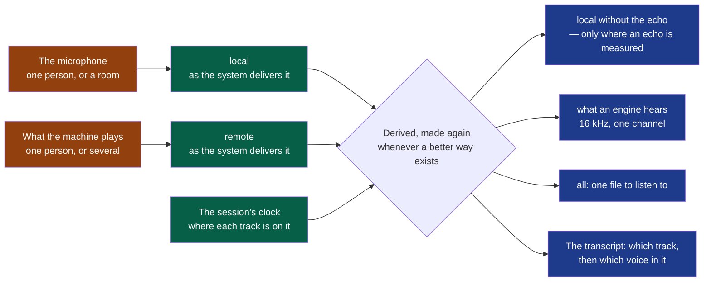

# ADR-0004 — The audio as recorded is kept; everything else is derived from it

- **Status**: Accepted
- **Read on 2026-10-26, a review of the documents; cycle 02's closure, the cycle that implemented it, did not read it**: Met, on the median. On the bench, loudspeakers gave no more words said twice than a headset on 23 draws of 24, and no more local words wrong than as delivered on the median, not on every draw (cycle 02, D10). A session is transcribed again without being recorded again: by another model, from the window (#219, cycle 03, D18).
- **Date**: 2026-10-13
- **Decision makers**: the decider, `@napkinstack-admin`
- **Scope**: project
- **Reversibility**: easy for what is derived — it is made again; costly for what is
  recorded — a recording made poorer cannot be made richer afterwards. That asymmetry is
  the decision.

---

**Legend** — orange: what is in the room and on the call · green: what a session keeps and
never changes, the source of truth · blue: what is made from it, and made again.

## Context

On 2026-10-13 the decider recorded a first real meeting — sixteen minutes, the laptop's
loudspeakers and its built-in microphone. The transcript made one party repeat the other
"like a parrot", and put some exchanges out of order. An attempt to take the echo out
afterwards removed repetitions and cut real sentences: a regression, said the decider, who
then set the bar — "l'audio est la source de vérité et doit être traité méticuleusement et de
manière pro" — and three remarks: the source files are kept; there may be several, "me",
"them" and "all"; behind one microphone or one stream there may be several speakers.

`session-audio/v1` does the opposite on each point. It writes what a speech engine needs —
16 kHz, one channel, 16 bits — and throws the rest away at the microphone; it names its two
files `me` and `others`, as if each were one person; and it brings the two onto one clock
by writing silence where a source gave nothing, without saying where.

## Problem

What is the audio of a session — what is kept, in what form, under what names — so that
nothing decided later is limited by what was thrown away at the recording?

## Constraints

- The audio is never lost: killed, a recording leaves files that read (cycle 01, second
  orientation; D3's second and third criteria, verified).
- Open files, readable without Summit (D6; the idea file's first principle).
- Three systems, one capture code (ADR-0002): nothing here may rest on one system's own
  sound service.
- Everything on the machine by default: no step of this decision sends audio anywhere.
- One builder with agents: what is added must be measured by a machine, not judged by ear.
- D3's sixth criterion — "an hour of recording … at most 250 MB" — was written to bring
  down D1's 2.7 GB an hour, by writing only what an engine needs. This decision reopens it.

---

## Prior art

**Dominant convention of the field:** capture the microphone and the system's sound as two
streams, label the transcript by stream — the nearest product says it of itself: "Me" is
the microphone, "Them" the system's audio — and keep no audio, or a compressed one.

**References examined** — read on 2026-10-13:

| Reference | What it does | What we keep from it |
|---|---|---|
| [Granola, how transcription works](https://docs.granola.ai/help-center/taking-notes/transcription), read | Sends the microphone and the system audio to a provider, "doesn't record or save audio"; labels Me and Them by stream when no speaker tag exists | The stream is the surest thing known about who spoke. Keeping no audio is the opposite of the decider's bar |
| [MacParakeet, issue 920](https://github.com/moona3k/macparakeet/issues/920), read | The same defect as ours: "repeating and echoed" transcription with loudspeakers. Its maintainer: "AEC needs to happen", and meanwhile "use a headset". Its fix keeps a cleaned microphone file **beside** the recorded one, and found that the reference arriving 20 ms late made the cancellation collapse | The cleaned microphone is a derived file, never the recording; cancelling an echo needs the two streams placed to the sample, which is a matter of clocks before it is one of algorithms |
| [Hyprnote / Anarlog, its crates](https://github.com/fastrepl/hyprnote/tree/main/crates), read by name only | A crate `aec`, crates `audio-sync`, `audio-norm`, `audio-chunking`: the audio path is a third of the product | The echo and the clocks are work of their own, not a flag |
| [Deepgram, multichannel vs diarization](https://deepgram.com/learn/multichannel-vs-diarization) and [AssemblyAI](https://www.assemblyai.com/blog/multichannel-speaker-diarization) — *secondary, vendors* | Separate channels when the sources are separate; diarization — telling voices apart — when several people share one channel; a channel that hears the other "leads to repetitions in the final transcript" | Two tools for two questions: the track says which side, the voice says which person. Neither replaces the other |
| [PipeWire, echo-cancel](https://docs.pipewire.org/page_module_echo_cancel.html), read; macOS and Windows have their own | Each system cancels echo its own way, for calls | Not the capture's base: three behaviours for one code. An echo canceller inside the program, the same on the three systems, fed by the two tracks already captured |
| Preservation practice for recorded speech — *secondary* | A master kept at the quality it was captured in, lossless; a 16 kHz copy made for recognition, which loses nothing an engine uses | The master and the copy are two files with two jobs |

**Why the convention is not enough:** it optimises for the transcript of today. A product
whose first principle is that the user's files are theirs keeps what was heard — and a
recording reduced at the microphone can never be heard again better than it was reduced.

---

## Options considered

### Option 1 — One file, the two sources mixed

What a single microphone in a room gives. It destroys the one certain thing — which side
spoke — and leaves everything to telling voices apart, which fails where voices overlap.

### Option 2 — Keep `session-audio/v1`, and clean the microphone at the recording

The least work. The echo is cancelled before the file is written: whatever the canceller
cuts is gone, and the day a better one exists the meetings already recorded do not benefit.
It is the regression of 2026-10-13, made permanent.

### Option 3 — The tracks as delivered, their clock written down, everything else derived

Each source is written as the system delivers it; where each track is on the session's
clock is recorded beside it; the echo-free microphone, the engine's copy, the file to
listen to and the transcript are made from those, and can be made again. More disk, a
second version of the audio contract, a derivation step to write.

### Option 4 — Do nothing

Not available: the transcript of a meeting taken on loudspeakers is wrong about who spoke.

---

## Decision

**Option 3.** Six rules, each answering one thing observed:

| # | Rule | Answers |
|---|---|---|
| 1 | **A track is what one source delivered**: its sample rate, its channels, 24 bits. It is written while recording, never rewritten, never cleaned. Two tracks today: `local`, the microphone; `remote`, what the machine plays | "On garde les fichiers audio source, c'est la source de vérité." A weak voice at a ten-thousandth of full scale — D1's — has two bits left in sixteen |
| 2 | **A track is named for its source, not for a person**: `local` is whoever the microphone hears — one person, a room, and the loudspeakers when there is no headset; `remote` is whoever the machine plays | "Derrière un micro ou un audio il peut y avoir plusieurs locuteurs." `me` and `others` promised one person each |
| 3 | **The session's clock is written down**: for each track, where its samples are on one clock, how far two tracks drift apart, and which stretches are silence written by the capture because the source gave nothing | Two devices are two clocks. An echo is cancelled, and two voices are put in order, to the sample or not at all |
| 4 | **Everything else is derived, in its own place, and says what made it**: the microphone without the echo, the copy an engine hears, `all` — the two tracks as one file to listen to — and the transcript | "all" is wanted, and it is a product of the two sources, not a third source. A derived file is deleted and made again without loss |
| 5 | **The echo is taken out only where it is measured**, in a derived file, by a canceller inside the program — the same on the three systems. With a headset nothing is touched | A canceller run on clean audio can only damage it; the system's own cancellers are three behaviours |
| 6 | **Who spoke is two questions**: which track — certain; which voice within the track — estimated, and added later. The transcript holds both, and its times come from where speech is in the audio, not from an engine's guess | The exchanges out of order; a room behind one microphone |

**What is decided by measure, not here**: the canceller; how the transcript's times are
taken; how voices are told apart. Each is chosen on a bench — a meeting whose every word,
speaker and instant is known, played through three listening conditions: a headset,
loudspeakers low, loudspeakers loud — that counts the words wrong, the words said twice, the
exchanges out of order and the words given to the wrong side. The bench is built before the
capture is touched. The attempt of 2026-10-13 was judged by counting segments and by one
reading: that is how a regression was called a result.

### Deviation from the convention

- **Expected user value**: a meeting recorded today is transcribed better next year, from
  the same files; a user listens again to what was really heard; a room of four is not one
  "me".
- **How we will observe it**: the bench's four counts, before and after each change; and
  the meeting of 2026-10-13 recorded again by the decider, on loudspeakers and with a
  headset, read by them.

---

## Success criterion

> We will consider this was the right call if, **by the end of the cycle that implements
> it**, the bench shows on loudspeakers no more words said twice than with a headset, and no
> more words wrong on the `local` side than the recording as delivered gives — that is, the
> echo gone without the speaker's own words; and if a session recorded under this decision
> is transcribed again by a later version **without being recorded again**.

If the criterion is not met: the tracks as delivered stay — nothing is lost by having kept
more — and the derivation that failed is replaced. That is what the decision buys.

---

## Consequences

**Positive:** nothing recorded limits what is done later; the echo, the order of exchanges
and the voices become three measured problems instead of one tangle; `all` gives D6 the one
file a user plays.

**Negative and accepted debt:**

- **Disk.** As delivered, D1 measured 2.7 GB an hour for the two tracks. Written in 24 bits
  and compressed without loss once the recording has stopped, an hour is expected between
  half a gigabyte and one — **to be measured on the bench, not promised**. D3's sixth
  criterion, 250 MB, cannot hold as written: the decider restates it, and how long a
  session's tracks are kept becomes a setting, which the idea file already lists.
- **A second version of the audio contract**, `session-audio/v2`, while `transcription`
  reads the first: four pull requests, as `contracts/AGENTS.md` asks.
- **The cycle.** D3 and D4 were accepted, or nearly, on the first contract. This reopens
  both, in a cycle that already owed the shell's last slices, `export`, and two systems.

**Impacts on other modules or contracts:** `session-audio/v2` — tracks, clock, names;
`transcript/v2` — the track, then the voice; `capture` writes tracks as delivered and the
clock; a derivation step, whose module the first plan names; `transcription` reads a
derived copy; `export` makes `all`; the shell's words — *your microphone*, *the meeting* —
already speak of sources and stand.

**Rule to automate:** the bench is the oracle of every change to how audio is captured or
derived — `nstack e2e` of the modules concerned, with its four counts in the evidence. No
such change is merged on a reading alone.

---

## Rejected alternatives

- **One mixed file**: it throws away the side that spoke, the only certain thing.
- **Cleaning the microphone as it is recorded**: irreversible, and it was tried.
- **The systems' own echo cancellers as the base**: three codes for one capture, against
  ADR-0002; each may still be tried on the bench, as one candidate among others.
- **Telling voices apart on one mixed file instead of keeping two tracks**: it estimates
  what the capture already knows.
- **Keeping only a compressed, lossy audio**: smaller, and no longer what was heard.
