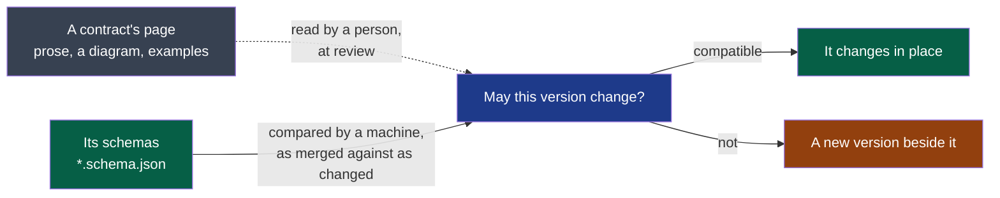

# ADR-0005 — A contract carries a schema, and a comparator judges its changes

- **Status**: Accepted
- **Read on 2026-10-26, a review of the documents; cycle 02's closure (2026-10-17) did not read it**: Met. The three false pages corrected in place, each let through by the comparator (#103, #108, #164); a field of `recording/v1` or `transcript/v1` removed, renamed or retyped is refused — the comparator (#101), checked on the real schemas on 2026-10-17 (cycle 02, D15).
- **Date**: 2026-10-14
- **Decision makers**: the decider, `@napkinstack-admin`
- **Scope**: project
- **Reversibility**: easy — a schema says what a page already said; the comparator is one
  call behind one script.

---

**Legend** — grey: what a person reads · green: what a machine compares, and the change it
lets through · blue: the question rule V1 asks · orange: what a refused change becomes.

## Context

Summit's contracts are pages of prose: `session-audio` in two versions, `recording`,
`transcript`, `minutes`. Each is consumed by a module. The framework freezes a version from
the moment it is consumed: it changes in place only when the project's comparator — the
`compat` command of the module that holds it — calls the change compatible (rule V1).

The `contracts` module declared no such command. On 2026-10-13 a pull request that
corrected an example and three diagrams (#96) was refused on four contracts, and rightly:
nothing could say a page's change was compatible. Three pages have said something false
since: `recording/v1` describes the first form of a recording only, `transcript/v1`'s
example names an engine the program does not write, four diagrams draw a consumer that
reads nothing.

## Problem

What proves, here, that a change to a consumed contract breaks no consumer — so that a page
can be corrected without a new version, and a promise cannot be changed without one?

## Constraints

- All four contracts describe JSON: a record, lines of events, lines of a transcript.
- uv is the project's only prerequisite on a runner; a module's commands run from its folder.
- The comparator runs as merged, in the merged tree, and is handed the two folders of one
  version (the framework's rule).
- Free tools, current and proven as far as there are any (the decider, 2026-10-14).
- One builder with agents: what a contract promises must be held by a machine where it can.

## Prior art

Read and tried on 2026-10-14, on a schema of a transcript's line and six changes to it:

| Tool | What it is | Tried |
|---|---|---|
| `jsoncompat` 0.5.0 (PyPI, also a Rust crate and an npm package) | Compares two JSON Schemas by what they allow, for a writer, a reader or both; gives an example of what broke | Right on the six: a field removed, renamed, of another type, a value added — refused with an example; a field added, a value no longer written — let through. It calls itself alpha |
| `json-schema-diff-validator` 0.4.2 (npm) | Compares the two documents' structure: what was removed or replaced is breaking | Right on the six; last published in 2024; needs Node, which nothing else here does |
| `json-schema-diff` (Rust crate) | A work in progress: many keywords ignored, by its own page | Not tried |
| OpenAPI comparators (`oasdiff` and others) | Mature, for HTTP interfaces | Not tried: no contract here is one |

No comparator of JSON Schemas is established the way a linter is. The field is thin.

## Options considered

1. **Nothing**: the pages stay as they are until each contract gets a second version.
2. **A new version for every correction**: `transcript/v2` to correct an example; every
   consumer migrates for a typing mistake.
3. **A schema beside each page, compared by a tool**: a change to a field is judged by a
   machine; a page is corrected freely.

## Decision

**Option 3.** A version of a contract holds, beside its page, a schema for each JSON
document it describes — `<name>.schema.json`, JSON Schema 2020-12. The `contracts` module's
`compat` command compares the schemas of a version as merged with the same as changed,
with `jsoncompat`, from the consumers' side: everything a producer may write under the
changed schema must be something the merged one allowed.

- A schema that was merged is never removed from its version.
- A schema added where there was none is let through once the comparator reads it: nothing
  was promised by a machine yet.
- **A version that holds no schema cannot change**: nothing can be compared, and what is
  not proven is refused. The same holds for a change the comparator cannot decide.
- **A version's pages are not compared.** A promise made in prose only — "a track is never
  rewritten" — is held by review and by nothing else. What can be said in a schema is said
  there.
- The same schemas are what a contract test reads on each side: the producer's output and
  the consumer's fixtures are validated against them. That is the module's `test`, built
  contract by contract.

`jsoncompat` is pinned to one version and held by tests of the comparator on changes made
for the purpose: if it judges one of them otherwise after an update, the tests say so.

## Success criterion

> We will consider this was the right call if, **by the end of cycle 02 (2026-11-04)**, the
> three pages known to be wrong are corrected in place with the comparator's approval, and a
> change that removes or renames a field of `recording/v1` or `transcript/v1` is refused by
> it in a pull request.

If the criterion is not met: the schemas stay — they are documentation a machine can read —
and the comparator is replaced behind its one script.

## Consequences

- A contract's page can be corrected, its example and its diagram included, without a new
  version.
- A field cannot be removed, renamed or retyped in a consumed version without one.
- A new value of an enumeration is refused in place, even where the page tells consumers to
  ignore what they do not know: a schema that wants room for more says so, by not
  enumerating.
- Writing a schema finds what a page left unsaid. Two such points are open as this is
  written: where the transcript of a session recorded as `session-audio/v2` lives — beside
  the tracks, as `transcript/v1` says, or under `derived/`, as `session-audio/v2` says — and
  whether a session of the second form with no clock is to be refused.
- The `contracts` module now holds code: it has `check`, `test` and a locked environment.
- The comparator is alpha software. It judges JSON Schemas only: a contract that is not
  JSON — `minutes/v1`, a page of Markdown — would need another, and stays frozen until then.
- What its first verification measured, on 327 changes to schemas written for this
  project's contracts: **no break was let through**; 23 harmless changes of 124 were refused,
  most because a union leaned on a keyword beside it — the module's rule for writing a
  schema comes from there. It reads JSON Schema 2020-12 only, follows a `$ref` only inside
  its own file, does not read `format`, and cannot decide a changed `pattern`. Whether an
  example comes with a refusal can vary from one run to the next; the refusal does not.
- An object left open is what makes "a field added" compatible. Each schema decides it,
  object by object; the pages of `recording` and `transcript` tell a reader to ignore what
  it does not know, and their schemas leave their objects open.

## Rejected alternatives

- **Comparing the pages themselves** — the sections "what it carries" and "what it never
  does" held byte for byte: it refuses the corrections this decision exists to allow, and
  says nothing of a field.
- **`json-schema-diff-validator`**: a structural comparison calls a reordering or a
  rewording of a schema breaking, and brings Node into a project that has none.
- **A comparator written here**: deciding whether one schema allows only what another does
  is not a script's worth of work.
