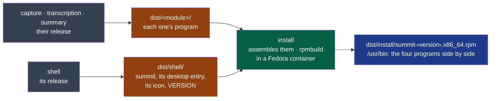

# ADR-0006 — A module assembles the package from each module's release

- **Status**: Proposed — the agent's, on the decider's word of 2026-10-18 ("fais ce qu'il
  reste en autonomie… continue"); the criticality is the decider's to settle
- **Date**: 2026-10-18
- **Decision makers**: the decider, `@napkinstack-admin`
- **Scope**: module install
- **Reversibility**: easy — the package is made from the artefacts as each module ships them;
  another packer replaces one script and one spec

---

**Legend** — grey: the modules as they are · amber: what each one's release leaves in `dist/` ·
green: the new module · blue: what a user installs.

## Context

The charter's success criteria start "from the day Summit installs on the decider's Fedora";
Summit was built from the repository. Cycle 03 takes D24 on the decider's word: one package,
installed with `dnf`, running with nothing built and no variable set. Summit is to follow on
macOS, then Windows.

The shell already finds the other programs beside its own executable when no variable names
them (`program()` in `modules/shell/src/main.rs`).

## Problem

Where is the package made, from what, and with what?

## Constraints

- One module never reads another's folder (the framework's B2): a package made of four modules'
  programs needs their *artefacts*, not their code.
- Fedora first, the other systems after, from the same artefacts.
- No paid signing, no repository to host yet: a file the decider installs.

## Prior art

**Dominant conventions:** a distribution's own packaging for its users (`rpmbuild` and a `.spec`
on Fedora), which reads the libraries each program links and requires their packages; and, in a
repository of several components, a release step per component whose outputs a packaging step
assembles (NapkinStack ≥ 0.9.6: `nstack release`, `dist/<module>/`, `assembles`).

| Reference | What it does | What we keep |
|---|---|---|
| `rpmbuild` with a `.spec` | Fedora's way; automatic library dependencies; any language | All of it, run in a throwaway Fedora container, so the workstation needs only `podman` |
| Tauri's bundler (`tauri build --bundles rpm`) | Packs the shell, side programs as `externalBin` | Tried first: it must run in the shell's folder (B2), rewrites the shell's `Cargo.toml`, names the desktop entry after the product, and lists no dependency but the shell's |
| Flatpak | Sandboxed, distribution-independent | Not now: portals for the sessions folder, PipeWire's monitor of the output, the other programs — a project of its own |

## Options considered

1. **A module `install` assembling each module's release artefacts with `rpmbuild`.**
2. Tauri's bundler in a module of its own, or in the shell.
3. A hand-made script at the repository's root, outside every module.

## Decision

Option 1. Each program's module declares `release`, leaving what it ships in its folder of
`dist/` — the shell its program, its desktop entry and icon under the application's id
(`dev.summit.Summit`, which GNOME's shortcut portal needs) and its version. `modules/install`
declares `assembles: [shell, capture, transcription, summary]` and its release
(`scripts/release.sh rpm`) builds `summit.spec` in a Fedora of this system's release. A program
*run* rather than linked is required by name (`pw-metadata`, for capture).

The next system adds its format to the same release — a `dmg` from the same artefacts — the
modules' releases taking their target as argument.

**Criticality: standard** — a broken package costs a reinstall from the repository, never a
meeting or a setting: it installs nothing outside `/usr`. Not `prototype`: the charter's two
weeks run on it.

## Success criterion

By the end of cycle 03 (2026-11-07): the decider installs Summit from `dist/install/` with `dnf`
and goes through a meeting with nothing built; the module's e2e installs and removes the package
in a Fedora that never saw Summit.

## Consequences

- `nstack release` builds every program in release mode, then the package: minutes, and the
  network once for the container's image and `rpm-build`.
- The version is the shell's (`tauri.conf.json`); updating is installing a newer package — no
  repository, no automatic update.

## Rejected alternatives

- **Tauri's bundler:** see the prior art — it crosses into the shell's folder and decides less
  than `rpmbuild` does.
- **A root script:** outside every module, so outside every check and every owner.
- **Flatpak:** see the prior art.
