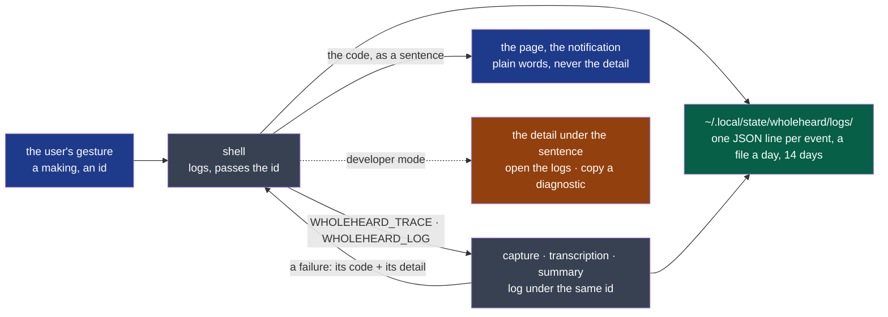

# ADR-0007 — Each program logs what it does, never what was said

- **Status**: Proposed — the agent's, on the decider's word ("il faut qu'on logs de maniere
  expert les etapes et les erreur … les erreurs technique ne devrait pas remonté dans l'ihm de
  l'utilisateur (ou peut être prévoir un mode "developpeur", a toi de voir)"; then, 2026-10-20,
  "oui pour les 2")
- **Date**: 2026-10-20
- **Decision makers**: the decider, `@napkinstack-admin`
- **Scope**: project — the four programs and the shell
- **Reversibility**: easy — a log is read by people; nothing depends on its form but a reader

---

**Legend** — blue: what the user sees · grey: the programs · green: the logs · amber: shown only
in developer mode.

## Context

Nothing is logged today. Each program prints a sentence on its error stream when it fails; the
shell shows that sentence — in English, technical — to the user, and nothing remains of what led
to it. A trial of D25 showed "the provider at local does not know this model…" inside a
French sentence; a window that froze for nine hours on a lock left no trace to read. A tester
on another machine (D27's colleague) could tell nothing but what they saw.

## Problem

How do the programs record what they do, so that a failure is traced from the gesture to its
cause, without what is recorded ever holding a meeting — and how does a failure reach the user?

## Constraints

- Nothing of a meeting in a log: no audio, no transcript, no minutes, no context, no key (the
  charter's promise; PDR-0001: nothing leaves the machine — and a log is sent by a tester).
- No telemetry: logs stay on the machine; the user sends one if they choose.
- Four Rust programs and a shell, started by it or by a person in a terminal.
- Programs started by hand stay quiet on the screen unless asked.

---

## Prior art

**Dominant convention of the field:** structured logs (one JSON object per line) through the
language's standard facade, rotated by day and size, levels set by an environment variable, a
correlation id carried across processes; user-facing messages separate from diagnostics.

| Reference | What it does | Applicable here? |
|---|---|---|
| Rust's `tracing` + `tracing-subscriber` (`json`, `EnvFilter`) + `tracing-appender` (rolling) | Spans and events, filtered by `RUST_LOG`-like strings, written as JSON to daily files | Yes: the de-facto Rust stack, no runtime cost when a level is off |
| OpenTelemetry's trace context | A trace id passed from process to process | The idea, not the dependency: an id in an environment variable is enough for four local programs |
| XDG Base Directory, `$XDG_STATE_HOME` | Logs and history belong in state, not data or cache | Yes: `~/.local/state/wholeheard/logs/` |
| Apple / GNOME HIG on errors | A message says what happened and what to do, in the user's words; details on demand | Yes: the code mapped to a sentence; the detail in developer mode |

## Options considered

1. **`tracing` in each program, JSON lines in the state folder, an id from the shell, error
   codes mapped to sentences by the shell, a developer mode in Settings.**
2. The journal (`systemd-journald`) through `tracing-journald`: no files to rotate — but Linux
   only, and a tester cannot easily send it.
3. Logs only on the error stream, captured by the shell: nothing remains of a program run by hand.

## Decision

Option 1.

- **Where:** `$XDG_STATE_HOME/wholeheard/logs/<program>.<YYYY-MM-DD>.jsonl` — one file per program
  and day; files older than 14 days removed at start, and the folder kept under 50 MB.
- **What:** each event a JSON line — time, level, program, version, the id of the making it
  belongs to, the step (`capture.started`, `transcription.model_loaded`, `summary.sent`,
  `summary.answered`, …), durations, sizes, counts, model names, hosts, HTTP statuses, error
  codes and their technical detail. **Never** a text of the meeting, a context, a path to a
  meeting beyond its folder's name, nor a key; a test of each program reads its own log after a
  run on a known meeting and finds none of its words.
- **Levels:** `info` by default; `WHOLEHEARD_LOG=debug` (or a filter string) for more.
- **One id per making:** the shell makes one for each recording, transcript or minutes asked,
  logs under it and passes it as `WHOLEHEARD_TRACE`; each program logs under it.
- **Errors:** each program ends a failure with a stable code (`provider.unreachable`,
  `provider.refused_key`, `model.missing`, …) and its technical detail on the error stream; the
  shell logs both, and says the code to the user as a sentence of `words` — plain, in their
  language, with what to do. The detail is never on the page or in a notification.
- **Errors, as built (2026-10-20, D29's third step):** the code is not put first on the error
  stream. It is a `failed` event, the last line of the program's output, beside the sentence,
  which stays as it was. The reasons: the output is already a contract judged by its schema,
  and the shell already reads the sentence. A line the contract adds is additive; a sentence
  that changes form is not. Codes start with `wholeheard-summary` (`summarising/v1`). Capture's
  and transcription's come later: transcription has no contract for how it runs.
- **Developer mode:** Settings → Advanced, off by default. On: the detail under the sentence, a
  log level chosen, *Open the logs*, *Copy a diagnostic* — the last day's logs of a meeting's
  makings, nothing of the meeting, ready to send.

**Criticality: standard** — a log that fails is a log missing, never a meeting lost; a log is
written beside, never in the user's meetings.

## Success criterion

By the end of the cycle that builds it: a failure provoked in each program is found in the logs
under the id of its making, with its cause; the page says it in a plain sentence; the logs of a
day of real meetings hold none of their words.

## Consequences

- Each program gains three dependencies (`tracing`, `tracing-subscriber`, `tracing-appender`).
- The programs' contracts gain a `failed` event with a code; their failure sentences keep their form
  (see *Errors, as built*).
- The page's error sentences move from the programs to the shell's `words`.

## Rejected alternatives

- **journald:** Linux only, and not what a tester can send.
- **Error stream only:** nothing remains of a run by hand, nothing is traced across programs.
