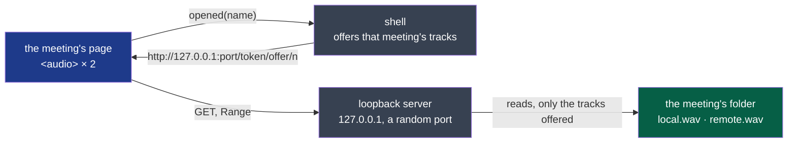

# ADR-0008 — The window plays a meeting from a loopback server, its tracks alone

- **Status**: Proposed — the agent's, building D26 on the decider's word ("read the audio and
  follow the transcript, like a song with its lyrics"; 2026-10-20, "continue en autonomie")
- **Date**: 2026-10-20
- **Decision makers**: the decider, `@napkinstack-admin`
- **Scope**: the shell
- **Reversibility**: easy — the page plays a URL; another way of giving it one changes the shell
  alone

---

**Legend**: blue is the window, grey the shell's code, green the meeting's files.

## Context

D26 plays a meeting's two tracks in the window, synced with its transcript. The window is a
web view (ADR-0002), given no file of the disk and no permission. The established way to hand a
web view a local file is Tauri's asset protocol (`convertFileSrc`). It was built and tried. On
Linux, the web view's media player (WebKitGTK's GStreamer) refuses a URL of that custom scheme:
`MEDIA_ERR_SRC_NOT_SUPPORTED`, and `play()` rejects with `NotSupportedError`. The same file, 24
bits and two channels at 48 kHz, plays from `http://127.0.0.1`. This was measured on the
decider's laptop on 2026-10-20.

## Problem

How does the window play a meeting's tracks, which may weigh a gigabyte an hour each, seek
anywhere in them, and get no other file of the disk?

## Constraints

- Nothing leaves the machine (`docs/project/rules/security.md`, rule 1): no listening on a
  network another machine reaches.
- The window gets the opened meeting's tracks, and nothing else.
- Seeking anywhere in an hour's track at once: no file read whole into memory.
- Linux first, macOS and Windows later (charter).

---

## Prior art

| Reference | What it does | Applicable here? |
|---|---|---|
| Tauri's asset protocol (`convertFileSrc`, a scope) | Serves files of a scope under a custom scheme | Not on Linux for media: WebKitGTK's player refuses the scheme (measured) |
| `tauri-plugin-localhost` (official), on `tiny_http` | Serves the app's own pages from `localhost` | Its approach — a loopback HTTP server inside the app, on `tiny_http` — for files it is told of |
| Media servers and desktop players with a web view (Jellyfin, Electron apps) | A loopback HTTP server with Range, an access token in the URL | Yes: the established pattern for streaming local media to a web view |
| A blob URL (`fetch`, then `createObjectURL`) | The whole file in memory | No: an hour's track is about a gigabyte |
| Native playback in the shell (`rodio`) | Plays without the web view | Possible, but the page would lose the media element's seeking and timing, and the shell would draw its own clock |

## Options considered

1. **A loopback HTTP server in the shell, on `tiny_http`: `127.0.0.1` and a random port; each
   URL carries a random token of the run and an offer's number; the tracks are named by index,
   never by path; only the tracks offered last are served.**
2. Tauri's asset protocol: refused by WebKitGTK's media player (measured).
3. Native playback with `rodio`: more code in the shell, and a clock of its own to keep the page
   in step.

## Decision

Option 1.

- **Where:** `127.0.0.1`, a port the system gives, opened at the shell's first meeting with
  tracks. Never `0.0.0.0` or another interface.
- **What:** `GET` and `HEAD` of `/<token>/<offer>/<n>`, with a single Range. The token is 128
  random bits from the system, per run. The offer is a counter that `opened` moves on. `n` is a
  place in that offer's list. A path never appears in a URL, so none can be asked.
- **Only what is open:** each `opened(name)` replaces the list with that meeting's tracks. An
  earlier offer's URL then answers 404.
- **Read only:** a file is opened for reading, at the moment it is asked for. Nothing is
  written, and nothing else is listed.
- **The page:** its CSP allows media from `http://127.0.0.1:*` and nothing more.

**Criticality: standard.** A failure is a meeting that does not play, never a file read
elsewhere: the token, the index and the loopback interface each refuse that on their own.

## Success criterion

By the end of cycle 03: the decider listens to a real meeting in the window, its two tracks
together and its words following (D26's acceptance, D23's trial). A request without the token,
with another offer's number, or for any path is refused, as `tests/player.rs` shows.

## Consequences

- The shell gains `tiny_http` and uses `getrandom`, which is already among its dependencies.
- A local process of the same user that reads the shell's memory could find the token. It
  would get the same tracks the user can already read.

## Rejected alternatives

- **The asset protocol:** WebKitGTK's player refuses it.
- **Blob URLs:** a meeting's track whole in memory.
