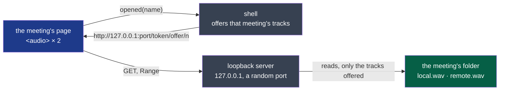

# ADR-0008 — The window plays a meeting from a loopback server, its tracks alone

- **Status**: Proposed — the agent's, building D26 on the decider's word ("read the audio and
  follow the transcript, like a song with its lyrics"; 2026-10-20, "continue en autonomie")
- **Date**: 2026-10-20
- **Decision makers**: the decider, `@napkinstack-admin`
- **Scope**: module `shell`
- **Reversibility**: easy — the page plays a URL; another way of giving it one changes the shell
  alone

---

**Legend**: blue is the window, grey the shell's code, green the meeting's files.

## Context

D26 plays a meeting's two tracks in the window, synced with its transcript. The window is a
web view (ADR-0002), given no file of the disk and no permission. The established way to hand a
web view a local file is Tauri's asset protocol (`convertFileSrc`). It was built and tried in
the window's e2e on the decider's laptop (Fedora, WebKitGTK) on 2026-10-20. The web view's
media player refused the URL: `MEDIA_ERR_SRC_NOT_SUPPORTED`, `networkState` *no source*, and
`play()` rejected with `NotSupportedError`. The same file, 24 bits, two channels at 48 kHz,
played from `http://127.0.0.1` in the same window. Both were measured, not assumed; the
attempt is in the history of branch `d26-playback`.

## Problem

How does the window play a meeting's tracks, which may weigh a gigabyte an hour each, seek
anywhere in them, and get no other file of the disk?

## Constraints

- Nothing leaves the machine (`docs/project/rules/security.md`, rule 1): nothing listens on an
  interface another machine reaches.
- The window gets the opened meeting's tracks, and nothing else.
- Seeking anywhere in an hour's track at once: no file is read whole into memory.
- Linux first, macOS and Windows later (charter).

---

## Prior art

**Dominant convention of the field:** a web view or a desktop browser shell plays local media
from a URL its host serves. In Tauri that is the asset protocol, a custom scheme. In Electron
it is a custom protocol (`protocol.handle`). Where a custom scheme is not playable, a host
serves the file over HTTP on the loopback interface.

**References examined:**

| Reference | What it does | Applicable here? |
|---|---|---|
| Tauri's asset protocol (`convertFileSrc`, a scope) | Serves files of a scope under a custom scheme | Not on Linux for media: WebKitGTK's player refused it, as measured above |
| A custom scheme of the shell (`register_asynchronous_uri_scheme_protocol`) | The same, with the shell answering | **Not measured.** It goes through the same WebKitGTK scheme handler as the asset protocol, so it is assumed to fail the same way |
| `tauri-plugin-localhost` (Tauri's own), built on `tiny_http` | Serves the app's pages from `localhost` | Its approach: an HTTP server inside the app, on the loopback interface, on `tiny_http` |
| A blob URL (`fetch`, then `createObjectURL`) | The whole file in memory | No: an hour's track is about a gigabyte |
| Native playback in the shell (`rodio`) | Plays without the web view | Possible, but the page loses the media element's seeking and timing, and the shell draws its own clock |

**Why the convention is not enough:** its custom scheme is refused by the media player of the
web view the shell runs in on Linux. The fallback the convention itself leaves, HTTP on the
loopback interface, is what this record decides.

## Options considered

### Option 1 — A loopback HTTP server in the shell, on `tiny_http`

`127.0.0.1` and a random port. Each URL carries a random token of the run and an offer's
number; a track is named by its index, never by a path; only the tracks offered last are
served.

### Option 2 — Native playback with `rodio`

More code in the shell, and a clock of its own to keep the page in step.

### Option 3 — Do nothing

D26 is not built: the meeting is read, never heard. The cycle's D26 is not met.

## Decision

Option 1.

- **Where:** `127.0.0.1`, a port the system gives, opened at the shell's first meeting with
  tracks and open until the shell quits. Never `0.0.0.0` or another interface.
- **What:** `GET` and `HEAD` of `/<token>/<offer>/<n>`, with a single Range. The token is 128
  random bits from the system, per run. The offer is a counter that `opened` moves on. `n` is
  a place in that offer's list. A path never appears in a URL, so none can be asked.
- **Only the opened meeting's tracks:** each `opened(name)` replaces the list with that
  meeting's tracks, and an earlier offer's URL then answers 404. The last offer stays served
  after its page is left, until another meeting is opened or the shell quits.
- **Read only:** a file is opened for reading, at the moment it is asked for. Nothing is
  written, and nothing else is listed.
- **Who is turned away first:** a request without the token, or of another offer, is answered
  where it arrives. Only a request for an offered track gets a thread of its own to stream it.
- **The page:** its CSP allows media from `http://127.0.0.1:*`, and nothing more.
- **Threats, and what is accepted:**
  - *Another machine:* refused, since nothing listens beyond the loopback interface.
  - *Another user of this machine, or a web page in a browser here* (DNS rebinding, a forged
    request): either reaches the port, never a track without the 128-bit token of the run,
    which travels only between the shell and its window. Accepted: a guess is not a threat at
    that size, so the token is compared plainly, not in constant time.
  - *A process of the same user that reads the shell's memory:* it can find the token, and gets
    the tracks the user can already read. Accepted.
  - *The URL in a log:* it is never logged.
  - *Many requests at once:* each without the token is answered at once and holds no thread.
  - *A path, `..`, an encoded path:* nothing in a URL is a path, so each answers 404.

**Criticality: standard.** A failure is a meeting that does not play, never a file read
elsewhere: the token, the index and the loopback interface each refuse that on their own.

### Deviation from the convention

- **Expected user value:** the decider hears a meeting in the window, its words following,
  on the system where the convention's custom scheme does not play.
- **How we will observe it:** the decider's trial (D23) plays a real meeting.

---

## Success criterion

> We will consider this was the right call if **the decider listens to a real meeting in the
> window, its two tracks together and its words following, and a request without the token,
> of another offer or for any path is refused (`tests/player.rs`)** is observed before
> **2026-11-07**, the end of cycle 03.

What we do if it is not: correct. If the web view refuses loopback HTTP too, or the trial finds
the server in the way, this record is superseded by native playback (Option 2).

---

## Consequences

**Positive:** a meeting is played with the web view's own media element: seeking, timing and
pausing, with no clock of the shell's.

**Negative and accepted debt:**
- The shell gains a direct dependency on `tiny_http`, and on `getrandom`, which it reached only
  through other crates until now.
- A port stays open on the loopback interface while the shell runs.

**Impacts on other modules or contracts:** none. It reads `session-audio`'s tracks as any
consumer does.

**Rule to automate:** `tests/player.rs`. It refuses a URL without the token, of another offer,
out of the offer, or naming a path, and it checks what a Range answers. It runs with the
module's tests on every pull request.

---

## Rejected alternatives

- **The asset protocol:** WebKitGTK's player refused it (measured).
- **A custom scheme of the shell:** the same scheme handler, assumed to fail the same way (not
  measured).
- **Blob URLs:** a meeting's track whole in memory.
