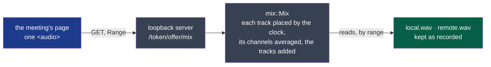

# ADR-0009 — The window plays a meeting's tracks as one sound, mixed as they are read

- **Status**: Proposed — the agent's, on the decider's word: "pourquoi ne pas lire l'audio unifié
  même si on navigue sur le graphe des 2 courbes pour éviter de synchro ?" (2026-10-21)
- **Read at cycle 03's closure, 2026-10-26**: Met: D26 accepted after the decider's real meeting; the e2e's scenario R plays past the shorter track's end (#304), as one sound since #307. The record stays *Proposed*: accepting it is
  the decider's.
- **Date**: 2026-10-21
- **Decision makers**: the decider, `@napkinstack-admin`
- **Scope**: the shell
- **Reversibility**: easy — the page plays one URL; what the server makes behind it changes the
  shell alone
- **Amends**: [ADR-0008](./0008-the-window-plays-a-meeting-from-a-loopback-server.md): the server
  serves the opened meeting's mix, no longer its tracks one by one

---

**Legend**: blue is the window, grey the shell's code, green the meeting's files, unchanged.

## Context

ADR-0008 had the page play a meeting's two tracks with two media elements, kept in step by the
page. In WebKitGTK the in-step player failed three times, each time on the same piece (#304):
- read from a track a tick behind, the time went back to 0 at the first track's end;
- a track put at its very end stopped answering — playing no more, put nowhere else;
- a track ended, then put back, stayed seeking for good.

Each was found by an independent verifier or the e2e, and each fix met the next fault. The kernel
stops a fix after three failures: the problem was the design, not the code.

## Problem

How does the window play a meeting, seek anywhere in it, and show who spoke, with no clock of
its own to keep two players in step?

## Constraints

- The tracks are kept as recorded (ADR-0004): nothing is written beside them for the window.
- A meeting of an hour plays and seeks at once: nothing is read whole into memory.
- The server's guarantees stand (ADR-0008): the loopback interface, the run's token, the last
  offer alone, read only.

---

## Prior art

| Reference | What it does | Applicable here? |
|---|---|---|
| Players of recorded meetings with several tracks (Riverside, Zencastr, Descript) | Each speaker recorded apart, the meeting played as one mix, the tracks kept for editing | Yes: the established way to play such a meeting |
| `waveform-playlist` and Web Audio multitrack players | Decode each track whole, play them on one `AudioContext` clock | No: an hour's track decoded is about a gigabyte |
| Two media elements kept in step by script (ADR-0008 as built) | One clock of the page's, each element put back to it | Failed three times in WebKitGTK (above) |
| A mixed file in `derived/` (ADR-0004 allows it) | Made once, served as a file | Possible, but about 350 MB an hour more on the disk, to be freed with the audio |

## Options considered

1. **The server mixes the tracks as the page reads them.**
2. A mixed file written in `derived/`.
3. The page keeps two players in step: the design that failed.

## Decision

Option 1. The page plays one URL, and the drawing of who spoke is only its control.

- **What is played.** `mix::Mix` places each track where `session-audio`'s clock puts its
  first frame, averages its channels, and adds the tracks. A frame beyond full scale is held
  there.
  - The result is one channel of 16 bits at the highest of the tracks' rates, a WAV whose size
    is known at once.
  - A track of a lower rate is brought up with rubato, the resampler the transcription uses.
    The resampler always starts on the same grid of its blocks, each block starting on a frame
    that falls on a frame of the mix, so a range is the same bytes as the whole.
- **How it is read.** `/<token>/<offer>/mix`, `GET` and `HEAD`, a single Range, as ADR-0008
  says. Each range is made as it is asked for, a second at a time, off the server's thread.
  Nothing is written, nothing is kept in memory but the second being made, and the tracks are
  only read. A meeting freed meanwhile is not found.

**Criticality: standard**, as ADR-0008: a failure is a meeting that does not play.

## Success criterion

By the end of cycle 03, 2026-11-07:
- the decider listens to a real meeting in the window, both sides together, and seeks in it
  by the drawing and by a line, with nothing playing out of step (D26, D23);
- the e2e plays a meeting from its start through the end of its shorter track to the end, with
  no clock in the page.

## Consequences

- The shell gains `rubato`, already a dependency of the transcription, at the same version, and
  loses `tokio-util`.
- The two sides are heard together, as in the call. One side alone is not offered: the drawing
  shows who spoke.
- Two sides speaking at once are added: a sum held at full scale may clip, where a call's own
  mix would bring them down. Speech rarely overlaps for long.
- **Each track is placed by its first clock point, then read at the rate its header names.**
  `session-audio/v2`'s clock also gives each track's true rate, which this mix does not apply.
  - On one sound server with one device, two tracks moved by a ten-thousandth of a second
    (measured 2026-10-13).
  - Two devices on two clocks may drift further over an hour. How far is the contract's open
    question, and the decider's trial (D23) will hear it.
  - Following the true rate is the next step if they are heard apart.

## Rejected alternatives

- **The page keeping two players in step**: three failures in WebKitGTK, above.
- **A mixed file in `derived/`**: the disk taken twice over, and one more file to free.
- **Web Audio with decoded tracks**: a meeting's tracks whole in memory.
