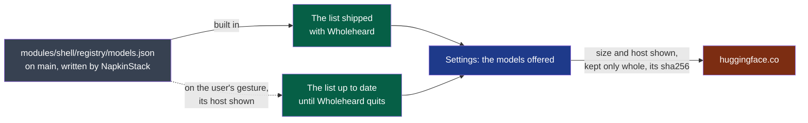

# ADR-0010 — The models offered are a list kept in the repository, read again on the user's word

> The framework's words: `.nstack/handbook/glossary.md`.

- **Status**: Proposed — the framer's, on the decider's word of 2026-10-26: "on peut le faire
  maintenant, tranche tu es autonome". Accepting it is the decider's.
- **Date**: 2026-10-26
- **Decision makers**: the decider, `@napkinstack-admin`
- **Scope**: module `shell`
- **Reversibility**: easy — the shipped list is the same file; dropping the fetch leaves it as
  D37 left it

---

**Legend** — grey: the repository · green: what Wholeheard holds · blue: what the user sees ·
red: outside the machine, reached on the user's word · dotted: only when asked.

## Context

Settings offer a short list of Whisper models to download (D37, cycle 03): the default and
Whisper small, each with its address, size and fingerprint, written in `modules/shell/src/model.rs`.
It changes with a release. Cycle 03 put a registry kept open on GitHub in *Later*, as the
decider's idea (2026-10-25), with the framer's condition "only once the list changes faster than
the releases". On 2026-10-26 the decider asked for it now, with a folder of its own that only a
member of NapkinStack can write to.

## Problem

Where does the list of models live, so that it can change without a release, without breaking
the promise that nothing leaves the machine unless the user chose it?

## Constraints

- Security rule 1: no network call to a host the user did not configure or was not shown first.
- Rule 1 of the project: every sentence the user reads is in `src/words.rs`.
- A model file is large and parsed by the engine: what is fetched must be the published file.
- One builder, no budget, no server of the project's own: the repository and its forge are what exists.

---

## Prior art

**Dominant convention of the field:** a catalogue of models kept as a file in the project's own
repository, read by the application, each entry with its address, size and checksum.

| Reference | What it does | Applicable here? |
|---|---|---|
| GPT4All ([`gpt4all-chat/metadata/models3.json`](https://github.com/nomic-ai/gpt4all/blob/main/gpt4all-chat/metadata/models3.json), read 2026-10-26) | 32 models in one JSON file in its repository, each with its URL, size and md5; the application reads it from the project's site (`modellist.cpp`) | Yes: one file in the repository, sizes and checksums. Its checksum is md5; ours is SHA-256, as D37's |
| Homebrew ([homebrew-core](https://github.com/Homebrew/homebrew-core), not read again here) | Each formula a file in a repository only maintainers merge into, its downloads by SHA-256 | Yes: who may write is who may merge |
| Debian's apt ([*SecureApt*](https://wiki.debian.org/SecureApt), not read again here) | The index signed by the archive's key, each package by its hash | Its signature: not yet (*Rejected alternatives*) |

---

## Options considered

### Option 1 — Do nothing
- The list stays in the code and changes with a release (D37).
- Cost of getting out: none. Drawback: what the decider asked for is not there.

### Option 2 — A file of the shell's, built in and read again on the user's word
- `modules/shell/registry/models.json`: the shipped list is built from it; Settings offer to read
  it again from `main`, its host shown.
- Advantages: one source; no request without a gesture; a broken file is refused by the shell's
  own tests before it is merged.
- Cost of getting out: drop the fetch; the file stays the shipped list.

### Option 3 — A repository of its own (`NapkinStack/wholeheard-registry`)
- Drawbacks: a second place to keep current, its own checks and settings to set by hand, for
  one file.

### Option 4 — A signed list
- The application holds a public key and refuses a list it does not sign; the private key is
  the decider's, kept outside any repository.
- Drawback: every change to the list waits on the decider's signing gesture.

## Decision

**Option 2.**

1. **The list is one file, `modules/shell/registry/models.json`**, in the module that owns the
   settings. Version 1 holds the Whisper models offered: for each, its address, its size, its
   SHA-256, and what it is good for as a key whose sentence is in `src/words.rs` (`recommended`,
   `faster`). A key unknown to a build shows the model without a sentence.
2. **The shipped list is that file**, built into Wholeheard: no list of models remains in the code.
3. **Read again only on the user's gesture**, in Settings, its host shown
   (`raw.githubusercontent.com`), from `main`. What it gives replaces the shipped list until
   Wholeheard quits. Never at the start, never in the background.
4. **Refused, the shipped list stays**: a list that does not answer, is larger than 64 KB, does
   not read, says a version the build does not know, or names a model's host other than
   `huggingface.co`. One sentence says it could not be brought up to date.
5. **Who may write it**: whoever may merge into `main`, NapkinStack's members; no outside
   contribution is merged (`CONTRIBUTING.md`, PDR-0002). The shell's tests read the file in
   every pull request that changes it.
6. **A model is fetched as D37's are**: its size and host shown first, kept only whole and with
   its fingerprint.

The models of the minutes, fetched by Ollama, stay in the code (`providers::RECOMMENDED`): the
list holds what the shell downloads itself.

---

## Success criterion

> We will consider this was the right call if, **by 2027-06-30**, a model has been added to or
> removed from the list without a release of Wholeheard, and no list refused by the shell's tests
> has reached `main`.

What we do if it is not: if nothing changed without a release, the fetch is removed and the
file stays the shipped list.

---

## Consequences

**Positive:** one file to change; the list kept with the code that reads it.

**Negative and accepted debt:** the list is as safe as the forge's write access. A list written
by someone who took that access could offer another file from `huggingface.co`, of the size and
fingerprint it states: the user is still shown the host and the size before anything is fetched.

**Impacts on other modules or contracts:** none: the file is the shell's.

**Rule to automate:** the shell's test that reads the file: a list that does not read, names a
host not allowed, a size of zero or a fingerprint that is not 64 hexadecimal characters fails it.

---

## Rejected alternatives

- **A repository of its own** (option 3): one file does not pay for a second repository.
- **A signed list, now** (option 4): it guards against the forge's write access being taken, at
  the price of the decider's gesture on every change. It comes **before the first build
  published for people outside the project**, the event PDR-0002 makes `capture` `critical` on:
  from then on, strangers' machines would trust the list.
- **Reading it at each start**: a request the user did not ask for (security rule 1).
