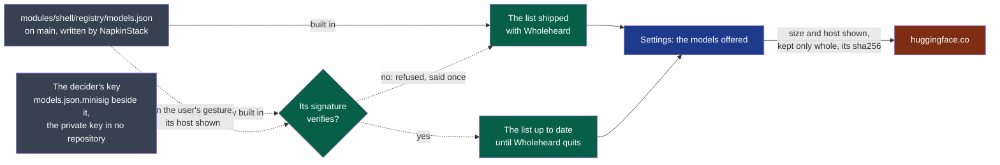

# ADR-0010 — The models offered are a list kept in the repository, read again on the user's word

> The framework's words: `.nstack/handbook/glossary.md`.

- **Status**: Accepted — by the decider, 2026-10-27: "ok, ajoute ça à l'ADR-0010 et j'accepte
  l'ADR", once option 5 below was added. Proposed by the framer on the decider's word of
  2026-10-26: "on peut le faire maintenant, tranche tu es autonome". Amended 2026-10-30 by D56
  (cycle 05): option 4 adopted, as *Rejected alternatives* had said it would be, before the first
  build published outside the project.
- **Date**: 2026-10-26
- **Decision makers**: the decider, `@napkinstack-admin`
- **Scope**: module `shell`
- **Reversibility**: easy — the shipped list is the same file; dropping the fetch leaves it as
  D37 left it

---

**Legend** — grey: the repository and the decider's signature · green: what Wholeheard holds · blue: what the user sees ·
red: outside the machine, reached on the user's word · dotted: only when asked.

## Context

Settings offer a short list of Whisper models to download (D37, cycle 03): the default and
Whisper small, each with its address, size and fingerprint, written in `modules/shell/src/model.rs`.
It changes with a release. Cycle 03 put a registry kept open on GitHub in *Later*, as the
decider's idea (2026-10-25), with the framer's condition "only once the list changes faster than
the releases". On 2026-10-26 the decider asked for it now, with a folder of its own that only a
member of NapkinStack can write to.

## Problem

Where does the list of models live, so that it can change without a release, without breaking
the promise that nothing leaves the machine unless the user chose it?

## Constraints

- Security rule 1 (`docs/project/rules/security.md`): "no network call to a host the user did not configure, unless the user turned on the sending that names it — … no update check, no model download from a host that is not shown first". Reading the list again is no update check: it runs only on a gesture whose host is shown, never by itself.
- The shell's convention (`modules/shell/AGENTS.md`): every sentence the user reads is in `src/words.rs`.
- A model file is large and parsed by the engine: what is fetched must be the published file.
- One builder, no budget, no server of the project's own: the repository and its forge are what exists.

---

## Prior art

**Dominant convention of the field:** a catalogue of models kept as a file in the project's own
repository, read by the application, each entry with its address, size and checksum.

**References examined:**

| Reference | What it does | Applicable here? |
|---|---|---|
| GPT4All ([`gpt4all-chat/metadata/models3.json`](https://github.com/nomic-ai/gpt4all/blob/main/gpt4all-chat/metadata/models3.json), read 2026-10-26) | 32 models in one JSON file in its repository, each with its URL, size and checksum — md5 for 28, SHA-256 for 4, SHA-256 preferred when present; the application reads it from the project's site (`modellist.cpp`) | Yes: one file in the repository, sizes and checksums; ours SHA-256 only, as D37's |
| Homebrew ([homebrew-core](https://github.com/Homebrew/homebrew-core), not read again here) | Each formula a file in a repository only maintainers merge into, its downloads by SHA-256 | Yes: who may write is who may merge |
| Debian's apt ([*SecureApt*](https://wiki.debian.org/SecureApt), not read again here) | The index signed by the archive's key, each package by its hash | Its signature: yes, since D56 |
| minisign ([site](https://jedisct1.github.io/minisign/); crate [`minisign-verify`](https://crates.io/crates/minisign-verify), read 2026-10-30) | Signs a file with a key pair, one `.minisig` beside it. The crate, by minisign's author: 0.3.0 of 2026-09-25, MIT, no dependency, 19 million downloads, not archived | Yes: the established tool, a public format, an exit of a few lines |

---

## Options considered

### Option 1 — Do nothing
- The list stays in the code and changes with a release (D37).
- Cost of getting out: none. Drawback: what the decider asked for is not there.

### Option 2 — A file of the shell's, built in and read again on the user's word
- `modules/shell/registry/models.json`: the shipped list is built from it; Settings offer to read
  it again from `main`, its host shown.
- Advantages: one source; no request without a gesture; a broken file is refused by the shell's
  own tests before it is merged.
- Cost of getting out: drop the fetch; the file stays the shipped list.

### Option 3 — A repository of its own (`NapkinStack/wholeheard-registry`)
- Drawbacks: a second place to keep current, its own checks and settings to set by hand, for
  one file.

### Option 4 — A signed list
- The application holds a public key and refuses a list it does not sign; the private key is
  the decider's, kept outside any repository.
- Drawback: every change to the list waits on the decider's signing gesture.

### Option 5 — Hugging Face's own listing, filtered (the decider's question, 2026-10-27)
- No list kept: Settings ask Hugging Face's API for the speech-to-text models, the best rated
  first, and their files' sizes and SHA-256 from the same API.
- Read on 2026-10-27:
  - `GET /api/models?pipeline_tag=automatic-speech-recognition&sort=downloads` — of the first
    eight, none is a file whisper.cpp reads: three wav2vec2 models (Japanese, Russian,
    Portuguese) and `openai/whisper-large-v3-turbo` in transformers' format, WhisperKit's Core ML,
    faster-whisper's CTranslate2, and two pyannote speaker-diarization models, which transcribe nothing.
  - The same with `filter=ggml` — Parakeet, SenseVoice, Qwen3-ASR, VibeVoice: the format's
    family, not Whisper; whisper.cpp runs none of them.
  - `ggerganov/whisper.cpp`, where the models offered come from, is in neither: tagged
    `automatic-speech-recognition` but not `ggml`, its downloads counted as 0.
  - That repository's own tree (`/api/models/ggerganov/whisper.cpp/tree/main`) gives each file's
    model file's size and SHA-256 — 47 entries, encoders for Core ML and quantised variants among them.
- Drawbacks: no filter picks the files the engine reads; downloads and likes say what is
  popular, not what hears a meeting in French; a fingerprint read from the host that serves the
  file checks nothing against that host.

## Decision

**Option 2.**

1. **The list is one file, `modules/shell/registry/models.json`**, in the module that owns the
   settings. Version 1 holds the Whisper models offered: for each, its address, its size, its
   SHA-256, and what it is good for as a key whose sentence is in `src/words.rs` (`recommended`,
   `faster`). A key unknown to a build shows the model without a sentence.
2. **The shipped list is that file**, built into Wholeheard: no list of models remains in the code.
3. **Read again only on the user's gesture**, in Settings, its host shown
   (`raw.githubusercontent.com`), from `main`. What it gives replaces the shipped list until
   Wholeheard quits. Never at the start, never in the background.
4. **Refused, the shipped list stays**: a list that does not answer, is larger than 64 KB, does
   not read, says a version the build does not know, or names a model's host other than
   `huggingface.co` — nor one whose first model is not the build's default (`model::DEFAULT`),
   the model a transcript waits for and the tray fetches, which changes with a release (amended
   with D40's second pull request, 2026-10-26). One sentence says it could not be brought up to
   date.
5. **Who may write it**: whoever may merge into `main` — NapkinStack's members, and the agent
   merging alone under rule 2 —; no outside contribution is merged (`CONTRIBUTING.md`, PDR-0002,
   decision 3). No rule of its own guards the folder: the repository's write access does. The
   shell's tests read the file in every pull request that changes it.
6. **A model is fetched as D37's are**: only on the user's click, kept only whole and with its
   fingerprint — and its host shown beside its size, which D37's list does not do today (only
   D36's offer in the menu names it), as security rule 1 asks.

**Amended by D56 (2026-10-30): option 4 adopted, on top of option 2.**

7. **A list read again is taken only signed by the decider's key**: `registry/models.json.minisig`
   beside the file on `main`, made with minisign; the public key built into the shell
   (`registry::PUBLIC_KEY`), the private key the decider's, in no repository. Unsigned, signed by
   another key, or changed after it was signed, it is refused like any other (point 4); its bytes
   are verified before any of them is read as a list. Each change to the list waits on that gesture.
8. **Until the key is given, no list is read again**: nothing is asked of the network, Settings
   say it waits on the key instead of offering the button, and the shell's test of the file says
   the same in its output — it verifies nothing then, and does not pretend to. Once the key is
   built in, that test refuses, in every pull request, a file whose signature does not verify.
9. **`minisign-verify`** does the verifying, declared in the shell's manifest. To leave it: one
   function, `registry::verify`, and a public format; any Ed25519 library and the few lines that
   read a `.minisig` replace it. The crate `minisign`, a dev-dependency, makes a key at each run
   of the shell's tests, which therefore hold no key of anyone's.

The models of the minutes, fetched by Ollama, stay in the code (`providers::RECOMMENDED`): the
list holds what the shell downloads itself.

---

## Success criterion

> We will consider this was the right call if, **by 2027-06-30**, a model has been added to or
> removed from the list without a release of Wholeheard, and no list refused by the shell's tests
> has reached `main`.

What we do if it is not: if nothing changed without a release, the fetch is removed and the
file stays the shipped list.

---

## Consequences

**Positive:** one file to change; the list kept with the code that reads it.

**Negative and accepted debt:** ~~the list is as safe as the forge's write access.~~ Since D56,
taking that access no longer writes a list Wholeheard takes; the list is as safe as the decider's
private key. Each change to the list waits on their gesture, and without the key's being given no
list is read again at all: colleagues' builds lose that reading until then.

**What a signature does not stop:** an older list, signed, offered again — a signature says who
wrote a list, not that it is the latest, and nothing here compares its age. Whoever can serve the
address can bring back a list the decider has since replaced, its models still of the allowed host,
still kept only with the fingerprint they state. Nor does it say the model is good: it says the
decider listed it.

**Impacts on other modules or contracts:** none: the file is the shell's.

**Rule to automate:** the shell's test that reads the file: a list that does not read, names a
host not allowed, a size of zero or a fingerprint that is not 64 hexadecimal characters fails it;
and, once the key is built in, one whose signature does not verify (D56).

---

## Rejected alternatives

- **A repository of its own** (option 3): one file does not pay for a second repository.
- ~~**A signed list, now** (option 4): it guards against the forge's write access being taken, at
  the price of the decider's gesture on every change. It comes **before the first build
  published for people outside the project**, the event PDR-0002 makes `capture` `critical` on:
  from then on, strangers' machines would trust the list.~~ Adopted by D56, 2026-10-30, the Store's
  package being that build.
- **Hugging Face's listing, filtered** (option 5, read 2026-10-27): what it returns first, the
  engine does not run, and what it guards is only what the host says of itself. The list stays
  short and chosen; a second local engine, when one comes, gets its own section in the same file.
- **Reading it at each start**: a request the user did not ask for (security rule 1).
