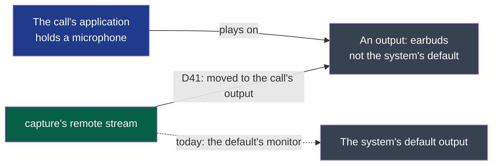

# ADR-0011 — The other side is recorded where the call plays, not only at the default output

> The framework's words: `.nstack/handbook/glossary.md`.

- **Status**: Proposed — the framer's, on the decider's word of 2026-10-26: "oui, cadre D41 et
  continue en autonomie", after #436. Accepting it is the decider's.
- **Date**: 2026-10-26
- **Decision makers**: the decider, `@napkinstack-admin`
- **Scope**: module `capture`, on Linux
- **Reversibility**: easy — without a call found, the remote side records the default output as
  D31 left it

---

**Legend** — blue: the call's application · grey: outputs · green: capture · dotted: what it
records today.

## Context

capture records the other side as the monitor of the system's default output, and follows it
when the default changes (D31). On 2026-10-26 a 705 s call in Discord, on AirPods Pro, lost the
other side: Discord played on the AirPods' Bluetooth output while the default stayed on the
built-in speaker, so the remote track held exact zeros in 41 of its 48 blocks of 15 s, with
nothing said (#436). An application that picks its own output, or a headset profile that takes
the call, is common.

## Problem

Which output does the remote side record, so that it holds what the call plays wherever it plays?

## Constraints

- Linux with PipeWire, as capture is today (`host()`); macOS is D39's and its own tap.
- One stream per side, kept as delivered with the session's clock (ADR-0004): a move is a
  `device` event, never a new track.
- Nothing of the meeting in a log (ADR-0007); nothing sent anywhere (security rule 1).

---

## Prior art

**Dominant convention of the field:** a recorder that wants an application's sound records the
output that application plays to — on PipeWire by targeting that node — and a mixer moves a
stream from one output to another by setting its `target.object` in the default metadata.

**References examined:**

| Reference | What it does | Applicable here? |
|---|---|---|
| WirePlumber's stream linking ([*Linking policy*](https://pipewire.pages.freedesktop.org/wireplumber/policies/linking.html), read 2026-10-26) | "`target.object`: the name of the desired node for this stream to be linked with" — set on the stream, or updated in the `target.object` metadata key, WirePlumber moves the stream there; without it, the default | Yes: how capture's own stream is moved, as `pavucontrol` moves one |
| OBS Studio's PipeWire application capture ([obs-studio, `linux-pipewire`](https://github.com/obsproject/obs-studio/tree/master/plugins/linux-pipewire), not read again here) | Records an application's sound by the nodes it plays | The idea: the call's sound by the application, not by the default |
| macOS Core Audio process taps ([Apple, *Capturing system audio with Core Audio taps*](https://developer.apple.com/documentation/coreaudio/capturing-system-audio-with-core-audio-taps), not read again here) | A tap on a process's output, wherever it plays | The same answer on another system: out of D41 |

---

## Options considered

### Option 1 — Do nothing
- The remote side stays the default's monitor; a call on another output records nothing, as #436.

### Option 2 — Move capture's remote stream to the output the call plays on
- The call is the application holding a microphone, capture excepted, as D30 finds it. When all
  its playing streams go to one output other than the default, capture sets its own remote
  stream's `target.object` to that output; when they go back, or the call ends, it clears it, and
  the stream follows the default again.
- Advantages: one stream, moved by PipeWire as on a default's change (D31): the track goes on in
  its form, the move is a `device` event and a line of `session.json`.
- Cost of getting out: clear the target; D31's behaviour remains.

### Option 3 — Open a second stream on the call's output and mix
- Drawbacks: two clocks in one track, against ADR-0004.

### Option 4 — Close and reopen the remote stream on the call's output
- Drawbacks: a gap at each move, and a stream of another form if the output's differs.

## Decision

**Option 2.** It is how a mixer moves a stream, and it keeps D31's path: what moves the stream
is PipeWire either way.

- The graph is read from `pw-dump`, which capture runs as it runs `pw-metadata`, at most once a
  second while recording; a call is the application other than capture with a stream recording a
  microphone; its outputs are the sinks its playing streams are linked to.
- One output other than the default → the remote stream's `target.object` set to it, through
  `pw-metadata`. Several, none, or the default → no target: the default, as today.
- A target that cannot be set, or a graph that cannot be read, leaves the default and is logged
  once, as a warning.

---

## Success criterion

> We will consider this was the right call if, **by the end of cycle 04, 2026-11-02**, the
> decider's call of #436 — Discord on AirPods, the default left on the speaker — recorded again,
> holds the other side throughout, and the capture's e2e holds it on devices of its own.

What we do if it is not: if a stream cannot be moved by its target, Option 4.

---

## Consequences

**Positive:** the other side is recorded where it is heard; `device` names that output, so the
small window shows it (D33).

**Negative and accepted debt:** a call whose sound plays on two outputs at once records the
default; an application that only plays — a browser tab heard without a microphone taken — is no
call, and is not followed.

**Impacts on other modules or contracts:** none: `recording/v1`'s `device` and `session-audio/v2`'s
changes already say a move.

**Rule to automate:** capture's e2e, a stand-in call on an output of its own that is not the default.

---

## Rejected alternatives

- **Mixing every output's monitor** (option 3): two clocks in one track, and the sound of
  anything else that plays.
- **Asking the user to set the default themselves**: what #436 shows nobody does mid-call.
