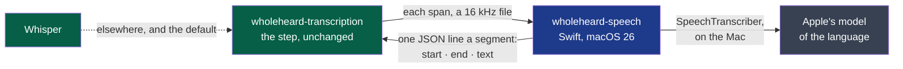

# ADR-0012 — On macOS, Apple's SpeechAnalyzer hears, through a program of its own

> The framework's words: `.nstack/handbook/glossary.md`.

- **Status**: Proposed — the framer's, on the decider's word of 2026-10-26: "j'aimerai qu'on
  traite directement la solution avec speechanalyzer … analyse le marché et la solution et fais
  le dans le cycle". Accepting it is the decider's.
- **Date**: 2026-10-26
- **Decision makers**: the decider, `@napkinstack-admin`
- **Scope**: module `transcription`; the shell and `install` consume it
- **Reversibility**: easy — an engine behind ADR-0003's interface; Whisper stays the default
  where SpeechAnalyzer is not

---

**Legend** — green: what exists · blue: this record's program · grey: Apple's, installed by the
system · dotted: the other engine.

## Context

On a Mac, transcription runs Whisper large-v3-turbo on the processor alone: Vulkan is not there
(#424) and Metal is not built. On the decider's laptop the processor alone took 230 s for what the
graphics card did in about 35 s. macOS 26 brings Apple's own engine, SpeechAnalyzer and its
`SpeechTranscriber`, on the Mac, for French among about ten languages. Cycle 04's colleague is on
macOS 26 (the decider, 2026-10-26): with it, they try the whole chain on their Mac this week.

## Problem

How does Wholeheard hear with SpeechAnalyzer, an API in Swift alone, from a step written in Rust,
without changing the step?

## Constraints

- ADR-0003: one interface (`Engine::hear`, a span of 16 kHz sound → segments with their times);
  a second engine is added without a change to the step.
- ADR-0002: a Rust core of programs, "Rust for the four modules; each builds one program"; the
  shell starts them, finding each beside its own. A second program, in Swift, departs from it:
  see *Deviation*.
- Security rule 1: Apple's model of a language is downloaded by the system from Apple — only on
  the user's word, the host shown first.
- Nothing of the meeting leaves the Mac: SpeechTranscriber runs on it.

---

## Prior art

**Dominant convention of the field:** a Swift program of its own around `SpeechAnalyzer`, which
any other language runs: the API has no C interface.

**References examined:**

| Reference | What it does | Applicable here? |
|---|---|---|
| Yap ([finnvoor/yap](https://github.com/finnvoor/yap), CC0, `TranscriptionEngine.swift` read 2026-10-26) | A command-line program on SpeechAnalyzer: checks `SpeechTranscriber.supportedLocales`, reserves the locale, installs Apple's model through `AssetInventory.assetInstallationRequest` when missing, transcribes a file with `.audioTimeRange` | Yes: the whole flow, and that a program run from a terminal needs no app around it |
| Lyonesse, formerly Inscribe — on-device transcription and meeting notes for iPhone, iPad and Mac ([its benchmark](https://get-inscribe.com/blog/apple-speech-api-benchmark.html), which redirects to lyonesse.app; read by the verifier of #440, 2026-10-26) | Its *Auto* engine prefers SpeechAnalyzer for the languages it supports; since 1.8.9 its fallback is NVIDIA Parakeet, Whisper retired. Its benchmark is English (LibriSpeech) | Yes: the same choice, by language and by system — a meeting-notes app has made it |
| An on-device benchmark of 25 European languages ([founden-bot/on-device-asr-benchmark](https://github.com/founden-bot/on-device-asr-benchmark), macOS 26.6.2, measured 2026-10-19; a repository created 2026-10-26, citing yapapp.cc — young, not independent) | French on FLEURS, 100 recordings: SpeechTranscriber 6.6 % of words wrong, Whisper large-v3-turbo (q5_0, Metal) 6.6 %, unformatted; SpeechTranscriber at 64 times real time | Worth as much as Whisper on read French; a meeting is not read French — our bench and the colleague's call say the rest |
| WhisperNotes ([*Apple Speech vs Whisper*](https://whispernotes.app/blog/apple-speech-vs-whisper), not read again here) | French on FLEURS: Apple 7.61, Whisper Large 5.97 | The sources disagree on French: not a reason to make it the default |

What the market shows (2026-10-26): dictation tools adopted it first — Spokenly, Yap — and one
meeting-notes app, Lyonesse. On one file MacStories timed Yap at 45 s, Whisper Large-v3 at 1 min
41 s and MacWhisper's Large-v2 at 3 min 55 s — one hands-on test, by Yap's own author, as
[Gigazine](https://www.gigazine.net/gsc_news/en/20250619-apple-speech-analyzer) reports it.

---

## Options considered

### Option 1 — Do nothing
- Whisper on the processor: about six times slower than on a graphics card; the colleague's call
  of an hour waits long for its transcript.

### Option 2 — Whisper on Metal
- `whisper-rs`'s Metal feature: the same engine, faster. Still a model of 874 MB to download.
- Left for later: it does not answer what the decider asked, and is no second engine.

### Option 3 — A Swift program of its own, `wholeheard-speech`, behind the interface
- `wholeheard-speech transcribe <file> <language>` prints one JSON line a segment; `status` and
  `install` say and fetch Apple's model of a language. A Rust engine (`speechanalyzer`) writes
  each span to a file, runs it, and reads its lines into segments.
- Advantages: the step does not change (ADR-0003's criterion); no Swift in the Rust programs; the
  program is tried alone from a terminal.
- Cost of getting out: drop the engine and the program; Whisper stays.

### Option 4 — Swift linked into the Rust program (`swift-bridge`, a C interface written by hand)
- Drawbacks: a build that mixes two toolchains in one binary, for a call made once a span.

## Decision

**Option 3.**

- `modules/transcription/speech/`: a Swift package, macOS 26, no dependency. Built by
  transcription's release on a Mac, beside `wholeheard-transcription`; installed in
  `Wholeheard.app/Contents/MacOS` by `install`.
- `wholeheard-transcription <session> --engine speechanalyzer [--language fr]`: the step, as
  ever; the transcript's header names the engine `SpeechAnalyzer` and Apple's model.
- **Offered only where it answers**: macOS 26 or later, SpeechTranscriber available, the
  language supported. Elsewhere, and out of the box, Whisper.
- **Apple's model on the user's word**: Settings say it is fetched by macOS from Apple, and its
  size when the system says it; nothing is fetched before the click.
- **The language is the system's**, French or English (`--language`, as the shell's interface
  follows it): SpeechTranscriber hears one locale, never a guess. Its model is that language's.
- **The context the user attached** is given as SpeechAnalyzer's contextual strings where the
  API takes them; otherwise it is not used, and the log says so once.
- **Found beside** `wholeheard-transcription`, as the shell finds its programs, or where
  `WHOLEHEARD_SPEECH` names it, for the tests.
- **What it prints is the meeting's text, on its output to the engine alone**: its errors go to
  its error stream without a word of the meeting, and the engine logs steps, never text
  (ADR-0007).

### Deviation from the convention

- **From ADR-0002**: a program in Swift in a Rust core. **Expected user value**: a Mac hears with
  its own engine, without a model of 874 MB to download first, the colleague's call transcribed in
  less time than it lasted. **How we will observe it**: D42's last criterion.

---

## Success criterion

> We will consider this was the right call if, **by the end of cycle 04, 2026-11-02**, the
> colleague's real call is transcribed on their Mac by SpeechAnalyzer, in less time than the call
> lasted, and if no line of the step changed to add it.

What we do if it is not: if it does not run on their Mac, Whisper on Metal (option 2).

---

## Consequences

**Positive:** a second engine behind ADR-0003's interface; a Mac hears without a model to download
from Hugging Face.

**Negative and accepted debt:** a second language in the repository (Swift), for one program; its
segments carry no words' own times unless `.audioTimeRange` gives them, which the transcript's
contract does not require.

**Impacts on other modules or contracts:** `install` packs one more program on a Mac; the shell
offers the engine in Settings. `transcript/v1` unchanged: its header already names an engine and
a model.

**Rule to automate:** the macOS workflow builds `wholeheard-speech` and transcribes a sentence
`say` speaks, where the runner's SpeechTranscriber is available — otherwise it says it was not
run. ADR-0003's own rule, the same sheet for every engine on D4's sample, is owed on a Mac: none of
the project's runs one; it is debt, said here.

---

## Rejected alternatives

- **Linking Swift into Rust** (option 4): two toolchains in one binary.
- **SpeechAnalyzer as the default on a Mac now**: the sources disagree on French; the default
  changes once the bench and a real call say so.
