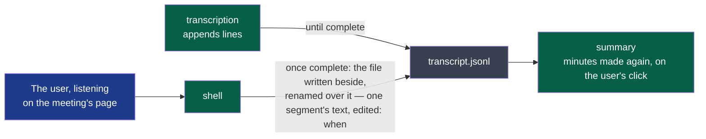

# ADR-0014 — A transcript's line corrected in place, once the transcript is complete

> The framework's words: `.nstack/handbook/glossary.md`.

- **Status**: Proposed — the framer's, on the decider's words of 2026-10-29 (« pouvoir modifier chaque
  ligne de transcript, si un humain écoute et relit il peut corriger ce qui a été mal transcrit ») and
  their choice the same day: « Réécrire la ligne ». Accepting it is the decider's.
- **Date**: 2026-10-29
- **Decision makers**: the decider, `@napkinstack-admin`
- **Scope**: contract `transcript/v1`, provided by `transcription`; module `shell` becomes its second writer — a boundary crossed, said here and on the contract's page —; `summary` reads it unchanged
- **Reversibility**: easy — the field and the sentence removed, corrected files stay valid transcripts

---

**Legend** — green: Wholeheard's programs · blue: the user · grey: the file in the meeting's folder.

## Context

`contracts/transcript/v1` says a transcript « never rewrites or removes a line. A better transcript is
another file, made again from the audio — never this one edited. » Its readers rely on it while it is
written: the window follows a transcript being made, a step run again starts from the last `covered`.
Whisper and the services mishear names, jargon and short words; whoever listens again on the meeting's
page (ADR-0009) has no way to fix a line but an editor and the JSON. The decider asks for it (D62).

## Problem

Where does a correction made by a person live, so that the page, the folder copied and the minutes made
again all read it?

## Constraints

- The meeting's folder is the record: readable with a text editor, copied whole (cycle 01, D1).
- Lines only grow while the transcript is written: its readers follow it.
- The summary (`summarising/v1`) reads the folder's `transcript.jsonl`; a second file would be its change.
- A segment is known by `speaker` and `start` (`transcript/v1`).

---

## Prior art

**Dominant convention of the field:** the meeting-notes and transcription tools let the reader edit
the transcript's text in place, the audio kept beside it *(the framer's reading of Otter, Descript and
Fireflies, no source read again here)*; event-sourced records keep corrections as entries appended.

| Reference | What it does | Applicable here? |
|---|---|---|
| Otter, Descript, Fireflies — the framer's reading of their products, no page cited | The transcript's text edited where it is read; what was heard is not kept beside it | Yes: the gesture, the text replaced |
| Append-only logs, event sourcing | A correction is a new entry; the record is never rewritten | Proposed to the decider, refused: two places to read the text, an editor showing the old one |

---

## Options considered

### Option 1 — The line rewritten in place, once complete (chosen by the decider)
- Description: the shell replaces the file whole — written beside, renamed over it —, one segment's
  `text` changed and `edited` set to when, ISO 8601, every other line as it was, in the same order;
  never while the transcript is made or made again — the shell holds one making at a time, and a
  correction waits for it as *Refaire…* does.
- Advantages: one file, read as before by the summary, a text editor and a copy; nothing for the
  readers but an optional field they may ignore.
- Drawbacks: what the engine heard is lost; the file no longer only grows once complete.
- Cost of getting out: the sentence and the field removed; files already corrected stay valid.

### Option 2 — A `correction` line appended
- Description: `{"type": "correction", "speaker", "start", "text"}` at the end; the last one wins.
- Advantages: lines only ever grow; what was heard kept.
- Drawbacks: every reader applies them — the summary changed —; an editor shows the old text first.

### Option 3 — A file beside, `corrections.jsonl`
- Drawbacks: a new contract, two files kept together, corrections orphaned when the transcript is made again.

### Option 4 — Do nothing
- The user corrects the minutes by hand in their own editor; the transcript stays wrong.

---

## Decision

Option 1, the decider's choice of 2026-10-29: one file, the text where every reader already reads it.
The rule readers rely on is kept where it matters — while the transcript is written: no correction
before its `complete` line, none while it is made again. `edited`, a time, lets the page say « corrigé »
and compare it with the minutes' `made`: corrected since, the minutes are offered again.

**The readers, read on 2026-10-29 by #516's challenge**: the summary reads the file once, whole; the
shell's page reads it at each drawing; the transcription's resume reads it only before `complete`; the
bench (`platform`) reads transcripts of its own folders, never a user's. None relies on lines only
growing once `complete` is there: one pull request of the contracts module, additive — `edited` optional,
its type checked by `nstack compat` before it is said so —, no v2.

---

## Success criterion

> We will consider this was the right call if **a transcript corrected on the meeting's page is read
> by the minutes made again and by a copy of the folder opened in a text editor, with no change to the
> summary** before **2026-12-31**.

What we do if it is not: supersede with option 2.

---

## Consequences

**Positive:** the gesture the decider asked for, at the cost of one sentence and one optional field.

**Negative and accepted debt:** what the engine heard on a corrected line is gone; a transcript made
again does not keep the corrections — said before it starts.

**Impacts on other modules or contracts:** `transcript/v1` — a sentence, a second writer named and an
optional field, its pull request alone and first; `summary` and the bench unchanged.

**Rule to automate:** the shell's tests read a corrected file against `line.schema.json` and compare it
line by line with the one before: one line differs, by `text` and `edited`.

---

## Rejected alternatives

Option 2 and 3 were proposed first by the framer: refused by the decider on 2026-10-29 for one file read
in one way.
