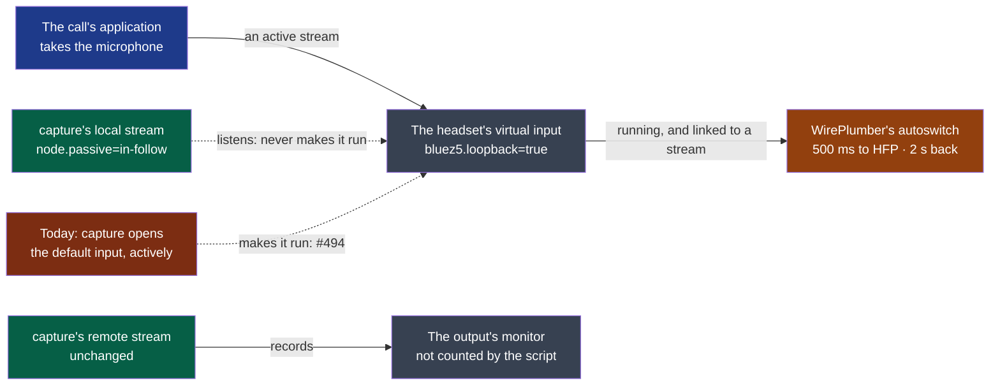

# ADR-0015 — The local side records the microphone the call holds, passively, and never makes a Bluetooth profile switch

> The framework's words: `.nstack/handbook/glossary.md`.

- **Status**: Proposed — the framer's, on the decider's word of 2026-10-30: « corriger de manière
  fiable et stable, durable », after #494. Accepting it is the decider's.
- **Date**: 2026-10-30
- **Decision makers**: the decider, `@napkinstack-admin`
- **Scope**: module `capture`, on Linux
- **Reversibility**: easy — the Linux stream goes behind the one function that opens a source; without
  it, cpal opens the default input as today, and #494 is back

---

**Legend** — blue: the call's application · grey: the devices · orange: the system's policy · green:
capture as decided · red: capture today. Solid: an active link · dotted: what passes without
deciding anything (green), or what this decision removes (red).

## Context

*Facts, read 2026-10-30 on Fedora 44: pipewire 1.6.10, wireplumber 0.5.18, bluez 5.87.*

- **Two defects, one cause: `me` is the default input** (`record_v2`, `host.default_input_device()`),
  not the call's. On 2026-10-27, capture opening the AirPods' virtual input during a call cut the call
  (#494). On 2026-10-30 at 15:03, the laptop's microphone as default and muted: the other side heard
  the decider, the local track stayed silent. `call.rs` already follows the call's *output* from
  `pw-dump` (ADR-0011); nothing follows its microphone.
- **What switches.** `/usr/share/wireplumber/scripts/device/autoswitch-bluetooth-profile.lua` asks for
  HFP when a `bluez5.loopback=true` node is `running` **and** linked to a `Stream/Input/Audio` with
  neither `stream.monitor=true` nor `node.link-group`; otherwise it restores the profile. 500 ms to HFP,
  2 s back (`PROFILE_SWITCH_TIMEOUT_MSEC`, `PROFILE_RESTORE_TIMEOUT_MSEC`). A link to a sink's monitor
  is not counted. The browser switches by taking the microphone, Wholeheard or not.
- **What the failure is.** `Failure in Bluetooth audio transport` means a started node saw its transport
  idle — mostly these switches: 19 of 35 A2DP failures came 0.51–0.65 s after an event, 10 of 25 HFP
  failures 1.2–2 s after one. On 2026-10-27, capture on the AirPods: 8 of 9 openings followed by one; on
  the laptop's microphone: 0 of 10 (the workstation's logs).
- **The trial**, on the decider's AirPods, 2026-10-30 at 15:18, during a WhatsApp Web call on their
  microphone: `pw-record --target bluez_input.<address> -P '{ node.passive=in-follow }'`, 16.6 s, 48 kHz
  stereo 16 bits, `pw-record`'s default, not a track's 24. The call held; no failure logged between its start (15:18:09) and its end (15:18:26);
  the browser's switch at 15:17:59 came before it, the switch back at 15:18:29 after. The decider's voice
  is in the file, the other's is not: as expected, so this stream is the microphone alone, and `others`
  stays the monitor.
- **cpal 0.18.2** (`src/host/pipewire/device.rs`, `pw_properties`) offers no way to set `node.passive`,
  and puts both streams in `node.group=cpal-<pid>`. It is the latest release on crates.io.

*Inferred, not observed:* the mechanism from switch to failure — WirePlumber logs no switch at warning
level.

*Not explained:* two true disconnections and seven failures with no visible trigger. This decision does
not claim them.

## Problem

Which stream records the local side, so that it holds what the call hears from the user and a recording
never changes the call's devices?

## Constraints

- The charter's promise: Wholeheard stays out of the meeting. A recording never changes a device, a
  profile or a route of another application (#494).
- ADR-0004 still holds: a track is as delivered, one form from first frame to last, each frame placed by
  `clock.jsonl`. An instant is when the system handed the frame to the capture.
- ADR-0002: one code on the three systems. What this adds is chosen by what the system offers
  (`host.id().name() == "PipeWire"`, as `follow` does) — and it is still code for one system: see
  *Deviation*.
- ADR-0011: the graph is read at most once a second; a move is a `device` event.
- macOS and Windows: no passive equivalent is documented, and opening the microphone there forces HFP
  *(the framer's assumption, not read here)*. The same product contract, with other adapters: **not in
  this decision, and not in D66**. cpal keeps serving them.

---

## Prior art

**Dominant convention of the field:** a meeting recorder follows the meeting application's microphone
and falls back on the system's default. On the system's side, whoever takes a headset's microphone gets
HFP; a node that must not wake its peer is declared passive.

**References examined** (all read 2026-10-30):

| Reference | What it says or does | Applicable here? |
|---|---|---|
| [Granola, *Transcription issues*](https://docs.granola.ai/help-center/troubleshooting/transcription-issues) | "Auto follows your meeting app's microphone when one is open. Otherwise it uses your system default." A microphone can also be chosen in the transcript window | Yes: the product's behaviour. The choice by hand: *Later* |
| [PipeWire, *running.dox*](https://raw.githubusercontent.com/PipeWire/pipewire/master/doc/dox/internals/running.dox) | `in-follow`: "input ports have `port.passive = follow`"; a `follow` port does not make its peer active, an active peer makes it run | Yes: the mechanism tried |
| [WirePlumber, *Linking policy*](https://pipewire.pages.freedesktop.org/wireplumber/policies/linking.html) | `target.object` on a stream names its node. The page says nothing of `node.passive` | Yes: how the stream is moved, as ADR-0011 |
| [WirePlumber, *NEWS*](https://github.com/PipeWire/wireplumber/blob/master/NEWS.rst) | 0.4.82: auto-switching through a virtual source node; 0.5.7: a timer delays the switch; 0.5.14: the loopback nodes always created; 0.5.18: a pending restore cancelled when a headset profile is applied explicitly | Yes: the script is the system's and it moves, so capture depends on the *conditions*, never on the timers |
| [Voxtype #773](https://github.com/peteonrails/voxtype/issues/773) | A tool opening the same microphone and a playing stream: the switch errors its transports and aborts its recording. A commenter names `pipewire#5476`, fixed after 1.6.9 *(their word; not checked, nor whether 1.6.10 holds it)* and the workaround of turning the autoswitch off | The same family of failure elsewhere. A fix upstream does not remove the switch: the call would still be cut over to HFP by capture |

**Why the convention is not enough**: it is enough for what to record. What it does not settle is *how*
to listen on Linux, and the library this module uses cannot say it. See *Options*.

---

## Options considered

All three record the same stream, the local side's, on Linux only; the question is who opens it.

| | 1 — `pipewire` crate | 2 — a `pw-record` child | 3 — `PIPEWIRE_PROPS` |
|---|---|---|---|
| Sets `node.passive` on the local stream alone | Yes: `Properties` given to `StreamBox::new` / `StreamRc::new` | Yes: `-P`, as tried | **No**: process-wide, the remote stream goes passive too |
| Tried on the decider's AirPods | The same properties, not this code | **Yes** | No |
| Frames' instants (ADR-0004) | In the `process` callback, as cpal's own | After a pipe's buffer: an instant no longer the system's hand-over | Unchanged |
| Sees the stream's state — D66's gaps | `state_changed` | Only what it prints on stderr | cpal's error callback |
| What it adds to the build | **Nothing new to compile or link**: `pipewire` 0.10.1 is in `modules/capture/Cargo.lock` through cpal's `pipewire` feature | Nothing: `pipewire-utils` / `pipewire-bin` is already required for `pw-dump` | Nothing |
| Code | A thread and its main loop, the format's pod, about what `examples/audio-capture.rs` shows — a second way to open a source | A child to start, read, stop and not leave behind on a kill; samples to parse | One line |
| Getting out | Delete the adapter: cpal opens it again; or cpal offers the property | Delete the child | Delete the line |

- **Option 4 — do nothing:** #494 stays, and the muted microphone with it. The workaround, "keep the
  laptop's microphone as default", is what nobody does before a call.
- **State of the crate, read 2026-10-30:** [`pipewire` on crates.io](https://crates.io/crates/pipewire):
  0.10.1 of 2026-08-19, 0.10.0 of 2026-05-17; MIT; 3.1 million downloads, 78 reverse dependencies; its
  repository under [PipeWire's own GitLab](https://gitlab.freedesktop.org/pipewire/pipewire-rs). The API
  above was read in its 0.10.1 sources. **Its catch:** `pipewire-sys` says `links = "pipewire-0.3"`, so
  Cargo allows one version in a build: capture's and cpal's move together.

## Decision

**Recommendation: option 1**, passing the niche filter (`.nstack/handbook/06-decisions.md` §3) on
adoption, maintenance, licence and way out, and already in the build. Option 2 is the dumbest version and
the one tried; what rules it out is the contract: the clock's instant would stop being the system's
hand-over, and a failure would be read from a child's stderr. Option 3 changes `others`, which must stay
active on its monitor: wrong by construction.

1. **What the local side records**, read from `pw-dump` at most once a second, as ADR-0011:

| In the graph | `me` records | Its stream | Said |
|---|---|---|---|
| A call holds a microphone | That microphone; followed if it changes | Passive on a loopback source, else as today | `device`, as D31 |
| No call; the default input is a loopback source | Nothing yet: it waits | Passive | The microphone waits (below) |
| No call; another default input | The default input | As today, active | As today |

2. **A stream never opens a `bluez5.loopback=true` source actively.** `node.passive=in-follow` on the
   local stream alone. `others` is left as it is.
3. **Contracts.** A gap is already what [`session-audio/v2`](../../contracts/session-audio/v2/README.md)
   allows: `clock.jsonl`'s `silence`, `changed` with `device: null`. No schema of it changes.
   [`recording/v1`](../../contracts/recording/v1/README.md)'s `device: null` carries the moment, but the
   shell says of it « Votre ordinateur n'a plus de micro », false here: a sentence of its own takes an
   optional field on that event — additive, in the contract's own pull request first, the shell's sentence
   in its own after.
4. **Nothing else moves:** `others`, its follower (ADR-0011), macOS, Windows.

### Deviation from the convention

- The module's convention is "no code written for one system" (ADR-0002, `modules/capture/AGENTS.md`).
  This is some, as `call.rs` already is, and it declares `pipewire` in the manifest with its exit strategy.
- **Expected user value**: a recording started during a call on a headset no longer cuts that call, and
  the local track holds the voice the call hears.
- **How we will observe it**: the success criterion below.

---

## Success criterion

> We will consider this was the right call if, **before the end of cycle 05, 2026-11-19**, the decider's
> real WhatsApp Web call on AirPods, recorded from start to stop at least five times, is never cut, no
> `Failure in Bluetooth audio transport` is logged within two seconds of capture opening or closing a
> stream (8 of 9 on 2026-10-27), and `local.wav` holds their voice each time; capture's e2e holds D66's
> second criterion on a stand-in source.

What we do if it is not: correct at the first unknown below that fell; a passive stream that cannot be
made to hold means the macOS and Windows question comes to Linux too: read the decision again rather than
force a card's profile.

---

## Unknown — to settle first, before building on them

None was tried; the first three on the decider's device, the rest on virtual ones.

- **A passive stream with no call at all.** The trial ran with a call already holding. That it leaves the
  node asleep and the profile on A2DP is what `running.dox` says, not what was seen.
- **The signal in `in-follow` across a flip** — the stream connected before the call takes the microphone,
  and through 500 ms to HFP and 2 s back: does it deliver, how late, in what form?
- **`others` across a flip**: the stream on the A2DP sink's monitor, and how it reconnects.
- **A stream's clock.** Outside cpal's `node.group`, the two streams may run on different drivers. The
  clock places them, as the contract promises, but how far they drift is measured, not assumed. Whether
  `node.group` itself played a part in #494 was not isolated.
- **A stream's passivity after it is made.** `node.passive` is given at creation. A `me` going from the
  laptop's microphone, active, to a call's loopback source, passive, may have to close and open again
  under the same track, its gap a `silence` — where a move between two sources of a kind stays a
  `target.object`. ADR-0011's option 4 was refused for the remote side on that gap; here it is paid only at
  a change of kind.
- **What capture sees of a transport failure**, against a call letting go. If the two cannot be told apart,
  one sentence says both.

---

## Consequences

**Positive:** #494 and the muted microphone close together; `session.json` names the microphone
actually recorded; a new device needs no case: the rule reads the graph.

**Negative and accepted debt:** a second way to open a source on Linux; a thread of its own, and a
version tied to cpal's. A user who records in A2DP with no call and a headset as default records no
microphone, and is told: an in-person meeting on AirPods is such a case. HFP's quality is the call's, and
the local track inherits it while the call holds it.

**Impacts on other modules or contracts:** `recording/v1` (additive, above); the shell's sentences, in
its own pull request; D55's runbook, whose known failure #494 changes when this lands.

**Rule to automate:** capture's e2e, on a stand-in source carrying `bluez5.loopback=true`: the source is
not `running` from capture's stream alone, and capture's node says `node.passive=in-follow`. No Bluetooth
card there, so WirePlumber's script itself is judged by the decider's trial alone.

---

## Rejected alternatives

- **Writing the user's configuration, or turning the autoswitch off** (Voxtype's workaround): a call could
  then no longer take the headset's microphone; capture has no business in the system's policy.
- **Forcing a card's profile**: it changes the call's devices, what the charter's promise forbids.
- **Setting `stream.monitor=true` to hide from the script**: lying about what the stream is. It would be
  counted out while still making the node run, and rests on one script's internals.
- **Heuristics per headset**: the rule is the graph's, `bluez5.loopback`, whatever the model.
- **A dialog on each new device**: Discord's is criticised *(the decider's reading, no source read)*. A
  discreet indication may come later.
- **A fork or a patch of cpal**: a dependency to carry for one property. A request upstream, for a property
  on a stream, is a way out: on the day it is offered, this adapter goes.
- **Asking the user to choose the right default**: the workaround given on #494, which is the defect.
