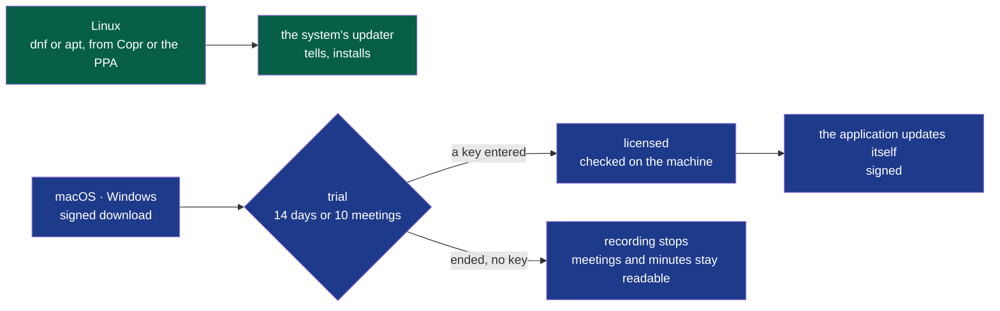

# PDR-0001 — Wholeheard: be in the meeting; open and free on Linux, paid once on macOS and Windows

- **Status**: Accepted — the decider's word, 2026-10-19 ("ok pour tes recommandations",
  "ok pour Wholeheard")
- **Date**: 2026-10-19
- **Decision makers**: the decider, `@napkinstack-admin`
- **Modules affected**: all — the name; `install` (where users get it, how it updates); a
  licence check on macOS and Windows only

> The PDR describes **what the product must do and why**, never its implementation.
> The how belongs to an ADR.

---

## User problem

In a meeting, part of the room types instead of listening, and the meeting still ends without
anyone sure of who does what by when. The ones taking notes are not in the meeting; the ones
who are in it leave with nothing written. The tools that write the notes for them send the
meeting to someone else's cloud, or bring a bot into the call — which rules them out for the
meetings that matter most: HR, legal, a client, a board.

Two more things stop people from trying Summit today: it is installed by building it, and its
name is taken — *Summit AI Notes* is a paid, local, macOS meeting note-taker
(summitnotes.app, 2026).

## Goal

A user stays fully in the meeting and leaves with its decisions and actions written, without
the meeting leaving their machine — and gets the product, and every update, the way their
system offers software.

## Out of scope

- An account, a sign-up, a server of ours that a user's machine must reach to work.
- A subscription: everything runs on the user's machine, there is no service to pay for.
- The Mac App Store and the Microsoft Store, for now (see the options).
- A paid tier of features: every platform runs the same product.
- Telemetry, still (the charter's).

---

## Prior art

| Product / reference | Solution chosen | What we keep from it |
|---|---|---|
| Granola | Closed, cloud transcription and AI; free tier, then $14 per user per month | No bot in the call; the minutes as the product. Not the cloud, not the subscription |
| Meetily | Open source (MIT) Community edition; a commercial Pro at $10 per user per month (speaker identification, templates, exports); 14-day trial; payment through Lemon Squeezy | The trial, the merchant of record. Not the MIT licence — anyone can close a fork —, not the features held back |
| Hyprnote → Char → Anarlog | Open source (MIT), local; the company renamed it, then left the code to its community (2026) | A warning: open source under MIT alone did not carry a business |
| MacWhisper | Closed, macOS; a free tier, Pro about €59 once | The one-time price: local software with no service behind it is sold once |
| Summit AI Notes | Closed, macOS, local; 15 free recordings, then $89.99 a year or $149.99 for life | The price range a local meeting tool sells at — and the reason to change our name |
| Ardour, Krita | GPL; the source free, the ready-made builds sold on some systems | The model: what is sold is the signed build, its updates and support, not the code |

**The convention the user already knows:** on Linux, software comes from the system's
repositories and its updates from the system's updater; on macOS and Windows, a signed
download, a trial, then a licence key.

---

## Options considered

| Option | What the user experiences | Cost | Chosen? |
|---|---|---|---|
| Do nothing: private, closed, built from the repository | Nobody outside the three users can try it; a name taken | 0 | |
| Closed everywhere, sold everywhere | Must trust a closed tool with every meeting; no free distribution channel on Linux (Copr and Launchpad's PPAs are for free software) | Own repositories to host and sign | |
| Open under MIT, sell features (Meetily) | A free edition missing what they want; anyone may sell a closed copy | A second edition to build | |
| **Open under GPL-3.0; free on Linux; signed builds sold once on macOS and Windows, after a trial** | Linux: installed and updated by the system. macOS, Windows: a download, a trial, a key — no account, nothing sent | Signing on two systems; a licence check; a contributor agreement | ✓ |
| The same, through the Mac App Store | Apple's payment; 15–30 % to Apple; a sandbox that hampers recording the system's sound | Store review at each version | Later, perhaps |

## Decision

1. **The name is Wholeheard.** *"Be in the meeting. The minutes write themselves — and never
   leave your machine."* — in French: *« Soyez pleinement à la réunion. Le compte rendu s'écrit
   tout seul, et ne quitte jamais votre machine. »* The minutes lead with the decisions and the
   actions — who, what, by when.
2. **The source is open under GPL-3.0**; an outside contribution is taken under a contributor
   licence agreement, so that the project may also sell what it builds.
3. **Linux is free**: Fedora through Copr, Ubuntu through a PPA, Debian as soon as a channel
   carries it; updates come through the system's updater, which tells the user.
4. **macOS and Windows are sold once** — between €49 and €69, minor versions included —
   after a trial in the application (14 days or 10 meetings, whichever comes last), with a
   licence key checked on the machine: no account, nothing sent. A merchant of record takes
   the payment and the VAT. The builds are signed (Apple notarisation, a Windows code-signing
   certificate) and update themselves.
5. **Whoever builds it from source has it free on every system** — owned: what is sold is the
   ready-made build, its updates and support.

---

## Expected behaviour

**Legend** — green: free, on Linux · blue: sold, on macOS and Windows.

**Edge cases and degraded states:** a trial ended never locks the meetings already made: they
stay readable and exportable. A key that cannot be checked on the machine says why, in one
sentence. No network is needed, ever, to use a valid key.

**Acceptance criteria:**

- [ ] Given a Fedora or an Ubuntu that never saw it, when the user adds its repository and
      installs Wholeheard, then a later version is offered by the system's updater
- [ ] Given macOS or Windows, when the trial ends without a key, then no new meeting is
      recorded, and every meeting already made is still read and exported
- [ ] Given a valid key and no network, when the application starts, then it is licensed
- [ ] Given the Linux build, then it holds no licence check

---

## Success criterion

> We will consider this was the right call if **ten people outside the project use Wholeheard
> on Linux through its repositories, and the first licence is sold on macOS**, before
> **2027-06-30**.

How it is observed: the repositories' download counts, the merchant's sales, the testers'
word.

If the criterion is not met: the price and the trial are adjusted first; the model is
reconsidered before the licence is.

---

## Removal condition

> The paid builds are dropped if **after a year on sale, the licences do not pay for signing on
> both systems** — the builds then become free, as on Linux.

---

## Impacts

- **Existing users**: the three users keep their meetings and settings through the rename —
  folders and files are carried over, never lost.
- **Modules and contracts**: every module renamed; contracts keep their versions. The capture
  becomes `critical` **before the repository is opened**, as the decider set on 2026-10-12.
- **The charter**: its out-of-scope line "anything that sells the product: licence, payment,
  shop" is lifted by this record; its open question on signing for macOS and Windows is
  answered — yes, paid by the licences.
- **Before the repository is opened**: its whole history read for secrets and anything of a
  real meeting; the licence and the contributor agreement added; the trademark searched
  (INPI, EUIPO, USPTO) and the domains taken.
- **Support and documentation**: the README and the site say the promise, the price, and how
  to build it free.
- **Data**: unchanged — nothing leaves the machine; the licence check sends nothing.
