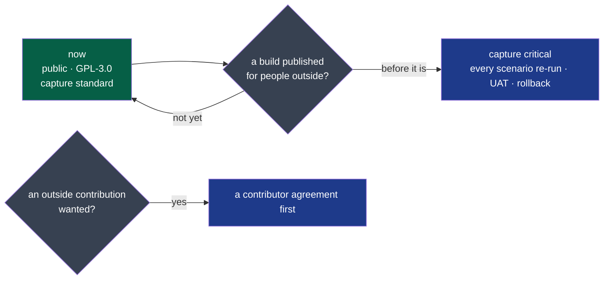

# PDR-0002 — The repository opened now, without slowing the work that finishes the project

- **Status**: Accepted — the decider's word, 2026-10-25 ("oui c'est ok, vas-y avec ta
  recommandation"; "le but n'est pas d'overingé ni d'alourdir les process de dev, il faut
  qu'on termine le projet")
- **Date**: 2026-10-25
- **Decision makers**: the decider, `@napkinstack-admin`
- **Modules affected**: none in their code; `capture`'s criticality, by when it changes;
  the repository's licence, contributions and merges
- **Amends**: [PDR-0001](./0001-wholeheard-open-on-linux-paid-on-macos-and-windows.md), its
  *Impacts* (the capture `critical` before the opening; a contributor agreement with the
  licence); the charter's constraint and risk on the opening; the project's rule 2
  (`docs/project/rules/always.md`)

> The PDR describes **what the product must do and why**, never its implementation.

---

## User problem

The two colleagues on Windows and macOS cannot get a build. The decider's Fedora cannot make
one, and on a private repository macOS minutes are counted ten to one against a monthly
quota ([GitHub Actions billing](https://docs.github.com/en/billing/managing-billing-for-your-products/managing-billing-for-github-actions/about-billing-for-github-actions), not read again here). Opening the repository is also how the project is meant to make the decider's company
known (charter).

Opening it, as the charter and PDR-0001 set it, comes with three costs before anyone outside
uses it:
- every change to `capture` passes the `critical` level;
- a contributor agreement has to be signed;
- a human approval is needed on every pull request.

They would slow the work that finishes the project, for users who do not exist yet.

## Goal

The repository is public, under GPL-3.0, and its work goes on at today's pace. The heavier
level arrives on the day the first build reaches people outside the project.

## Out of scope

- Publishing a build to Copr or a PPA: that is the event this record waits for, not part of
  it.
- Accepting a contribution from outside the project.
- The trademark search and the domains (PDR-0001's *Impacts*, a condition of the opening
  there): not decided here. It is put to the decider before the visibility changes, as is
  leaving the session links of five commits (*Impacts*).

---

## Prior art

| Product / reference | Solution chosen | What we keep from it |
|---|---|---|
| Ardour, Krita (GPL; PDR-0001's prior art) | Source public; ready-made builds sold | The source public from now on, while the builds are what is sold |
| Projects that open their history before taking contributions (e.g. SQLite, ["open-source, not open-contribution"](https://www.sqlite.org/copyright.html), not read again here) | Code public; outside patches not merged | No contributor agreement until a contribution is wanted |
| GitHub's guidance on self-hosted runners ([about self-hosted runners](https://docs.github.com/en/actions/hosting-your-own-runners/managing-self-hosted-runners/about-self-hosted-runners), not read again here) and this framework's (`.nstack/handbook/INSTALL.md`, *Where the CI runs*) | Never a self-hosted runner on a public repository | The runner goes before the repository opens |

**The convention:** a project opens its code first and its process later, once there is
someone outside to protect.

---

## Options considered

| Option | What the users experience | Cost | Chosen? |
|---|---|---|---|
| Stay private until the project is finished | Nothing changes; the colleagues wait for builds | macOS minutes counted against the quota | |
| Open as the charter and PDR-0001 set it | Same product, delivered more slowly | `critical` on capture, a contributor agreement, an approval on each merge | |
| **Open now, the pace kept; the heavier level at the first public build** | Builds for the colleagues from hosted runners, free; the same pace until strangers install it | The licence file and one line in CONTRIBUTING | ✓ |

## Decision

1. **The repository is opened now**, under **GPL-3.0** (`LICENSE`). PDR-0001's model is
   unchanged: Linux free, signed builds sold once on macOS and Windows.
2. **`capture` becomes `critical` before the first build is published for people outside the
   project**: Copr, a PPA, or a download. That moves the condition from "before the
   repository is opened". The charter's own line already ended the deviation on "the day
   strangers install Wholeheard". A public repository has readers; only a published build
   has users whose recordings it keeps.
3. **No contributor agreement for now.** No contribution from outside the project is merged
   (`CONTRIBUTING.md`). The code stays the project's alone, so it can still be sold under
   other terms. The agreement comes with the first outside contribution the project wants.
4. **No human approval is required on a pull request.** Rule 2 of `docs/project/rules/always.md`
   holds after the opening: the agent merges on a passed record of its head, a compliant
   `pr-check` and an independent verifier, and never approves. `nstack doctor` will report
   G2 and G3 (no approving review, no code owner review) as gaps: they are taken knowingly.
   The rulesets that refuse without slowing the work are the decider's to set (*Impacts*): no
   direct push to `main`, required checks, no force push, `main` not deletable, holds
   protected; no approving review, no code owner review.
5. **No self-hosted runner** once the repository is public. Hosted runners are free
   there, macOS included ([GitHub Actions billing](https://docs.github.com/en/billing/managing-billing-for-your-products/managing-billing-for-github-actions/about-billing-for-github-actions), not read again here).

---

## Expected behaviour

**Legend** — green: from today · grey: the event that changes it · blue: what that event
brings.

**Acceptance criteria:**

- [ ] Given the repository public, then `LICENSE` holds the GPL-3.0 and `CONTRIBUTING.md` says
      no outside contribution is merged for now
- [ ] Given the repository public, then no workflow runs on a self-hosted runner
- [ ] Given a first build to publish for people outside the project, when its pull request is
      opened, then `capture`'s manifest already says `critical`

---

## Success criterion

> The author's criterion, proposed with this record. We will consider this was the right call if **by 2026-12-31 a macOS build is made by the
> hosted runners and the project still merges at today's pace**. The pace is read in the
> cycle's own log: no deliverable held back by the process.

If it is not met: the cause is named first, whether the runners, the process or the openness,
before the opening is reconsidered.

---

## Removal condition

> Decisions 3 and 4 are put back to the decider **when the project wants its first
> contribution from outside it**. Nothing else ends them.

---

## Impacts

- **The charter**: its constraint "opening it has a price already set" and its risk table's
  "`critical` before the repository is opened" now read "before the first build published
  for people outside the project". Its open question "what proven in use means" is answered:
  the opening no longer waits for it.
- **PDR-0001**: its *Impacts* on the opening (the capture `critical`, the licence and the
  contributor agreement before it) are amended by decisions 2 and 3; its decision 2 holds.
- **Rule 2** of `docs/project/rules/always.md`: kept after the opening, until this record's
  removal condition.
- **What becomes public**: the whole history, the issues, the test sheets and the notes of
  `nstack attest`. Its audit of 2026-10-25 found no secret (gitleaks, 1128 commits with every
  pull request's head and the notes), no audio, and nothing of a real meeting. It did find
  the workstation's local paths in the attest records, reported to the framework
  (NapkinStack/engineering-os#277), and session links in five commits of 2026-10-12.
  Removing them would rewrite `main`; whether they are left is the decider's, asked before
  the visibility changes.
- **The decider's settings** (not a file here): the `NSTACK_RUNS_ON` variable removed, the
  visibility, the rulesets of decision 4, private vulnerability reporting turned on
  (`SECURITY.md`), and workflow approval for every outside contributor.
