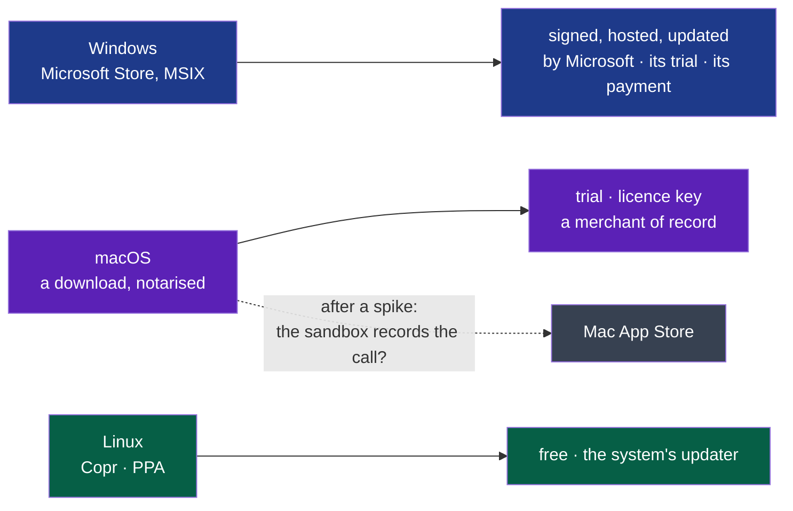

# PDR-0004 — Windows through the Microsoft Store; macOS a notarised download, its store later

- **Status**: Accepted — the choice delegated by the decider, 2026-10-27: « comme d'hab tu es
  expert dans chacun des domaine donc tu analayse le marché, tendance, faiblaisse, force et tu
  tranches […] il nous faut la version complete pour commencer la publication sur les store ».
  Written and settled by the framer that day, on the sources below; the decider may reverse it.
- **Date**: 2026-10-27
- **Decision makers**: the decider, `@napkinstack-admin`
- **Modules affected**: `install` (the package each store takes); none other by this record.
- **Amends**: [PDR-0001](./0001-wholeheard-open-on-linux-paid-on-macos-and-windows.md) — its
  *Out of scope* "The Mac App Store and the Microsoft Store, for now", its decision 4 for
  Windows, and its success criterion's "the first licence is sold on macOS".

> The PDR describes **what the product must do and why**, never its implementation.

---

**Legend** — blue: Windows, through its store · violet: macOS, sold as PDR-0001 decided · grey,
dotted: later, on a spike's answer · green: Linux, unchanged.

## User problem

The decider wants the complete version published "sur les stores" (2026-10-27). PDR-0001 kept
both stores out "for now" and chose, for macOS and Windows alike, a signed download, a trial
written in the application and a licence key sold by a merchant of record. On Windows that means
a code-signing certificate bought each year, a merchant's account, the trial and the key written
and kept by the project, an updater of its own — all before the first sale. A Windows user, for
their part, meets a warning on an unsigned download (the charter's open question, answered by
PDR-0001), and installs and updates software more and more from the Store.

## Goal

A Windows user finds Wholeheard in the Microsoft Store, tries it, buys it there, and has every
update without doing anything — with nothing the project must buy before the first sale. A Mac
user gets it as PDR-0001 decided. A Linux user, as ever.

## Out of scope

- The Mac App Store, until a spike says a sandboxed build records the other side of a call
  (*Options*). It is not refused: it waits on that answer.
- Flathub: it does not sell applications yet (below); Linux stays free through Copr and a PPA.
- A subscription, an account, a server of ours: PDR-0001's exclusions hold.
- Building any of it: this record decides the channels. The deliverables that build them are
  framed with their criteria.

---

## Prior art

| Reference | What it says | Read |
|---|---|---|
| Microsoft, [*Get started with the Microsoft Store*](https://learn.microsoft.com/en-us/windows/apps/publish/get-started) (updated 2026-08-24) | MSIX packages "signed by Microsoft", hosted and updated by it; a free trial set in Partner Center; for non-game apps, "use their own commerce platform and keep 100% of the revenue", or Microsoft's "and pay a competitive fee of […] 15% for apps"; "the new onboarding flow does not charge a registration fee"; an MSI or EXE must be signed by the publisher | 2026-10-27 |
| Microsoft, [*Code signing options*](https://learn.microsoft.com/en-us/windows/apps/package-and-deploy/code-signing-options) | An MSIX distributed outside the Store must be signed by the publisher | 2026-10-27, by a search's summary |
| Flathub, [*When are paid applications supported?*](https://discourse.flathub.org/t/when-are-paid-applications-supported/7757) | Payments planned since 2024; no launch found | 2026-10-27, by a search's summary |
| DGR Labs, [*Capturing system audio on macOS in 2026*](https://dgrlabs.co/blog/2026-04-25-capturing-system-audio-on-macos-in-2026.html), and developers' repositories | Core Audio taps (macOS 14.2+) ask an audio-only consent; whether a sandboxed App Store build may use them is reported as "should", "spike to confirm" — no review outcome found | 2026-10-27, by a search's summary |
| MacWhisper, Granola, Meetily (PDR-0001) | Local meeting tools on macOS are sold as downloads, not through the Mac App Store | PDR-0001, 2026-10-19 |

**The convention the user already knows:** on Windows, the Store, more and more, for software
that updates itself; on macOS, for a tool that records the system's sound, a notarised download.

---

## Options considered

| Option | What the user experiences | Cost before the first sale | Chosen? |
|---|---|---|---|
| Do nothing: PDR-0001 as written | A download, a trial and a key on both systems | A Windows certificate each year, a merchant, a trial, a key and an updater written and kept | |
| **Windows through the Microsoft Store; macOS as PDR-0001** | Windows: found, tried, bought and updated in the Store. macOS: a notarised download, a trial, a key | Windows: nothing bought; an MSIX built. macOS: Apple's developer programme, a merchant | ✓ |
| Both through their stores | The same on macOS, through the Mac App Store | A sandboxed build whose recording of the call nobody has confirmed | After the spike |
| Windows through the Store with the project's own key | The Store's install and updates; the project's trial and key | 0 % to Microsoft, but the trial and the key written for Windows too | Not now: 15 % is cheaper than writing and keeping them before a sale |

## Decision

1. **Windows is sold through the Microsoft Store**, as an MSIX package that Microsoft signs,
   hosts and updates, with the Store's trial and Microsoft's commerce. The Store's trial is
   time-limited — 1, 7, 15 or 30 days — or unlimited, and limiting it by meetings needs code
   ([*Set app pricing and availability*](https://learn.microsoft.com/en-us/windows/apps/publish/publish-your-app/msix/price-and-availability),
   read by the verifier, 2026-10-27): on Windows, PDR-0001's "14 days or 10 meetings" becomes
   **15 days**, the nearest the Store offers, and Wholeheard reads the Store's licence to stop
   recording once it ends — the one piece of the trial written for Windows. The price stays in
   PDR-0001's range; its exact figure and the developer account are the decider's.
2. **macOS stays as PDR-0001 decided**: a download notarised by Apple, a trial and a licence key,
   a merchant of record. The Mac App Store follows if a spike shows a sandboxed build records
   both sides of a call.
3. **Linux is unchanged**: free, Copr and a PPA.
4. **The order**: Windows first — it needs nothing bought — then macOS, once Apple's developer
   programme is joined. The Windows build itself does not exist yet; it is the first step
   (cycle 04, D53).

---

## Expected behaviour

**Acceptance criteria** — for the deliverables that build it:

- [ ] Given the Microsoft Store, when a Windows user installs Wholeheard and records a meeting
      in the trial, then it records and transcribes as on Linux, with no warning from Windows
- [ ] Given the trial over and no purchase, when the user opens Wholeheard, then no new meeting
      is recorded, and every meeting already made is still read and exported (PDR-0001)
- [ ] Given a new version accepted by the Store, when it is published, then the user's
      Wholeheard updates with no gesture of theirs, their meetings and settings kept

---

## Success criterion

> We will consider this was the right call if, **by 2027-06-30**, Wholeheard is in the Microsoft
> Store and its first copy is sold there, with no certificate bought for Windows.

How it is observed: Partner Center's acquisitions report.

If it is not met: a signed download with the project's own key, as PDR-0001 decided — signed by
a yearly certificate or by Microsoft's Artifact Signing (formerly Trusted Signing), a monthly
subscription whose price and eligibility are not checked here *(uncertainty)*.

---

## Removal condition

> Withdrawn if the Store refuses the package for what Wholeheard does — recording the
> microphone and the system's sound — or takes more than PDR-0001's price can bear.

---

## Impacts

- **PDR-0001**: its *Out of scope* line on the stores, its decision 4 for Windows and its
  success criterion ("the first licence is sold on macOS or in the Microsoft Store") read through
  this record; PDR-0001 is not rewritten.
- **install**: an MSIX package beside the zip, the deb and the rpm — a deliverable of its own.
- **The decider**: a Partner Center developer account — a company's, since Wholeheard is
  NapkinStack's (Microsoft's page: an individual account is for apps "not in relation to their
  business"); whether a company account is charged is not confirmed *(uncertainty)*. Apple's
  developer programme for macOS.
- **ADR-0010**: its signed list comes before the first build published for people outside the
  project — a Store build is one.
- **Risks the Store package must answer**, each a criterion of the deliverable that builds it:
  - a packaged app's writes to its application data are redirected per package and removed on
    uninstall ([Advanced Installer, *MSIX file redirection*](https://www.advancedinstaller.com/msix-files-redirection.html),
    not read again here): the meetings must live where uninstalling leaves them, as D27 asks of
    the deb;
  - `runFullTrust` and the microphone are capabilities justified at certification;
  - GPL-3.0 beside the Store's standard licence terms: Partner Center takes the publisher's own
    terms — to be read before the first submission *(uncertainty)*;
  - `capture` becomes `critical` before the first build published outside the project
    (PDR-0002, decision 2): a Store build is one.
- **D53's unsigned zip** meets SmartScreen's warning, and may be refused outright by Smart App
  Control where it is on (reported by the press, not read in Microsoft's documentation): a
  precondition of the colleague's trial.
- **Data**: unchanged — Microsoft's commerce knows the buyer, as a merchant would; Wholeheard
  sends nothing.
