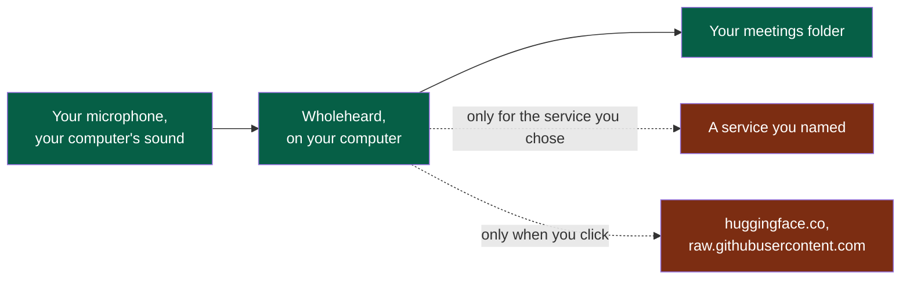

# Wholeheard — privacy policy / politique de confidentialité

Last changed / dernière modification: 2026-10-30. Publisher / éditeur: NapkinStack.
[English](#english) · [Français](#français)

**Legend** — green: your computer · red: outside it, reached only on your choice.

## English

**In one sentence.** Wholeheard keeps your meetings on your computer; it has no account and no
server of ours, and it sends nothing anywhere unless you chose to.

### What it records and where it keeps it

| What | Where |
|---|---|
| The sound of a meeting: your microphone and what your computer plays, as two tracks | Your meetings folder: `Documents/Wholeheard` unless you choose another |
| Its transcript, its minutes, the context you wrote for it, its language, your corrections | The same folder, beside the sound |
| Your settings, and the key of a service if you gave one | Your user's configuration folder |
| Downloaded speech models | Your user's data folder |
| Logs: steps, durations, hosts, models and failures — never a word of a meeting, nor a key | Your user's state folder (on Windows, the application's data) |

Nothing is recorded until you start a recording. Telling the other participants that you are
recording is yours to do: Wholeheard shows them nothing. It reminds you, and you may turn the
reminder off.

### What leaves your computer, and to which host

By default, nothing of a meeting. Wholeheard hears and writes on your computer. Something leaves
only when you do one of these:

| Your choice | What is sent | To |
|---|---|---|
| A service to transcribe | The meeting's sound, and its context and language | The service you chose: `openrouter.ai`, `api.openai.com` |
| A service to write the minutes | The transcript and the context | The service you chose: `openrouter.ai`, `api.openai.com`, `api.mistral.ai`, or the address you typed |
| Download a speech model (a click) | A request for that file | `huggingface.co` |
| Read the list of models again (a click) | A request for that file | `raw.githubusercontent.com` |
| Download a model through Ollama (a click) | Ollama's own request | Ollama, a program of its own, from its registry |

The host is shown to you and agreed by you before a first sending. What a service does with what
it receives is under its own policy: read it before you choose it.

A meeting you say **confidential** is made on this computer alone, even when a service is chosen.

There is no telemetry, no analytics, no advertising, and we receive no data about you. Should
telemetry ever exist, it will be off until you turn it on, and will show what it sends and where.

### How to remove it all

- A meeting, or its sound alone: from its page, to your system's trash. You can have the sound
  go to the trash by itself after a number of days, in Settings.
- Everything: uninstall Wholeheard, then delete your meetings folder and Wholeheard's folders:
  - Linux: `~/.config/wholeheard`, `~/.local/share/wholeheard`, `~/.local/state/wholeheard`;
  - Windows, from the Store's package: removing it removes settings, models and logs; your
    meetings stay in `Documents\Wholeheard` until you delete them;
  - macOS: `~/Library/Application Support/wholeheard` and `~/Library/Logs/Wholeheard`.
- Keys are also revoked at the service that issued them.

### Contact

Questions: [an issue on this repository](https://github.com/NapkinStack/wholeheard/issues).
Changes to this policy are in this file's history.

## Français

**En une phrase.** Wholeheard garde vos réunions sur votre ordinateur ; il n'a ni compte ni serveur
à nous, et il n'envoie rien nulle part sauf si vous l'avez choisi.

### Ce qu'il enregistre et où il le garde

| Quoi | Où |
|---|---|
| Le son d'une réunion : votre micro et ce que votre ordinateur joue, en deux pistes | Votre dossier de réunions : `Documents/Wholeheard`, sauf si vous en choisissez un autre |
| Sa transcription, son compte rendu, le contexte que vous avez écrit, sa langue, vos corrections | Le même dossier, à côté du son |
| Vos réglages, et la clé d'un service si vous en avez donné une | Le dossier de configuration de votre utilisateur |
| Les modèles de parole téléchargés | Le dossier de données de votre utilisateur |
| Les journaux : étapes, durées, hôtes, modèles et échecs — jamais un mot d'une réunion, ni une clé | Le dossier d'état de votre utilisateur (sous Windows, les données de l'application) |

Rien n'est enregistré tant que vous ne lancez pas un enregistrement. Prévenir les autres
participants que vous enregistrez vous revient : Wholeheard ne leur montre rien. Il vous le
rappelle, et vous pouvez couper ce rappel.

### Ce qui quitte votre ordinateur, et vers quel hôte

Par défaut, rien d'une réunion. Wholeheard écoute et écrit sur votre ordinateur. Quelque chose ne
part que si vous faites l'un de ces choix :

| Votre choix | Ce qui est envoyé | Vers |
|---|---|---|
| Un service pour transcrire | Le son de la réunion, son contexte et sa langue | Le service choisi : `openrouter.ai`, `api.openai.com` |
| Un service pour écrire le compte rendu | La transcription et le contexte | Le service choisi : `openrouter.ai`, `api.openai.com`, `api.mistral.ai`, ou l'adresse saisie |
| Télécharger un modèle de parole (un clic) | La demande de ce fichier | `huggingface.co` |
| Relire la liste des modèles (un clic) | La demande de ce fichier | `raw.githubusercontent.com` |
| Télécharger un modèle par Ollama (un clic) | La demande d'Ollama elle-même | Ollama, un programme à part, depuis son registre |

L'hôte vous est montré et vous l'acceptez avant un premier envoi. Ce qu'un service fait de ce qu'il
reçoit relève de sa propre politique : lisez-la avant de le choisir.

Une réunion dite **confidentielle** est traitée sur cet ordinateur seulement, même si un service est
choisi.

Il n'y a ni télémétrie, ni mesure d'audience, ni publicité, et nous ne recevons aucune donnée sur
vous. Si une télémétrie existait un jour, elle resterait coupée tant que vous ne l'activez pas, et
montrerait ce qu'elle envoie et où.

### Comment tout supprimer

- Une réunion, ou son son seul : depuis sa page, vers la corbeille de votre système. Dans les
  Réglages, le son peut partir à la corbeille de lui-même après un nombre de jours.
- Tout : désinstallez Wholeheard, puis supprimez votre dossier de réunions et les dossiers de
  Wholeheard :
  - Linux : `~/.config/wholeheard`, `~/.local/share/wholeheard`, `~/.local/state/wholeheard` ;
  - Windows, depuis le paquet du Store : le retirer retire réglages, modèles et journaux ; vos
    réunions restent dans `Documents\Wholeheard` jusqu'à ce que vous les supprimiez ;
  - macOS : `~/Library/Application Support/wholeheard` et `~/Library/Logs/Wholeheard`.
- Les clés se révoquent aussi auprès du service qui les a émises.

### Contact

Questions : [une issue sur ce dépôt](https://github.com/NapkinStack/wholeheard/issues). Les
changements de cette politique sont dans l'historique de ce fichier.
