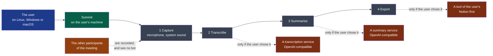

# Charter — Summit

> Written at the first framing (`.nstack/playbooks/framing.md`), from the discovery decided **go** on
> 2026-10-12 (`discovery.md`); changed only through a PDR. Every agent session reads it.
> *(framer, to confirm)* marks what the framer proposes and the decider has not confirmed.

## Users and their problem

**Legend** — blue: who uses Summit · green: the product · grey: its four steps, each usable
alone · red: what is outside the machine, reached only by the user's choice · orange: people
who do not use Summit and are affected by it.

**Who.** Today, three people: the decider, on Fedora, and two colleagues, one on Windows and
one on macOS, each on the latest version of their system. The idea names wider profiles — the
privacy-minded professional, the pragmatist, the tinkerer: they are **assumptions**, nobody
of them was met (`discovery.md`, stage 3).

**Their problem.** They take meeting notes with bots that join their meetings: an intruder
the other participants see, their words held by a third party, a subscription, a model
nobody chose. The local alternatives are limited to one platform or one brick, and the
nearest one did not install on the decider's Fedora — one attempt, on one product that was
not named.

## Success criteria

The three criteria of the front matter are the discovery's success signals, **re-dated**: the
challenger showed that a fixed date two weeks after a product that does not exist cannot tell
"not wanted" from "not finished". Each window now starts the day the product is in the
user's hands. They are observed by asking the three people, and by the sessions Summit keeps.

A second purpose is not a criterion: the project is meant to make the decider's company
known, once the repository is opened. Nothing measures it yet.

## Constraints

- **One builder, with agents; no budget.** The decider builds and tests on Fedora only.
  Windows and macOS are verified by the two colleagues, on their machines and their time.
- **The three systems, latest versions.**
- **Private repository first**; opened once the software is proven in use. What "proven"
  means is an open question. **Opening it has a price already set**: the module that captures
  and keeps recordings becomes `critical` first (risks).
- **Recording law: France now, anywhere later.** The defaults must hold where the rule is
  strictest. In France the Penal Code, art. 226-1, presumes consent only when the recording
  is made in the sight and knowledge of the people recorded — the other participants, not the
  user (read at Légifrance by the challenger, 2026-10-12).
- **Summit tells the other participants nothing; the user announces the recording.** Decided
  by the decider on 2026-10-12: "rien, c'est l'utilisateur qui annonce". The lawfulness of a
  recording therefore rests on its user, each time. What Summit owes them in return *(framer,
  to confirm)*: it says so plainly before the first recording, and its reminder at each start
  is the only trace that the user was told — whether that reminder may be switched off, as
  the idea file allows (C7), was not decided.
- **Everything in English** in this repository (`rules/always.md`, rule 1).
- **Distribution costs money the project does not have**: signing for macOS needs a paid
  developer programme, and an unsigned build meets a warning on Windows (`discovery.md`,
  stage 5). **Not paid for now**: the decider decides after the probe on the three machines
  (2026-10-12), which records whether each colleague opened an unsigned build without help.

## Risks

| Risk | What it would cost | What follows |
|---|---|---|
| A recording is made that a participant did not know about | A criminal offence for the user, in France; the end of the product's reason to exist | Accepted by the decider as the user's responsibility (constraints). By the handbook's own rule — a module that "touches someone's personal data is `critical`" (`.nstack/handbook/05-workflow.md` §7) — the capture module would be **critical**. **The decider declares it `standard` for now, and `critical` before the repository is opened** (2026-10-12): three users who agreed, a private repository, one builder. A deviation from the handbook's rule, taken knowingly; the day strangers install Summit it ends |
| A recording or a transcript leaves the machine without the user choosing it | The one promise the product keeps against a bot, broken | `.nstack/playbooks/security.md` applies from the first cycle; a rule of the project is proposed (`rules/security.md`) |
| A recording is lost: a crash, a full disk | A meeting that cannot be held again | Part of the capture module's criticality |
| The nearest product works after all | Nothing to build; perhaps a contribution | **Not tested, by the decider's choice** (2026-10-12): "on ne le fait pas, on a déjà acté le dev Summit". The spike the discovery carried is dropped, and the objection it answered stays open: nobody ran the nearest product's Linux build |
| Three systems, tested on one | Two of three users never get a working build | The first deliverable of the first cycle: a two-day probe on the three machines, before any feature |
| An all-local result in French is not worth keeping | "Everything stays on the machine" stops being a reason to use it | The second deliverable of the first cycle: half a day, by hand |
| The scope of the idea does not fit the time the decider wants to spend | A cycle that ends on nothing usable | The appetite is asked, and the scope is cut to it — never the reverse |

## Vocabulary

| Term | Meaning |
|---|---|
| **Session** | One recorded or imported conversation and everything made from it: audio, transcript, minutes |
| **Step** | One of the four stages — capture, transcription, summary, export — each usable alone |
| **Provider** | What runs a step: an engine on the machine, or an OpenAI-compatible service at an address the user gives |
| **Profile** | A ready-made choice of providers for the four steps |
| **Minutes** | The structured result of the summary step: highlights, actions, key points |
| **Context** | A text or a file the user attaches to a step that uses AI — a vocabulary, an agenda, their notes |
| **Me / Others** | The two sources of a capture: the microphone, and the system's sound |

## Out of scope

The decider's, from the idea file and the discovery:

- A bot that joins a meeting; an account, a sign-up.
- Cloud synchronisation, team collaboration.
- A provider imposed, a key supplied by Summit.
- A mobile application.
- "Ask your notes a question" across meetings.
- Sales analysis of calls, CRM integration.
- Anything that sells the product: licence, payment, shop.

The framer's, accepted with the discovery:

- A recording that starts by itself before the user chose it.
- A notes editor: Summit produces the minutes and hands them over.
- Telemetry, even opt-in, while the repository is private.

## Open questions

**Blocking:** none left.

**Not blocking:**

- Does the project pay for signing on macOS and Windows? Decided after the first cycle's
  probe (D1), on what it records.
- May the reminder to announce the recording be switched off? The idea file says yes (C7);
  since the announcement is now the only thing that makes a recording lawful, the framer
  would say no.
- Which product was tried on Fedora, and with which error — it shapes the first spike.
- What "proven in use" means for opening the repository.
- Whether the context given to a step is in the first version.
- Which bots the three people use today, and what they cost.
