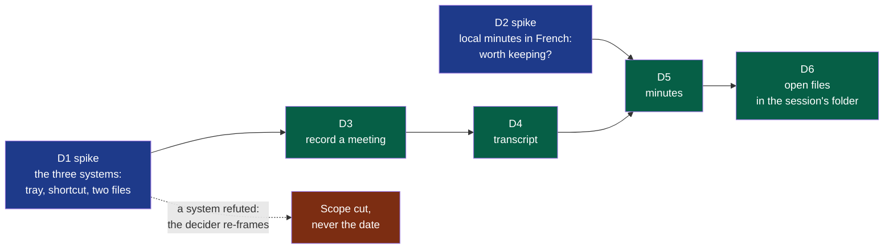
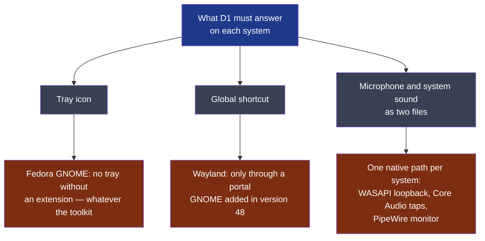
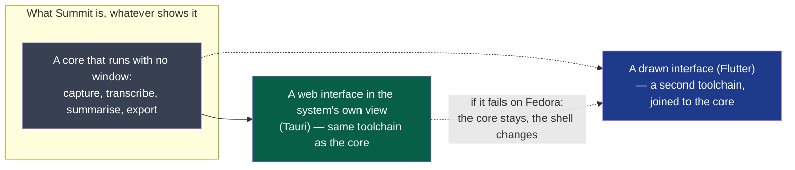
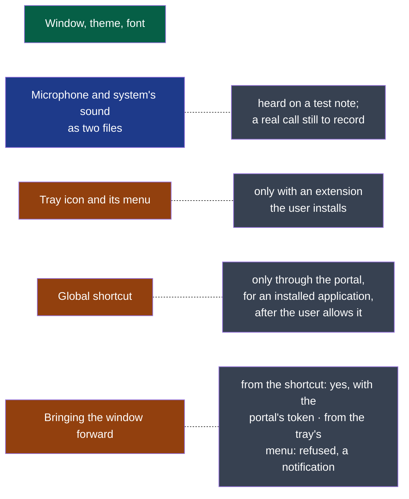
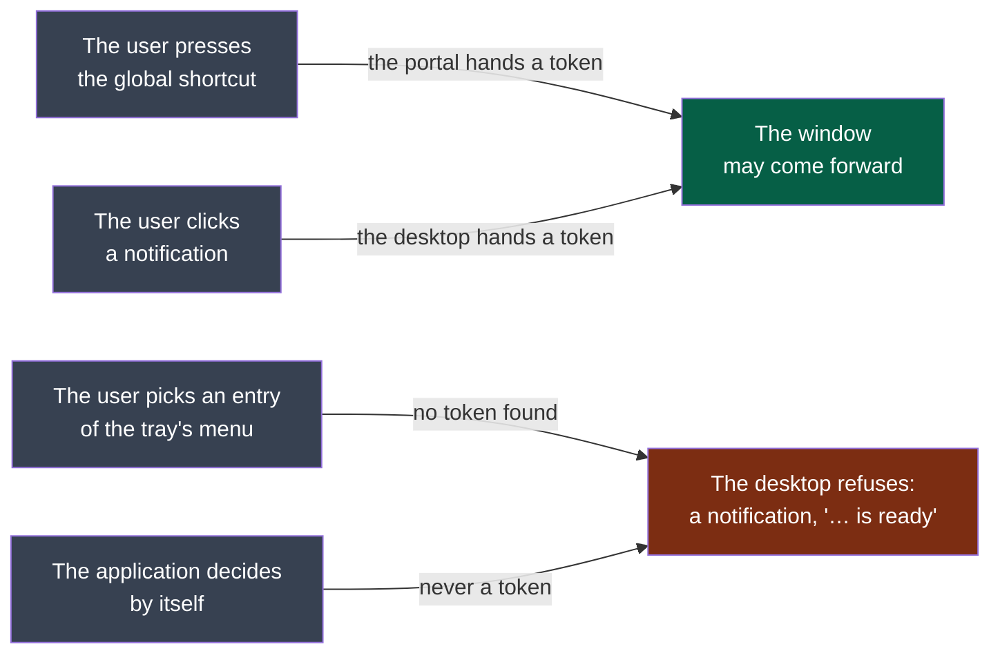
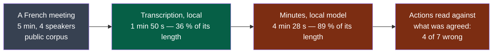
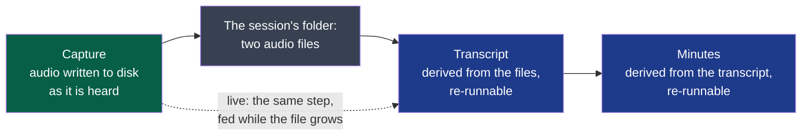

# Cycle 01 — A first meeting, on three systems

> One accepted cycle at a time; no automatic extension.

## Goal

**Legend** — blue: a spike, whose product is knowledge and whose refuted result is still
delivered · green: delivery work, in the order it can be built · red: what happens if a
spike says no.

The charter's criteria start the day Summit installs on each of the three machines. This
cycle is what gets it there: the smallest thing the three people can use for a real meeting.
Two weeks is what the decider wants to spend, with Windows and macOS included.

## Deliverables

**D1 comes first and decides the rest.** D3 is written for the three systems; if D1 refutes
one of them, D3 cannot be accepted there, and the decider re-frames — the scope is cut, the
date is not moved. D1 also records whether an unsigned build opens without help, which is
what the decision on paying for signing waits for.

**D1 — what was read before the probe (2026-10-12).** Not a choice of technology: what
the probe must find out, and with what it can start. Read with the agent runtime's web
search; *secondary* marks what was not read at its primary source.

**Legend** — blue: the spike's question · grey: its three parts · red: what the reading
found, each one the operating system's doing rather than a toolkit's.

| Finding | What it changes for the probe | Source |
|---|---|---|
| A Flutter tray plugin supports the three systems, and its own page says that under GNOME "the AppIndicator extension may be required to display the icon" | The tray on the decider's Fedora depends on an extension the user must add, with any toolkit. The probe records it; it cannot fix it | [tray_manager](https://pub.dev/packages/tray_manager), read through a search summary — *secondary* |
| GNOME 48 lets an application "register system-wide shortcuts" through a portal; users on Fedora 42 report never seeing its prompt | A global shortcut under Wayland exists on paper. Whether a given toolkit's plugin uses the portal is unknown for both candidates | [GNOME 48 release notes](https://release.gnome.org/48/developers/), [Fedora discussion](https://discussion.fedoraproject.org/t/how-do-you-enable-disable-global-shortcuts-in-gnome-48/154507) — *secondary* |
| Capturing the system's sound has one native path per system: WASAPI loopback on Windows; Core Audio process taps on macOS, which need a usage description in the application's manifest and deliver silence without the permission; the monitor of the default output under PipeWire on Linux | This is the hard part, and no toolkit hides it. A probe that shows a tray and a shortcut and cannot write the second file has answered nothing | [AudioCap](https://github.com/insidegui/AudioCap), [wasapi crate](https://docs.rs/wasapi), [Fedora discussion on monitors](https://discussion.fedoraproject.org/t/what-is-the-equivalent-of-pulseaudios-monitor-sources-in-pipewire/68939) — *secondary* |
| Flutter packages for the system's sound are young: one claims the three systems at version 0.0.2 with 38 downloads; another lists macOS and Linux as not yet supported | With the decider's candidate, the capture is likely to need native code per system, behind the toolkit | [desktop_audio_capture](https://pub.dev/packages/desktop_audio_capture/score), [audio_io](https://pub.dev/packages/audio_io/versions/0.6.0) — *secondary* |
| A macOS or Windows build cannot be made on the decider's Fedora | Whatever the toolkit, the two colleagues' builds come from the forge's CI runners or from their own machines. On a private repository the free minutes are counted, and macOS minutes cost more | **Assumption** — the forge's billing page was not read |

**On this workstation (read 2026-10-12):** Flutter and Dart are installed; no Rust toolchain;
`ffmpeg`, `pw-record` and `pactl` are present; the session is GNOME on Wayland.

**The two candidates, read at their sources (2026-10-12), and the one the probe starts
with.** The decider asked for a thorough reading, with two weights: the interface comes
first, and the software must be of quality. *Read* means the page itself; *secondary* a
search summary.

**Legend** — grey: the part every step and every right-click needs, with no window at all ·
green: the shell the probe starts with · blue: the shell kept in reserve, which the probe
can still fall back to.

| Criterion | Flutter | Rust core with a web view (Tauri v2) | Source |
|---|---|---|---|
| **The system's sound, on three systems** — the hard part | Packages too young: one at version 0.0.2 with 38 downloads, another without macOS or Linux. Native code per system, written by hand | One audio library with a host per system: WASAPI, CoreAudio — "loopback recording requires 14.6+" — and PipeWire or PulseAudio as optional hosts | [cpal](https://github.com/RustAudio/cpal), *read*; Flutter packages *secondary* |
| **Running a step with no window** — a right-click on a file, the idea's §8 | The interface toolkit is the application; a headless step is a second program | The core is a program of its own; the window is one of its clients | The idea file, §8 |
| **What the nearest products chose** | None found | Both: Meetily — "built with Tauri", "a Rust-based backend" — and Anarlog — "Tauri v2 desktop app: React and TypeScript UI, Rust backend" | Their repositories, *read* |
| **The interface: quality and the system's look** — the decider's first weight | Draws every pixel itself: identical on the three systems, and not the system's controls or fonts unless rebuilt | The system's own web view: the system's fonts and light or dark theme come for free; three engines to test — Chromium on Windows, WebKit on macOS, WebKitGTK on Linux | [Tauri, webview versions](https://v2.tauri.app/reference/webview-versions/), *read* |
| **Linux rendering** — where the nearest products are weakest | A GTK embedder, no web engine in between | Its own documentation lists blank windows and crashes, "most often NVIDIA GPUs" | [Tauri, Linux graphics](https://v2.tauri.app/develop/debug/linux-graphics/), *secondary* |
| **Global shortcut under Wayland** | Its package needs `keybinder-3.0`, an X11 library, and was published two years ago | Its plugin's page says nothing of Wayland; its library was read by the challenger as X11 only. A wrapper of the desktop portal exists for Rust | [hotkey_manager](https://pub.dev/packages/hotkey_manager), [ashpd](https://docs.rs/ashpd/latest/ashpd/desktop/global_shortcuts/index.html), *read* |
| **Tray** | Needs an extension under GNOME | Needs the same; and on Linux "the event is not emitted even though the icon is shown" — a menu on right click only | [Tauri, system tray](https://v2.tauri.app/learn/system-tray/), *read* |
| **Toolchains for one builder** | Dart, plus native code in three languages for the capture | Rust, plus a web interface | — |

**On the decider's workstation, read the same day:** an AMD graphics card, not the one
Tauri's page warns about; WebKitGTK 2.54; GNOME 50, which has the shortcuts portal; PipeWire
1.6; **no tray extension installed** — the icon will not show there with either candidate.

**The probe starts with the Rust core and the web view.** In order of weight: the capture
is the part that can sink the product, and one library covers the three systems; every step
must run without a window, so the core exists whichever shell is chosen, and one toolchain
is what one builder can hold; the two nearest products made this choice; and the idea asks
for the system's look, which a web view inherits and a drawn interface has to imitate. What
it costs is known: three web engines instead of one renderer, and Linux is where that engine
is weakest. **So D1 tests exactly that**, on the decider's Fedora first — a window that
renders badly there ends the web view, not the core, and the drawn shell takes its place.

This is the choice **for the probe**. The decision for the product is an ADR, written on what
D1 records.

**D1 — what the probe recorded.** One row per run; a refuted run is a recorded answer.

| Date | System | Run | Microphone | System's sound | Read |
|---|---|---|---|---|---|
| 2026-10-12 | Fedora 44, GNOME on Wayland, PipeWire 1.6 | `d1-capture`, 20 s, by the decider | A file with sound, 20.0 s; loudest sample at 100 % of full scale — it clipped | **A file of silence**, 20.0 s, opened on the default output with no error | Not met. Not yet known whether anything was playing: the probe now plays a test note of its own and tries a second way to open the output |
| 2026-10-12 | Same | `d1-capture`, 10 s, `--tone`, by the decider | Heard | **Heard**: the probe's own note, which the decider heard on the loudspeakers | **Met with a test note, not with a call.** The first run's silence was nothing playing: the decider had not spoken and no sound was running. Which of the two ways heard it was not reported. Still to record: a real call; and whether "me" stays free of the others' voices when they come out of loudspeakers the microphone can hear |

| Date | System | Run | Window | Theme and font | Tray icon | Global shortcut |
|---|---|---|---|---|---|---|
| 2026-10-12 | Fedora 44, GNOME on Wayland | `d1-shell`, by the decider, read from their screenshot | **Rendered**, sharp, no artefact visible | **Dark theme followed**; the system's font | **Created and visible** in the top bar — with the tray extension the decider installed first, which a user of stock Fedora does not have | **Accepted, and never fired**: the shortcut library registered Ctrl+Alt+R without an error, and pressing it with another window focused did nothing — 0 times. A silent failure, worse than a refusal: the application believes it has a shortcut. The tray's menu opens on a click. Asked of the desktop portal next: **refused — "An app id is required"**, no dialog shown. The portal answers only an application that has declared who it is, with a desktop entry installed under that name: true of an installed product, not of a program run from its build folder. Declaring itself next: **refused again — "App info not found for 'dev.summit.d1shell'"**, with the desktop entry installed. Probable cause, the framer's own mistake: the entry's `Exec` named a program that is on no path, and the desktop discards an entry whose program it cannot find. **Not obtained in three tries**; what is established is the way — an installed application, a valid desktop entry, the portal — and that the shortcut library's "accepted" means nothing under Wayland |

| 2026-10-12 | Same, fourth run | `d1-shell` with a corrected desktop entry and Super+Alt+M | — | — | Its menu opens; **"Show the probe" does not bring the window forward**: the desktop shows a notification, "Summit — D1 probe is ready", instead | **Obtained through the portal**: the desktop asked the decider to add the shortcut, bound it, and it fired 6 times with another window focused. The shortcut library's own registration still fired 0 times |
| 2026-10-12 | Same, fifth run | `d1-shell` using the portal's token | **Comes forward** when the shortcut is pressed with another window focused — seen by the decider | — | — | Fired 2 times, **2 of 2 came with a token**. A run in between, with the desktop entry removed, gave "0 of 0": without the entry the portal binds nothing, and says so only in its own line |

**What D1 established on Fedora** (GNOME 50, Wayland), for whatever is built next:

**Legend** — green: works as it is · blue: works, not yet on what the criterion asks · orange:
works under a condition · grey: the condition or the reason.

**Bringing the window forward under GNOME — what was read (2026-10-12).** The decider saw
"Show the probe" answered by a notification, "… is ready", instead of the window.

**Legend** — grey: what happened · green: the desktop lets the window come forward · red: it
does not, whatever the application asks.

| Finding | What it means for Summit | Source |
|---|---|---|
| Under Wayland a window is raised only with a token the compositor issued for an input event, and it "might decide not to follow through with the activation if it's considered unwanted" | No application takes the focus by itself. This is the desktop protecting the user from exactly what the idea file forbids — "aucune fenêtre ne s'ouvre sans action de l'utilisateur" | [xdg-activation-v1](https://wayland.app/protocols/xdg-activation-v1), *read* |
| The shortcut portal's signal carries `activation_token`: "A token that can be used to activate a window in response to the shortcut getting activated" | The global shortcut **can** bring the window forward. **Confirmed by the fifth run**: handed to the window as its startup id, the token raised it both times | [GlobalShortcuts portal](https://flatpak.github.io/xdg-desktop-portal/docs/doc-org.freedesktop.portal.GlobalShortcuts.html), *read* |
| A click on a notification makes GNOME Shell emit an activation token, then the action | A notification is the desktop's own doorway to a window: "your minutes are ready", click, the window opens | A bug report describing the signals, and the specification's change — *secondary* |
| A token passed to an application when an entry of its tray menu is chosen: **not found** for GNOME's tray extension; a to-do item on another desktop | "Show the window" in the tray's menu cannot be relied on under GNOME. It is what the decider observed | [KWin issue](https://invent.kde.org/plasma/kwin/-/issues/39) — *secondary*; nothing found for GNOME |

**What follows for the interface** *(framer, to confirm)* — it agrees with the product's
fifth principle rather than fighting it:

- **The tray's menu holds the actions themselves** — start, stop, the last sessions — not a
  door to a window. Nothing in it needs the window to come forward.
- **A result arrives as a notification**, and the click on it opens the window: the one path
  the desktop always allows.
- **The global shortcut starts and stops a recording**; where it must show something, it may,
  because it comes with a token.
- **"Show the window" stays in the menu on Windows and macOS**, where it works, and on GNOME
  it is answered by the desktop's own notification. Not hidden: said in the settings, as the
  idea file asks for whatever one system cannot do.

**D1 is not closed.** Windows and macOS wait for builds the decider chose to set up later
(2026-10-12: "on mettra les workflows plus tard"), and a real call is still to record on
Fedora. D3 cannot be accepted on a system D1 has not answered for.

Three of these are the desktop's rules, not the toolkit's: a drawn interface would meet the
same tray, the same portal and the same refusal to steal the focus. The one that was the
web view's own risk — the window — is the one that simply worked.

### D2 — first run, on a public sample (2026-10-12)

**Legend** — grey: the input · green: under its threshold · red: over it.

The decider chose not to wait for a meeting of their own. The sample is five minutes of a
planning meeting from [SUMM-RE](https://huggingface.co/datasets/linagora/SUMM-RE) (CC BY-SA
4.0), with a human transcript. **It is not the hour the criterion asks for**: what follows is
a first reading, and the verdict is the decider's.

| Measure | Result | Threshold |
|---|---|---|
| Machine | The decider's laptop: 16 threads, 23 GB, integrated graphics — the model ran on the processor alone | — |
| Engines | `faster-whisper` with `large-v3-turbo`; `mistral` 7B through Ollama | — |
| Setup | **70 min 15 s**, nearly all of it two downloads (6 GB) | under 15 min — **over** |
| Transcription | 1 min 50 s, 36 % of the meeting's length | — |
| Minutes | 4 min 28 s, 89 % of the meeting's length | — |
| Processing, total | **125 %** of the meeting's length | under 50 % — **over** |
| Transcript against the human one | 27 % of the words differ — overstated: the human one writes hesitations, numbers in letters and overlapping speech | — |
| Actions missing, wrong or invented | **4 of 7 wrong**, read by the agent, to be confirmed by the decider | at most 1 in 5 — **over** |

What the minutes got wrong: the meeting **decided** its date and the minutes list it as an
action to do; a deadline is invented; and twice the owner is a person the meeting talks
*about*, not a participant. The transcript does not say who speaks, so the model guesses.

**Does knowing who speaks fix it?** Tried the same day, each speaker's track transcribed
apart, same model, one run each:

| The transcript says | Actions written | Wrong | What is lost |
|---|---|---|---|
| Nothing about who speaks | 7 | 4 | The decided date |
| Each of the four speakers | 3 | 2 — the owners | Two actions, the fallback date |
| **Me / Others**, as the product records | 5 | 1 | Deadlines; it writes *not specified* rather than guess |

One run each is no measurement: the third row may be luck. What it suggests is worth a
criterion in D5 — **minutes that say *not specified* instead of naming someone**.

**What was learned about the tools**, for the engine D4 and D5 will choose:

- The distribution's `whisper-cpp` package holds the library and no program.
- The Python engine's own decoder broke on its audio library; it was handed raw samples.
- That engine's voice detector tried to send telemetry to its publisher at start.
- A meeting of an hour is about 37,000 tokens: over the 32,768 this model was given.

**The decider's reading (2026-10-12).** These measures say what this laptop and this model
can do, not what the product can: local figures follow the hardware and the model, and an
online provider with a good model would give entirely different ones. The setup time is the
connection's, weak that day, and is not representative. So D2 answers its question for one
machine — *on the decider's laptop, all-local minutes are not worth keeping* — and decides
nothing against local processing as such: each step keeps its provider, chosen by the user.

| What D2 leaves for the deliverables | Goes to |
|---|---|
| Local transcription holds on this laptop: about a third of the meeting's length | D4 |
| The same measures, taken with an online provider, before a threshold of quality is written | D5 |
| Minutes that write *not specified* rather than name someone | D5, as a criterion |
| A step that uses a model takes **a context from the user** — *"four speakers in a meeting room, two men and two women"* | D4 and D5, below |

**A context given to a step — the decider asks for its place now.** Tried on the same
sample, same local model, one run: a three-line context saying who attends and who is only
talked about.

| | Without a context | With it |
|---|---|---|
| A person the meeting talks about, written as the owner of an action | 3 times | never |
| The decided date written as an action still to do | yes | yes |

It removes the mistake it speaks to, and no other. What a context can do differs by step,
and the product says so rather than promise more:

- **For the minutes**, it is read as written: who attends, the agenda, the user's notes.
- **For the transcript**, the engine tried here takes a few hundred words that steer
  spelling — names, jargon — and nothing more. Telling speakers apart is another engine's
  work; *"two men and two women"* helps that one, or the minutes, not the words heard.

**Decided by the decider (2026-10-12): the context ships in this cycle.** It had been listed
out of scope; it is now part of D4 and D5, whose criteria — written after D1 and D2 — will
say, for each step, what the user may attach and what the step does with it. The contracts
`transcription` and `summary` carry it as an optional field from their first version.

The appetite does not move: two weeks, ending 2026-10-27. One more thing to deliver in the
same time; if it does not fit, the circuit breaker decides what ships, not an extension.
Custom vocabulary and templates of minutes stay out: a context is free text or a file, and
nothing more is built around it.

### Three orientations from the decider (2026-10-12)

**Legend** — green: what must never be lost · grey: files on the machine · blue: what can
always be made again from the files. Dotted: the live path, an addition to the same step.

1. **Fedora first.** Every choice stays one that works on the three systems — no dependency
   without its named equivalent on Windows and macOS — but this cycle is built and tried on
   Fedora. The two other systems are built and tried afterwards; what the end date does not
   reach is said at closure, not hidden behind the goal's wording.
2. **Resilience, as far as it goes.** The audio first: it is written to disk as it is heard,
   so a crash costs seconds and not the meeting (the charter's first risk). Every later step
   is made from files and can be run again; a provider that fails loses nothing the step
   before it wrote. These become criteria of D3 to D6, not intentions.
3. **Live transcription, or after the recording — to decide.** The cycle had listed live
   transcription out of scope; the decider asks for the choice to be made on purpose.

| | After the recording | Live, while recording |
|---|---|---|
| What the user sees | The transcript some minutes after *stop* | The words as the meeting goes |
| If the engine fails | Nothing lost: the audio is there, run it again | The same, **provided live never replaces the files** |
| Measured | Local: a third of the meeting's length on this laptop | Not measured: the engine while a call uses the machine; an online one needs a provider that streams |
| Cost in this cycle | Already D4 | One more thing in two weeks, after the context |

**The framer's recommendation**: after the recording in this cycle, on the design drawn
above — the transcript is a step fed by files, so feeding it the file *while it grows* is an
addition later, not a rewrite. Live is then tried as a spike once D3 and D4 hold on Fedora.

**D3 to D6 are `proposed`, not `ready`**: their acceptance criteria are written once D1
and D2 have answered — which engine, which capture path per system, which threshold of
quality. Writing them today would be writing them around the answer hoped for.

**Four modules, decided by the decider** (2026-10-12: "on découpe les 4 modules"), one per
step of the idea file: `capture`, `transcription`, `summary`, `export`. The framer had
proposed two, on the handbook's advice not to split on day one (`.nstack/handbook/02-modules.md` §3);
the decider's reason is the product's second principle — each step independent, with its own
provider, usable alone. What it costs is known and accepted: four modules know each other
only through contracts, so **the session's files are contracts** — the audio `capture`
provides, the transcript `transcription` provides, the minutes `summary` provides — and their
first versions are written with D3 to D5. `capture` is declared `standard` now and `critical`
before the repository is opened (charter, risks); the three others are `standard`. All four
are user-facing.

**No technology is chosen here.** D1 asks whether one application can do these three things
on the three systems; it does not say with what. The decider named one candidate — "certains
frameworks comme Flutter génèrent des apps natives à partir du même dev" — and that it is
early to settle it. The choice is a decision of its own, taken after D1 on what it records,
with its prior art: an ADR, not a line of this cycle.

**Who verifies.** The four modules are user-facing: each change carries a test sheet run by
someone who is not its author. On Windows and macOS only the two colleagues can run it.

## Out of scope

Not done in this cycle, even if time remains:

- Export to Notion, or to any tool: the files in the session's folder are the export.
- The file context menu; a watched folder.
- Live transcription during the recording.
- Detecting that the microphone is in use; stopping by itself.
- The first-launch assistant and the ready-made profiles: one configuration file.
- Costs, the list of sessions, search, the audio player.
- Custom vocabulary; templates of minutes — beyond the free context a step takes.
- Import and export between the steps beyond the files themselves.
- Signing the builds.

## Later

Candidates for the next framing, in the order the idea file gives them weight: the context
menu on files; export to Notion; detection of the microphone;
profiles; costs; live transcription.

## Open questions

**Blocking:** none left.

**Not blocking:**

- The spike the discovery carried first — running the nearest product's Linux build — was
  dropped by the decider on 2026-10-12. If D1 shows capture on Fedora to be as fragile as the
  challenger found it elsewhere, that question comes back.
- The colleagues' time is not the decider's to spend: D1 and the test sheets of D3 to D6
  wait on two people outside the build. If a reply takes more than two days, it is named at
  the circuit breaker, not absorbed.

## Closure

<Written at the end: what was delivered, which success criteria moved, what was deferred,
where the next framing starts.>

**Documents brought current:** <the front page, the module map, a module's page — each with
its pull request; or "none", and why nothing a reader sees has changed>
