# Cycle 01 — A first meeting, on three systems

> One accepted cycle at a time; no automatic extension.

## Goal

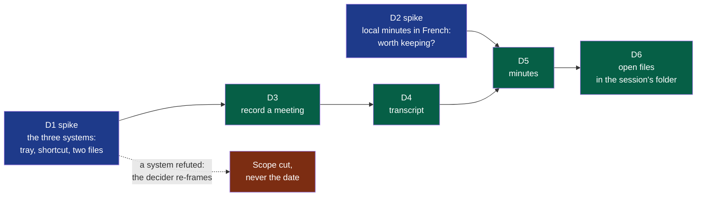

**Legend** — blue: a spike, whose product is knowledge and whose refuted result is still
delivered · green: delivery work, in the order it can be built · red: what happens if a
spike says no.

The charter's criteria start the day Summit installs on each of the three machines. This
cycle is what gets it there: the smallest thing the three people can use for a real meeting.
Two weeks is what the decider wants to spend, with Windows and macOS included.

## Deliverables

**D1 comes first and decides the rest.** D3 is written for the three systems; if D1 refutes
one of them, D3 cannot be accepted there, and the decider re-frames — the scope is cut, the
date is not moved. D1 also records whether an unsigned build opens without help, which is
what the decision on paying for signing waits for.

**D1 — what was read before the probe (2026-10-12).** Not a choice of technology: what
the probe must find out, and with what it can start. Read with the agent runtime's web
search; *secondary* marks what was not read at its primary source.

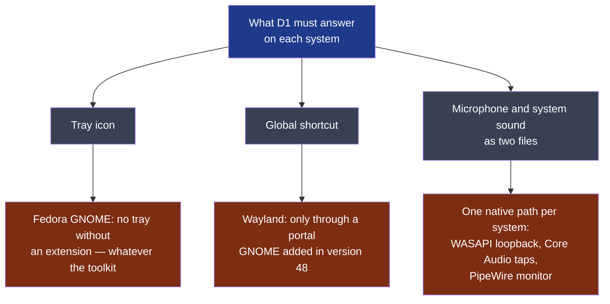

**Legend** — blue: the spike's question · grey: its three parts · red: what the reading
found, each one the operating system's doing rather than a toolkit's.

| Finding | What it changes for the probe | Source |
|---|---|---|
| A Flutter tray plugin supports the three systems, and its own page says that under GNOME "the AppIndicator extension may be required to display the icon" | The tray on the decider's Fedora depends on an extension the user must add, with any toolkit. The probe records it; it cannot fix it | [tray_manager](https://pub.dev/packages/tray_manager), read through a search summary — *secondary* |
| GNOME 48 lets an application "register system-wide shortcuts" through a portal; users on Fedora 42 report never seeing its prompt | A global shortcut under Wayland exists on paper. Whether a given toolkit's plugin uses the portal is unknown for both candidates | [GNOME 48 release notes](https://release.gnome.org/48/developers/), [Fedora discussion](https://discussion.fedoraproject.org/t/how-do-you-enable-disable-global-shortcuts-in-gnome-48/154507) — *secondary* |
| Capturing the system's sound has one native path per system: WASAPI loopback on Windows; Core Audio process taps on macOS, which need a usage description in the application's manifest and deliver silence without the permission; the monitor of the default output under PipeWire on Linux | This is the hard part, and no toolkit hides it. A probe that shows a tray and a shortcut and cannot write the second file has answered nothing | [AudioCap](https://github.com/insidegui/AudioCap), [wasapi crate](https://docs.rs/wasapi), [Fedora discussion on monitors](https://discussion.fedoraproject.org/t/what-is-the-equivalent-of-pulseaudios-monitor-sources-in-pipewire/68939) — *secondary* |
| Flutter packages for the system's sound are young: one claims the three systems at version 0.0.2 with 38 downloads; another lists macOS and Linux as not yet supported | With the decider's candidate, the capture is likely to need native code per system, behind the toolkit | [desktop_audio_capture](https://pub.dev/packages/desktop_audio_capture/score), [audio_io](https://pub.dev/packages/audio_io/versions/0.6.0) — *secondary* |
| A macOS or Windows build cannot be made on the decider's Fedora | Whatever the toolkit, the two colleagues' builds come from the forge's CI runners or from their own machines. On a private repository the free minutes are counted, and macOS minutes cost more | **Assumption** — the forge's billing page was not read |

**On this workstation (read 2026-10-12):** Flutter and Dart are installed; no Rust toolchain;
`ffmpeg`, `pw-record` and `pactl` are present; the session is GNOME on Wayland.

**The two candidates, read at their sources (2026-10-12), and the one the probe starts
with.** The decider asked for a thorough reading, with two weights: the interface comes
first, and the software must be of quality. *Read* means the page itself; *secondary* a
search summary.

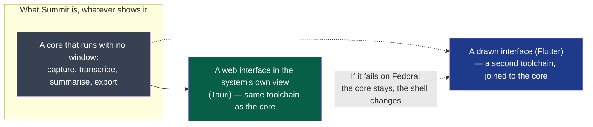

**Legend** — grey: the part every step and every right-click needs, with no window at all ·
green: the shell the probe starts with · blue: the shell kept in reserve, which the probe
can still fall back to.

| Criterion | Flutter | Rust core with a web view (Tauri v2) | Source |
|---|---|---|---|
| **The system's sound, on three systems** — the hard part | Packages too young: one at version 0.0.2 with 38 downloads, another without macOS or Linux. Native code per system, written by hand | One audio library with a host per system: WASAPI, CoreAudio — "loopback recording requires 14.6+" — and PipeWire or PulseAudio as optional hosts | [cpal](https://github.com/RustAudio/cpal), *read*; Flutter packages *secondary* |
| **Running a step with no window** — a right-click on a file, the idea's §8 | The interface toolkit is the application; a headless step is a second program | The core is a program of its own; the window is one of its clients | The idea file, §8 |
| **What the nearest products chose** | None found | Both: Meetily — "built with Tauri", "a Rust-based backend" — and Anarlog — "Tauri v2 desktop app: React and TypeScript UI, Rust backend" | Their repositories, *read* |
| **The interface: quality and the system's look** — the decider's first weight | Draws every pixel itself: identical on the three systems, and not the system's controls or fonts unless rebuilt | The system's own web view: the system's fonts and light or dark theme come for free; three engines to test — Chromium on Windows, WebKit on macOS, WebKitGTK on Linux | [Tauri, webview versions](https://v2.tauri.app/reference/webview-versions/), *read* |
| **Linux rendering** — where the nearest products are weakest | A GTK embedder, no web engine in between | Its own documentation lists blank windows and crashes, "most often NVIDIA GPUs" | [Tauri, Linux graphics](https://v2.tauri.app/develop/debug/linux-graphics/), *secondary* |
| **Global shortcut under Wayland** | Its package needs `keybinder-3.0`, an X11 library, and was published two years ago | Its plugin's page says nothing of Wayland; its library was read by the challenger as X11 only. A wrapper of the desktop portal exists for Rust | [hotkey_manager](https://pub.dev/packages/hotkey_manager), [ashpd](https://docs.rs/ashpd/latest/ashpd/desktop/global_shortcuts/index.html), *read* |
| **Tray** | Needs an extension under GNOME | Needs the same; and on Linux "the event is not emitted even though the icon is shown" — a menu on right click only | [Tauri, system tray](https://v2.tauri.app/learn/system-tray/), *read* |
| **Toolchains for one builder** | Dart, plus native code in three languages for the capture | Rust, plus a web interface | — |

**On the decider's workstation, read the same day:** an AMD graphics card, not the one
Tauri's page warns about; WebKitGTK 2.54; GNOME 50, which has the shortcuts portal; PipeWire
1.6; **no tray extension installed** — the icon will not show there with either candidate.

**The probe starts with the Rust core and the web view.** In order of weight: the capture
is the part that can sink the product, and one library covers the three systems; every step
must run without a window, so the core exists whichever shell is chosen, and one toolchain
is what one builder can hold; the two nearest products made this choice; and the idea asks
for the system's look, which a web view inherits and a drawn interface has to imitate. What
it costs is known: three web engines instead of one renderer, and Linux is where that engine
is weakest. **So D1 tests exactly that**, on the decider's Fedora first — a window that
renders badly there ends the web view, not the core, and the drawn shell takes its place.

This is the choice **for the probe**. The decision for the product is an ADR, written on what
D1 records.

**D1 — what the probe recorded.** One row per run; a refuted run is a recorded answer.

| Date | System | Run | Microphone | System's sound | Read |
|---|---|---|---|---|---|
| 2026-10-12 | Fedora 44, GNOME on Wayland, PipeWire 1.6 | `d1-capture`, 20 s, by the decider | A file with sound, 20.0 s; loudest sample at 100 % of full scale — it clipped | **A file of silence**, 20.0 s, opened on the default output with no error | Not met. Not yet known whether anything was playing: the probe now plays a test note of its own and tries a second way to open the output |
| 2026-10-12 | Same | `d1-capture`, 10 s, `--tone`, by the decider | Heard | **Heard**: the probe's own note, which the decider heard on the loudspeakers | **Met with a test note, not with a call.** The first run's silence was nothing playing: the decider had not spoken and no sound was running. Which of the two ways heard it was not reported. Still to record: a real call; and whether "me" stays free of the others' voices when they come out of loudspeakers the microphone can hear |
| 2026-10-12 | Same | `d1-capture`, 60 s, by the decider, meant as the real call | "A file with sound", 59.9 s, loudest sample at 100 % — **a verdict the file does not support**: read back, the two channels rest at −19 % and −33 % of full scale for the whole minute, the 100 % is a click in the first 45 ms, and what moves around the resting level is 1 % with a few peaks to 25 %. Measured from zero, a silent room passes | **Two files of exact zeros**, 5,754,880 samples each, on both ways of opening the output | **Not met, and not a call's failure**: the same minute, read sample by sample, shows that nothing reached the loudspeakers. Checked next by the framer, microphone closed (`--others-only`): a note played by **another program** is heard on both ways, and silence is reported when nothing plays. So the capture hears what other programs play; whether a call was running, and on which output, is the decider's to say. The machine's configured output is a Bluetooth headset that was not connected. The probe now measures a file around its resting level, first second left out |
| 2026-10-12 | Same | `d1-capture`, 60 s, by the decider, **during a WhatsApp call in Firefox** | A file with sound, 60.0 s: loudest sample 16.6 % around a resting level of −32.7 % — the same offset as the run before. Read back: a noise floor of 0.6 % and about 3 s of the minute clearly above it. **Weak**; whether the decider's voice is intelligible in it is theirs to hear | **Heard on both ways**, 60 s, the two files the same sound; 12 samples of 5.7 million at full scale, mean level 5 % | **Met on Fedora with a real call.** The others spoke for about 8 s of the minute, and the microphone's level does not follow theirs (correlation 0.08): no trace of them in "me" on this run — they were heard on the laptop's loudspeakers, no headset (the decider): on this run the loudspeakers did not bleed into the microphone, at the volume and the 8 s of speech it had. The decider listened to "me": weak, and usual for this laptop |

| Date | System | Run | Window | Theme and font | Tray icon | Global shortcut |
|---|---|---|---|---|---|---|
| 2026-10-12 | Fedora 44, GNOME on Wayland | `d1-shell`, by the decider, read from their screenshot | **Rendered**, sharp, no artefact visible | **Dark theme followed**; the system's font | **Created and visible** in the top bar — with the tray extension the decider installed first, which a user of stock Fedora does not have | **Accepted, and never fired**: the shortcut library registered Ctrl+Alt+R without an error, and pressing it with another window focused did nothing — 0 times. A silent failure, worse than a refusal: the application believes it has a shortcut. The tray's menu opens on a click. Asked of the desktop portal next: **refused — "An app id is required"**, no dialog shown. The portal answers only an application that has declared who it is, with a desktop entry installed under that name: true of an installed product, not of a program run from its build folder. Declaring itself next: **refused again — "App info not found for 'dev.summit.d1shell'"**, with the desktop entry installed. Probable cause, the framer's own mistake: the entry's `Exec` named a program that is on no path, and the desktop discards an entry whose program it cannot find. **Not obtained in three tries**; what is established is the way — an installed application, a valid desktop entry, the portal — and that the shortcut library's "accepted" means nothing under Wayland |

| 2026-10-12 | Same, fourth run | `d1-shell` with a corrected desktop entry and Super+Alt+M | — | — | Its menu opens; **"Show the probe" does not bring the window forward**: the desktop shows a notification, "Summit — D1 probe is ready", instead | **Obtained through the portal**: the desktop asked the decider to add the shortcut, bound it, and it fired 6 times with another window focused. The shortcut library's own registration still fired 0 times |
| 2026-10-12 | Same, fifth run | `d1-shell` using the portal's token | **Comes forward** when the shortcut is pressed with another window focused — seen by the decider | — | — | Fired 2 times, **2 of 2 came with a token**. A run in between, with the desktop entry removed, gave "0 of 0": without the entry the portal binds nothing, and says so only in its own line |

**What D1 established on Fedora** (GNOME 50, Wayland), for whatever is built next:

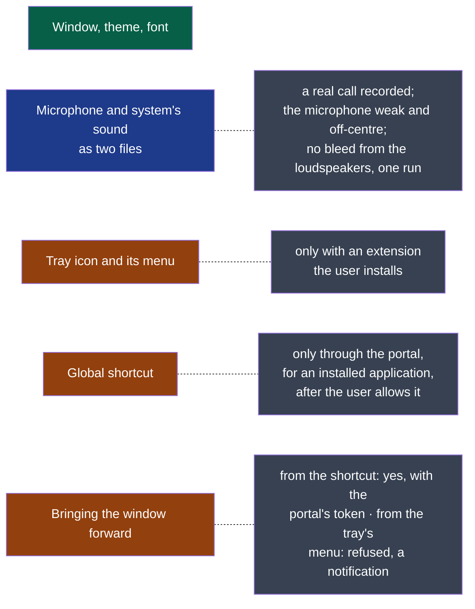

**Legend** — green: works as it is · blue: works, not yet on what the criterion asks · orange:
works under a condition · grey: the condition or the reason.

**Bringing the window forward under GNOME — what was read (2026-10-12).** The decider saw
"Show the probe" answered by a notification, "… is ready", instead of the window.

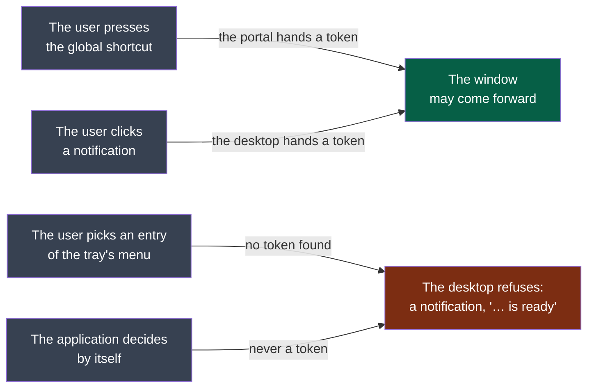

**Legend** — grey: what happened · green: the desktop lets the window come forward · red: it
does not, whatever the application asks.

| Finding | What it means for Summit | Source |
|---|---|---|
| Under Wayland a window is raised only with a token the compositor issued for an input event, and it "might decide not to follow through with the activation if it's considered unwanted" | No application takes the focus by itself. This is the desktop protecting the user from exactly what the idea file forbids — "aucune fenêtre ne s'ouvre sans action de l'utilisateur" | [xdg-activation-v1](https://wayland.app/protocols/xdg-activation-v1), *read* |
| The shortcut portal's signal carries `activation_token`: "A token that can be used to activate a window in response to the shortcut getting activated" | The global shortcut **can** bring the window forward. **Confirmed by the fifth run**: handed to the window as its startup id, the token raised it both times | [GlobalShortcuts portal](https://flatpak.github.io/xdg-desktop-portal/docs/doc-org.freedesktop.portal.GlobalShortcuts.html), *read* |
| A click on a notification makes GNOME Shell emit an activation token, then the action | A notification is the desktop's own doorway to a window: "your minutes are ready", click, the window opens | A bug report describing the signals, and the specification's change — *secondary* |
| A token passed to an application when an entry of its tray menu is chosen: **not found** for GNOME's tray extension; a to-do item on another desktop | "Show the window" in the tray's menu cannot be relied on under GNOME. It is what the decider observed | [KWin issue](https://invent.kde.org/plasma/kwin/-/issues/39) — *secondary*; nothing found for GNOME |

**What follows for the interface** *(framer, to confirm)* — it agrees with the product's
fifth principle rather than fighting it:

- **The tray's menu holds the actions themselves** — start, stop, the last sessions — not a
  door to a window. Nothing in it needs the window to come forward.
- **A result arrives as a notification**, and the click on it opens the window: the one path
  the desktop always allows.
- **The global shortcut starts and stops a recording**; where it must show something, it may,
  because it comes with a token.
- **"Show the window" stays in the menu on Windows and macOS**, where it works, and on GNOME
  it is answered by the desktop's own notification. Not hidden: said in the settings, as the
  idea file asks for whatever one system cannot do.

**Two things the third capture run adds for D3** *(framer, to confirm)*:

- **A level read from zero proves nothing.** This microphone rests far from zero; the
  recorder must take the resting level out before it shows a level, decides that a source is
  silent, or hands the sound to the transcription. Whether the offset comes from the
  microphone or from the way it is opened is not known: one machine, one run.
- **"The others" follows the output in use.** A headset connected during a meeting changes
  where the call plays; a recording that stays on the loudspeakers writes zeros without an
  error. Not tested yet — it is the first thing the real call should try.

**D1 is not closed.** Windows and macOS wait for builds the decider chose to set up later
(2026-10-12: "on mettra les workflows plus tard"). **Fedora's half is answered**: window,
tray, shortcut, and the two files of a real call. D3 cannot be accepted on a system D1 has not answered for.

Three of these are the desktop's rules, not the toolkit's: a drawn interface would meet the
same tray, the same portal and the same refusal to steal the focus. The one that was the
web view's own risk — the window — is the one that simply worked.

### D2 — first run, on a public sample (2026-10-12)

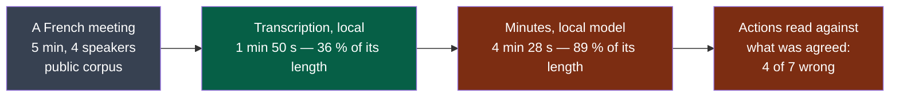

**Legend** — grey: the input · green: under its threshold · red: over it.

The decider chose not to wait for a meeting of their own. The sample is five minutes of a
planning meeting from [SUMM-RE](https://huggingface.co/datasets/linagora/SUMM-RE) (CC BY-SA
4.0), with a human transcript. **It is not the hour the criterion asks for**: what follows is
a first reading, and the verdict is the decider's.

| Measure | Result | Threshold |
|---|---|---|
| Machine | The decider's laptop: 16 threads, 23 GB, integrated graphics — the model ran on the processor alone | — |
| Engines | `faster-whisper` with `large-v3-turbo`; `mistral` 7B through Ollama | — |
| Setup | **70 min 15 s**, nearly all of it two downloads (6 GB) | under 15 min — **over** |
| Transcription | 1 min 50 s, 36 % of the meeting's length | — |
| Minutes | 4 min 28 s, 89 % of the meeting's length | — |
| Processing, total | **125 %** of the meeting's length | under 50 % — **over** |
| Transcript against the human one | 27 % of the words differ — overstated: the human one writes hesitations, numbers in letters and overlapping speech | — |
| Actions missing, wrong or invented | **4 of 7 wrong**, read by the agent, to be confirmed by the decider | at most 1 in 5 — **over** |

What the minutes got wrong: the meeting **decided** its date and the minutes list it as an
action to do; a deadline is invented; and twice the owner is a person the meeting talks
*about*, not a participant. The transcript does not say who speaks, so the model guesses.

**Does knowing who speaks fix it?** Tried the same day, each speaker's track transcribed
apart, same model, one run each:

| The transcript says | Actions written | Wrong | What is lost |
|---|---|---|---|
| Nothing about who speaks | 7 | 4 | The decided date |
| Each of the four speakers | 3 | 2 — the owners | Two actions, the fallback date |
| **Me / Others**, as the product records | 5 | 1 | Deadlines; it writes *not specified* rather than guess |

One run each is no measurement: the third row may be luck. What it suggests is worth a
criterion in D5 — **minutes that say *not specified* instead of naming someone**.

**What was learned about the tools**, for the engine D4 and D5 will choose:

- The distribution's `whisper-cpp` package holds the library and no program.
- The Python engine's own decoder broke on its audio library; it was handed raw samples.
- That engine's voice detector tried to send telemetry to its publisher at start.
- A meeting of an hour is about 37,000 tokens: over the 32,768 this model was given.

**The decider's reading (2026-10-12).** These measures say what this laptop and this model
can do, not what the product can: local figures follow the hardware and the model, and an
online provider with a good model would give entirely different ones. The setup time is the
connection's, weak that day, and is not representative. So D2 answers its question for one
machine — *on the decider's laptop, all-local minutes are not worth keeping* — and decides
nothing against local processing as such: each step keeps its provider, chosen by the user.

| What D2 leaves for the deliverables | Goes to |
|---|---|
| Local transcription holds on this laptop: about a third of the meeting's length | D4 |
| The same measures, taken with an online provider, before a threshold of quality is written | D5 |
| Minutes that write *not specified* rather than name someone | D5, as a criterion |
| A step that uses a model takes **a context from the user** — *"four speakers in a meeting room, two men and two women"* | D4 and D5, below |

**A context given to a step — the decider asks for its place now.** Tried on the same
sample, same local model, one run: a three-line context saying who attends and who is only
talked about.

| | Without a context | With it |
|---|---|---|
| A person the meeting talks about, written as the owner of an action | 3 times | never |
| The decided date written as an action still to do | yes | yes |

It removes the mistake it speaks to, and no other. What a context can do differs by step,
and the product says so rather than promise more:

- **For the minutes**, it is read as written: who attends, the agenda, the user's notes.
- **For the transcript**, the engine tried here takes a few hundred words that steer
  spelling — names, jargon — and nothing more. Telling speakers apart is another engine's
  work; *"two men and two women"* helps that one, or the minutes, not the words heard.

**Decided by the decider (2026-10-12): the context ships in this cycle.** It had been listed
out of scope; it is now part of D4 and D5, whose criteria — written after D1 and D2 — will
say, for each step, what the user may attach and what the step does with it. The contracts
`transcription` and `summary` carry it as an optional field from their first version.

The appetite does not move: two weeks, ending 2026-10-27. One more thing to deliver in the
same time; if it does not fit, the circuit breaker decides what ships, not an extension.
Custom vocabulary and templates of minutes stay out: a context is free text or a file, and
nothing more is built around it.

### D2 — the same transcript, minutes from an online provider (2026-10-12)

The measure the decider asked for before any threshold of quality is written. Same sample,
same local transcript, same instruction; three models through one OpenAI-compatible provider,
each without and with the three-line context. Run by the decider, with their own key.

| Model | Context | Time | Actions written | Wrong | Read against the meeting |
|---|---|---|---|---|---|
| Local, 7B (the first run) | no | 4 min 28 s | 7 | 4 | Three owners are a person talked about; a deadline invented |
| A mid-size online model | no | about 3 s | 4 | 1 | The same mistake once: the guest written as owner |
| The same | **yes** | about 3 s | 3 | 0 | The mistake is gone |
| A fast, cheap online model | no | about 3 s | 2 | 0 | Right, and short: the smaller actions are left out |
| The same | yes | about 3 s | 2 | 0 | The same |
| A large online model | no | 13 s | 7 | 0 | Every action, and it says when an owner *was proposed but did not clearly accept* |
| The same | yes | 18 s | 8 | 0 | The same, the guest named in full |

Times for the two fastest are read from the files' timestamps, not from the probe's report.
One run each; the count is the agent's, for the decider to confirm.

**What it answers.**

- **The first run's result was the machine's and the model's**, as the decider read it: on
  the same transcript, five online runs of six are within the threshold, in seconds.
- **The context earns its place a second time**: it removed the one wrong owner the mid-size
  model wrote, exactly as it had for the local one.
- **Fewer actions is not better minutes.** Two right actions of seven agreed passes *"at most
  one in five wrong"* and fails the user. D5's criterion must count what is **missing** against
  what was agreed — which D2's wording already says, and this table is why.
- **The best minutes say what they do not know**: *"proposed, acceptance not explicit"*. That
  is the behaviour the *not specified* criterion asks for, met without being asked.

What it does not answer: a meeting of an hour; a recording of the decider's own; cost, which
was cents for the six runs and is not measured here.

### D4 — a native engine tried before the engine is chosen (2026-10-13)

ADR-0002 left the transcription engine to its own decision: D2's probe used a Python one,
and the core is Rust. Tried: whisper.cpp linked into a Rust program (`spikes/d4-engine`), on
the same public five-minute sample, the same model family, the decider's laptop, processor only.

| | Python engine, D2 | Native engine, linked into Rust |
|---|---|---|
| Model | `large-v3-turbo`, 8-bit | `large-v3-turbo`, 5-bit, 574 MB |
| Words that differ from the human transcript | 26.8 % | 28.0 % |
| Time, as a share of the sample's length | 36 % | **82 %** on 8 threads — 220 % on 16, the number the system reports |
| Model loaded in | not measured apart | 0.4 s |
| To build it | `uv` fetches it | A C++ compiler and CMake; no system package |
| To ship it | A Python runtime beside a Rust program | One program |

One run each. **What it answers:** the native engine hears as well — 1.2 points apart, inside
what the count itself overstates. **It does not meet D4's second criterion**, half the
sample's length: it is 2.3 times slower than the Python engine on this processor. And the
number of threads is not a detail — one per logical core made it 2.7 times slower than one
per physical core.

**Not tried here**, each of which could change the answer: the graphics card and a model
stored otherwise — both tried since, below; a smaller model, faster and less exact; a voice
detector that skips silence, which the Python engine has and this probe has not.

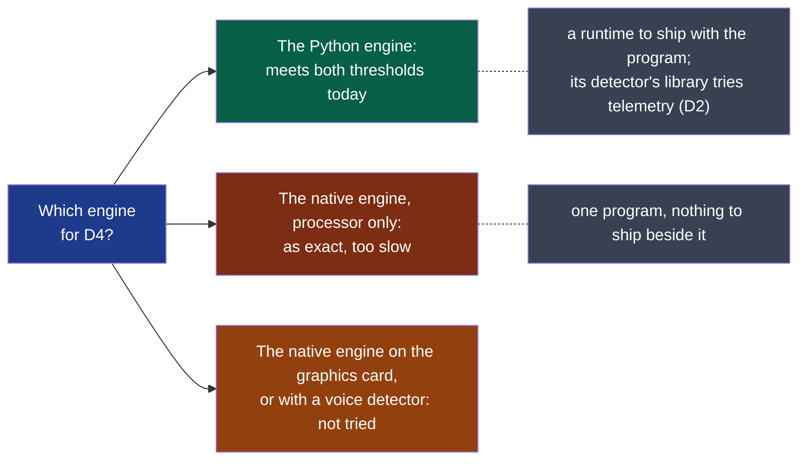

**Legend** — blue: the question · green: meets D4's thresholds as measured · red: does not ·
orange: not measured · grey: what each costs or spares.

**The engine is not chosen here**: it is a decision of the `transcription` module, with its
record, once the two orange leads are tried or set aside by the decider.
The decider's fourth orientation, below, changes the question it answers.

### Three orientations from the decider (2026-10-12)

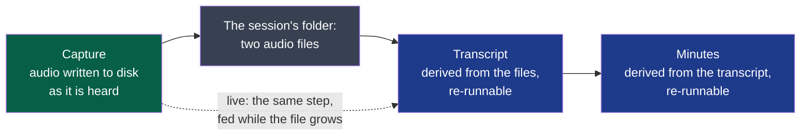

**Legend** — green: what must never be lost · grey: files on the machine · blue: what can
always be made again from the files. Dotted: the live path, an addition to the same step.

1. **Fedora first.** Every choice stays one that works on the three systems — no dependency
   without its named equivalent on Windows and macOS — but this cycle is built and tried on
   Fedora. The two other systems are built and tried afterwards; what the end date does not
   reach is said at closure, not hidden behind the goal's wording.
2. **Resilience, as far as it goes.** The audio first: it is written to disk as it is heard,
   so a crash costs seconds and not the meeting (the charter's first risk). Every later step
   is made from files and can be run again; a provider that fails loses nothing the step
   before it wrote. These become criteria of D3 to D6, not intentions.
3. **The transcript comes after the recording in this cycle — and live is prepared now**
   (decided 2026-10-12), so that adding it later costs as little as possible.

| | After the recording | Live, while recording |
|---|---|---|
| What the user sees | The transcript some minutes after *stop* | The words as the meeting goes |
| If the engine fails | Nothing lost: the audio is there, run it again | The same, **provided live never replaces the files** |
| Measured | Local: a third of the meeting's length on this laptop | Not measured: the engine while a call uses the machine; an online one needs a provider that streams |
| Cost in this cycle | Already D4 | One more thing in two weeks, after the context |

**Decided**: after the recording in this cycle, on the design drawn above; live is tried as a
spike once D3 and D4 hold on Fedora. *Prepared now* means three constraints on what this
cycle builds anyway, and no line of live code:

| Constraint, from the first version | Why live then costs little | Lands in |
|---|---|---|
| The audio on disk can be read **while it is still being written** | A live engine reads the same file the deferred one reads, a little earlier | D3, the `session-audio` contract |
| The transcript is a list of **timestamped segments that only grows** — never a text rewritten whole | A partial transcript and a finished one have the same shape; whoever reads it does not care which | D4, the `transcript` contract |
| The transcription step takes **a span of the audio**, and running it twice on the same span changes nothing | Live is that step called every few seconds; a failed call is called again | D4 |

Each is also what resilience asks: a crash leaves a readable audio and a transcript true up
to its last segment.

### D4 — the native engine on the graphics card (2026-10-13)

The decider installed the three packages; the same probe, built with `--features vulkan`,
on the same sample, the laptop's own graphics card (a Radeon 860M, through Vulkan).

| Engine | Model | Words that differ | Time, share of the sample's length |
|---|---|---|---|
| Python, processor — D2 | `large-v3-turbo`, 8-bit | 26.8 % | 36 % |
| Native, processor, 8 threads | 5-bit, 574 MB | 28.0 % | 82 % |
| **Native, graphics card** | 5-bit, 574 MB | 28.4 % | **9 %** — run twice |
| **Native, graphics card** | 8-bit, 874 MB | 27.3 % | **10 %** |
| **Native, graphics card** | unquantised, 1.6 GB | 28.0 % | **11 %** |

One run per line but the second. **What it answers:**

- **Time is settled**: half a minute for five minutes of meeting, four times faster than the
  Python engine and five times under D4's threshold.
- **Exactness is the same within what one run can tell.** The three models span 27.3 to
  28.4 %, and the largest is not the best: the differences between them are noise, and so is
  the point between them and the Python engine's 26.8 %.
- **D4's second criterion says "at most 27 %"**, which was D2's own figure with no margin. Read
  to the letter, the native engine misses it by 0.3 to 1.4 points; read for what it meant —
  as exact as the engine D2 used — it is met. **A threshold with no margin measures the noise
  of a run**: the decider decides whether it is restated.

**Restated by the decider, 2026-10-13**: *at most 29 %* — D2's figure with two points of margin.
The engine for Fedora is chosen with it: the native one on the graphics card, the model on
8 bits (ADR-0003).

**What it costs**: the graphics card's path needs Vulkan on the user's machine — present on a
Fedora desktop, to be read for the two other systems — and a model file of 574 to 874 MB that
someone must fetch, shown first (security rule 1).

### D5 — the minutes from real providers, and the model the example names (2026-10-13)

The program `summit-summary`, on D2's public sample, from its transcript and its context;
the runs and their reading are in the acceptance issue #43.

**The seven actions really agreed**, the reference D5's second criterion counts against:
contact the three speakers, Alexandre asked, answers by 26 April · contact the scientific
committee · send reminders two or three times a week · propose the two dates, 3 and 10
June · keep a plan B · pre-book the rooms, Laure · check the equipment and the technicians,
and test beforehand.

| Model | Tasks written | Of the seven: missing | Wrong | The guest as owner | Time |
|---|---|---|---|---|---|
| On the machine, 7B, with the context | 3 | 4 | 0 | no | minutes |
| Online, mid-size, with the context | 4 to 7 | 3 | 0 to 1 | no | 3 s |
| Online, fast, with the context | 7 | 2 to 3 | 0 to 2 — an owner and a date guessed | no | 3 s |
| **Online, large, with the context** | 8 to 9 | **0** | 0 | no | 15 s |
| Online, mid-size, without the context | 2 | 4 | 1 | **yes** | 2 s |

Two runs per online model with the context — the framer's, then an independent session's, which
counted for itself: where they differ the table gives both. A model does not answer twice the
same way, and the seven have soft edges: two of them are spoken as one task, one holds three.

- **The request was wrong, and is right**: its first wording labelled the three parts in
  English and the model copied the labels over a French text; it asked for "actions" and got
  the two that had an owner. Reworded, every model titles in the meeting's language.
- **The context is what keeps the guest out of the owners**, as in D2.
- **The wording was tuned on this one meeting** — the verifier's remark: its phrase on a task
  "said as a need" mirrors this sample's reminders and plan B. Another meeting must be read
  before the wording is trusted.
- **The second criterion is a matter of model.** Only the large one misses none of the seven;
  it also says of an owner that he "was asked, and did not explicitly accept".

**Decided by the decider (2026-10-13): the configuration example names the large model.** It
is the only one that keeps what D5 promises; a user who chooses a faster or a cheaper one
does so knowing what it leaves out. The model on the machine stays what a user without a
provider gets: three tasks of seven on this laptop.

### A fourth orientation — the best engine of each system (2026-10-13)

The decider, on reading the native engine's trial: each system may have a speech-to-text of
its own, made for it and fast on it; Whisper works on Fedora, and the product must be able to
take the best of each world.

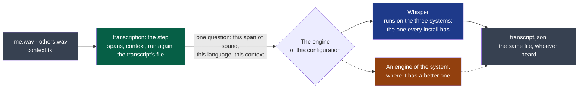

**Legend** — grey: the session's files · green: what is written once, for every engine · blue:
the engine every system can run · orange: an engine one system has and the others do not.
Dotted: not built in this cycle.

What it fixes for D4, from its first line of code:

| | |
|---|---|
| **The contract is the constant** | `transcript/v1` is the same file whoever heard; its header already names the engine and the model. Nothing downstream knows which one ran |
| **The engine is a setting, like the provider of the minutes** | The step is written once — spans, context, running again, the file. The engine answers one question behind one interface, and is chosen by configuration, with a default per system |
| **One engine runs everywhere** | Whisper, so that no system is left without a transcript. A system's own engine is added where it is better, never required |
| **An engine is admitted by the same sheet** | D4's criteria — words that differ, time, context received — are read per system, with that system's engine. A new engine passes the contract's tests and that sheet, or does not ship |
| **What it changes in the trial above** | The question is no longer which engine wins everywhere, but which one Fedora uses: the one that meets D4's thresholds there |

**What this cycle builds**: the step, the interface, and the one engine Fedora needs.
**Named, not read**: what Windows and macOS offer on the machine — their speech frameworks,
the runtimes made for their processors' accelerators. Each is a reading and a trial of its
own, on the colleagues' machines, in a later cycle.

**What it costs, known**: as many engines to try and to keep working as there are, on machines
the decider does not have. The interface is what keeps that cost in one place.

**D3 to D6 are `ready`** (2026-10-12): their acceptance criteria, in the front matter, were
written once D1 had answered for Fedora and D2 on a local and on an online provider. Each
comes from something the cycle recorded, not from a wish:

| Criterion | Comes from |
|---|---|
| Start and stop from the tray and the shortcut; no window by itself | D1 on Fedora: the tray's menu cannot raise a window, the shortcut can |
| Killed after two minutes, the audio is there; readable while written | The decider's second orientation, and the first constraint that prepares live |
| A silent source is said; the level read around its resting level | D1's third run: a file of zeros with no error, and a silent microphone judged "with sound" |
| The headset connected during the call | D1's third run: the output in use moves; **not tried yet**, so the criterion allows saying so to the user |
| 250 MB for an hour | D1's files: as heard, the two take 2.7 GB an hour |
| 29 % of the words, half the length | D2's first run on this laptop: 27 %, and 36 % of the length; two points of margin since 2026-10-13, when three ways to store one model gave 27.3 to 28.4 % |
| A weak microphone, read by the decider | D1's real call: the decider's voice is weak on this laptop, "as usual" |
| The context, on both steps | The decider, 2026-10-12: "On livre avec" |
| Killed halfway; run again on a span | The two other constraints that prepare live |
| A missing action counts; "not specified" rather than a guess | D2 online: two right actions of seven pass a count of wrong ones; the best minutes said what was not settled |
| A provider that fails loses nothing | The decider's second orientation |
| Only the configured host; shown before the first sending | Security rule 1 |

**Built and tried on Fedora** (first orientation): where a criterion names the decider's
laptop, Windows and macOS are tried afterwards with the same sheet, by the two colleagues.

**Four modules, decided by the decider** (2026-10-12: "on découpe les 4 modules"), one per
step of the idea file: `capture`, `transcription`, `summary`, `export`. The framer had
proposed two, on the handbook's advice not to split on day one (`.nstack/handbook/02-modules.md` §3);
the decider's reason is the product's second principle — each step independent, with its own
provider, usable alone. What it costs is known and accepted: four modules know each other
only through contracts, so **the session's files are contracts** — the audio `capture`
provides, the transcript `transcription` provides, the minutes `summary` provides — and their
first versions are written with D3 to D5. `capture` is declared `standard` now and `critical`
before the repository is opened (charter, risks); the three others are `standard`. All four
are user-facing.

**No technology is chosen here.** D1 asks whether one application can do these three things
on the three systems; it does not say with what. The decider named one candidate — "certains
frameworks comme Flutter génèrent des apps natives à partir du même dev" — and that it is
early to settle it. The choice is a decision of its own, taken after D1 on what it records,
with its prior art: an ADR, not a line of this cycle.

**Who verifies.** The four modules are user-facing: each change carries a test sheet run by
someone who is not its author. On Windows and macOS only the two colleagues can run it.

### D4 — the program, tried on Fedora (2026-10-13)

`summit-transcription` is merged (#41, #44, #49, #50): the step every engine shares, Whisper
behind its interface, a program with no window. Where each criterion stands on the decider's
laptop:

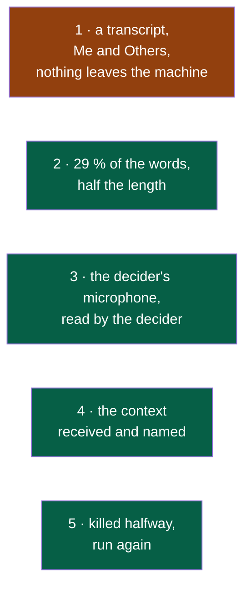

**Legend** — green: met, read by a verifier who is not the author · orange: met as a program;
"when the user asks" waits for the shell.

| Criterion | Measured | Stands |
|---|---|---|
| 2 · words that differ, time | On the public five-minute sample: **26.8 %** and **34 to 38 s for 302 s** on the graphics card (11 to 13 % of the length); 26.0 % and 230 s on the processor alone — 76 % of the length | Met on the graphics card. **On the processor the words are met and the time is not**: a machine with no graphics card Whisper can use does not meet "half the length" with this model |
| 4 · the context | The engine receives `context.txt` with each span; the transcript's header holds it | Met |
| 5 · killed, run again | Killed at three moments with the real model, run again: the same bytes as a run never stopped. With played engines: a stop at every call, a kill at every byte | Met — and narrower than written: a session is taken up, a span of one is not asked for by itself |
| 1 · Me and Others, on the machine | The sample has one file of voices: every segment is `others`, none on the silent `me`. The program opens no connection | Met as a program; both voices of a real call come with criterion 3 |
| 3 · a weak microphone | Ten sentences read by the decider into the laptop's microphone, no headset (issue #53): **none lost of ten**, each word for word, 2.6 s for 27 s. The recording was at 8 % of full scale, resting at zero | Met, **at a speaking voice**. The weak level of D1's call — 0.01 to 0.5 % — was the decider speaking very low, not the microphone: "j'ai juste parlé plus fort". A voice that low was not transcribed again; the decider judged it not worth the cycle's time (2026-10-13) |

**What the step cost, and why it is recorded.** The step was verified seven times before it
passed. Every failure but the first had one cause: it decided on fractions of a second what
the transcript writes in hundredths. Counted in whole hundredths from end to end, it passed.
The lesson is the module's (`modules/transcription/AGENTS.md`); the cost is the cycle's.

**The span is five minutes, on a measure**: heard thirty seconds at a time, 34.5 % of the
words differed on the same sample; one or two minutes, 28 %; whole, 26.7 %. A sentence longer
than half a span may come out in two pieces: two and a half minutes.

**Left open by the trial**, for the shell: where the model comes from and is kept (874 MB,
shown to the user first); a session still recording whose context is edited is refused when
its transcript is taken up, since the transcript says which context made it.

### The shell, framed (2026-10-13)

The fifth module of ADR-0002, not created yet. It holds no step: it starts the four
programs, reads what they print and the session's folder, and is everything the user
touches.

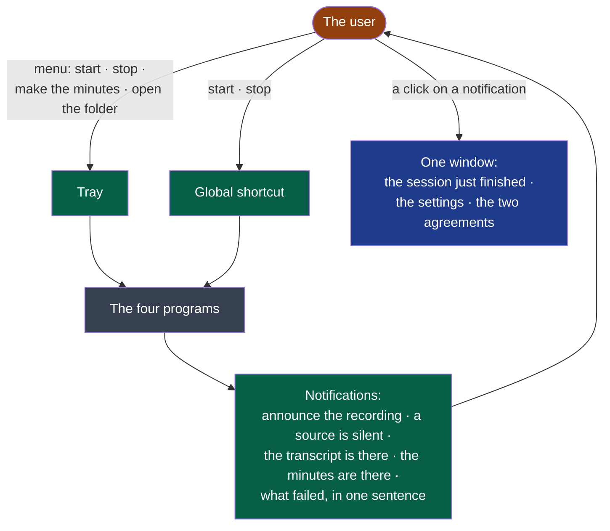

**Legend** — green: what D3 to D6 already ask of the shell · blue: D7, accepted by the decider
on 2026-10-13 · grey: merged.
Under GNOME the window comes forward from a notification or the shortcut, never from the
tray's menu (D1): the menu holds the actions themselves.

**Decided by the decider on 2026-10-13:**

| Subject | Decision | In their words |
|---|---|---|
| What follows a recording | A setting. Out of the box the transcript follows alone; the user may have the minutes follow too, or nothing | "tout devrait pouvoir être automatique mais ça doit être un réglage de l'application, par défaut transcript auto seul" |
| The interface | Modern, high-end, the best the system allows; the framer settles how much of it enters this cycle | "l'ux/ui doit être moderne et highend, optimale, tranche" |
| The model, 874 MB | Fetched by Summit, after the user agreed to its size and its host | — |
| The reminder to announce the recording | May be switched off — the idea file's C7, against the framer's reading of the charter | "Désactivable" |

**Settled by the framer, as asked** — one window enters this cycle, as D7, and it is small on
purpose: the session just finished, four settings, and the two moments where the user must
agree before something crosses the network. A setting the decider asked for has no home in
a tray's menu, and an agreement cannot live in a notification that fades. What stays out is
what makes a window large: the list of sessions, the player, search, costs, the assistant.

**How it is built** — in this order, each slice a pull request with its sheet:

| Slice | The user sees | Closes |
|---|---|---|
| 1 | Tray, shortcut, start and stop, the reminder, "a source is silent" | D3 on Fedora |
| 2 | The transcript follows the recording; the model is fetched once, agreed and checked | D4's first criterion |
| 3 | The minutes, asked for or chained; what leaves is agreed first; a failure is one sentence | D5 |
| 4 | The window: the session, the settings | D7 |
| 5 | "Open the session's folder", with `export` | D6 |

Before slice 4 is coded, the decider sees the window and the menu as a picture and amends
it: an interface is judged by looking at it.

**Proposed by the framer, confirmed by the decider on 2026-10-13** ("ok") — each with its source:

- **The shortcut is Super+Alt+M** on Fedora, the one D1's fifth run fired; Ctrl+Alt+M and
  ⌥⌘M elsewhere. Under GNOME the portal lets the user change it.
- **The provider's key goes to the system's keyring** once the window can take it — the idea
  file, §9: "stockés dans le coffre sécurisé de l'OS, jamais en clair". Until slice 4 it
  stays the file it is today.
- **The model comes from whisper.cpp's own published files**, the host named to the user,
  its fingerprint written in the shell's code: security rule 1 allows a host only when the
  user was shown it.
- **`shell` is `standard`**, as `summary` is, which handles the same key.
- **A context edited while recording** is no trouble while the transcript starts after the
  stop — and becomes one the day transcription is live: noted for that day.

**What it costs, said now.** Fourteen days remain, and the cycle already owed the shell's
first three slices, `export`, and the trials on Windows and macOS on two colleagues' time.
D7 is added, nothing is removed: the appetite does not stretch. If the end date comes
first, the circuit breaker decides what ships — and the order above is the order of what
ships: a recording, a transcript and minutes reached from the tray come before the window.

### A first real meeting, through the three programs (2026-10-13)

The decider recorded a real meeting of sixteen minutes — a video call, the laptop's
loudspeakers and its built-in microphone — with the three programs started by hand, before
the tray existed. Nothing of what was said is written here: only what the programs did, and
what the decider read.

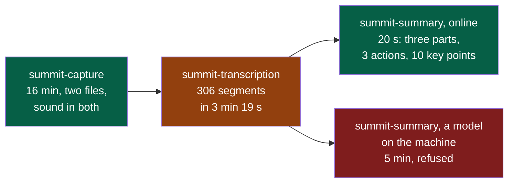

**Legend** — green: did what was asked · orange: did it, with a defect the decider read ·
red: failed, and said so.

| Step | Measured | Read by the decider |
|---|---|---|
| Recording | 16 min 5 s; `me` and `others` both hold sound from end to end | — |
| Transcript | 306 segments in 199 s on the graphics card — 21 % of the meeting's length, two files of speech to hear. `me`: 14.9 min of speech; `others`: 10.2 min | "Dans l'ensemble pas trop mal", with **repetitions that are wrong**: one party seems to repeat, like a parrot, what the other just said |
| Minutes, online | The large model of the example: 20 s; highlights, 3 actions, 10 key points | "Pas mal fait" |
| Minutes, on the machine | A 7B model: 4 min 57 s, then refused — "the provider's answer is not minutes" — and no file written | — |

**What it shows.**

- **The microphone hears the loudspeakers.** With no headset, `me` holds the user's voice
  *and* everyone else's, a moment late: each sentence of the others is transcribed twice,
  once for each party. `session-audio/v1` says so — "it never promises that `me` is free of
  the others' voices" — and the transcript then says the wrong thing about who spoke. It is
  the commonest way to take a call, not an edge. The minutes hold, because a large model
  passes over what is said twice.
- **A model on the machine did not give minutes of a sixteen-minute meeting.** The program
  refused an answer that was not minutes rather than write it: what D5's fifth criterion
  asks. Why the answer was not minutes is not known yet; the transcript was 20,685
  characters, and whether the model read all of it is the first thing to look at. D2's
  sample was five minutes.
- **The time.** The transcript took a fifth of the meeting's length where the sample took an
  eighth: both files hold speech here, and one was silent there.

**What follows** *(framer, to confirm)*: the echo first — taken out of the microphone where
the sound is captured, with what the system already offers for it, tried on Fedora before
anything is decided; then the model on the machine. Neither is a deliverable of this cycle
as written: both are D3's and D5's own criteria read on a real meeting.

## Out of scope

Not done in this cycle, even if time remains:

- Export to Notion, or to any tool: the files in the session's folder are the export.
- The file context menu; a watched folder.
- Live transcription during the recording.
- Detecting that the microphone is in use; stopping by itself.
- The first-launch assistant and the ready-made profiles. The settings D7's window shows are
  the four the shell needs — what follows a recording, the reminder, the provider, the
  shortcut — and they stay one configuration file.
- Costs, the list of sessions, search, the audio player: D7's window shows one session, the
  one just finished.
- Custom vocabulary; templates of minutes — beyond the free context a step takes.
- Import and export between the steps beyond the files themselves.
- Signing the builds.

## Later

Candidates for the next framing, in the order the idea file gives them weight: the context
menu on files; export to Notion; detection of the microphone;
profiles; costs; live transcription.

## Open questions

**Blocking:** none left.

**Not blocking:**

- The spike the discovery carried first — running the nearest product's Linux build — was
  dropped by the decider on 2026-10-12. If D1 shows capture on Fedora to be as fragile as the
  challenger found it elsewhere, that question comes back.
- The colleagues' time is not the decider's to spend: D1 and the test sheets of D3 to D6
  wait on two people outside the build. If a reply takes more than two days, it is named at
  the circuit breaker, not absorbed.

## Closure

<Written at the end: what was delivered, which success criteria moved, what was deferred,
where the next framing starts.>

**Documents brought current:** <the front page, the module map, a module's page — each with
its pull request; or "none", and why nothing a reader sees has changed>
