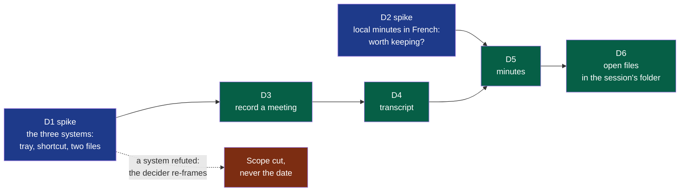
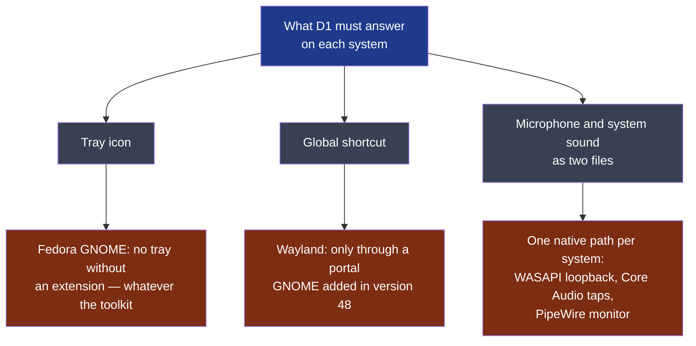
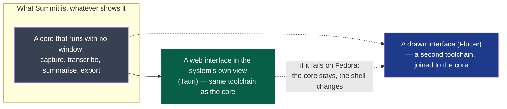
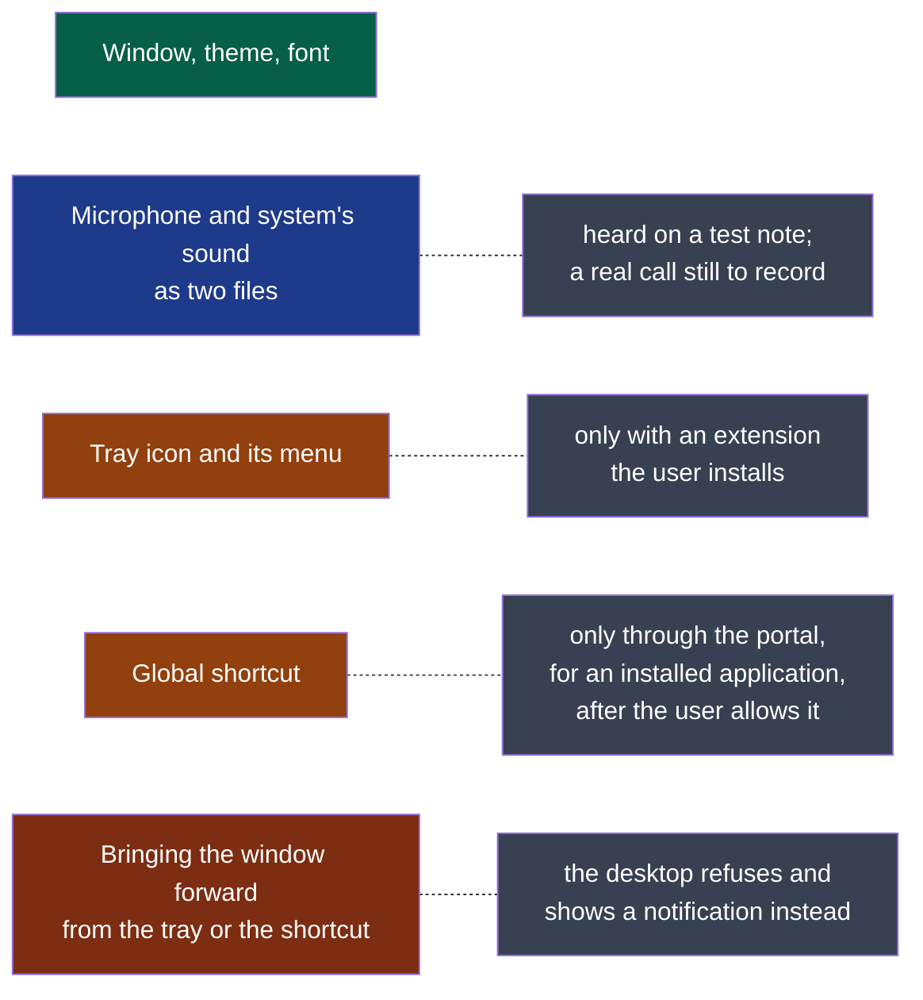

# Cycle 01 — A first meeting, on three systems

> One accepted cycle at a time; no automatic extension.

## Goal

**Legend** — blue: a spike, whose product is knowledge and whose refuted result is still
delivered · green: delivery work, in the order it can be built · red: what happens if a
spike says no.

The charter's criteria start the day Summit installs on each of the three machines. This
cycle is what gets it there: the smallest thing the three people can use for a real meeting.
Two weeks is what the decider wants to spend, with Windows and macOS included.

## Deliverables

**D1 comes first and decides the rest.** D3 is written for the three systems; if D1 refutes
one of them, D3 cannot be accepted there, and the decider re-frames — the scope is cut, the
date is not moved. D1 also records whether an unsigned build opens without help, which is
what the decision on paying for signing waits for.

**D1 — what was read before the probe (2026-10-12).** Not a choice of technology: what
the probe must find out, and with what it can start. Read with the agent runtime's web
search; *secondary* marks what was not read at its primary source.

**Legend** — blue: the spike's question · grey: its three parts · red: what the reading
found, each one the operating system's doing rather than a toolkit's.

| Finding | What it changes for the probe | Source |
|---|---|---|
| A Flutter tray plugin supports the three systems, and its own page says that under GNOME "the AppIndicator extension may be required to display the icon" | The tray on the decider's Fedora depends on an extension the user must add, with any toolkit. The probe records it; it cannot fix it | [tray_manager](https://pub.dev/packages/tray_manager), read through a search summary — *secondary* |
| GNOME 48 lets an application "register system-wide shortcuts" through a portal; users on Fedora 42 report never seeing its prompt | A global shortcut under Wayland exists on paper. Whether a given toolkit's plugin uses the portal is unknown for both candidates | [GNOME 48 release notes](https://release.gnome.org/48/developers/), [Fedora discussion](https://discussion.fedoraproject.org/t/how-do-you-enable-disable-global-shortcuts-in-gnome-48/154507) — *secondary* |
| Capturing the system's sound has one native path per system: WASAPI loopback on Windows; Core Audio process taps on macOS, which need a usage description in the application's manifest and deliver silence without the permission; the monitor of the default output under PipeWire on Linux | This is the hard part, and no toolkit hides it. A probe that shows a tray and a shortcut and cannot write the second file has answered nothing | [AudioCap](https://github.com/insidegui/AudioCap), [wasapi crate](https://docs.rs/wasapi), [Fedora discussion on monitors](https://discussion.fedoraproject.org/t/what-is-the-equivalent-of-pulseaudios-monitor-sources-in-pipewire/68939) — *secondary* |
| Flutter packages for the system's sound are young: one claims the three systems at version 0.0.2 with 38 downloads; another lists macOS and Linux as not yet supported | With the decider's candidate, the capture is likely to need native code per system, behind the toolkit | [desktop_audio_capture](https://pub.dev/packages/desktop_audio_capture/score), [audio_io](https://pub.dev/packages/audio_io/versions/0.6.0) — *secondary* |
| A macOS or Windows build cannot be made on the decider's Fedora | Whatever the toolkit, the two colleagues' builds come from the forge's CI runners or from their own machines. On a private repository the free minutes are counted, and macOS minutes cost more | **Assumption** — the forge's billing page was not read |

**On this workstation (read 2026-10-12):** Flutter and Dart are installed; no Rust toolchain;
`ffmpeg`, `pw-record` and `pactl` are present; the session is GNOME on Wayland.

**The two candidates, read at their sources (2026-10-12), and the one the probe starts
with.** The decider asked for a thorough reading, with two weights: the interface comes
first, and the software must be of quality. *Read* means the page itself; *secondary* a
search summary.

**Legend** — grey: the part every step and every right-click needs, with no window at all ·
green: the shell the probe starts with · blue: the shell kept in reserve, which the probe
can still fall back to.

| Criterion | Flutter | Rust core with a web view (Tauri v2) | Source |
|---|---|---|---|
| **The system's sound, on three systems** — the hard part | Packages too young: one at version 0.0.2 with 38 downloads, another without macOS or Linux. Native code per system, written by hand | One audio library with a host per system: WASAPI, CoreAudio — "loopback recording requires 14.6+" — and PipeWire or PulseAudio as optional hosts | [cpal](https://github.com/RustAudio/cpal), *read*; Flutter packages *secondary* |
| **Running a step with no window** — a right-click on a file, the idea's §8 | The interface toolkit is the application; a headless step is a second program | The core is a program of its own; the window is one of its clients | The idea file, §8 |
| **What the nearest products chose** | None found | Both: Meetily — "built with Tauri", "a Rust-based backend" — and Anarlog — "Tauri v2 desktop app: React and TypeScript UI, Rust backend" | Their repositories, *read* |
| **The interface: quality and the system's look** — the decider's first weight | Draws every pixel itself: identical on the three systems, and not the system's controls or fonts unless rebuilt | The system's own web view: the system's fonts and light or dark theme come for free; three engines to test — Chromium on Windows, WebKit on macOS, WebKitGTK on Linux | [Tauri, webview versions](https://v2.tauri.app/reference/webview-versions/), *read* |
| **Linux rendering** — where the nearest products are weakest | A GTK embedder, no web engine in between | Its own documentation lists blank windows and crashes, "most often NVIDIA GPUs" | [Tauri, Linux graphics](https://v2.tauri.app/develop/debug/linux-graphics/), *secondary* |
| **Global shortcut under Wayland** | Its package needs `keybinder-3.0`, an X11 library, and was published two years ago | Its plugin's page says nothing of Wayland; its library was read by the challenger as X11 only. A wrapper of the desktop portal exists for Rust | [hotkey_manager](https://pub.dev/packages/hotkey_manager), [ashpd](https://docs.rs/ashpd/latest/ashpd/desktop/global_shortcuts/index.html), *read* |
| **Tray** | Needs an extension under GNOME | Needs the same; and on Linux "the event is not emitted even though the icon is shown" — a menu on right click only | [Tauri, system tray](https://v2.tauri.app/learn/system-tray/), *read* |
| **Toolchains for one builder** | Dart, plus native code in three languages for the capture | Rust, plus a web interface | — |

**On the decider's workstation, read the same day:** an AMD graphics card, not the one
Tauri's page warns about; WebKitGTK 2.54; GNOME 50, which has the shortcuts portal; PipeWire
1.6; **no tray extension installed** — the icon will not show there with either candidate.

**The probe starts with the Rust core and the web view.** In order of weight: the capture
is the part that can sink the product, and one library covers the three systems; every step
must run without a window, so the core exists whichever shell is chosen, and one toolchain
is what one builder can hold; the two nearest products made this choice; and the idea asks
for the system's look, which a web view inherits and a drawn interface has to imitate. What
it costs is known: three web engines instead of one renderer, and Linux is where that engine
is weakest. **So D1 tests exactly that**, on the decider's Fedora first — a window that
renders badly there ends the web view, not the core, and the drawn shell takes its place.

This is the choice **for the probe**. The decision for the product is an ADR, written on what
D1 records.

**D1 — what the probe recorded.** One row per run; a refuted run is a recorded answer.

| Date | System | Run | Microphone | System's sound | Read |
|---|---|---|---|---|---|
| 2026-10-12 | Fedora 44, GNOME on Wayland, PipeWire 1.6 | `d1-capture`, 20 s, by the decider | A file with sound, 20.0 s; loudest sample at 100 % of full scale — it clipped | **A file of silence**, 20.0 s, opened on the default output with no error | Not met. Not yet known whether anything was playing: the probe now plays a test note of its own and tries a second way to open the output |
| 2026-10-12 | Same | `d1-capture`, 10 s, `--tone`, by the decider | Heard | **Heard**: the probe's own note, which the decider heard on the loudspeakers | **Met with a test note, not with a call.** The first run's silence was nothing playing: the decider had not spoken and no sound was running. Which of the two ways heard it was not reported. Still to record: a real call; and whether "me" stays free of the others' voices when they come out of loudspeakers the microphone can hear |

| Date | System | Run | Window | Theme and font | Tray icon | Global shortcut |
|---|---|---|---|---|---|---|
| 2026-10-12 | Fedora 44, GNOME on Wayland | `d1-shell`, by the decider, read from their screenshot | **Rendered**, sharp, no artefact visible | **Dark theme followed**; the system's font | **Created and visible** in the top bar — with the tray extension the decider installed first, which a user of stock Fedora does not have | **Accepted, and never fired**: the shortcut library registered Ctrl+Alt+R without an error, and pressing it with another window focused did nothing — 0 times. A silent failure, worse than a refusal: the application believes it has a shortcut. The tray's menu opens on a click. Asked of the desktop portal next: **refused — "An app id is required"**, no dialog shown. The portal answers only an application that has declared who it is, with a desktop entry installed under that name: true of an installed product, not of a program run from its build folder. Declaring itself next: **refused again — "App info not found for 'dev.summit.d1shell'"**, with the desktop entry installed. Probable cause, the framer's own mistake: the entry's `Exec` named a program that is on no path, and the desktop discards an entry whose program it cannot find. **Not obtained in three tries**; what is established is the way — an installed application, a valid desktop entry, the portal — and that the shortcut library's "accepted" means nothing under Wayland |

| 2026-10-12 | Same, fourth run | `d1-shell` with a corrected desktop entry and Super+Alt+M | — | — | Its menu opens; **"Show the probe" does not bring the window forward**: the desktop shows a notification, "Summit — D1 probe is ready", instead | **Obtained through the portal**: the desktop asked the decider to add the shortcut, bound it, and it fired 6 times with another window focused. The shortcut library's own registration still fired 0 times |

**What D1 established on Fedora** (GNOME 50, Wayland), for whatever is built next:

**Legend** — green: works as it is · blue: works, not yet on what the criterion asks · orange:
works under a condition the user must meet · red: refused by the desktop · grey: the
condition or the reason.

Three of these are the desktop's rules, not the toolkit's: a drawn interface would meet the
same tray, the same portal and the same refusal to steal the focus. The one that was the
web view's own risk — the window — is the one that simply worked.

**D3 to D6 are `proposed`, not `ready`**: their acceptance criteria are written once D1
and D2 have answered — which engine, which capture path per system, which threshold of
quality. Writing them today would be writing them around the answer hoped for.

**Four modules, decided by the decider** (2026-10-12: "on découpe les 4 modules"), one per
step of the idea file: `capture`, `transcription`, `summary`, `export`. The framer had
proposed two, on the handbook's advice not to split on day one (`docs/os/02-modules.md` §3);
the decider's reason is the product's second principle — each step independent, with its own
provider, usable alone. What it costs is known and accepted: four modules know each other
only through contracts, so **the session's files are contracts** — the audio `capture`
provides, the transcript `transcription` provides, the minutes `summary` provides — and their
first versions are written with D3 to D5. `capture` is declared `standard` now and `critical`
before the repository is opened (charter, risks); the three others are `standard`. All four
are user-facing.

**No technology is chosen here.** D1 asks whether one application can do these three things
on the three systems; it does not say with what. The decider named one candidate — "certains
frameworks comme Flutter génèrent des apps natives à partir du même dev" — and that it is
early to settle it. The choice is a decision of its own, taken after D1 on what it records,
with its prior art: an ADR, not a line of this cycle.

**Who verifies.** The four modules are user-facing: each change carries a test sheet run by
someone who is not its author. On Windows and macOS only the two colleagues can run it.

## Out of scope

Not done in this cycle, even if time remains:

- Export to Notion, or to any tool: the files in the session's folder are the export.
- The file context menu; a watched folder.
- Live transcription during the recording.
- Detecting that the microphone is in use; stopping by itself.
- The first-launch assistant and the ready-made profiles: one configuration file.
- Costs, the list of sessions, search, the audio player.
- A context given to a step; custom vocabulary; templates of minutes.
- Import and export between the steps beyond the files themselves.
- Signing the builds.

## Later

Candidates for the next framing, in the order the idea file gives them weight: the context
menu on files; export to Notion; the context given to a step; detection of the microphone;
profiles; costs; live transcription.

## Open questions

**Blocking:** none left.

**Not blocking:**

- The spike the discovery carried first — running the nearest product's Linux build — was
  dropped by the decider on 2026-10-12. If D1 shows capture on Fedora to be as fragile as the
  challenger found it elsewhere, that question comes back.
- The colleagues' time is not the decider's to spend: D1 and the test sheets of D3 to D6
  wait on two people outside the build. If a reply takes more than two days, it is named at
  the circuit breaker, not absorbed.

## Closure

<Written at the end: what was delivered, which success criteria moved, what was deferred,
where the next framing starts.>

**Documents brought current:** <the front page, the module map, a module's page — each with
its pull request; or "none", and why nothing a reader sees has changed>
