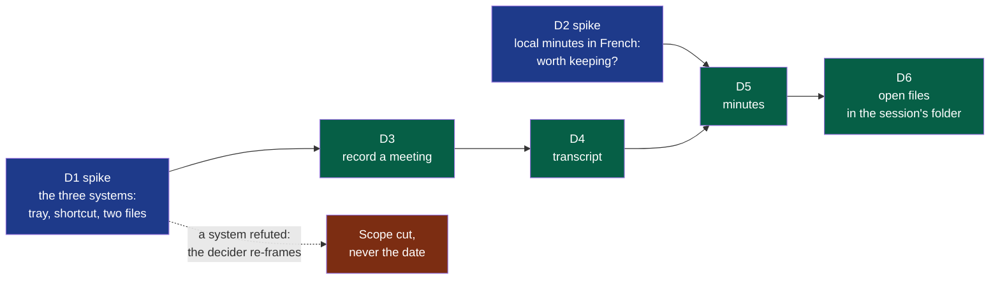

# Cycle 01 — A first meeting, on three systems

> One accepted cycle at a time; no automatic extension.

## Goal

**Legend** — blue: a spike, whose product is knowledge and whose refuted result is still
delivered · green: delivery work, in the order it can be built · red: what happens if a
spike says no.

The charter's criteria start the day Summit installs on each of the three machines. This
cycle is what gets it there: the smallest thing the three people can use for a real meeting.
Two weeks is what the decider wants to spend, with Windows and macOS included.

## Deliverables

**D1 comes first and decides the rest.** D3 is written for the three systems; if D1 refutes
one of them, D3 cannot be accepted there, and the decider re-frames — the scope is cut, the
date is not moved. D1 also records whether an unsigned build opens without help, which is
what the decision on paying for signing waits for.

**D3 to D6 are `proposed`, not `ready`**: their acceptance criteria are written once D1
and D2 have answered — which engine, which capture path per system, which threshold of
quality. Writing them today would be writing them around the answer hoped for.

**Four modules, decided by the decider** (2026-10-12: "on découpe les 4 modules"), one per
step of the idea file: `capture`, `transcription`, `summary`, `export`. The framer had
proposed two, on the handbook's advice not to split on day one (`docs/os/02-modules.md` §3);
the decider's reason is the product's second principle — each step independent, with its own
provider, usable alone. What it costs is known and accepted: four modules know each other
only through contracts, so **the session's files are contracts** — the audio `capture`
provides, the transcript `transcription` provides, the minutes `summary` provides — and their
first versions are written with D3 to D5. `capture` is declared `standard` now and `critical`
before the repository is opened (charter, risks); the three others are `standard`. All four
are user-facing.

**No technology is chosen here.** D1 asks whether one application can do these three things
on the three systems; it does not say with what. The decider named one candidate — "certains
frameworks comme Flutter génèrent des apps natives à partir du même dev" — and that it is
early to settle it. The choice is a decision of its own, taken after D1 on what it records,
with its prior art: an ADR, not a line of this cycle.

**Who verifies.** The four modules are user-facing: each change carries a test sheet run by
someone who is not its author. On Windows and macOS only the two colleagues can run it.

## Out of scope

Not done in this cycle, even if time remains:

- Export to Notion, or to any tool: the files in the session's folder are the export.
- The file context menu; a watched folder.
- Live transcription during the recording.
- Detecting that the microphone is in use; stopping by itself.
- The first-launch assistant and the ready-made profiles: one configuration file.
- Costs, the list of sessions, search, the audio player.
- A context given to a step; custom vocabulary; templates of minutes.
- Import and export between the steps beyond the files themselves.
- Signing the builds.

## Later

Candidates for the next framing, in the order the idea file gives them weight: the context
menu on files; export to Notion; the context given to a step; detection of the microphone;
profiles; costs; live transcription.

## Open questions

**Blocking:** none left.

**Not blocking:**

- The spike the discovery carried first — running the nearest product's Linux build — was
  dropped by the decider on 2026-10-12. If D1 shows capture on Fedora to be as fragile as the
  challenger found it elsewhere, that question comes back.
- The colleagues' time is not the decider's to spend: D1 and the test sheets of D3 to D6
  wait on two people outside the build. If a reply takes more than two days, it is named at
  the circuit breaker, not absorbed.

## Closure

<Written at the end: what was delivered, which success criteria moved, what was deferred,
where the next framing starts.>

**Documents brought current:** <the front page, the module map, a module's page — each with
its pull request; or "none", and why nothing a reader sees has changed>
