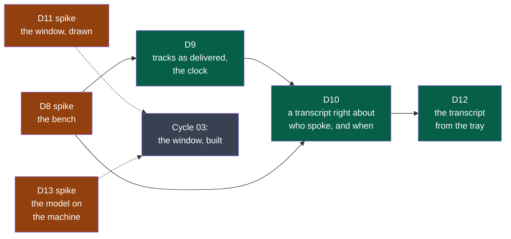
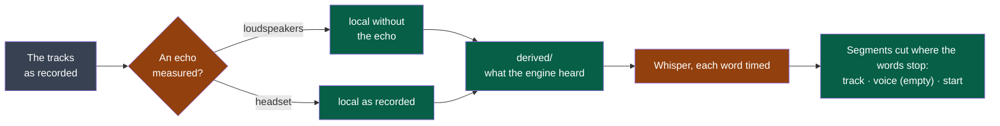

# Cycle 02 — The audio kept as recorded

> One accepted cycle at a time; no automatic extension.

## Goal

Cycle 01 built the three programs and put Summit in the tray. A first real meeting, taken
as most are — on a laptop's loudspeakers — gave a transcript that repeats one party under
the other's name. ADR-0004 decided what a session's audio is; this cycle builds it, and
builds first the means to measure it.

**Legend** — orange: a spike, whose product is knowledge · green: a deliverable a user sees ·
grey: what this cycle prepares and does not build.

## Deliverables

**The order is the method.** D8 comes first and alone: nothing in the capture or the
transcription moves before the twelve counts of today exist. D9 then D10 are read against
them. D11 runs beside them from the first day: drawings cost little and decide much, and
the decider's eye is the slowest thing to schedule. D12 comes once D10 holds — a transcript
that is wrong is not worth bringing to the tray. D13 is small and fits where a day is free.

| Deliverable | Comes from | Reopens |
|---|---|---|
| D8 — the bench | ADR-0004's rule of method; cycle 01's closure: seven verifications of one step, a regression called a result | — |
| D9 — tracks as delivered, the clock | ADR-0004, rules 1 to 3 | Cycle 01's D3: its six criteria on the first contract |
| D10 — who spoke, and when | ADR-0004, rules 4 to 6; the decider's reading of 2026-10-13 | Cycle 01's D4 |
| D11 — the window, drawn | Cycle 01's D7; the decider, 2026-10-13: "moderne, ludique … UX/UI primordiale" | — |
| D12 — the transcript from the tray | Cycle 01's shell, second slice | Cycle 01's D4, first criterion |
| D13 — the model on the machine | Cycle 01, *A first real meeting* | Cycle 01's D5 |

**What a count is worth.** D10's thresholds — one exchange in twenty, one word in fifty —
are the framer's, written before the bench exists *(framer, to confirm on D8's twelve
counts)*: if a headset itself does worse, the decider restates them on that measure, as D4's
second criterion was restated in cycle 01.

**Modules.** A sixth, `platform`, for the bench: a tool the modules share and none owns
(`.nstack/handbook/09-platform.md`). No other is created: the echo-free microphone and the
engine's copy are made by `transcription`, which is what needs them; `all`, the file to
listen to, is `export`'s, in a later cycle.

### D8

The bench is `modules/platform`: a meeting of 70 turns and 4.3 minutes, four synthesised
voices — two on each side — a fifth of the local speech said over the remote; three
listening conditions set on one minute measured on the decider's laptop; six draws of each.
The programs of 2026-10-13, lowest – median – highest — **the line every later change is read
against**:

| Count | Headset | Loudspeakers low | Loudspeakers loud |
|---|---|---|---|
| Words wrong, local, of 516 | 22 – 27.5 – 67 | 246 – 250.5 – 262 | 264 – 267 – 346 |
| … net of the echo | 22 – 27.5 – 67 | 40 – 43 – 60 | 47 – 49.5 – 123 |
| Words wrong, remote, of 331 | 6 – 7 – 10 | 6 – 6 – 23 | 6 – 6 – 14 |
| Local words lost under the remote, of 109 | 7 – 7 – 16 | 7 – 9 – 12 | 14 – 21 – 25 |
| Words said twice, of 331 | 0 | 201 – 204 – 210 | 214 – 218.5 – 223 |
| Words on the wrong side | 0 | 0 | 0 |
| Exchanges out of order, of 42 to 47 found | 10 – 12 – 14 | 6 – 7 – 12 | 6 – 8 – 14 |
| Turns far from their time, of 67 to 70 found | 27 – 30.5 – 34 | 15 – 17 – 21 | 16 – 18 – 22 |
| Turns not found, of 70 | 0 – 0 – 3 | 0 – 1 – 3 | 2 – 2 – 3 |

**D10's criteria, read on this line** *(framer — the decider restates)*:

- The first — "no more words of the local side wrong than as delivered" — is passed by
  muting the microphone, which removes the echo's words. Proposed: *no more local words
  lost under the remote than as delivered, and no more local words wrong net of the echo*.
- "At most one exchange in twenty out of order": a headset gives one in four today. It is a
  target for D10's work on times, not a line already held.
- "At most one word in fifty on the wrong side" and "no more said twice than a headset":
  readable as they are; a headset gives none of either.

What the line says, and what it cost to get one worth reading: [its entry in the log, #129](https://github.com/NapkinStack/summit/issues/129#issuecomment-6196156196).

### D9

In progress. The second form of a session (`contracts/session-audio/v2`) is written **on
asking**, read by the step that follows, and measured on the bench.

| Piece | Today |
|---|---|
| `capture` | `summit-capture record <sessions> --as v2` writes each source as delivered — its rate, its channels, 24 bits — and the session's clock beside. Without `--as v2` it writes the first form, as before: that is still what the tray starts. Its end-to-end scenarios cover both forms, on devices made for the run |
| `platform` | The bench renders its meeting in either form, the second with a clock that has two stops and a silence in it |
| `transcription` | Reads either form — `session.json` names which — and says which it read. A track is brought to what an engine hears and placed on the session's clock; the first form is heard as it always was |
| What the programs say while recording (`recording/v1`) | The same lines in both forms; they still name the sources `me` and `others` where the second form's files are `local` and `remote` |

**The remote side is worse in the second form** (median 6 → 21.5 words wrong of 331 on loud
loudspeakers): the engine hears a long recording window after window, so a pause the clock
places truly moves every window after it. It is the engine's way with long sound, not a sound
the reader makes wrong. The measures and how the cause was found: [its entry in the log, #129](https://github.com/NapkinStack/summit/issues/129#issuecomment-6196157116).

**Decided by the decider on 2026-10-14**, once D14 was refuted: the tray keeps starting the
first form until D10 holds. The second form stays written on asking, and measured.

Not measured yet — the fourth criterion: what an hour weighs on the decider's laptop.
Computed, not measured: two tracks at 48,000 samples a second, two channels, 24 bits are
2.07 GB an hour as delivered. The limit that replaces 250 MB is the decider's to set on the
real measure.

Left before D9 is offered for acceptance: the second form becomes what `record` writes, from
the tray too — weighed again once D10 holds, on the remote side's count; a session of the
first form is still read, or refused in one sentence; the hour's weight.

### D10

In progress. Built and merged: the turns timed by their words (#117), a segment's track and
the voice's place (#118, #119), the echo canceller (#120), what the engine heard kept (#121),
a turn the engine jumped over heard again (#124), a loop heard again (#133).

**Legend** — grey: the recording, never touched · orange: what D10 built · green: what it
makes, kept apart and made again the same.

**What is decided, and binds the next changes:**

- The echo canceller is WebRTC's, the one browsers and PipeWire use, in its Rust port
  `sonora` 0.2.0 (BSD-3-Clause), fed the remote track as what the loudspeakers played. It is
  used only where an echo is measured (3 dB): a headset's microphone goes to the engine as
  recorded.
- When a turn was said comes from each word's time, from the alignment heads `whisper.cpp`
  carries for this model, and a segment is cut where the words stop for more than 0.5 s.
- A stretch of a speaker's sound at the level of the words written, 1.5 s or more, where no
  word was written, is heard again alone (#124).
- A run of four words written three times or more in what a span gave is a loop: from the
  segment before to the one after, it is heard again alone, after no text of the window
  before, and before #124's rule; the text of the window before stays everywhere else, as
  `context.txt` rides with it (#133).
- The product transcribes a stopped recording: a transcript begun while the meeting is
  recorded keeps the echo decision of its beginning.
- Each segment's track and voice are optional fields of `transcript/v1`, so the transcripts
  written before still read; `transcript/v2` is owed only the day `speaker` is dropped.

| Criterion | Where it stands |
|---|---|
| No more words said twice than with a headset | Holds on 23 loudspeaker draws of 24; one loud draw gave 3 words |
| No more local words wrong than as delivered, the echo gone without the speaker's words | Holds on the median, not on every draw; more local words said over the remote are lost than as delivered — the canceller's suppression while both speak |
| At most one exchange in twenty out of order, one word in fifty on the wrong side | Holds in every draw |
| A headset's local track goes to the engine as recorded | Holds |
| What was made kept apart, saying what made it; made again, the same | Holds |
| Each segment says its track, and has a place for the voice | Holds |
| The meeting of 2026-10-13, recorded again by the decider, on loudspeakers then with a headset | **Owed — the decider's gesture** |

**Next:** the local words said over the remote that are lost — `bench.counts`' *local words
lost under the remote* (24.5 of 109 on loudspeakers, loud). The canceller's own variants
trade them for the echo written as words; the trial meeting, with no local track, cannot
judge a lever here.

**How a change is measured.** On the bench (`modules/platform`, its `README.md`: four draws
at least of each condition, `bench.counts`) and on the trial meeting — cycle 01's D4
recording and its reference transcript, kept outside the repository on the decider's machine,
scored as the share of its words wrong. A change is read against `main` run on the
same draws, on the medians: the bench's earlier figures were taken on other forms and other
draws, and are not a baseline. The bench alone cannot judge the engine: a change better on it
can be worse on a real meeting.

**Refuted — not to be tried again as such:** thirty-second pieces, fixed or cut at the
quietest tenth (better on the bench, worse on the trial meeting: its short replies lost);
beam search; the engine's no-speech and log-probability thresholds; a speech detector before
the engine (D14); the canceller's linear filter alone, and the echo removed from the text;
against the loop, no text of the window before or a short one, `context.txt` in every window
(`carry_initial_prompt`), a stricter repetition guard (`entropy_thold`, with five samples or
without); Parakeet TDT as the default engine (57.1 % on the trial meeting). What was tried,
its measures, and what was refuted: [its entry in the log, #129](https://github.com/NapkinStack/summit/issues/129#issuecomment-6196158029),
and [the double-talk and the loop](https://github.com/NapkinStack/summit/issues/129#issuecomment-6219946187).

### D11

Six boards, each in a dark and a light theme, shown to the decider: the sessions and what
they weigh; one session; freeing space; the settings; the two agreements; and — after their
reading — the small window. Their word on the first five: "dans l'ensemble est bien fait".
Their changes, drawn in the second round:

| Asked by the decider | Drawn |
|---|---|
| For each step that uses a model, the user chooses it: on the machine or online, with their own address | A picker per step — models found on the machine, online services with their address filled in, "custom" with address, model, key and a test |
| The windows are large: a reduced one for when a recording is all there is to manage | A small window: the time, the two sources' levels, stop |
| An automatic mode: record when the system opens the microphone | Drawn as a proposal — "a call seems to start", record or not — with the setting to record without asking, and to stop when the microphone is let go. The framer advised against silence by default: other people are recorded, and a voice message opens a microphone too |
| A transcript or minutes made again | "Again…" on each, with the model chosen; what was there stays until the new one is whole |

Still owed to close D11: the decider's word on the second round — accepted, or changed
again. What is accepted is the next cycle's criteria.

### D12

Not started: it comes once D10 holds — a transcript that is wrong is not worth bringing to
the tray.

### D13

**Result: refuted.** The threshold — minutes of an hour's meeting, on the decider's laptop,
in less than the meeting's length — is not met: 4.3 minutes of meeting already take five,
and sixteen take more than ten. The cause of 2026-10-13 is the window, not the model's
wits: it never read the instructions. What would have to change, each a choice of the next
framing: the window set by Summit, which the protocol it speaks to the server cannot ask
for; the model run on the graphics card, as the transcription is; a smaller model; or the
minutes made of a long meeting in parts. Until then the page of `summary` is right to say:
on a laptop, fewer of the actions — and, for a long meeting, none. The three requests and
what came back: [its entry in the log, #129](https://github.com/NapkinStack/summit/issues/129#issuecomment-6196158848).

### D14

**Result: refuted.** In a room that is not silent, the detector makes the engine write the
words nobody at the meeting said; without it, the engine leaves them out. No setting tells a
television's voice from a participant's: the defaults were measured, and are not what was
refuted. A detector before the engine is not adopted as it is; what would have to change,
each a choice for D10: the instants taken from the detector's stretches while the words come
from longer pieces; or a voice that is no participant's told apart before anything is
written — which is D10's question of who spoke, put to a television. Nothing of the spike is
in the product. Why it was tried, which detector, and every measure: [its entry in the log, #129](https://github.com/NapkinStack/summit/issues/129#issuecomment-6196159566).

### D15

Decided by the decider on 2026-10-13, when a pull request that corrected an example and
three diagrams of consumed contracts was refused (#96): the contracts were pages of prose,
and nothing could call a change to one compatible. The decision, what was read and what was
tried: [ADR-0005](../../adr/0005-a-contract-carries-a-schema-and-a-comparator-judges-its-changes.md).

## Out of scope

Not done in this cycle, even if time remains:

- Windows and macOS: no build, no trial. They come once the audio's base holds on one system.
- Building the window. It is drawn here (D11) and built next.
- The minutes from the tray, and the agreement before the first sending: with the window.
- Telling the voices of one track apart. The transcript keeps the place for it (D10); the
  bench's script has two voices on one side so that the day it is tried, it is measured.
- `export`: the open files of D6, and `all`.
- Compressing the tracks, and deleting them after a time: measured in D9, built later.
- Live transcription; the file context menu; costs; signing.

## Later

Candidates for the next framing:

- The window, built from D11's drawings: the session, the sessions and their weight, the
  two ways of freeing space, the settings, the two agreements.
- The minutes from the tray; `export`, with `all`.
- Windows and macOS, with the two colleagues.
- The voices within a track.
- A rule that frees space by itself after a time.

## Open questions

**Blocking:** none left.

- ~~The appetite.~~ Answered by the decider on 2026-10-13: three weeks as a forecast — "on
  est en plein rush donc on ira probablement plus vite". The end date stands as the circuit
  breaker; ending sooner closes the cycle sooner.

**Not blocking:**

- ~~Whose voices the bench speaks with.~~ Answered by D8: four synthesised voices, nobody's
  (see its record above).
- Whether the bench's simulated room is near enough to a real one is D8's second criterion:
  if it is not, the bench is played through real loudspeakers each time, which only the
  decider's laptop can do.

## Closure

<Written at the end: what was delivered, which success criteria moved, what was deferred,
where the next framing starts.>

**Documents brought current:** <the front page, the module map, a module's page — each with
its pull request; or "none", and why nothing a reader sees has changed>
