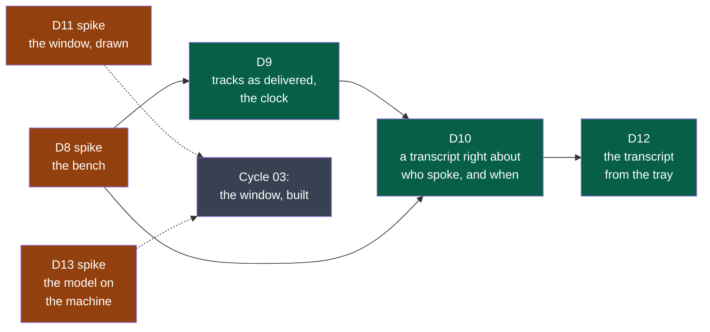

# Cycle 02 — The audio kept as recorded

> One accepted cycle at a time; no automatic extension.

## Goal

Cycle 01 built the three programs and put Summit in the tray. A first real meeting, taken
as most are — on a laptop's loudspeakers — gave a transcript that repeats one party under
the other's name. ADR-0004 decided what a session's audio is; this cycle builds it, and
builds first the means to measure it.

**Legend** — orange: a spike, whose product is knowledge · green: a deliverable a user sees ·
grey: what this cycle prepares and does not build.

## Deliverables

**The order is the method.** D8 comes first and alone: nothing in the capture or the
transcription moves before the twelve counts of today exist. D9 then D10 are read against
them. D11 runs beside them from the first day: drawings cost little and decide much, and
the decider's eye is the slowest thing to schedule. D12 comes once D10 holds — a transcript
that is wrong is not worth bringing to the tray. D13 is small and fits where a day is free.

| Deliverable | Comes from | Reopens |
|---|---|---|
| D8 — the bench | ADR-0004's rule of method; cycle 01's closure: seven verifications of one step, a regression called a result | — |
| D9 — tracks as delivered, the clock | ADR-0004, rules 1 to 3 | Cycle 01's D3: its six criteria on the first contract |
| D10 — who spoke, and when | ADR-0004, rules 4 to 6; the decider's reading of 2026-10-13 | Cycle 01's D4 |
| D11 — the window, drawn | Cycle 01's D7; the decider, 2026-10-13: "moderne, ludique … UX/UI primordiale" | — |
| D12 — the transcript from the tray | Cycle 01's shell, second slice | Cycle 01's D4, first criterion |
| D13 — the model on the machine | Cycle 01, *A first real meeting* | Cycle 01's D5 |

**What a count is worth.** D10's thresholds — one exchange in twenty, one word in fifty —
are the framer's, written before the bench exists *(framer, to confirm on D8's twelve
counts)*: if a headset itself does worse, the decider restates them on that measure, as D4's
second criterion was restated in cycle 01.

**Modules.** A sixth, `platform`, for the bench: a tool the modules share and none owns
(`.nstack/handbook/09-platform.md`). No other is created: the echo-free microphone and the
engine's copy are made by `transcription`, which is what needs them; `all`, the file to
listen to, is `export`'s, in a later cycle.

## Out of scope

Not done in this cycle, even if time remains:

- Windows and macOS: no build, no trial. They come once the audio's base holds on one system.
- Building the window. It is drawn here (D11) and built next.
- The minutes from the tray, and the agreement before the first sending: with the window.
- Telling the voices of one track apart. The transcript keeps the place for it (D10); the
  bench's script has two voices on one side so that the day it is tried, it is measured.
- `export`: the open files of D6, and `all`.
- Compressing the tracks, and deleting them after a time: measured in D9, built later.
- Live transcription; the file context menu; costs; signing.

## Later

Candidates for the next framing:

- The window, built from D11's drawings: the session, the sessions and their weight, the
  two ways of freeing space, the settings, the two agreements.
- The minutes from the tray; `export`, with `all`.
- Windows and macOS, with the two colleagues.
- The voices within a track.
- A rule that frees space by itself after a time.

## Open questions

**Blocking:**

- **The appetite.** Three weeks is the framer's proposal, not the decider's wish: the
  playbook asks how long they *want* to spend. Fewer weeks means cutting — D13 first, then
  D12 — never the bench.

**Not blocking:**

- Whose voices the bench speaks with: synthesised, or read from public recordings. Neither
  is a person recorded for Summit; D8 says which, and why.
- Whether the bench's simulated room is near enough to a real one is D8's second criterion:
  if it is not, the bench is played through real loudspeakers each time, which only the
  decider's laptop can do.

## Closure

<Written at the end: what was delivered, which success criteria moved, what was deferred,
where the next framing starts.>

**Documents brought current:** <the front page, the module map, a module's page — each with
its pull request; or "none", and why nothing a reader sees has changed>
