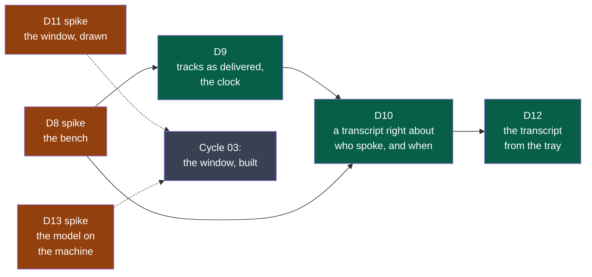
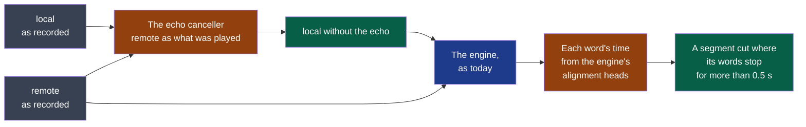
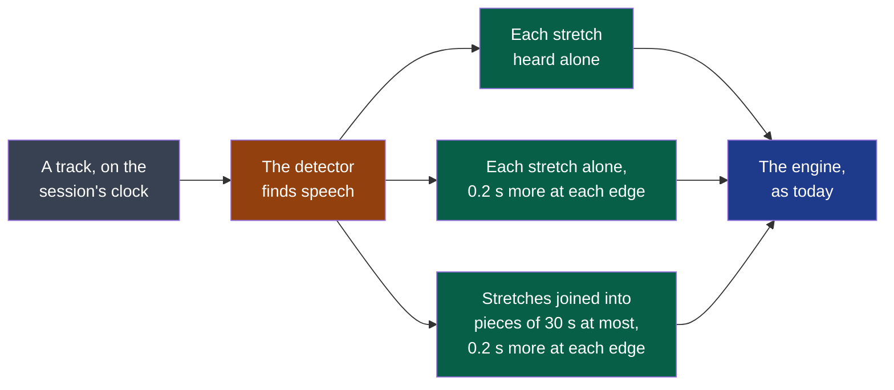

# Cycle 02 — The audio kept as recorded

> One accepted cycle at a time; no automatic extension.

## Goal

Cycle 01 built the three programs and put Summit in the tray. A first real meeting, taken
as most are — on a laptop's loudspeakers — gave a transcript that repeats one party under
the other's name. ADR-0004 decided what a session's audio is; this cycle builds it, and
builds first the means to measure it.

**Legend** — orange: a spike, whose product is knowledge · green: a deliverable a user sees ·
grey: what this cycle prepares and does not build.

## Deliverables

**The order is the method.** D8 comes first and alone: nothing in the capture or the
transcription moves before the twelve counts of today exist. D9 then D10 are read against
them. D11 runs beside them from the first day: drawings cost little and decide much, and
the decider's eye is the slowest thing to schedule. D12 comes once D10 holds — a transcript
that is wrong is not worth bringing to the tray. D13 is small and fits where a day is free.

| Deliverable | Comes from | Reopens |
|---|---|---|
| D8 — the bench | ADR-0004's rule of method; cycle 01's closure: seven verifications of one step, a regression called a result | — |
| D9 — tracks as delivered, the clock | ADR-0004, rules 1 to 3 | Cycle 01's D3: its six criteria on the first contract |
| D10 — who spoke, and when | ADR-0004, rules 4 to 6; the decider's reading of 2026-10-13 | Cycle 01's D4 |
| D11 — the window, drawn | Cycle 01's D7; the decider, 2026-10-13: "moderne, ludique … UX/UI primordiale" | — |
| D12 — the transcript from the tray | Cycle 01's shell, second slice | Cycle 01's D4, first criterion |
| D13 — the model on the machine | Cycle 01, *A first real meeting* | Cycle 01's D5 |

**What a count is worth.** D10's thresholds — one exchange in twenty, one word in fifty —
are the framer's, written before the bench exists *(framer, to confirm on D8's twelve
counts)*: if a headset itself does worse, the decider restates them on that measure, as D4's
second criterion was restated in cycle 01.

**Modules.** A sixth, `platform`, for the bench: a tool the modules share and none owns
(`.nstack/handbook/09-platform.md`). No other is created: the echo-free microphone and the
engine's copy are made by `transcription`, which is what needs them; `all`, the file to
listen to, is `export`'s, in a later cycle.

### D10 — the echo and the times, tried before they are built (2026-10-14)

**Result: both hold on the bench**: no word said twice on loudspeakers, and at most two
exchanges in forty-four out of order in any condition. What is built follows; what is open
is said below.

Tried on a branch of the spike's own, never merged, on the bench's first form (D8's material,
six draws of each condition):

**Legend** — grey: the tracks · orange: the two things tried · green: what they make · blue:
the engine, unchanged. On loudspeakers both are used; with a headset, the second only.

| Count, medians, headset / loudspeakers low / loud | Today (D8) | The canceller | The canceller and the words' times |
|---|---|---|---|
| Words said twice, of 331 | 0 / 204 / 218.5 | 0 / **0** / **0** | 0 / 0 / 0 |
| Local words wrong net of the echo, of 516 | 27.5 / 43 / 49.5 | — / 38.5 / 46 | 27.5 / 38.5 / 46 |
| Local words lost under the remote, of 109 | 7 / 9 / 21 | — / 8.5 / **23.5** | 7 / 8.5 / 23.5 |
| Words on the wrong side | 0 | 0 | 0 |
| Exchanges out of order, of about 45 | 12 / 7 / 8 | — / 13 / 14 | **0.5 / 0 / 0** — at most 2 |
| Turns far from their time, of about 69 | 30.5 / 17 / 18 | — / 29 / 27 | **1.5 / 2 / 2** |
| Seconds to hear a session | about 50 | about 50 | 51 to 62 |

- **The canceller** is WebRTC's, the one browsers and PipeWire use, in its Rust port
  `sonora` 0.2.0 (BSD-3-Clause): fed the remote track as what the loudspeakers played, it
  leaves a third to a half of the microphone's sound where only the remote speaks, and the
  engine writes none of it. Cycle 01's attempt cut sentences; this one does not: the local
  words wrong net of the echo go down, not up.
- **Where it costs**: on loud loudspeakers, the local words said over the remote — 23.5 lost
  of 109, against 21 as delivered; the draws overlap (20 – 30 against 14 – 25). This is the
  criterion's half still open; the canceller's settings are its first lever.
- **The order is the words' times, not the echo's doing.** Without the echo the order falls
  back to a headset's, one in four. Each word timed by the alignment heads `whisper.cpp`
  carries for this model, and a segment cut where the words stop, put each turn where it was
  said — as hearing each stretch alone did in D14, at a tenth of its cost, and with no
  detector to write a television. The words are the same, to the count.
- **Not tried yet**: the canceller on the second form, at the rate a track was delivered;
  telling where an echo is measured (ADR-0004, rule 5), so that a headset's microphone goes
  to the engine untouched; a mark of punctuation alone, cut off as a segment of its own.

### D15 — why the contracts get schemas (2026-10-14)

Decided by the decider on 2026-10-13, when a pull request that corrected an example and
three diagrams of consumed contracts was refused (#96): the contracts were pages of prose,
and nothing could call a change to one compatible. The decision, what was read and what was
tried: [ADR-0005](../../adr/0005-a-contract-carries-a-schema-and-a-comparator-judges-its-changes.md).

### D14 — what the speech detector did (2026-10-14)

**Result: refuted.** In a room that is not silent, the detector makes the engine write the
words nobody at the meeting said; without it, the engine leaves them out.

Tried on a branch of the spike's own, never merged: the detector `whisper.cpp` carries,
with its Silero model (v5.1.2), at its default settings, called before the engine on each
track of the second form. Three ways to hear what it finds:

**Legend** — grey: the sound · orange: the detector · green: the three ways tried · blue:
the engine, unchanged. The third is how WhisperX does it.

**In the room that is not silent** — the bench's `television` condition (#110): no echo, a
television that talks all along 15 dB under the local voices, a hum. Six draws, lowest –
median – highest:

| Count | Without | Each stretch alone, wider | Pieces of 30 s |
|---|---|---|---|
| Local words wrong, of 516 | 22 – 23.5 – 27 | 326 – 342 – 352 | 23 – 51.5 – 98 |
| … of which the television's, two in a row, of 1,546 it said | 0 | 39 – 46 – 55 | 0 – 6 – 15 |
| Words missing, local / remote | 21 / 9 | 20.5 / 11 | 21 / 8 |
| Seconds to hear a session | 51 | 254 | 47 |

- Without the detector the engine writes nothing of the television: a voice 15 dB under the
  meeting's is passed over.
- The detector finds speech in the television too, as was known before the spike: whose
  voice it is, it cannot say. Heard alone, a stretch where only the television speaks is
  written whole — most of it garbled, which is why the television's own count, words two in
  a row, holds so few of the 300 words added. Joined in pieces, it is written where a piece
  holds both.
- No word of the participants more is missing with it, nor fewer: the second half of the
  threshold holds, the first does not.

**In the bench's three other conditions** (second form, medians, headset / loudspeakers low /
loud; the first two columns are D9's):

| Count | First form | Second form | Each stretch alone, wider | Pieces of 30 s |
|---|---|---|---|---|
| Remote words wrong, of 331 | 7 / 6 / 6 | 11.5 / 15.5 / 21.5 | 13.5 / 14 / 13.5 | 10.5 / 11 / 11 |
| Local words wrong net of the echo, of 516 | 27.5 / 43 / 49.5 | 40.5 / 45.5 / 46.5 | 24 / 40.5 / 53.5 | 22.5 / 33.5 / 40.5 |
| Exchanges out of order, of about 45 | 12 / 7 / 8 | 14.5 / 11 / 9.5 | **0 / 1 / 1** | 16 / 10.5 / 10.5 |
| Turns far from their time, of about 69 | 30.5 / 17 / 18 | 32 / 20.5 / 20 | **1 / 2 / 1** | 28 / 15 / 14 |

Each stretch alone with the detector's own edges, 30 ms, lost short words at the start of
turns — *oui*, *on* — and gave 21 remote words wrong in each condition; 0.2 s more at each
edge gave them back.

**What it showed besides, and what it asks of the next steps:**

- **When a turn was said is right when each stretch is heard alone**: one exchange in
  forty-five out of order, where a headset gives one in four today. The order D10 asks for —
  one in twenty — is reached by where the engine starts its windows, not by the words. It
  costs five times the time: the engine hears thirty seconds for every *oui*.
- **The words are best in pieces of 30 s**, and faster than today; the second form's loss on
  the remote side is halved on loud loudspeakers. That holds only where the room is silent.
- **A detector before the engine is not adopted as it is.** What would have to change, each
  a choice for D10: the instants taken from the detector's stretches while the words come
  from longer pieces; or a voice that is no participant's told apart before anything is
  written — which is D10's question of who spoke, put to a television.
- **The settings** were the detector's defaults — a threshold of 0.5, speech of 250 ms at
  least, silence of 100 ms — and are not what was refuted: no setting tells a television's
  voice from a participant's.

The detector's model file was fetched by the framer, for the spike, from the public
repository of `whisper.cpp`'s models (`ggml-org/whisper-vad`, MIT); the program fetched
nothing. The third criterion asked for a file the user was shown and placed: it was not
shown first. Nothing of the spike is in the product.

### D14 — why a speech detector is tried, and which (2026-10-14)

Asked by the decider on 2026-10-14, while the step that reads a session as delivered was
being verified: a measure of silence written here — a level against a threshold — was taken
up three times in one pull request, and tells silence from sound, never speech from noise.
A room is not silent: with a television on beside the microphone no span of that track is
silence to a level, all of it goes to the engine, and an engine handed sound without speech
writes words nobody said. Turning the sound down changes nothing: it lowers a voice and a
noise together.

What is established practice (read on 2026-10-14): a speech detector is run before the
engine, and the engine hears only where it found speech. WhisperX is built on it and reports
fewer invented and repeated words; faster-whisper carries it as an option; a 2025 study of
what Whisper writes on sound without speech put Silero's, and WebRTC's, before it.
`whisper.cpp` — the engine's library here, ADR-0003 — carries one since 2025, with the
Silero model, and the Rust binding the module already uses exposes it: no dependency is
added, one small model file is.

| Detector | Licence | Kept or not |
|---|---|---|
| Silero, through `whisper.cpp` | MIT | **Tried in this spike**: the usual reference for accuracy, already in the library the module links |
| WebRTC's | BSD | Not tried: smaller and faster, less accurate on the comparisons read |
| TEN | Apache-2.0 with a clause against competing use | Refused: not a free licence |

What it will not do, known before the spike: a detector finds speech, the television's
included — whose voice it is, is D10's. And Silero is reported to find speech in some
noises: the spike counts it, on the bench, before anything is adopted. The level measure
stays in the step for what it does tell: a source that delivered nothing.

Sources: WhisperX, arXiv 2303.00747; *Investigation of Whisper ASR Hallucinations Induced by
Non-Speech Audio*, arXiv 2501.11378; the `whisper.cpp` README, "Voice Activity Detection";
the TEN VAD licence as its repository states it.

### D8 — the line every later change is read against (2026-10-13)

The bench is `modules/platform`: a meeting of 70 turns and 4.3 minutes, four synthesised
voices — two on each side — a fifth of the local speech said over the remote; three
listening conditions set on one minute measured on the decider's laptop; six draws of each.
Today's programs, lowest – median – highest:

| Count | Headset | Loudspeakers low | Loudspeakers loud |
|---|---|---|---|
| Words wrong, local, of 516 | 22 – 27.5 – 67 | 246 – 250.5 – 262 | 264 – 267 – 346 |
| … net of the echo | 22 – 27.5 – 67 | 40 – 43 – 60 | 47 – 49.5 – 123 |
| Words wrong, remote, of 331 | 6 – 7 – 10 | 6 – 6 – 23 | 6 – 6 – 14 |
| Local words lost under the remote, of 109 | 7 – 7 – 16 | 7 – 9 – 12 | 14 – 21 – 25 |
| Words said twice, of 331 | 0 | 201 – 204 – 210 | 214 – 218.5 – 223 |
| Words on the wrong side | 0 | 0 | 0 |
| Exchanges out of order, of 42 to 47 found | 10 – 12 – 14 | 6 – 7 – 12 | 6 – 8 – 14 |
| Turns far from their time, of 67 to 70 found | 27 – 30.5 – 34 | 15 – 17 – 21 | 16 – 18 – 22 |
| Turns not found, of 70 | 0 – 0 – 3 | 0 – 1 – 3 | 2 – 2 – 3 |

**What it says.** On loudspeakers, two remote words in three are written a second time
under the local side: the "parrot" of 2026-10-13, measured. With a headset the transcript is
right about the words — two in a hundred wrong on the remote side — and wrong about when:
one exchange in four out of order, four turns in ten more than two seconds from where they
were said. The order is not the echo's doing: it is where the engine starts its segments.

**What it cost to get a line worth reading.** Two independent reviews. The first form was
beaten by muting the microphone. The second measured, for the most part, one synthetic
voice that spoke eight words a second; the voice put in its place spoke at a person's pace
and the engine still could not follow it. The voices are now chosen on a measure — each said
alone and written back, 2 to 13 words wrong of 192. A count that nobody attacked is not yet
a count.

**D10's criteria, read on this line** *(framer — the decider restates)*:

- The first — "no more words of the local side wrong than as delivered" — is passed by
  muting the microphone, which removes the echo's words. Proposed: *no more local words
  lost under the remote than as delivered, and no more local words wrong net of the echo*.
- "At most one exchange in twenty out of order": a headset gives one in four today. It is a
  target for D10's work on times, not a line already held.
- "At most one word in fifty on the wrong side" and "no more said twice than a headset":
  readable as they are; a headset gives none of either.

### D13 — why a model on the machine gave no minutes (2026-10-13)

Asked through the real program, of the model the first meeting was tried on — seven billion
parameters, on the laptop's processor, served by Ollama:

| Meeting | Sent | The model was given | Came back | In |
|---|---|---|---|---|
| The bench's, 4.3 minutes | 2,605 tokens | all of it | Minutes — written in English, of a meeting in French | 297 s |
| Sixteen minutes, made from it | about 8,500 tokens | 4,096: the server's window, the start of the request cut off — the instructions | A free summary, refused: "it does not open on its first section" | 474 s |
| The same, the window set to 12,288 | about 8,500 tokens | all of it | Nothing within the program's ten minutes | — |

**Result: refuted.** The threshold — minutes of an hour's meeting, on the decider's laptop,
in less than the meeting's length — is not met: 4.3 minutes of meeting already take five,
and sixteen take more than ten. The cause of 2026-10-13 is the window, not the model's
wits: it never read the instructions. What would have to change, each a choice of the next
framing: the window set by Summit, which the protocol it speaks to the server cannot ask
for; the model run on the graphics card, as the transcription is; a smaller model; or the
minutes made of a long meeting in parts. Until then the page of `summary` is right to say:
on a laptop, fewer of the actions — and, for a long meeting, none.

### D11 — the window, drawn, and what the decider changed (2026-10-13)

Six boards, each in a dark and a light theme, shown to the decider: the sessions and what
they weigh; one session; freeing space; the settings; the two agreements; and — after their
reading — the small window. Their word on the first five: "dans l'ensemble est bien fait".
Their changes, drawn in the second round:

| Asked by the decider | Drawn |
|---|---|
| For each step that uses a model, the user chooses it: on the machine or online, with their own address | A picker per step — models found on the machine, online services with their address filled in, "custom" with address, model, key and a test |
| The windows are large: a reduced one for when a recording is all there is to manage | A small window: the time, the two sources' levels, stop |
| An automatic mode: record when the system opens the microphone | Drawn as a proposal — "a call seems to start", record or not — with the setting to record without asking, and to stop when the microphone is let go. The framer advised against silence by default: other people are recorded, and a voice message opens a microphone too |
| A transcript or minutes made again | "Again…" on each, with the model chosen; what was there stays until the new one is whole |

Still owed to close D11: the decider's word on the second round — accepted, or changed
again. What is accepted is the next cycle's criteria.

### D9 — where it stands (2026-10-14)

In progress. The second form of a session (`contracts/session-audio/v2`) is written **on
asking**, read by the step that follows, and measured on the bench.

| Piece | Today |
|---|---|
| `capture` | `summit-capture record <sessions> --as v2` writes each source as delivered — its rate, its channels, 24 bits — and the session's clock beside. Without `--as v2` it writes the first form, as before: that is still what the tray starts. Its end-to-end scenarios cover both forms, on devices made for the run |
| `platform` | The bench renders its meeting in either form, the second with a clock that has two stops and a silence in it |
| `transcription` | Reads either form — `session.json` names which — and says which it read. A track is brought to what an engine hears and placed on the session's clock; the first form is heard as it always was |
| What the programs say while recording (`recording/v1`) | The same lines in both forms; they still name the sources `me` and `others` where the second form's files are `local` and `remote` |

**The bench on the second form** (2026-10-14; one binary, built from `main` at `cdcef09`,
for both forms; six draws of each condition; lowest – median – highest is in the runs, the
medians here, headset / loudspeakers low / loud):

| Count | First form | Second form |
|---|---|---|
| Words said twice, of 331 | 0 / 204 / 218.5 | 0 / 206.5 / 212.5 |
| Local words wrong net of the echo, of 516 | 27.5 / 43 / 49.5 | 40.5 / 45.5 / 46.5 |
| **Remote words wrong, of 331** | **7 / 6 / 6** | **11.5 / 15.5 / 21.5** |
| Local words lost under the remote, of 109 | 7 / 9 / 21 | 12.5 / 10.5 / 18 |
| Exchanges out of order, of about 45 | 12 / 7 / 8 | 14.5 / 11 / 9.5 |
| Turns far from their time, of about 69 | 30.5 / 17 / 18 | 32 / 20.5 / 20 |

The first form gives D8's line again, to the count: the programs have not moved it. The
echo is where it was — nothing treats it yet. **The remote side is worse in the second
form**, and that one was followed to its cause on the six loud draws:

| The remote track, heard… | Remote words wrong, the six draws | Median |
|---|---|---|
| as the clock places it: two stops, 0.7 s at 104 s and 0.5 s at 147 s | 29, 14, 31, 33, 13, 7 | 21.5 |
| the same, heard a second time | the same six transcripts, byte for byte | 21.5 |
| with the two stops not placed | 7, 7, 8, 13, 7, 13 | 7.5 |
| with no stop, the whole track 1.2 s later | 13, 6, 6, 6, 6, 6 | 6 |

- The engine is the same twice on the same sound: the differences are of the sound, not of chance.
- What is lost is one turn of sixteen words, at 251 s — a hundred seconds after the last
  stop, in sound that is the same, at the same instants, in the first and in the last row
  (by how the two are made: from 149 s on, both are the track 1.2 s later — not compared
  sample for sample).
  The stops fall in pauses between two turns, and the sound itself is the first form's:
  same level, same spectrum.
- So the engine writes something else at 251 s according to what it heard at 105 s. It
  hears a long recording window after window, each started from where the one before said
  it ended: a pause moved by half a second moves every window after it. **This is the
  engine's way with long sound, shown by a recording that places its pauses truly; it is
  not a sound the reader makes wrong.** The first form hides it only because its bench has
  no stop in it — and loses whole turns too, on the local side (0 to 52 words a draw).
- What it asks for is D14's: sound cut where nobody speaks, each piece heard by itself, so
  that no piece depends on the one before. The four rows above are the line D14 is read
  against, on the remote side.
- On the local side the medians differ and the draws overlap widely; no direction is
  established there.

Not measured yet — D9's fourth criterion: what an hour weighs on the decider's laptop.
Computed, not measured: two tracks at 48,000 samples a second, two channels, 24 bits are
2.07 GB an hour as delivered. The limit that replaces 250 MB is the decider's to set on the
real measure.

**Decided by the decider on 2026-10-14**, once D14 was refuted: the tray keeps starting the
first form until D10 holds. The second form stays written on asking, and measured.

Left before D9 is offered for acceptance: the second form becomes what `record` writes, from
the tray too — weighed again once D10 holds, on the remote side's count; a session of the
first form is still read, or refused in one sentence; the hour's weight.

## Out of scope

Not done in this cycle, even if time remains:

- Windows and macOS: no build, no trial. They come once the audio's base holds on one system.
- Building the window. It is drawn here (D11) and built next.
- The minutes from the tray, and the agreement before the first sending: with the window.
- Telling the voices of one track apart. The transcript keeps the place for it (D10); the
  bench's script has two voices on one side so that the day it is tried, it is measured.
- `export`: the open files of D6, and `all`.
- Compressing the tracks, and deleting them after a time: measured in D9, built later.
- Live transcription; the file context menu; costs; signing.

## Later

Candidates for the next framing:

- The window, built from D11's drawings: the session, the sessions and their weight, the
  two ways of freeing space, the settings, the two agreements.
- The minutes from the tray; `export`, with `all`.
- Windows and macOS, with the two colleagues.
- The voices within a track.
- A rule that frees space by itself after a time.

## Open questions

**Blocking:** none left.

- ~~The appetite.~~ Answered by the decider on 2026-10-13: three weeks as a forecast — "on
  est en plein rush donc on ira probablement plus vite". The end date stands as the circuit
  breaker; ending sooner closes the cycle sooner.

**Not blocking:**

- ~~Whose voices the bench speaks with.~~ Answered by D8: four synthesised voices, nobody's
  (see its record above).
- Whether the bench's simulated room is near enough to a real one is D8's second criterion:
  if it is not, the bench is played through real loudspeakers each time, which only the
  decider's laptop can do.

## Closure

<Written at the end: what was delivered, which success criteria moved, what was deferred,
where the next framing starts.>

**Documents brought current:** <the front page, the module map, a module's page — each with
its pull request; or "none", and why nothing a reader sees has changed>
