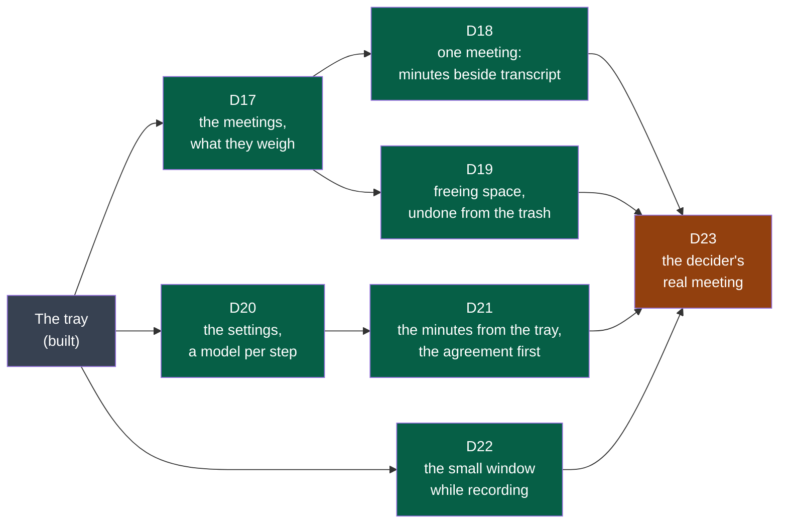

# Cycle 03 — the window

> Copied from `.nstack/forms/cycle.md` at framing (`.nstack/playbooks/framing.md`). One accepted cycle at a
> time; no automatic extension.

## Goal

Cycle 02 kept the audio as recorded and brought the transcript to the tray. Everything else a
user does with a meeting still takes a terminal or a file manager: finding it, reading its
minutes, freeing space, choosing a model. The window was drawn and accepted in cycle 02
([D11, its drawings](../drawings/d11-the-window/README.md)); this cycle builds it, and the
accepted changes are its criteria.

**Legend** — grey: built before this cycle · green: a deliverable a user sees · orange: the
decider's trial that closes the cycle.

## Deliverables

Each deliverable's screens are a board of [D11's drawings](../drawings/d11-the-window/README.md);
a board is what the decider accepted, the criteria are what binds. All are in `shell`: its web
view (ADR-0002, Tauri) shows the window, and the programs stay where they are.

### D17

Board 1. The list reads each session's `session.json` and files: both forms (`session-audio`
v1 and v2) are listed; what a session weighs is its files' size on disk.

### D18

Boards 2 and 6 (*Refaire…*). The minutes and the transcript are read from their files as their
contracts say (`minutes/v1`, `transcript/v1`); the window writes neither.

### D19

Board 3. The system's trash, never a delete: what the decider asked for undoing.

### D20

Board 4. What the shell's configuration already holds (the model, the folder, the shortcut)
moves into the window; models "on this computer" are those Summit finds installed (Whisper
models in its folder, Ollama's list).

### D21

Board 5, the second agreement. The first — the transcription model fetched on the user's word
— is built (cycle 02, D12) and is drawn in the window as it is.

### D22

Board 6, the small window. The levels come from what `capture` says while it records; if it
says nothing that carries a level today, `recording/v1` gains it as the contract's rules allow.

### D23

The trial that closes the cycle, as cycle 01's D7 had it.

## Out of scope

- The offer to record when an application takes the microphone, and recording by itself:
  drawn and accepted (board 6), not built here — it needs another application's use of the
  microphone seen on each system, and it records other people. *Later*.
- Windows and macOS.
- `export`, and `all`.
- Compressing the tracks.
- Telling the voices of one track apart.

## Later

- The offer when an application takes the microphone, and recording by itself.
- Windows and macOS, with the two colleagues.
- An installer: the day the charter's success criteria start.
- `export`, with `all`.
- Compressing the tracks without loss (cycle 02, D9: it halves their weight).

## Open questions

**Blocking:**

- **The appetite** — three weeks is the framer's proposal; the decider sets it. When the seven
  deliverables do not fit, D22 and D19 are cut first, never the end date.

**Not blocking:**

- How a window is tested end to end on Fedora: the shell's e2e drives the tray today; a window
  needs a driver of its web view (WebKitGTK's WebDriver, through `tauri-driver`). The first
  pull request of D17 shows one, or says why another way.
- The engine's remaining errors (cycle 02's closure) are read in the window as they are; the
  minutes' reading through them is D16's, accepted.

## Closure

<Written at the end: what was delivered, which success criteria moved, what was deferred,
where the next framing starts.>

**Documents brought current:** <the front page, the module map, a module's page — each with
its pull request; or "none", and why nothing a reader sees has changed>
