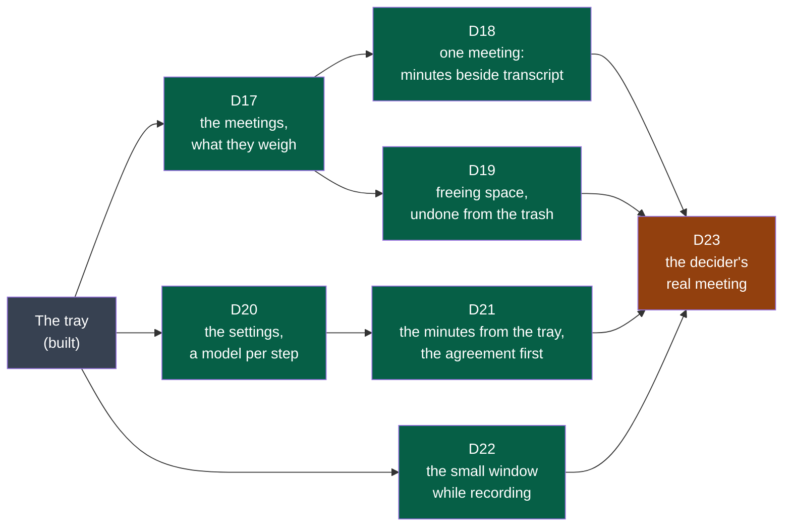

# Cycle 03 — the window

> Copied from `.nstack/forms/cycle.md` at framing (`.nstack/playbooks/framing.md`). One accepted cycle at a
> time; no automatic extension.

## Goal

Cycle 02 kept the audio as recorded and brought the transcript to the tray. Everything else a
user does with a meeting still takes a terminal or a file manager: finding it, reading its
minutes, freeing space, choosing a model. The window was drawn and accepted in cycle 02
([D11, its drawings](../drawings/d11-the-window/README.md)); this cycle builds it, and the
accepted changes are its criteria.

**Legend** — grey: built before this cycle · green: a deliverable a user sees · orange: the
decider's trial that closes the cycle.

## Deliverables

Each deliverable's screens are a board of [D11's drawings](../drawings/d11-the-window/README.md);
a board is what the decider accepted, the criteria are what binds. All are in `shell`: its web
view (ADR-0002, Tauri) shows the window, and the programs stay where they are.

### D17

Board 1. The list reads each session's `session.json` and files: both forms (`session-audio`
v1 and v2) are listed; what a session weighs is its files' size on disk.

**Offered for acceptance** — its acceptance issue: [#179](https://github.com/NapkinStack/summit/issues/179), the decider's trial on their own sessions. Built in four pull requests, each verified: the sessions read by
the library (#174), *Open Summit* in the tray's menu — or `summit --window` — opening the
window (#175), its frame in the system's language and theme (#176), the list (#177). The
window has no permission: the shell's own command needs none.

| Criterion | Where it stands |
|---|---|
| The meetings by week, newest first, each with its day, length, what it holds and its audio's weight; all the audio against the transcripts and minutes | Holds — the window's scenario H, on sessions it makes; a session whose start cannot be read is shown last, under *Date illisible*, never the end of the list |
| A session being recorded, or left without its end, says so; nothing offered touches it | Holds — the library's tests; the window offers no action yet |
| The system's theme, every action from the keyboard, no window without a gesture | Holds on a dark desktop — scenarios A and H; the light theme is written in the boards' colours and was not seen: GNOME's setting overrides what a test can set, and the decider's desktop is not changed for a test |

Seen by the verifiers and corrected before merging: a clicked entry left on its old number,
a capability far wider than the window needs, and a start the page could not date that hid
every older session.

### D18

Boards 2 and 6 (*Refaire…*). The minutes and the transcript are read from their files as their
contracts say (`minutes/v1`, `transcript/v1`); the window writes neither.

Built, each verified: the transcript read as its contract allows it (#180); the minutes **shown
as written** — rendered from their CommonMark by the reader their producer judged them with,
raw HTML as text, a link as its words (#181); the meeting opened from the list, its transcript
searched, the way back, its folder (#182); the minutes beside it and who spoke over it (#183).

The minutes were first read into parts — highlights, actions split into what, who and by when,
key points. Two verifications failed on it: each way the producer may write a list or a section
lost or glued something. Redesigned at the root: the window shows the minutes as the model wrote
them, and no longer lays the actions out in columns (the first criterion's "actions with who
and by when" are there as written, not as parsed).

| Criterion | Where it stands |
|---|---|
| The minutes beside the transcript, who wrote them and where, who spoke, search, the folder | Holds — the window's scenario J (#182, #183) |
| What a session lacks offered, made on the user's word | Holds — the minutes and the transcript offered on a meeting's page, through the tray's gates (#214, #215); scenarios N and H |
| *Refaire…* with the model chosen, the current kept until the new one is whole | Holds — the minutes made again with another model, the current ones kept until the new are whole, then in the trash (#218); the transcript made again by another model of this computer, the current put back if the new fails (#219); the window's scenario K |

**Offered for acceptance** — its acceptance issue: [#228](https://github.com/NapkinStack/summit/issues/228), the decider's trial on their desktop.

Seen by the verifiers and corrected before merging: a trash that refuses deleting the replaced
minutes, kept copies written over by the next making, minutes made over when they could not be
set aside, the transcript not put back when Summit quit during a redo, and a recording's
transcript left waiting behind a redo. The redesign of the minutes' reading, above, followed two
failed verifications.

### D19

Board 3. The system's trash, never a delete: what the decider asked for undoing.

Built in one pull request, verified (#220): *Faire de la place* beside the meetings' weights;
the audio alone or the whole meeting; the heaviest first by what would go; *Cocher celles de plus
de 30 jours*; what is freed said before anything is done; the audio or the folders to the
system's trash. A meeting being recorded or transcribed is shown, never offered, and the shell
refuses it whatever the page sends.

**Offered for acceptance** — its acceptance issue: [#229](https://github.com/NapkinStack/summit/issues/229), the decider's trial on their desktop.

| Criterion | Where it stands |
|---|---|
| The heaviest first, those older than thirty days ticked at once, what will be freed said before | Holds — the window's scenario P |
| To the system's trash, nothing deleted; a meeting whose audio went still lists and reads; one restored from the trash lists again | Holds for the trash and the listing — scenario P, in the scenario's own trash. Restoring is the system's: the list reads the folder, so a meeting put back lists again; seen in the acceptance trial, never by a scenario |

Seen by the verifier, left for the shell's polish pull request: a danger button's words too pale
on the dark theme's red (corrected with D22), a meeting whose minutes are being written not yet
held as busy, and the focus lost at each tick for a keyboard user.

### D20

Board 4. What the shell's configuration already holds (the model, the folder, the shortcut)
moves into the window; models "on this computer" are those Summit finds installed (Whisper
models in its folder, Ollama's list).

**Narrowed by the framer, 2026-10-17**: for transcription, the models are those found on this
computer — `summit-transcription` hears with a local file only; an online transcription service
is new work in that program, not a setting, and goes to *Later*. For the minutes, the three
kinds stand: on this computer (Ollama), online with its address, or the user's own address,
model and key — `summit-summary` already takes an address, a model and a key.

**Offered for acceptance** — its acceptance issue: [#201](https://github.com/NapkinStack/summit/issues/201), the decider's trial on their desktop. Built in pull
requests each verified: the settings read and written as the user's file, hand edits and
comments kept (#183–#186, #188); the keyring (#187); the audio's expiry to the system's trash
(#189, #190, #192, #194); who writes the minutes and its key (#191, #193, #194); a settings file
that cannot be read said and the page locked (#195); the sessions' folder (#196); *Tester*
(#197, #198); the shortcut (#199, #200).

| Criterion | Where it stands |
|---|---|
| What follows a recording, the reminder; out of the box the transcript alone and the reminder; one file that reads without Summit | Holds — the window's scenario K and the tray's; the file is the truth, read again before each recording, transcript and save |
| The model of a step: one on this computer, an online service, one's own address, model and key; the key in the keyring only; *Tester* in one sentence | Holds for the choice, the key and *Tester* — scenario K, on an Ollama, a keyring and a summit-summary of the scenario's. The transcription's model is used from the next transcript; the minutes' choice is used once the shell makes minutes, D21. Transcription models are those found here (narrowed above) |
| The shortcut, the sessions' folder, how long the audio is kept; audio older than that to the system's trash | Holds — scenarios K and L. The shortcut is the desktop's to grant and change under Linux: the page shows the keys granted and opens GNOME's keyboard settings (this desktop's portal has no dialog for it). On macOS and Windows the keys are shown, not changed — those systems are *Later* |

Seen by the verifiers and corrected before merging: a save that reverted a hand edit, a
comment lost on a written line, a model listed twice through a link, a session of negative
length expiring, audio of a session never transcribed sent to the trash, a refusal said in the
system's English, a key kept for a choice not saved, a silent Ollama holding the window, two
saves undoing each other, and a folder note that promised more than it held.

### D21

Board 5, the second agreement. The first — the transcription model fetched on the user's word
— is built (cycle 02, D12) and is drawn in the window as it is.

**Offered for acceptance** — its acceptance issue: [#216](https://github.com/NapkinStack/summit/issues/216), the decider's trial with a real provider and their key. Built in pull requests each verified: summit-summary's run as a contract, `summarising/v1` (#203), provided (#204), read by the shell (#205); the host agreed to in the settings and an address of this machine told apart — read as summit-summary reads it (#206, #207); the minutes from the tray, chained after a transcript, nothing sent unagreed (#208); the agreement page as the board drew it, "Ne plus demander pour ce service" unticked by default (#209); the word bound to the host shown, to the send (#210, #212); the minutes asked from a meeting's page (#214).

| Criterion | Where it stands |
|---|---|
| Before the first sending to an online host, exactly what leaves and to whom, nothing sent before the word; then chained without asking; another host asks again; written on this computer instead | Holds — the tray's scenario M and the window's N, with summit-summary played; a real provider is the decider's (#216) |
| Told when the minutes are ready; a failure in one sentence, the transcript untouched | Holds — scenario M and summit-summary's tests; the notifications on the decider's desktop are theirs to see (#216) |

Seen by the verifiers and corrected before merging: the contract promising a host format the
program never wrote; a draft written through a link; minutes told written from a file alone; an
address the program refuses judged local — twice, then the shell's reading redesigned on the
program's own; the agreement kept for any host the file named at the click, then at the send.

### D22

Board 6, the small window. The levels come from what `capture` says while it records; if it
says nothing that carries a level today, `recording/v1` gains it as the contract's rules allow.

Built, each verified: `recording/v1` gains `level`, about ten times a second for each source
being recorded (#222); capture says it (#223), and none for a source it could not open (#231);
the shell's small window (#227) — offered in the header while a recording runs, opened on that
gesture only, 380 by 260 and above the other windows, the time and both levels, *Arrêter*, ⤢ to
the whole window, closed when the recording ends.

**Offered for acceptance** — its acceptance issue: [#232](https://github.com/NapkinStack/summit/issues/232), the decider's trial on their desktop.

| Criterion | Where it stands |
|---|---|
| The time and a level for the microphone and one for the meeting, moving as sound comes; *Arrêter* stops as the tray does; the full window from it; never opened without a gesture | Holds — the window's scenario Q, with a played capture saying levels, in French and in English; capture's tests and e2e on virtual devices. A real microphone and meeting moving the levels: the trial |

Seen by the verifiers and corrected before merging: a label that wrapped in English and made the
window scroll, a small window that a click just after the stop opened empty, meters a screen
reader could not hear, and a reading test that could not tell the two sources apart. Left for
the shell's polish pull request: the note "the transcript writes itself" shown whatever the
setting, and in English the two meters' tracks not starting at the same place.

### D23

The trial that closes the cycle, as cycle 01's D7 had it.

### D24

**Added on the decider's word, 2026-10-18** ("fais ce qu'il reste en autonomie… mes
interventions ne sont pas bloquantes, continue"), on what the charter's success criteria
wait for: they start "from the day Summit installs on the decider's Fedora", and no installer
exists — Summit is built from the repository. It fits what is left of the appetite; the end
date does not move.

Fedora only, as the decider builds and tests there; Windows and macOS stay *Later*, with the
colleagues and the question of signing (charter). Each program's module leaves what it ships in
its folder of `dist/` (`nstack release`, NapkinStack 0.9.6); a new module, `install`, assembles
them into one package with `rpmbuild`, in a Fedora container — the programs side by side in
`/usr/bin`, where the shell already looks for them (ADR-0006). Tauri's bundler was tried first
and left: it must run in the shell's folder and requires only the shell's libraries.

Built, each verified: nstack 0.9.6's `release` taken (#238); each program's release into `dist/`
(#239); the module `install` and its package (#240) — `summit-0.1.0-1.fc44.x86_64.rpm`, 7 MB.

**Offered for acceptance** — its acceptance issue: [#241](https://github.com/NapkinStack/summit/issues/241), the decider's install on their desktop.

| Criterion | Where it stands |
|---|---|
| One package, `dnf install`; Summit in the menu and the tray with nothing built or set; it records, transcribes, writes the minutes | Holds in a Fedora 44 that never saw Summit — installed, every library found, each program run, the tray's library brought — `install`'s e2e on the real package. The desktop, the tray and a meeting from the package: the trial |
| Removed, the meetings and settings stay | Holds — nothing installed outside `/usr`, no scriptlet (`test.sh`); removed in the e2e, a user's files still there |

Seen by the verifier and corrected before merging: the tray's library, opened at run time, was
never required — a Fedora without the GNOME extension would have had no tray, which the
decider's own desktop would have hidden. Left for a follow-up: the e2e installing without weak
dependencies, file triggers refused like scriptlets, a pipe that could go falsely red. Before
the package leaves this laptop: build paths remapped out of the binaries.

### D25

**Added on the decider's word, 2026-10-18**, after using the window: "I click *Write the
minutes* and nothing seems to happen — can it run in the background, explicit for the user? Can
several be asked at once?" Measured: a making asked while another runs was dropped without a
word (`write_minutes` returns), the page said only *Asked*, and a local model failing the
minutes' form said so in a notification alone. In Settings, picking a local model saved it at
once — the decider's file held `codellama:latest`, a model for code. It fits what is left of the
appetite; the end date does not move.

Built, each verified by an independent session: the minutes' line, never waiting on an
agreement — one that needs it set aside and said, the next made —, each state said on the
meeting's page and its row (#244); the same for the transcript, a Refaire… waiting its turn, the
minutes' model saved only on *Enregistrer* (#246); a Refaire… never held behind the model, Try
again saying why (#247). Found on the way and fixed: a lock taken twice that froze the window
(the e2e now stops after 20 minutes), a page drawn again under a click.

**Offered for acceptance** — its acceptance issue: [#254](https://github.com/NapkinStack/summit/issues/254), the decider's.

| Criterion | Where it stands |
|---|---|
| Being made: what, by which model, for how long, on the page and the list; one asked meanwhile waits and says so, never dropped; a failure said on the page with its reason | Holds on stand-in programs — the shell's e2e, scenario N. Real models and the decider's eye: the trial |
| Nothing saved before the user's gesture in Settings, what is in use said | Holds — the e2e: going through the list saves nothing, *Pas encore enregistré…* says who still writes them |

Left, minor: a meeting put in line during a Refaire… while the default model is missing is
never offered its download (as before D25); the line's head moved behind when the model
arrives during a Refaire….

### D27

**Added on the decider's word, 2026-10-18**: "can Summit run on Ubuntu? … for Ubuntu, I think
both [check it and add a `.deb`], I leave you the choice of what you recommend". A program built
on Fedora 44 does not start on Ubuntu 24.04 (an older `glibc`): each program is built in a
container of the system it ships to, chosen by the environment every release reads (NapkinStack
0.9.6), and `install` makes the `.deb` there too — Fedora's package built the same way. Tried
with `apt` in an Ubuntu that never saw Summit, as Fedora's with `dnf`. A colleague with the
repository's access is the trial. macOS stays *Later*: no macOS container; a Mac builds it.

Built, each verified by an independent session: each program built in a container of the system
`SUMMIT_TARGET` names, from its module's own recipe (#249 capture, #250 transcription, #251
summary, #252 shell); `install` makes that system's package — the `.deb` read by
`dpkg-shlibdeps`, the rpm as before (#253). Found by the verifier and fixed: whisper.cpp tuned to
this laptop's processor (AVX-512) — a program that would stop on another — now built for
x86-64-v3 whoever builds it; and the graphics card: ADR-0003 chose Vulkan, the release never
built it — now built in, measured 24 s against 367 s for a meeting of 1 min 45, falling back to
the processor where there is none. Only capture and transcription failed on Ubuntu when built
on Fedora (`GLIBC_2.43`); summary and the shell are built on their target all the same.

**Offered for acceptance** — its acceptance issue: [#255](https://github.com/NapkinStack/summit/issues/255), a colleague on Ubuntu 24.04.

| Criterion | Where it stands |
|---|---|
| `sudo apt install ./summit_<version>_amd64.deb`; Summit in the menu and the tray with nothing built or set; removed, meetings and settings stay | Holds in an Ubuntu 24.04 that never saw Summit — `install`'s e2e on the real `.deb` (11 MB): every library found, each program run, nothing installed but its files and folders, no script, removed with a user's files still there. The desktop, the tray, a real meeting: the trial |
| Built in a container of the system it ships to, no package depending on the machine that made it | Holds — the four programs and both packages built in containers of Ubuntu 24.04 and Fedora 44; no AVX-512 required (what remains is chosen at run time) |

Left, minor: the processors' flags given by `.cargo/config.toml` yield to a variable set in the
shell (`force = true`); the e2e's judge examines nothing when the listing itself fails (not
reachable today); build folders of earlier images are never cleaned; `rustup-init` not pinned.

### D26

**Added on the decider's word, 2026-10-18**: "read the audio and follow the transcript, like a
song with its lyrics; navigate with the graph and in the text". The window draws who spoke over
the meeting's length (D17, D18); the transcript has each line's time. Played in the window, the
two tracks of a session together; the drawing and the lines are the controls. Built to the
boards' style (board 2, the meeting), no new board: the decider judges it in its trial.

### D28

**Added on the decider's word, 2026-10-20** ("tu connais le marché, tranche le nom et GO"), after
PDR-0001 named the product Wholeheard: *Summit AI Notes* sells a local macOS meeting note-taker
under the old name. Before the repository opens and before any package reaches a tester. The
user's settings, meetings, model and keys carried over, never asked for again; the meetings
stay in the folder they are in. The repository's own name on GitHub is the decider's gesture.

## Out of scope

- The offer to record when an application takes the microphone, and recording by itself:
  drawn and accepted (board 6), not built here — it needs another application's use of the
  microphone seen on each system, and it records other people. *Later*.
- Windows and macOS.
- `export`, and `all`.
- Compressing the tracks.
- Telling the voices of one track apart.

## Later

- The offer when an application takes the microphone, and recording by itself.
- Windows and macOS, with the two colleagues.
- `export`, with `all`.
- Compressing the tracks without loss (cycle 02, D9: it halves their weight).
- An online service for the transcription (narrowed out of D20).

## Open questions

**Blocking:** none left.

- ~~The appetite.~~ Answered by the decider on 2026-10-17, accepting the cycle ("c'est ok,
  avance en autonomie"): three weeks, from that day. When the seven deliverables do not fit,
  D22 and D19 are cut first, never the end date.

**Not blocking:**

- How a window is tested end to end on Fedora: the shell's e2e drives the tray today; a window
  needs a driver of its web view (WebKitGTK's WebDriver, through `tauri-driver`). The first
  pull request of D17 shows one, or says why another way.
- The engine's remaining errors (cycle 02's closure) are read in the window as they are; the
  minutes' reading through them is D16's, accepted.

## Closure

<Written at the end: what was delivered, which success criteria moved, what was deferred,
where the next framing starts.>

**Documents brought current:** <the front page, the module map, a module's page — each with
its pull request; or "none", and why nothing a reader sees has changed>
