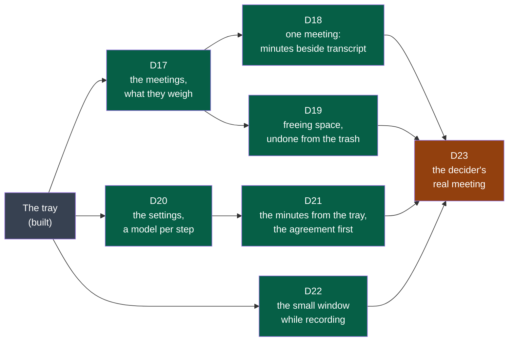
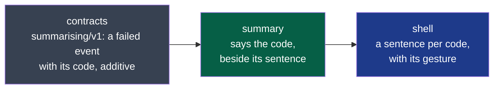

# Cycle 03 — the window

> Copied from `.nstack/forms/cycle.md` at framing (`.nstack/playbooks/framing.md`). One accepted cycle at a
> time; no automatic extension.

## Goal

Cycle 02 kept the audio as recorded and brought the transcript to the tray. Everything else a
user does with a meeting still takes a terminal or a file manager: finding it, reading its
minutes, freeing space, choosing a model. The window was drawn and accepted in cycle 02
([D11, its drawings](../drawings/d11-the-window/README.md)); this cycle builds it, and the
accepted changes are its criteria.

**Legend** — grey: built before this cycle · green: a deliverable a user sees · orange: the
decider's trial that closes the cycle.

## Deliverables

Each deliverable's screens are a board of [D11's drawings](../drawings/d11-the-window/README.md);
a board is what the decider accepted, the criteria are what binds. All are in `shell`: its web
view (ADR-0002, Tauri) shows the window, and the programs stay where they are.

### D17

Board 1. The list reads each session's `session.json` and files: both forms (`session-audio`
v1 and v2) are listed; what a session weighs is its files' size on disk.

**Offered for acceptance** — its acceptance issue: [#179](https://github.com/NapkinStack/summit/issues/179), the decider's trial on their own sessions. Built in four pull requests, each verified: the sessions read by
the library (#174), *Open Summit* in the tray's menu — or `summit --window` — opening the
window (#175), its frame in the system's language and theme (#176), the list (#177). The
window has no permission: the shell's own command needs none.

| Criterion | Where it stands |
|---|---|
| The meetings by week, newest first, each with its day, length, what it holds and its audio's weight; all the audio against the transcripts and minutes | Holds — the window's scenario H, on sessions it makes; a session whose start cannot be read is shown last, under *Date illisible*, never the end of the list |
| A session being recorded, or left without its end, says so; nothing offered touches it | Holds — the library's tests; the window offers no action yet |
| The system's theme, every action from the keyboard, no window without a gesture | Holds on a dark desktop — scenarios A and H; the light theme is written in the boards' colours and was not seen: GNOME's setting overrides what a test can set, and the decider's desktop is not changed for a test |

Seen by the verifiers and corrected before merging: a clicked entry left on its old number,
a capability far wider than the window needs, and a start the page could not date that hid
every older session.

### D18

Boards 2 and 6 (*Refaire…*). The minutes and the transcript are read from their files as their
contracts say (`minutes/v1`, `transcript/v1`); the window writes neither.

Built, each verified: the transcript read as its contract allows it (#180); the minutes **shown
as written** — rendered from their CommonMark by the reader their producer judged them with,
raw HTML as text, a link as its words (#181); the meeting opened from the list, its transcript
searched, the way back, its folder (#182); the minutes beside it and who spoke over it (#183).

The minutes were first read into parts — highlights, actions split into what, who and by when,
key points. Two verifications failed on it: each way the producer may write a list or a section
lost or glued something. Redesigned at the root: the window shows the minutes as the model wrote
them, and no longer lays the actions out in columns (the first criterion's "actions with who
and by when" are there as written, not as parsed).

| Criterion | Where it stands |
|---|---|
| The minutes beside the transcript, who wrote them and where, who spoke, search, the folder | Holds — the window's scenario J (#182, #183) |
| What a session lacks offered, made on the user's word | Holds — the minutes and the transcript offered on a meeting's page, through the tray's gates (#214, #215); scenarios N and H |
| *Refaire…* with the model chosen, the current kept until the new one is whole | Holds — the minutes made again with another model, the current ones kept until the new are whole, then in the trash (#218); the transcript made again by another model of this computer, the current put back if the new fails (#219); the window's scenario K |

**Offered for acceptance** — its acceptance issue: [#228](https://github.com/NapkinStack/summit/issues/228), the decider's trial on their desktop.

Seen by the verifiers and corrected before merging: a trash that refuses deleting the replaced
minutes, kept copies written over by the next making, minutes made over when they could not be
set aside, the transcript not put back when Summit quit during a redo, and a recording's
transcript left waiting behind a redo. The redesign of the minutes' reading, above, followed two
failed verifications.

### D19

Board 3. The system's trash, never a delete: what the decider asked for undoing.

Built in one pull request, verified (#220): *Faire de la place* beside the meetings' weights;
the audio alone or the whole meeting; the heaviest first by what would go; *Cocher celles de plus
de 30 jours*; what is freed said before anything is done; the audio or the folders to the
system's trash. A meeting being recorded or transcribed is shown, never offered, and the shell
refuses it whatever the page sends.

**Offered for acceptance** — its acceptance issue: [#229](https://github.com/NapkinStack/summit/issues/229), the decider's trial on their desktop.

| Criterion | Where it stands |
|---|---|
| The heaviest first, those older than thirty days ticked at once, what will be freed said before | Holds — the window's scenario P |
| To the system's trash, nothing deleted; a meeting whose audio went still lists and reads; one restored from the trash lists again | Holds for the trash and the listing — scenario P, in the scenario's own trash. Restoring is the system's: the list reads the folder, so a meeting put back lists again; seen in the acceptance trial, never by a scenario |

Seen by the verifier, left for the shell's polish pull request: a danger button's words too pale
on the dark theme's red (corrected with D22), a meeting whose minutes are being written not yet
held as busy, and the focus lost at each tick for a keyboard user.

### D20

Board 4. What the shell's configuration already holds (the model, the folder, the shortcut)
moves into the window; models "on this computer" are those Summit finds installed (Whisper
models in its folder, Ollama's list).

**Narrowed by the framer, 2026-10-17**: for transcription, the models are those found on this
computer — `summit-transcription` hears with a local file only; an online transcription service
is new work in that program, not a setting, and goes to *Later*. For the minutes, the three
kinds stand: on this computer (Ollama), online with its address, or the user's own address,
model and key — `summit-summary` already takes an address, a model and a key.

**Offered for acceptance** — its acceptance issue: [#201](https://github.com/NapkinStack/summit/issues/201), the decider's trial on their desktop. Built in pull
requests each verified: the settings read and written as the user's file, hand edits and
comments kept (#183–#186, #188); the keyring (#187); the audio's expiry to the system's trash
(#189, #190, #192, #194); who writes the minutes and its key (#191, #193, #194); a settings file
that cannot be read said and the page locked (#195); the sessions' folder (#196); *Tester*
(#197, #198); the shortcut (#199, #200).

| Criterion | Where it stands |
|---|---|
| What follows a recording, the reminder; out of the box the transcript alone and the reminder; one file that reads without Summit | Holds — the window's scenario K and the tray's; the file is the truth, read again before each recording, transcript and save |
| The model of a step: one on this computer, an online service, one's own address, model and key; the key in the keyring only; *Tester* in one sentence | Holds for the choice, the key and *Tester* — scenario K, on an Ollama, a keyring and a summit-summary of the scenario's. The transcription's model is used from the next transcript; the minutes' choice is used once the shell makes minutes, D21. Transcription models are those found here (narrowed above) |
| The shortcut, the sessions' folder, how long the audio is kept; audio older than that to the system's trash | Holds — scenarios K and L. The shortcut is the desktop's to grant and change under Linux: the page shows the keys granted and opens GNOME's keyboard settings (this desktop's portal has no dialog for it). On macOS and Windows the keys are shown, not changed — those systems are *Later* |

Seen by the verifiers and corrected before merging: a save that reverted a hand edit, a
comment lost on a written line, a model listed twice through a link, a session of negative
length expiring, audio of a session never transcribed sent to the trash, a refusal said in the
system's English, a key kept for a choice not saved, a silent Ollama holding the window, two
saves undoing each other, and a folder note that promised more than it held.

### D21

Board 5, the second agreement. The first — the transcription model fetched on the user's word
— is built (cycle 02, D12) and is drawn in the window as it is.

**Offered for acceptance** — its acceptance issue: [#216](https://github.com/NapkinStack/summit/issues/216), the decider's trial with a real provider and their key. Built in pull requests each verified: summit-summary's run as a contract, `summarising/v1` (#203), provided (#204), read by the shell (#205); the host agreed to in the settings and an address of this machine told apart — read as summit-summary reads it (#206, #207); the minutes from the tray, chained after a transcript, nothing sent unagreed (#208); the agreement page as the board drew it, "Ne plus demander pour ce service" unticked by default (#209); the word bound to the host shown, to the send (#210, #212); the minutes asked from a meeting's page (#214).

| Criterion | Where it stands |
|---|---|
| Before the first sending to an online host, exactly what leaves and to whom, nothing sent before the word; then chained without asking; another host asks again; written on this computer instead | Holds — the tray's scenario M and the window's N, with summit-summary played; a real provider is the decider's (#216) |
| Told when the minutes are ready; a failure in one sentence, the transcript untouched | Holds — scenario M and summit-summary's tests; the notifications on the decider's desktop are theirs to see (#216) |

Seen by the verifiers and corrected before merging: the contract promising a host format the
program never wrote; a draft written through a link; minutes told written from a file alone; an
address the program refuses judged local — twice, then the shell's reading redesigned on the
program's own; the agreement kept for any host the file named at the click, then at the send.

### D22

Board 6, the small window. The levels come from what `capture` says while it records; if it
says nothing that carries a level today, `recording/v1` gains it as the contract's rules allow.

Built, each verified: `recording/v1` gains `level`, about ten times a second for each source
being recorded (#222); capture says it (#223), and none for a source it could not open (#231);
the shell's small window (#227) — offered in the header while a recording runs, opened on that
gesture only, 380 by 260 and above the other windows, the time and both levels, *Arrêter*, ⤢ to
the whole window, closed when the recording ends.

**Offered for acceptance** — its acceptance issue: [#232](https://github.com/NapkinStack/summit/issues/232), the decider's trial on their desktop.

| Criterion | Where it stands |
|---|---|
| The time and a level for the microphone and one for the meeting, moving as sound comes; *Arrêter* stops as the tray does; the full window from it; never opened without a gesture | Holds — the window's scenario Q, with a played capture saying levels, in French and in English; capture's tests and e2e on virtual devices. A real microphone and meeting moving the levels: the trial |

Seen by the verifiers and corrected before merging: a label that wrapped in English and made the
window scroll, a small window that a click just after the stop opened empty, meters a screen
reader could not hear, and a reading test that could not tell the two sources apart. Left for
the shell's polish pull request: the note "the transcript writes itself" shown whatever the
setting, and in English the two meters' tracks not starting at the same place.

### D23

The trial that closes the cycle, as cycle 01's D7 had it.

**Accepted by the decider, 2026-10-24** ("le test est ok"), after their real meeting with the
window and the tray: nothing blocking. What they wrote stood in the way, and where each went:
the page following the line being said, intrusive — D26 changed (#383); opening small, the full
window behind — D34; correcting the transcript, and an offer to record with earbuds just
connected — *Later*; a first word written twice and a sentence written on a silence — the
engine's, accepted (#362, #355).

### D24

**Added on the decider's word, 2026-10-18** ("fais ce qu'il reste en autonomie… mes
interventions ne sont pas bloquantes, continue"), on what the charter's success criteria
wait for: they start "from the day Summit installs on the decider's Fedora", and no installer
exists — Summit is built from the repository. It fits what is left of the appetite; the end
date does not move.

Fedora only, as the decider builds and tests there; Windows and macOS stay *Later*, with the
colleagues and the question of signing (charter). Each program's module leaves what it ships in
its folder of `dist/` (`nstack release`, NapkinStack 0.9.6); a new module, `install`, assembles
them into one package with `rpmbuild`, in a Fedora container — the programs side by side in
`/usr/bin`, where the shell already looks for them (ADR-0006). Tauri's bundler was tried first
and left: it must run in the shell's folder and requires only the shell's libraries.

Built, each verified: nstack 0.9.6's `release` taken (#238); each program's release into `dist/`
(#239); the module `install` and its package (#240) — `summit-0.1.0-1.fc44.x86_64.rpm`, 7 MB.

**Offered for acceptance** — its acceptance issue: [#241](https://github.com/NapkinStack/summit/issues/241), the decider's install on their desktop.

| Criterion | Where it stands |
|---|---|
| One package, `dnf install`; Summit in the menu and the tray with nothing built or set; it records, transcribes, writes the minutes | Holds in a Fedora 44 that never saw Summit — installed, every library found, each program run, the tray's library brought — `install`'s e2e on the real package. The desktop, the tray and a meeting from the package: the trial |
| Removed, the meetings and settings stay | Holds — nothing installed outside `/usr`, no scriptlet (`test.sh`); removed in the e2e, a user's files still there |

Seen by the verifier and corrected before merging: the tray's library, opened at run time, was
never required — a Fedora without the GNOME extension would have had no tray, which the
decider's own desktop would have hidden. Left for a follow-up: the e2e installing without weak
dependencies, file triggers refused like scriptlets, a pipe that could go falsely red. Before
the package leaves this laptop: build paths remapped out of the binaries.

### D25

**Added on the decider's word, 2026-10-18**, after using the window: "I click *Write the
minutes* and nothing seems to happen — can it run in the background, explicit for the user? Can
several be asked at once?" Measured: a making asked while another runs was dropped without a
word (`write_minutes` returns), the page said only *Asked*, and a local model failing the
minutes' form said so in a notification alone. In Settings, picking a local model saved it at
once — the decider's file held `codellama:latest`, a model for code. It fits what is left of the
appetite; the end date does not move.

Built, each verified by an independent session: the minutes' line, never waiting on an
agreement — one that needs it set aside and said, the next made —, each state said on the
meeting's page and its row (#244); the same for the transcript, a Refaire… waiting its turn, the
minutes' model saved only on *Enregistrer* (#246); a Refaire… never held behind the model, Try
again saying why (#247). Found on the way and fixed: a lock taken twice that froze the window
(the e2e now stops after 20 minutes), a page drawn again under a click.

**Offered for acceptance** — its acceptance issue: [#254](https://github.com/NapkinStack/summit/issues/254), the decider's.

| Criterion | Where it stands |
|---|---|
| Being made: what, by which model, for how long, on the page and the list; one asked meanwhile waits and says so, never dropped; a failure said on the page with its reason | Holds on stand-in programs — the shell's e2e, scenario N. Real models and the decider's eye: the trial |
| Nothing saved before the user's gesture in Settings, what is in use said | Holds — the e2e: going through the list saves nothing, *Pas encore enregistré…* says who still writes them |

Left, minor: a meeting put in line during a Refaire… while the default model is missing is
never offered its download (as before D25); the line's head moved behind when the model
arrives during a Refaire….

### D27

**Added on the decider's word, 2026-10-18**: "can Summit run on Ubuntu? … for Ubuntu, I think
both [check it and add a `.deb`], I leave you the choice of what you recommend". A program built
on Fedora 44 does not start on Ubuntu 24.04 (an older `glibc`): each program is built in a
container of the system it ships to, chosen by the environment every release reads (NapkinStack
0.9.6), and `install` makes the `.deb` there too — Fedora's package built the same way. Tried
with `apt` in an Ubuntu that never saw Summit, as Fedora's with `dnf`. A colleague with the
repository's access is the trial. macOS stays *Later*: no macOS container; a Mac builds it.

Built, each verified by an independent session: each program built in a container of the system
`SUMMIT_TARGET` names, from its module's own recipe (#249 capture, #250 transcription, #251
summary, #252 shell); `install` makes that system's package — the `.deb` read by
`dpkg-shlibdeps`, the rpm as before (#253). Found by the verifier and fixed: whisper.cpp tuned to
this laptop's processor (AVX-512) — a program that would stop on another — now built for
x86-64-v3 whoever builds it; and the graphics card: ADR-0003 chose Vulkan, the release never
built it — now built in, measured 24 s against 367 s for a meeting of 1 min 45, falling back to
the processor where there is none. Only capture and transcription failed on Ubuntu when built
on Fedora (`GLIBC_2.43`); summary and the shell are built on their target all the same.

**Offered for acceptance** — its acceptance issue: [#255](https://github.com/NapkinStack/summit/issues/255), a colleague on Ubuntu 24.04.

| Criterion | Where it stands |
|---|---|
| `sudo apt install ./summit_<version>_amd64.deb`; Summit in the menu and the tray with nothing built or set; removed, meetings and settings stay | Holds in an Ubuntu 24.04 that never saw Summit — `install`'s e2e on the real `.deb` (11 MB): every library found, each program run, nothing installed but its files and folders, no script, removed with a user's files still there. The desktop, the tray, a real meeting: the trial |
| Built in a container of the system it ships to, no package depending on the machine that made it | Holds — the four programs and both packages built in containers of Ubuntu 24.04 and Fedora 44; no AVX-512 required (what remains is chosen at run time) |

Left, minor: the processors' flags given by `.cargo/config.toml` yield to a variable set in the
shell (`force = true`); the e2e's judge examines nothing when the listing itself fails (not
reachable today); build folders of earlier images are never cleaned; `rustup-init` not pinned.

### D26

**Added on the decider's word, 2026-10-18**: "read the audio and follow the transcript, like a
song with its lyrics; navigate with the graph and in the text". The window draws who spoke over
the meeting's length (D17, D18); the transcript has each line's time. Played in the window, the
two tracks of a session together; the drawing and the lines are the controls. Built to the
boards' style (board 2, the meeting), no new board: the decider judges it in its trial.

**Built, each pull request verified by an independent session (2026-10-21).** The page plays one
`<audio>` element, a click on a line or on the drawing moves it, and the space bar plays (#304).
At first the page played each track in its own element, kept in step; WebKitGTK failed that three
times. On the decider's word ("lire l'audio unifié … pour éviter de synchro"), the shell now
serves the tracks as one sound, mixed as they are read
([ADR-0009](../../adr/0009-the-window-plays-a-meeting-s-tracks-as-one-sound.md), #307), from
the loopback server of [ADR-0008](../../adr/0008-the-window-plays-a-meeting-from-a-loopback-server.md).
Not yet offered for acceptance: the decider's trial is D23's meeting.

**Accepted by the decider, 2026-10-24**, after their real meeting (D23). On their word the
criterion changed: the line being said is marked and the page no longer follows it ("faire
bouger le focus est un peu contre nature"; asked, they chose that it never moves by itself) —
built by #383, checked by e2e R.

### D30 and D31

**Added on the decider's word, 2026-10-20**: "si je démarre n'importe quel appel, discord,
whatsapp web ou autre et que le micro est sollicité, on me propose automatiquement d'enregistrer
via wholeheard ?", then "oui cadre-le dans ce cycle, il faut bien prendre en compte le switch du
matériel utilisé (un user peut changer les sources audio : baffle, casque, micro intégré, micro
écouteur etc.), continue en autonomie". The end date does not move.

- **D30, the offer.** Board 6's offer, not its recording by itself. Board 6 draws it as a card
  apart from the small window, naming the application ("Firefox utilise votre micro"). It is
  made as a notification, because a window opened by another application's microphone would
  break D17's "no window opens without a gesture of the user". On Linux, PipeWire lists each
  stream as it comes and goes. The shell watches `pw-dump --monitor` (`pipewire-utils`, which
  the package already requires, D24) for a `Stream/Input/Audio` node of another process; it
  does not use `pactl`, whose package (`pulseaudio-utils`) `pipewire-pulseaudio` does not
  require. What it reads is an application's name and the moment, shown and kept nowhere.
  Board 4's setting holds "nothing" and "offer"; "record alone" stays out of scope. Windows and
  macOS follow with the rest.
- **D31, the devices.** Capture opens the defaults without pinning them, so PipeWire moves its
  streams when the user switches devices. This was measured on virtual devices in #149: both
  tracks followed with no gap. What is missing:
  - the user is not told what is recorded now;
  - `session.json` names only the first devices;
  - a device taken away is said only as silence;
  - a device with other channels could end the recording, because a track refuses a delivery
    that is not whole frames. This is read in the code, not measured.

  D31 measures each case on virtual devices first, then makes it hold. A track is one WAV, as
  delivered, never resampled (`session-audio/v2`). A stream's format is fixed when it connects,
  so PipeWire is expected to convert a moved stream to it. This is measured first, with a
  device of other channels and rate. If it does not hold, the track's form is a new contract
  version, decided then. Telling the user is a `recording/v1` event, an additive change, which
  the shell turns into a notice, so the shell is touched too. Each device recorded is a
  `session-audio` record. Both go through the contracts module first, which answers its own
  open questions there (`recording/v1`, a
  source gone during the recording; `session-audio/v2`, a device changed during a meeting).
  - A limit stays, as #149 found: a microphone chosen inside the call's own application is not
    the system's default, so Wholeheard does not record it. No criterion here changes that.
  - Bluetooth and real devices are the decider's trial (D23); the e2e uses virtual devices.

**Appetite.** D30 and D31 enter with 18 days left, beside D26 and D29 (in progress), D27 (a
colleague's trial) and D23. Each is meant to take about a week. If they do not fit, D31's
third criterion (the session's record of each device) is cut first, then D30's choice of
nothing from the offer itself (Settings keep it). The end date does not move.

**Built (2026-10-21), each pull request verified by an independent session; acceptance is the
decider's, on real devices and real calls (D23):**

- **D31:** the contracts (#305, `device` and `changed`); capture saying the device it records
  from now and keeping each (#306); the shell's notices (#308).
- **D30:** the offer (#311, `pw-dump --monitor` read in `microphone.rs`); Settings' *Quand une
  application prend le micro* (#346, board 4). Out of reach, as #311's verifier noted: a call
  stays unwatched for 60 seconds after `pw-dump` exits, until it is started again.

**Both accepted by the decider, 2026-10-24**, after their real calls and devices (D23): the
offer made for Discord, taken and refused (D30); earbuds put in while recording, each change
said and recorded, and named in the small window as it was recorded (D31, D33).

### D28

**Added on the decider's word, 2026-10-20** ("tu connais le marché, tranche le nom et GO"), after
PDR-0001 named the product Wholeheard: *Summit AI Notes* sells a local macOS meeting note-taker
under the old name. Before the repository opens and before any package reaches a tester. The
user's settings, meetings, model and keys carried over, never asked for again; the meetings
stay in the folder they are in. The repository's own name on GitHub is the decider's gesture.

Built, each verified by an independent session: the programs (#264 capture, #265 transcription,
#266 summary), the shell and the carrying over of what the user held (#267, #271), the package
`wholeheard` taking Summit's place (#268), the contracts' prose (#269), the repository's pages
(#270, #273), the names of the transition taken out (#272). The carrying over was failed once
by its verifier — a settings file with no line end made unreadable, a move half-done leaving the
meetings' folder unnamed — and redone so that each step does what is left of it at every start.
The repository renamed `NapkinStack/wholeheard` by the decider, 2026-10-20.

**Accepted on the decider's delegation, 2026-10-20**, on their own laptop: `wholeheard-0.2.0`
installed over `summit-0.1.0` — Summit removed by dnf; the configuration's and
the data's `wholeheard/` folders carried over, the Whisper model (834 MB) not fetched again;
`sessions = "<documents>/Summit"` written in the settings, the meetings read where they are.

Left, minor, for configurations met rarely: a settings file linked into a read-only place (Nix,
home-manager) holds the whole carrying over back at each start; a broken link is replaced by a
plain file; a temporary file left by a crash is never cleaned.

### D29

**Added on the decider's word** ("il faut qu'on logs de maniere expert les etapes et les erreur
… les erreurs technique ne devrait pas remonté dans l'ihm de l'utilisateur (ou peut être prévoir
un mode "developpeur", a toi de voir)"; then, 2026-10-20, "oui pour les 2"). Nothing is logged
today; a program's technical sentence reaches the page as it is. Its design:
[ADR-0007](../../adr/0007-each-program-logs-what-it-does-never-what-was-said.md). Built in
steps, one module a pull request: the logs (each program, then the shell passing the making's
id); the failures said in words, and the developer mode (the shell); then their causes.

**Third step, the causes (2026-10-20, on the decider's word "avance en autonomie").** The
second step left one sentence per step: "The minutes were not written", with "“Write the
minutes of the last recording”, in Wholeheard’s menu, tries again." When the key was refused,
there is no credit left, or the provider is not running, that gesture fails the same way.
ADR-0007 (*Errors*) gives each failure a stable code for that reason. As built, the code is an
event of the output, not the head of the error stream's line (ADR-0007, *Errors, as built*). It starts
with `wholeheard-summary`, whose failures differ most in what the user does next:

**Legend**: grey is the contract, green the producer, and blue what the user reads. There is one
pull request per box, in this order.

- The code is a line the contract adds (a `failed` event). It is added, never put in place of
  anything: the sentence on the error stream stays as it is.
- A consumer that does not know a code reads it as no code, and keeps the step's sentence.
  So a code can be added later without a new version.
- Capture and transcription come later (see *Later*).

**Then (2026-10-21).** The shell's e2e reads what its run logged: a warning or an error nobody
provoked fails it. Its screenshots and logs are kept in `modules/shell/.evidence/` (#345). Out
of cycle, #347 fixed what those screenshots showed wrong (#312): the shortcut in GTK's
notation, a short length, a maker not known. NapkinStack 0.14.0 audits the logs of
`$NSTACK_EVIDENCE` too. The shell's e2e does not write there yet, and from the next minor
version an error it does not declare (`evidence.provoked`) fails the run: that move comes next.
Done on 2026-10-23 for the shell: its e2e writes its logs and screenshots to `$NSTACK_EVIDENCE`,
and its manifest declares what the scenarios provoke, in place of `scripts/e2e-logged.txt`.
Capture's too, the same day: its logs go to `$NSTACK_EVIDENCE`, and its manifest declares the
gaps of zeros its scenarios H and I provoke.

**Accepted by the decider, 2026-10-24**, after their real meeting (D23).

### D32

**Added on the decider's word, 2026-10-24**, during D23's trial: "il faut aussi prévoir dans
les reglage 'lancer au demarage'", then "on avance bien plus vite que prevu donc oui pou d32".
D30 offers a call only while Wholeheard runs; nothing starts it with the session today, so after
each restart no call is offered until the user starts it by hand. It fits what is left of the
appetite; the end date does not move.

- **How.** The desktop's convention, the [XDG Autostart specification](https://specifications.freedesktop.org/autostart-spec/latest/):
  a desktop entry in the user's `~/.config/autostart`, its name the package's
  (`dev.wholeheard.Wholeheard.desktop`), `Exec=wholeheard` — the tray, no window — and
  `TryExec=wholeheard`, so a removed package starts nothing. The file is the setting: GNOME's
  own tools see and change the same file. Written by the shell, no dependency: Tauri's
  autostart plugin is for when macOS and Windows come (*Later*).
- **On by default**, written once at the first start, as call applications do (Discord, Zoom):
  without it, the offer (D30) breaks at the first restart. Once the user turns it off, it stays
  off — Wholeheard never writes it again by itself.
- Board 4 gains one line, *Lancer Wholeheard à l'ouverture de session*, beside the offer's.

**Built (2026-10-24), verified by an independent session; acceptance is the decider's, after a
real restart (D23):** #370 — the entry written once at the first start, `autostart` in the
settings file saying so; Settings' switch reading the entry as the desktop's tools leave it.

**Accepted by the decider, 2026-10-24** ("D32 ok"), on their own laptop. In their words, they
closed their session and opened it again, Wholeheard started by itself, and the window they saw
was one they opened. The shell's log agrees: the entry written at the package's first start
(#370's own event), a second start two minutes later, and a call offered then taken fifty
minutes on, with no start between (D30).

### D33

**Added on the decider's word, 2026-10-24**, during D23's trial: they put their earbuds in
halfway through a recording; the computer kept its built-in microphone, Wholeheard recorded it,
and nothing said so — "les sources audio ne semblent pas apparaître dans l'application … si un
user switch il peut se poser la question de se dire si son switch est bien pris en compte",
then "oui D33". D31 tells a change; nothing names what is recorded while nothing changes. The
capture already says each device (`recording/v1`, `started` and `device`); the shell shows
them in the small window (board 6), under each level. The end date does not move.

**Built (2026-10-24), verified by an independent session; acceptance is the decider's, with
earbuds put in while recording (D23):** #375 — the device each side is recorded from, as capture
says it at `started` and on each `device`, named under its level; none named when a side has none.

**Accepted by the decider, 2026-10-24** ("d33 ok"), on their own laptop with `wholeheard-0.2.0`
built from fc44ea6: a recording started on the built-in devices, earbuds put in while it ran;
the small window named *Ryzen…* then *AirPods…*, and the recording was heard. The session's
own record agrees: the output went to the earbuds at 27 s while the system kept the built-in
microphone, recorded and named as such, until it moved to the earbuds at 58 s.

### D34

**Added on the decider's word, 2026-10-24**, after their real meeting (D23): "quand on ouvre
l'application je trouve mieux d'ouvrir la petite fenêtre et de pouvoir basculer sur le full mode
que l'inverse", then "oui cadre D34". Today the small window exists only while recording
(board 6). The full window opens from the tray's *Ouvrir Wholeheard*, or with `--window` (D17);
the applications' menu runs `wholeheard` without it — no window — and nothing stops a second
Wholeheard from starting beside the one D32 started with the session (#386). Opening from the
menu therefore takes one running Wholeheard that a second start brings forward: on Tauri, its
single-instance plugin ([tauri-plugin-single-instance](https://v2.tauri.app/plugin/single-instance/)),
a cost of the build, not of the drawing.

A small window at rest is a new surface: it is drawn first, as D11 drew the window, in a folder
of its own under `docs/project/drawings/`, and built only from what the decider accepts in it —
a deliverable framed then, if the cycle's appetite holds it. The end date does not move.

Open questions, for the decider on the drawings:

- A compact window first, the full window behind it: the pattern of tray applications, which the
  framer proposes without a source to cite — is it the one they want?
- Which gestures open it small: the applications' menu, the tray's *Ouvrir*, the shortcut?
- Is the size remembered — opened as it was left, small or full — or always small?
- What the small window at rest holds beyond *Enregistrer*: the last meeting and where it stands,
  what the meetings weigh, a reminder of the shortcut?
- Does it stay above the other windows, as while recording (board 6)?

**Drawn (2026-10-24), first round:** [the small window at rest](../drawings/d34-the-small-window-at-rest/README.md),
light and dark, with the framer's proposals beside each open question; shown to the decider, their
word owed.

**Accepted by the decider, 2026-10-25**: "pour moi oui aux 5 propositions", and "verifie la
cohérence, et l'experience user". Their answers, beside the open questions: a compact window first, the full one
behind it — yes; opened small from the applications' menu and *Ouvrir Wholeheard*, the shortcut
still records — yes; the size left is the one reopened — yes; at rest, *Démarrer un
enregistrement* and the shortcut, the last meeting and where it stands, what the meetings weigh —
yes; above the other windows while recording only — yes. They become D35's criteria.

### D35

**Added on the decider's word, 2026-10-25** ("pour moi oui aux 5 propositions, continue en
autonomie"), built from D34's accepted board. The framer's reading for coherence and the user's
experience (`ux.md`) added what the board left open, each in a criterion; the two that change
what is built were asked of the decider, who chose them the same day — "Une seule à la fois",
"Revient au repos":

- **One window at a time** — the decider's choice: going from one to the other replaces it; two
  windows open at once would show the recording twice. Today the full window stays open beside
  the small one.
- **The states the board did not draw** (`ux.md`, its eight states): no meeting yet; the last one
  being transcribed or summarised; failed, in the sentence the full window already uses; no
  shortcut granted by the desktop.
- **The stop closes the loop** — the decider's choice: the small window comes back to rest with
  the meeting just recorded as its last, its transcript on the way, where today it closes (D22,
  `main.rs`); what the user waits for is shown where they are, not only in a notification.
- **What needs room opens the full window**, as today: the agreements (board 5), the settings, a
  meeting to read — the agreement also without a gesture, when the minutes that follow a
  transcript need it (D21).
- **What does not change**, a criterion of its own: Wholeheard started with the session stays in
  the tray, no window (D17, D32) — its entry keeps `Exec=wholeheard`, the applications' menu
  gets its own argument; a recording started from the tray, the shortcut or an offer opens no
  window when none is open (D22).
- **One Wholeheard**: a second start brings the running one forward (#386) — on Tauri, its
  single-instance plugin ([tauri-plugin-single-instance](https://v2.tauri.app/plugin/single-instance/)),
  a new dependency, read against `security.md`.

**Appetite.** Two pull requests in the 13 days left: one Wholeheard (#386), then the small window
at rest. The end date does not move; what does not fit goes to *Later*.

**Built (2026-10-25), each pull request verified by an independent session; acceptance is the
decider's, on their own desktop:** #393 — one Wholeheard: a second start hands over and leaves,
the applications' menu runs `wholeheard --window`, the session's start opens nothing; #394 — the
small window at rest opens first, a recording shows in it above the other windows and it comes
back to rest at the stop, one window at a time, the window left kept as `window` in the
settings, a settings file that cannot be read opening the full window. One size for both states,
380×400: GTK does not shrink a window the user cannot resize. Left to the decider: the window
above the others while recording only, both themes, and the menu with the session's Wholeheard
running.

**Accepted by the decider, 2026-10-25** ("test et valide, tu es autonome"), then, the package's
trace showing no trial yet, "Fais les t'es en autonomie": the trial was run on their own desktop
by an agent session, on the installed package, through the window's accessibility tree, a silent
virtual microphone the system's default while it ran. Seen: opened from the applications' menu, the
small window at rest, *Start a recording* focused; a second start from the menu leaves one
Wholeheard; a recording shown in the same window and back to rest at the stop, its transcript
written; started in the full window, shown in the small one; one window at a time, `window` in
the settings following each change, and the window left reopened after quitting; closed, then
*Open Wholeheard* from the tray; started as the session starts it, alone or with one running, no
window; a recording from the tray with no window open, none opened. The shell's log agrees, no
warning nor error. Held by #394's e2e, not tried again: the keyboard's order and the focus, no
meeting yet, *Read the minutes* and *All meetings* opening the full window, a settings file that
cannot be read. Not seen: on Wayland without a screenshot, the window above the others while
recording and the two themes; a recording from the shortcut or an offer; the settings and the
agreement opening the full window from the small one; the menu while a
Wholeheard started with the session runs — the same hand-over as a second start from the menu.

### D36

**Added on the decider's word, 2026-10-25**, asking whether the tray's offer of the model "ca ne
fonctionne qu'une fois et apres ca disparait et c'est perdu ?", then "GO" to the framer's
proposal. It is not lost: the tray's entry stays until the model is there, and comes back at
the next transcript while it is missing. But only the tray offers it: Settings say "il est proposé
au premier transcript" and a meeting waiting for it says "téléchargez-le depuis le menu de
Wholeheard", with no gesture where the user reads it. The window offers the same fetch there, the
tray's own; nothing else changes. Fetching a model of Ollama for the minutes goes to *Later*.

**Appetite.** One pull request in the 13 days left; the end date does not move.

**Built (2026-10-25), verified by an independent session; acceptance is the decider's:** #400 —
Settings and a meeting waiting for the default model offer *Télécharger le modèle* with its size
and host, the tray's own fetch; while it comes, nothing is offered again; refused, it is offered
again; fetched, Settings say it ready and the meetings in line alone are transcribed — the fetch
no longer makes the latest meeting's transcript when none waits. A model the user named, not on
this computer, is not offered: "Pas sur cet ordinateur : remettez-le à sa place, ou choisissez-en
un autre." Left to the decider: the button in both themes, and a real fetch from huggingface.co. Known:
Settings opened within 1.5 s of the window show the model's card empty for about 1.3 s, until the
first reading of what is being made.

**Accepted by the decider, 2026-10-25** ("D36 ok"), after a trial an agent session ran on their
desktop, on the installed package, with a profile of its own — their model and settings
untouched by it: Settings offered *Download the model (874 MB, huggingface.co)*; clicked, the button
went while the model came from huggingface.co, then it was in place, the same bytes as the
decider's own, and offered no more; the shell's log held no warning nor error. Not seen by that
trial: the button in both themes, and a meeting's offer over the real network — held by #400's
scenario T on a local server. Then the decider looked themselves, in their own profile: at 10:41
Wholeheard was started twice from the applications' menu, their model set aside in their home
folder between the two, as the framer's steps said; their settings kept every key, the full window
left; the shell's log says nothing of what they saw.

## Out of scope

- Recording by itself when an application takes the microphone, and stopping when it lets it
  go: drawn (board 6), not built here — it records other people without a gesture. *Later*.
  The offer to record is D30.
- Windows and macOS.
- `export`, and `all`.
- Compressing the tracks.
- Telling the voices of one track apart.

## Later

- Offering the minutes' recommended model (`qwen3:8b`, about 5 GB) to be fetched by Ollama, on
  the user's word, when Ollama is on the computer without it — the framer's proposal B, 2026-10-25,
  put here with the decider's "GO". Installing Ollama itself is not proposed: another
  publisher's program and service, installed by ours.
- Recording by itself when an application takes the microphone, and stopping when it lets it go
  (board 6); the offer is D30.
- Windows and macOS, with the two colleagues.
- `export`, with `all`.
- Compressing the tracks without loss (cycle 02, D9: it halves their weight).
- An online service for the transcription (narrowed out of D20).
- Error codes from capture and transcription, as summary gives them (D29's third step). Few of
  capture's failures call for a gesture of their own: no source; a disk full while recording;
  a folder that cannot be written, which the shell already says before it starts. Transcription has no contract for
  how it runs and fails, only for the file it writes, so it would need one first.
- Offering to record from a device just connected — "earbuds connected: record with them?",
  as Discord offers to switch: the decider's idea, 2026-10-24 (D33 names the device, never
  changes it). Wholeheard follows the system's devices (D31): offering would mean changing the
  whole computer's microphone, or capture choosing its own — a contract change — and earbuds
  that switch to their microphone lower the call's sound; to frame with the decider.
- Correcting the transcript in the window — a word misheard, a sentence of a television in the
  room taken out — before the minutes are written from it: the decider's idea, 2026-10-24,
  during D23's trial. Today the window writes no transcript (D18, `transcript/v1`); it would
  need a version of that contract, or a file of corrections beside it.

## Open questions

**Blocking:** none left.

- ~~The appetite.~~ Answered by the decider on 2026-10-17, accepting the cycle ("c'est ok,
  avance en autonomie"): three weeks, from that day. When the seven deliverables do not fit,
  D22 and D19 are cut first, never the end date. Both were accepted since. For what is left,
  see D30 and D31's *Appetite*.

**Not blocking:**

- How a window is tested end to end on Fedora: the shell's e2e drives the tray today; a window
  needs a driver of its web view (WebKitGTK's WebDriver, through `tauri-driver`). The first
  pull request of D17 shows one, or says why another way.
- The engine's remaining errors (cycle 02's closure) are read in the window as they are; the
  minutes' reading through them is D16's, accepted.

## Closure

<Written at the end: what was delivered, which success criteria moved, what was deferred,
where the next framing starts.>

**Documents brought current:** <the front page, the module map, a module's page — each with
its pull request; or "none", and why nothing a reader sees has changed>
