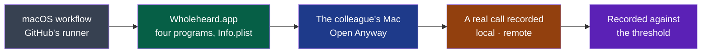

# Cycle 04 — Wholeheard on macOS

> The framework's words: `.nstack/handbook/glossary.md`.

> Framed on 2026-10-26 on the decider's word ("oui, cadre le build macOS"): after cycle 03, one
> week. **Accepted by the decider on 2026-10-26**, closing cycle 03 early — their choice among
> options, "Clore 03, D27 dans 04", which read "j'ajoute D27 au cycle 04 et tu acceptes 04 dans la
> même PR : D38 démarre tout de suite, fin 2026-11-02": from that day, D27 moved here. It rides
> along: Ubuntu is not this cycle's goal, and its trial is all that is left of it.

## Goal

The charter's second criterion starts the day Wholeheard installs on the colleagues' machines;
nothing installs on a Mac today. Since #416 and #417 the four programs compile there on GitHub's
runners (`cargo check`, macOS 26 arm64), free since the repository is public (PDR-0002). This
cycle turns them into an app the colleague opens, and tries the one thing a Mac might refuse:
recording what it plays.

**Legend** — dark grey: the forge · green: D38 · blue: the colleague · amber: D39 · violet: what
the cycle records.

## Deliverables

### D38

- The shell already finds the other programs beside its own executable (`program()`,
  `modules/shell/src/main.rs`): side by side in `Contents/MacOS`, they are found with nothing
  changed.
- Built on GitHub's macOS runner, never here: a Mac's app cannot be made in a Linux container
  (ADR-0002: "Windows and macOS are built by the forge"). How the app is put together — Tauri's
  bundler, or install assembling the folder from each module's release as ADR-0006 does for the
  rpm — is an ADR of install's, its prior art read first; the field's convention by default, so
  that the choice does not eat the week.
- Not signed by Apple: macOS stops it the first time. Since macOS 15, right-click, Open no longer
  lets it through; System Settings → Privacy & Security → Open Anyway does, with the Mac's
  password ([Michael Tsai, 2024-07-05](https://mjtsai.com/blog/?p=43993), read by the cycle's
  verifier). Signed ad hoc at least: an Apple chip runs nothing unsigned, and a bundle changed
  after its programs were linked is said *damaged*, which only a terminal gets past.
  Signing is PDR-0001's open question, out of this cycle.
- A new ad hoc signature on every build: macOS may ask for the microphone again with each
  artifact. That a program the app starts is asked for under the app's name, its taps of what
  plays included, is assumed, not tried: D38's third criterion says it.
- The artifact is kept 7 days on the run, the shortest a colleague needs: see *Open questions*.

**Built, each pull request verified by an independent session (2026-10-26).** The oracle first:
the macOS workflow's job *the app* runs `nstack release` on GitHub's runner and reads D38's first
criterion on the zip itself (#423) — red, on transcription's Vulkan; transcription released on a
Mac on the processor (#424) — red, on install's `/etc/os-release`; install assembles
`Wholeheard.app`, its Info.plist in English and French, signed ad hoc, zipped (#425, ADR-0006
amended) — green. `main`'s run 40264092320 keeps `wholeheard-macos-arm64` (11 MB) until
2026-11-02.

**Offered for acceptance** — its acceptance issue, with D39's:
[#426](https://github.com/NapkinStack/wholeheard/issues/426), the colleague on macOS.

| Criterion | Where it stands |
|---|---|
| One zip from the macOS workflow: the four programs in `Contents/MacOS`, an Info.plist naming the application, its version and the two sentences, signed ad hoc, `codesign --verify --deep --strict` passing | Holds — judged on every run of the job *the app*, on `main` since a8b5892 |
| Opened on the colleague's Mac through Open Anyway: the icon in the menu bar, the window, no terminal | The trial (#426) |
| macOS asks for the microphone and the sound the Mac plays naming Wholeheard, with the Info.plist's sentences | The trial (#426) |

### D27

**Moved from [cycle 03](03-the-window.md#d27) on the decider's word, 2026-10-26** (their
choice, "Clore 03, D27 dans 04"): built and verified there, its criteria unchanged but the name, Summit having
become Wholeheard (D28). What is left is its trial: a colleague on Ubuntu 24.04 installs the
package — its acceptance issue [#255](https://github.com/NapkinStack/wholeheard/issues/255). A
dependency with a date, as D39's: by 2026-10-31.

### D39

- cpal 0.18.2, which capture records with, says it records "system audio output on macOS >
  14.6" (its CHANGELOG, after 14.6, not at it): capture's code may need nothing. Not tried yet.
- Run by the colleague, on their call: nothing of it is published (rule of the project); the
  cycle records the counts, never the audio or its words.

Its trial: [#426](https://github.com/NapkinStack/wholeheard/issues/426), after D38's, on the same Mac.

### D40

**Added on the decider's word, 2026-10-26** ("c'est ok pour moi, on peut le faire maintenant,
tranche tu es autonome"), on cycle 03's *Later*: the list of D37 read from a registry kept open on
GitHub, signed — the signature deferred, below. It is not this cycle's goal; it fits what is left of the week without the colleagues,
whose trials are what D38, D39 and D27 wait on. The end date does not move.

- How: [ADR-0010](../../adr/0010-the-models-offered-are-a-list-kept-in-the-repository.md) —
  one file of the shell's, `modules/shell/registry/models.json`, built in as the shipped list
  and read again from `main` only on the user's gesture; refused, the shipped list stays.
- Who may write it: whoever may merge into `main` — NapkinStack's members, and the agent merging alone under rule 2 — with no rule of its own on the folder (`CONTRIBUTING.md`).
- D37's list does not show a model's host today, only its size (`Offered`, `modules/shell/src/main.rs`); D40's first criterion adds it, as security rule 1 asks of a download.
- Not signed: the signature comes before the first build published for people outside the
  project (ADR-0010, *Rejected alternatives*).
- The minutes' model, fetched by Ollama, stays in the code.

**Built, each pull request verified by an independent session (2026-10-26):** the list in
`modules/shell/registry/models.json`, built in, each model with its host — Settings showed no host
before (#434); read again on *Mettre à jour la liste (raw.githubusercontent.com)* only, refused
whole when it is not a list this build would ship, a redirect included (#435). Every criterion is
held by a scenario of the two sheets, automated but for one: a model of the list read again is
fetched as any other, read in the code (#435's S5). The 64 KB bound is held by tests (#434,
`a_list_larger_than_64_kb_is_refused_before_it_is_read`; #435, S4). Not exercised: a list that
answers too slowly (its timeouts), and the list read again kept only until Wholeheard quits (read in
the code: a static `RwLock`, `main.rs`).

**Accepted, 2026-10-27**, on the decider's word that day: « Tu peux valider en autonomie » — each
criterion held by a scenario of #434's and #435's sheets (#467's verifier).

### D41

**Added on the decider's word, 2026-10-26** ("oui, cadre D41 et continue en autonomie"), after
their own test: a call in Discord on AirPods Pro, the audio switched while recording, lost the
other side. Measured on the session, nothing of it published (#436): the remote track recorded
the built-in speaker's monitor, the system's default, and held exact zeros in 41 of its 48
blocks of 15 s; Discord played on the AirPods' Bluetooth output, which the default never became,
so D31 had nothing to follow. It is not this cycle's goal; it fits what is left of the week, and
it is the one promise the product keeps — the other side heard. The end date does not move.

- How: [ADR-0011](../../adr/0011-the-other-side-is-recorded-where-the-call-plays.md) — capture's
  remote stream moved to the output the call plays on, as a mixer moves one (`target.object`);
  the default otherwise.
- Linux only: on a Mac the other side is D39's, and its own tap.
- Its trial is the decider's: #436's call again, Discord on the AirPods, the default left on the
  speaker.

**Built, verified by an independent session (2026-10-26):** #441 — the graph read once a second
(`pw-dump`), the remote stream moved by `target.object` and back, a client's process read from its
client (PulseAudio's clients kept apart), `pw-metadata` bounded; the e2e's scenario K: the call's
note in the remote track, the default's once the call left it, never the note played on the output
it left. `recording/v1`'s page says it (#439). The warning said once when the graph does not read
or the stream does not move is read in the code, provoked by no test. A real call, criteria 1 and
2 on Discord: the decider's trial, in [#449](https://github.com/NapkinStack/wholeheard/issues/449)
(#436, the report, closed by #441).

### D42

**Added on the decider's word, 2026-10-26**: "pour profiter des test macOS j'aimerai qu'on traite
directement la solution avec speechanalyzer ça permettra à mon collaborateur de tout tester, analyse
le marché et la solution et fais le dans le cycle" — from *Later* above; the colleague is on macOS
26 (the decider, same day). Chosen first of the two added that day, should both not fit: their
answer, "SpeechAnalyzer d'abord". The end date does not move.

- How: [ADR-0012](../../adr/0012-on-macos-speechanalyzer-hears-through-a-program-of-its-own.md) —
  a Swift program of its own, `wholeheard-speech`, behind ADR-0003's interface; Whisper stays the
  default.
- The market, read 2026-10-26: dictation tools adopted it first (Spokenly, Yap), and one
  meeting-notes app, Lyonesse (formerly Inscribe), prefers it where the language is supported; on
  French the sources disagree with each other — tied
  with Whisper large-v3-turbo on one FLEURS run, behind Whisper Large on another (ADR-0012, *Prior art*).
- Three pull requests, one module each: transcription (the program and the engine), install (the
  app), the shell (Settings).
- Its trial: on the colleague's Mac, after D39's call, in #426.

**Built, each pull request verified by an independent session (2026-10-26):** transcription's
`wholeheard-speech` and its engine behind the step, `src/step.rs` unchanged (#444); Settings offer
it where the Mac does, its model fetched by macOS on the click, Whisper hearing again if the Mac
no longer offers it (#446); the app carries it, signed with the rest (#447) — its own workflow,
`macos-app.yml`, built on `main` and on a change to install only, on the decider's word: "il faut
le faire avec parcimonie lorsque c'est utile uniquement". GitHub's macOS runner offers no
SpeechTranscriber: the build is judged there, the hearing is the colleague's, in #426.
Left for later: *Refaire…* with SpeechAnalyzer; the context the user attached, not given to it.
To watch on the Mac: each span gives back the program's other reserved locales, as Yap does, and
macOS may then remove their models. Seen once: a run of the shell's tests that failed and did not
again in five, its output not kept.

### D43

**Added on the decider's word, 2026-10-26**: "je t'avais parler de gérer les models de transcription
de la même manière que pour les minutes" — asked what it means, their choice: "Le même choix que les
minutes" — on this computer, or a service OpenAI-compatible with its address, model and key, and a
test. The charter drew it from the start (a transcription service, "only if the user chose it").
Second of the two, should both not fit. The end date does not move.

- The minutes' way is the one known: the host agreed before the first sending, the key in the
  system's keyring, *Tester* (cycle 03).
- **`ready` since [ADR-0013](../../adr/0013-a-transcription-service-the-user-names-heard-as-the-minutes-are-written.md)**
  (2026-10-26): OpenAI's `/audio/transcriptions` with `verbose_json`, a text-only answer refused;
  transcription reads the key from `WHOLEHEARD_PROVIDER_KEY` as `summary` does, the shell handing
  it from the keyring; the host agreed first. Criticality, the decider's word of 2026-10-26:
  "Standard comme summary" — a deviation from the handbook's rule for both modules, ended with
  `capture`'s before the first build published outside the project.
- **Built**: the engine, #451; Settings, #454 — every criterion held by an automated scenario but a
  real service's, whose trial is the decider's (a key and a meeting of theirs), in
  [#463](https://github.com/NapkinStack/wholeheard/issues/463).

**Accepted, 2026-10-27**, on the decider's words that day: « Tu peux valider en autonomie », and of
the real service's trial, « pour groq normalement openai donc pas de probleme ca ne devrait pas
bloquer » — each criterion held by a scenario of the sheets, a service played on the machine
standing for a real one:

| Criterion | Held by |
|---|---|
| 1. Chosen as for the minutes: this computer, or a service's address, model and key | #454 S1, S4, S7 |
| 2. Nothing sent before the host is agreed to; another host asks again | #454 S2, S7 |
| 3. A service that answers: `transcript/v1` written by the step, each segment on its track with its times, the header its host and model | #451 S1 (times), S6 (header, `src/step.rs` unchanged); the meeting's page, #465 S1; each segment on its track with its times, both tracks sounding: #480 S1 |
| 4. *Tester* says in one sentence whether it hears, with a sound of its own | #451 S5; #454 S4 |
| 5. A key refused, no answer, no transcript, text without times: one sentence; nothing kept of a half; made again | #451 S2, S3; #466 S1, S2; a refused span is not written, and the step takes up the same making (`tests/taking_up.rs`, `tests/step.rs`); made again by another model after a refusal of the first span — found missing by #472's verifier, built by #473 S1 |

*Tester*'s sentence when the service hears (« Il entend : … ») is shown by no test: the e2e reaches no service. Never run: a real service on a real meeting (#454's S6) — its answer's times, the system's keyring
holding the key; #463 stays open for it, on the decider's time.

### D53

**Added on the decider's word, 2026-10-27** ("avance l'application autant que possible, il nous
faut la version complete pour commencer la publication sur les store"), after
[PDR-0004](../../pdr/0004-windows-through-the-microsoft-store.md), settled the same day on the
choice they delegated: Windows is sold through the Microsoft Store, and its build is the first
step — none exists. The charter's Windows colleague waits on it. The end date does not move: this
is the first cut should it not fit, and its third criterion is the colleague's, on their time.

- What exists: the shell's keyring for Windows (`windows-native-keyring-store`), `.exe` found
  beside the shell (`program()`), each program's log folder for Windows; nothing compiled on
  Windows yet, no workflow runs there.
- The remote side: cpal records what an output plays on Windows through WASAPI's loopback
  *(assumption, from cpal's documentation, to be read when it is built)*; whether capture needs a
  line for it is what the first run says.
- **Modules beyond `install`**: the first criterion's tests may need fixes in `shell`, `capture`,
  `transcription` or `summary`, as the Mac's did (#416, #417) — each in a pull request of its own,
  never one that crosses them.
- Unsigned, the zip meets SmartScreen's warning, and Smart App Control, where it is on, may refuse
  it outright (PDR-0004, *Impacts*): the colleague's trial needs it off, or waits on the Store's
  signed package.
- The zip is for the colleague, as the Mac's: no release, no link outside the project
  (open question of 2026-10-26). The Store's MSIX, signed by Microsoft, is *Later*: it needs the
  decider's Partner Center account.

**Built, each pull request verified by an independent session (2026-10-27):** each program
checked on GitHub's Windows runner (#471); what did not build there fixed in its module — tests
that make a link, a file mode or run a shell script kept to Unix, each program shipped as `.exe`,
Whisper on the processor there (no Vulkan SDK on the runner), the shell's `icon.ico` (#474–#477);
the zip, `Wholeheard-<version>-windows-x64.zip`, made and judged by `windows-app.yml`, the C and C++
runtimes inside each program (#478) — first made on `main` at 18bc62c, run 40486111684, kept until
2026-11-03. The tests run on Windows too (#481): a transcript interrupted could not be taken up
there — Windows lets a file opened to append only grow (#483) —, and the shell's logs kept a
sessions' folder written with a last `/`; its tests wrote Unix paths and TOML a Windows path breaks (#484). All four programs' tests pass there
(run 40493801338, `main` at 8131c04). The colleague's trial: [#482](https://github.com/NapkinStack/wholeheard/issues/482).

### D58

**Added on the decider's word, 2026-10-27** (« cadre le et continue en autonomie, il nous le faut
proprement, user friendly et ux/ui optimal, on le fait maintenant pour l'integré au test macos et
windows »), after their idea the same day — a short assistant that sets Wholeheard up from plain
questions (« est ce que vos données sont sensible ») rather than models and addresses. Drawn first:
[D58's board](../drawings/d58-the-first-run/README.md). Built before the colleagues' trials (D38,
D53), so that their first start is this one: the Mac's and Windows' builds and #426 and #482
brought current once it is merged. The end date does not move; cycle 05's D49 keeps its live
check, its model card now this assistant's last screen.

- Private by default: *Passer*, « Je ne sais pas », no answer — the product's promise (PDR-0001).
- **Revised on 2026-10-27 after the framing's review** (#487's verifier): the trigger is a setting
  of its own, `welcomed` — the settings file exists from the first start on Linux, written by
  `autostart::first`; the assistant opens by itself once; one question first, the welcome merged
  into it, no emoji; the online path asks no address, key or model — it opens Settings, where the
  services are named, tested, and their model chosen —; « Refaire le réglage » changes nothing until
  confirmed, and private changes only who transcribes and who writes.
- No question the user cannot answer: the machine is not asked about. The recommended model
  always, the faster one a choice of Settings — no setting tuned to a machine.
- The transcription stays on this computer in both modes: a service that hears (D43) is a choice
  of Settings, for whoever knows it.
- Out of scope: the live check of each side (cycle 05, D49); a line in the small window offering
  the model after « Plus tard » — Settings and the notification after a recording offer it, as today.

### D59

**Added on the decider's word, 2026-10-27** (« oui cadre D59 et continue en autonomie, integre
tout »), after their question the same day — « ajouter un contexte pour les traitements IA (par
exemple de quoi parle le meet, le nombre de participants, les noms) ». The end date does not move;
D58 first, then D59, then D60, each before the colleagues' builds if it can.

- The engine is there: `contracts/session-audio/v2` (v1 alike) lets the user write `context.txt`, "a few
  lines of plain text, UTF-8, handed to the steps that follow"; transcription gives it to Whisper as
  its first words (`set_initial_prompt`) and to a service as `prompt`; the summary reads it; the
  agreement already says it leaves. Nothing in the window writes it today: the file was written by
  hand.
- Why it pays: names and jargon spelled as the meeting says them — Whisper takes the context as
  the words heard before —, actions given to the right person in the minutes.
- **Revised on #489's review**: 400 characters, not 600 — #489's verifier measured with Whisper's
  own multilingual tokenizer 199 tokens for 600 characters of French and 320 for names in Polish,
  Vietnamese or Icelandic, then for 400: French 134, accented Latin names 210, Cyrillic 188, Arabic
  224, Greek 284, Chinese 515; whisper.cpp keeps the last 224 and drops the beginning, and Groq refuses
  more than 224 (#466). The context changed during a making would break *Réessayer*: the transcript's
  header names its context and another is not continued (`modules/transcription/src/lib.rs`) — hence
  the field closed while a making runs, and « Refaire avec ce contexte » setting aside and making
  again with the settings' engine, *Refaire…*'s own ways being Whisper's alone.
- The small window is full while recording: the field, and D60's switch, are drawn first.
- Written during the recording: the transcript starts at the stop, by itself.

**Accepted, 2026-10-29**, on the decider's words of 2026-10-29, « tu peux valider en autonomie » — built by #497; what its sheet left unrun found by an independent
read of every sheet of D58–D65 and run by #537:

| Criterion | Held by |
|---|---|
| 1. The field while recording, 400 characters said, `context.txt` written whole once `session.json` is there | #497 S1 (the small window); #537 S1 (the full window's page of the meeting being recorded — #497's named departure from the board's live block; a Cyrillic name and an emoji) |
| 2. The page shows and changes it, closed while a making runs or a transcript is unfinished; « Refaire avec ce contexte » by the settings' engine and provider, what was set aside put back on a failure | #497 S2; #537 S3 (a service the settings name; the minutes failing, put back) |
| 3. 400 characters of Latin or Cyrillic taken whole, 210 tokens at most; another script said; never more than 400 | #497 S3 (the cut at 400, the script said); the tokens measured with Whisper's own tokenizer by #489's verifier (above), not taken again |
| 4. The agreement says the context leaves; in private mode nothing of it leaves | #497 S4; #537 S2 |
| 5. Keyboard, both themes, FR and EN, the count announced, nothing overflowing at 380 × 400, the e2e's stand-in recording | #497 S5; #537 S4 |

What no scenario runs: private mode with a service still stored in the settings (read: `Hearer::of`
hears by Whisper once `engine` is Whisper); the minutes made again by a provider other than the one
their header names; a real service, and SpeechAnalyzer — a program on this computer stands for them.

### D60

**Added on the decider's word, 2026-10-27** (« integre tout »), on their question the same day,
« est ce que chaque réunion peut avoir son réglage ? », and the framer's answer: no page of settings
per meeting — the leaders keep one setting and meeting types *(the framer's reading of Granola,
Otter and Fireflies, no source read again here)* —, but the one choice that matters for a meeting,
in one gesture: this one leaves nothing on the machine. The connected mode for fast minutes, a confidential meeting kept here.

- A file in the meeting's folder, so that the mark lives with the meeting — moved, copied, made
  again — and nothing else needs to know it: the shell chooses who transcribes and who writes before
  it starts them, at one place each (`transcribe()` and `write_minutes_from`, read by #489's
  verifier). Declared first in `session-audio/v2` and v1, an additive line of the contracts module
  (expand, `.nstack/handbook/03-contracts.md`): the shell alone reads it — a step run by hand with a
  service is the user's own choice.
- The connected mode has not met a real service yet (#463): the stand-in service's count of requests
  is what holds "nothing is sent".

### D61

**Added on the decider's word, 2026-10-29** (« on le fait maintenant et je pense qu'on peut inclure dès à
présent la barre latérale repliable »), after their remark the same day — on a large screen the window's
frame stays narrow, « est-ce que ce n'est pas possible qu'il s'élargisse avec la fenêtre » — and their
question, « une seule page pour le listing des meetings (barre latérale fixe) et au clic on affiche le
meeting sélectionné ». The end date does not move: what is not accepted by then goes to the closure's
choices.

- The field's convention for a list read item after item: list and detail side by side at 840 dp and
  more, one at a time below — Material 3's
  [canonical layouts](https://developer.android.com/develop/adaptive-apps/guides/canonical-layouts);
  GNOME's own, a sidebar of 25 % between 180 and 280 sp folded into pages on a narrow window —
  [libadwaita](https://gnome.pages.gitlab.gnome.org/libadwaita/doc/1.8/adaptive-layouts.html); a sidebar
  the user can hide — Apple's [sidebars](https://developer.apple.com/design/human-interface-guidelines/sidebars.md).
  Today's window is D11's hub and spokes: the list, then a page per meeting with a way back.
- No width beyond the window's, the text alone kept readable: a line longer than 75 characters or so
  is lost by the eye; D11's 1040 px, 860 px for Settings, were a frame, not a reading width.
- Drawn first, as D58 was: the board, `docs/project/drawings/d61-the-window-in-two-panes/`, in a
  pull request of its own, read by the decider before a line of the window changes — a dependency with
  a date below. It replaces D11's boards 1, 2 and 4 for their layout; D11's boards stay the record of what
  was accepted then. Side by side at 1000 CSS px of pane: two columns of 75 characters do not fit
  in the 560 to 660 px a 840 px window leaves beside the sidebar (#516's challenge).
- Out of scope: a divider dragged to size the panes, a third pane, folders or labels — *Later*, if
  someone asks.

**Accepted, 2026-10-29**, on the decider's words of 2026-10-29, « tu peux valider en autonomie », D61's board read by the decider that day (« pour la maquette ca me
semble bien ») — built by #532 and #533; what their sheets left unrun run by #536:

| Criterion | Held by |
|---|---|
| 1. The sidebar and the pane: the recording, the search, the meetings by week — each its title, date, length and what it holds —, the space and Réglages; the last meeting or what to do; ↑ ↓, `aria-current`; Settings, freeing space and the agreements in the pane | #532 S1, S2, S3, S7; #536 S3 (each row), S2 (the agreement in the pane) |
| 2. Folded by its button or Ctrl+B outside a text field, brought back, kept by the settings | #533 S1, S2, S3 |
| 3. As wide as the window; side by side from 1000 px of pane, 75ch; Settings 720 px; one pane at a time under 840 px, down to 420 × 400 | #532 S3, S4, S5 |
| 4. The keyboard alone, both themes, FR and EN, the sidebar first, the focus always seen; the small window and the assistant as they were; screenshots | #532 S8; #536 S3 (English, the focus seen where it differs from the element at rest) |

What no scenario runs: ⌘B on a Mac — the keydown reads `metaKey`, never pressed on one (#426);
Ctrl+B on a Dvorak layout falls on the key that writes X (`event.code`, named in #533).

### D62

**Added on the decider's word, 2026-10-29** (« je t'avais parlé de la possibilité de pouvoir modifier
chaque ligne de transcript, si un humain écoute et relit il peut corriger ce qui a été mal transcrit »),
and their choices the same day: the line rewritten in the transcript, not kept beside it; the minutes
offered again, never made again by themselves.

- `transcript/v1` says today « it never rewrites or removes a line … never this one edited »: a
  contract's change, [ADR-0014](../../adr/0014-a-transcript-line-corrected-in-place-once-complete.md),
  its page changed first and alone (expand, `.nstack/handbook/03-contracts.md`). The summary reads the
  file as it is: the corrected text reaches the minutes made again with no change of its own.
- Only once complete: while a transcript is written, its readers rely on its lines only growing.
- The audio is already placed at a line's start by a click on it (ADR-0009): listen, then correct.
- A correction waits for the transcript's making, as *Refaire…* does: one writer at a time.
- Out of scope: who spoke corrected, lines joined or split, a correction kept through a transcript
  made again.

**Accepted, 2026-10-29**, on the decider's words of 2026-10-29, « tu peux valider en autonomie » — built by #525 (the contract, ADR-0014) and #528; what their sheets
left unrun run by #536, which fixed a pasted line break gluing two words:

| Criterion | Held by |
|---|---|
| 1. `transcript/v1` changed first: the shell a second writer of `text` and `edited`, once complete, the file replaced whole | #525 S1–S3 |
| 2. Its pencil, by the mouse or the keyboard; Enter or leaving keeps it, a pasted line break a space, the ends trimmed, Échap as it was, empty refused; any script, emoji included; « corrigé » | #528 S1, S2, S6; #536 S1 |
| 3. Minutes older than a correction say so and offer « Refaire avec les corrections », through *Refaire…*'s gate, the agreement and a confidential meeting included; nothing without that click | #528 S3; #536 S2 |
| 4. No line corrected while not complete or being made; *Refaire…* says the corrections will not be kept | #528 S4 |
| 5. The tests and the e2e: the keyboard alone, valid against the schema, a correction refused while made, the minutes not made again until asked | #528 S1, S3, S4 |

What no scenario runs: a real paste from the system's clipboard — the scenario dispatches the event;
Ctrl+Z after a paste.

### D63

**Added on the decider's word, 2026-10-29**, after their remark the same day (« je pensais pouvoir
sélectionner un modèle via OpenRouter comme c'est le cas pour le minutes … le "a service I name" ne
semble pas fonctionner »). The step hears through OpenRouter as it is: `wholeheard-transcription --test
--provider https://openrouter.ai/api/v1 --model openai/whisper-large-v3` ended well that day, a model
that is none refused (HTTP 400). What was missing is the choice: three empty fields where the minutes
offer services by name. OpenRouter lists its transcription models
([its documentation](https://openrouter.ai/docs/guides/overview/multimodal/stt)); a model that answers
without segment times — OpenAI's `gpt-4o-transcribe`, by #516's challenge, to be read again when it is
built — gives D43 nothing to place, and is not offered.

### D64

**Added on the decider's word, 2026-10-29**, after their question the same day (« je ne vois pas
comment je peux changer de langue dans l'app »): the words follow the system's language alone today
(`modules/shell/src/words.rs`), and that language is also the one a service and SpeechAnalyzer are
told a meeting is spoken in — the app's language and a meeting's are two settings from now on.

**Accepted, 2026-10-29**, on the decider's words that day, « tu peux valider en autonomie » — built
by #534, which took over #529 (dime-hermes, paused) on their word « est ce que tu peux analyser et
traiter a sa place »; each criterion held by a scenario of #534's sheet, verified by wh-verify-d64:

| Criterion | Held by |
|---|---|
| 1. Chosen in Settings — « Langue du système », Français, English —, spoken at once by the window, the small window, the assistant, the tray's menu and the notifications; the system's by default | #534 S1 (scenario AF; the tray's download entry, scenario T) |
| 2. Started again, the one chosen, whatever the system's | #534 S2 |
| 3. The language a meeting is heard in unchanged: SpeechAnalyzer and a service told the meetings' language, the system's otherwise | #534 S3 (SpeechAnalyzer played by a program, a service on this computer) |
| 4. The shell's tests and the window's e2e: French, English at once and after a restart, the system's again, a service told the same | #534 S4 |

What no scenario runs: that what the system draws itself — the folder picker, the keyring's
prompt, a Mac's application menu, the desktop's launcher — stays in the system's (the shell sets no
language on any of them, read in #534); Apple's SpeechAnalyzer itself, on a Mac.

### D65

**Added on the decider's word, 2026-10-29**, on the framer's proposal the same day after their
question « est-ce qu'on a bien pris en compte le fait d'avoir un réglage par défaut commun au meet
mais de pouvoir choisir un réglage spécifique par meet ? ». What a meeting may say of its own already:
its context (D59), confidential (D60), *Refaire…* with another model; D60's answer of 2026-10-27 stands
— no page of settings per meeting. The language spoken is the one more that changes the transcript:
Whisper detects it today, a service and SpeechAnalyzer are told the app's.

## Dependency with a date

- **The decider reads D61's board** by 2026-10-30 (the framer's date). Missed, D61 is not built in
  this cycle: its board goes to the closure's choices.

- **The colleague on Ubuntu 24.04**, for D27: the trial of #255 by 2026-10-31 (the framer's
  date). Missed, D27 stays where it is at the end date.
- **The colleague on macOS**, for D38's second and third criteria, D39, and D42's last: one session of
  an hour by 2026-10-31, the app ready by 2026-10-29 — for D42, its three pull requests
  merged before then, or its last criterion waits on another session. The cycle does not hold it: missed, the
  deliverables stay where they are at the end date.
- **The colleague on Windows**, for D53's second and third criteria: one session of an hour by
  2026-10-31, the zip ready by 2026-10-30. Missed, D53 stays where it is at the end date.

## Out of scope

- Apple's signing and notarisation, a `.dmg`, the App Store.
- Intel Macs, macOS 14.6 and before.
- ~~Windows.~~ D53, on the decider's word of 2026-10-27 — its build only; its Store package is *Later*.
- Anything of the window or of the settings made for macOS beyond opening — but D42's choice of who hears, on the decider's word of 2026-10-26.

## Later

- **The next framing starts from a review of 2026-10-26**, asked by the decider ("fais une revue
  complète pour que l'app soit la meilleure, ux/ui primordiale, moderne, haut de gamme … ludique et
  facile à utiliser … non intrusive, fluide"): [the market](../reviews/2026-10-26-market.md) and
  [the surface](../reviews/2026-10-26-ux.md), each by an independent session. The decider's choice
  the same day: a cycle 05 after this one, "le meilleur au quotidien" — the notifications that open
  the meeting and are fewer, the minutes copied, the French wording, actions as rows, a meeting's
  title ([#504](https://github.com/NapkinStack/wholeheard/issues/504), asked again on 2026-10-28:
  the list and « Libérer de l’espace » tell meetings apart by date alone), the first run, the cost
  an AI call reports ([#503](https://github.com/NapkinStack/wholeheard/issues/503): OpenRouter's
  `usage.cost`) — and the reminder kept, never off by default.
- **A transcript followed live**, the decider's idea of 2026-10-26 ("la possibilité de faire la
  transcription live, le traitement qu'on ne peut pas faire live est celui des minutes"): the
  framer's proposal, for cycle 05 — a provisional preview while recording, on the machine alone
  (SpeechAnalyzer's own live results on a Mac, a small Whisper model on short spans elsewhere), in
  the small window and the full one; the transcript of record made after the stop as today, short
  spans losing words (cycle 01, D4: 34.5 % differed at thirty seconds, 26.7 % whole); a spike
  first, measuring its load during a call and its words on the bench.

- The transcript and the minutes of D39's call made on the Mac by Whisper on its graphics card
  (Metal), and how long it takes against the call — by SpeechAnalyzer, it is D42's: narrowed out by the decider's appetite (one
  week, 2026-10-26). The charter's second criterion — two weeks of meetings on the Mac — needs it.
- ~~macOS's own transcription engine (SpeechAnalyzer), against Whisper.~~ D42, 2026-10-26.
- A refusal of macOS's trash said by its cause: today it is said as *other* (#417).

- **Windows in the Microsoft Store** (PDR-0004, 2026-10-27): an MSIX package that Microsoft signs,
  its trial and its commerce — after D53, once the decider's Partner Center account exists.
- **macOS notarised**, a trial and a licence key, a merchant of record (PDR-0001, decision 4) —
  once Apple's developer programme is joined; the Mac App Store after a spike on the sandbox.
- **The signed list of models** (ADR-0010) before the first Store or download build.

## Open questions

**Blocking:** none.

**Not blocking:**
- Is a run's artifact a build "published for people outside the project" (PDR-0002, decision
  2), which makes capture `critical` first? On a public repository any signed-in GitHub user can download it ([GitHub Docs, *Downloading workflow artifacts*](https://docs.github.com/en/actions/how-tos/manage-workflow-runs/download-workflow-artifacts): "People who are signed into GitHub and have read access to a repository can download workflow artifacts").
  The framer's proposal: no — no release, no link given outside the project, kept 7 days; the
  first Copr, PPA or Mac download page is. ~~*(framer, to confirm)*~~ Answered by the decider on
  2026-10-26: no ("ok pour ta proposition").

## Closure

<Written at the end.>

**Documents brought current:** <at the closure>
