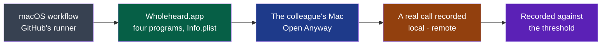

# Cycle 04 — Wholeheard on macOS

> The framework's words: `.nstack/handbook/glossary.md`.

> Framed on 2026-10-26 on the decider's word ("oui, cadre le build macOS"): after cycle 03, one
> week. **Accepted by the decider on 2026-10-26**, closing cycle 03 early — their choice among
> options, "Clore 03, D27 dans 04", which read "j'ajoute D27 au cycle 04 et tu acceptes 04 dans la
> même PR : D38 démarre tout de suite, fin 2026-11-02": from that day, D27 moved here. It rides
> along: Ubuntu is not this cycle's goal, and its trial is all that is left of it.

## Goal

The charter's second criterion starts the day Wholeheard installs on the colleagues' machines;
nothing installs on a Mac today. Since #416 and #417 the four programs compile there on GitHub's
runners (`cargo check`, macOS 26 arm64), free since the repository is public (PDR-0002). This
cycle turns them into an app the colleague opens, and tries the one thing a Mac might refuse:
recording what it plays.

**Legend** — dark grey: the forge · green: D38 · blue: the colleague · amber: D39 · violet: what
the cycle records.

## Deliverables

### D38

- The shell already finds the other programs beside its own executable (`program()`,
  `modules/shell/src/main.rs`): side by side in `Contents/MacOS`, they are found with nothing
  changed.
- Built on GitHub's macOS runner, never here: a Mac's app cannot be made in a Linux container
  (ADR-0002: "Windows and macOS are built by the forge"). How the app is put together — Tauri's
  bundler, or install assembling the folder from each module's release as ADR-0006 does for the
  rpm — is an ADR of install's, its prior art read first; the field's convention by default, so
  that the choice does not eat the week.
- Not signed by Apple: macOS stops it the first time. Since macOS 15, right-click, Open no longer
  lets it through; System Settings → Privacy & Security → Open Anyway does, with the Mac's
  password ([Michael Tsai, 2024-07-05](https://mjtsai.com/blog/?p=43993), read by the cycle's
  verifier). Signed ad hoc at least: an Apple chip runs nothing unsigned, and a bundle changed
  after its programs were linked is said *damaged*, which only a terminal gets past.
  Signing is PDR-0001's open question, out of this cycle.
- A new ad hoc signature on every build: macOS may ask for the microphone again with each
  artifact. That a program the app starts is asked for under the app's name, its taps of what
  plays included, is assumed, not tried: D38's third criterion says it.
- The artifact is kept 7 days on the run, the shortest a colleague needs: see *Open questions*.

**Built, each pull request verified by an independent session (2026-10-26).** The oracle first:
the macOS workflow's job *the app* runs `nstack release` on GitHub's runner and reads D38's first
criterion on the zip itself (#423) — red, on transcription's Vulkan; transcription released on a
Mac on the processor (#424) — red, on install's `/etc/os-release`; install assembles
`Wholeheard.app`, its Info.plist in English and French, signed ad hoc, zipped (#425, ADR-0006
amended) — green. `main`'s run 40264092320 keeps `wholeheard-macos-arm64` (11 MB) until
2026-11-02.

**Offered for acceptance** — its acceptance issue, with D39's:
[#426](https://github.com/NapkinStack/wholeheard/issues/426), the colleague on macOS.

| Criterion | Where it stands |
|---|---|
| One zip from the macOS workflow: the four programs in `Contents/MacOS`, an Info.plist naming the application, its version and the two sentences, signed ad hoc, `codesign --verify --deep --strict` passing | Holds — judged on every run of the job *the app*, on `main` since a8b5892 |
| Opened on the colleague's Mac through Open Anyway: the icon in the menu bar, the window, no terminal | The trial (#426) |
| macOS asks for the microphone and the sound the Mac plays naming Wholeheard, with the Info.plist's sentences | The trial (#426) |

### D27

**Moved from [cycle 03](03-the-window.md#d27) on the decider's word, 2026-10-26** (their
choice, "Clore 03, D27 dans 04"): built and verified there, its criteria unchanged but the name, Summit having
become Wholeheard (D28). What is left is its trial: a colleague on Ubuntu 24.04 installs the
package — its acceptance issue [#255](https://github.com/NapkinStack/wholeheard/issues/255). A
dependency with a date, as D39's: by 2026-10-31.

### D39

- cpal 0.18.2, which capture records with, says it records "system audio output on macOS >
  14.6" (its CHANGELOG, after 14.6, not at it): capture's code may need nothing. Not tried yet.
- Run by the colleague, on their call: nothing of it is published (rule of the project); the
  cycle records the counts, never the audio or its words.

Its trial: [#426](https://github.com/NapkinStack/wholeheard/issues/426), after D38's, on the same Mac.

### D40

**Added on the decider's word, 2026-10-26** ("c'est ok pour moi, on peut le faire maintenant,
tranche tu es autonome"), on cycle 03's *Later*: the list of D37 read from a registry kept open on
GitHub, signed — the signature deferred, below. It is not this cycle's goal; it fits what is left of the week without the colleagues,
whose trials are what D38, D39 and D27 wait on. The end date does not move.

- How: [ADR-0010](../../adr/0010-the-models-offered-are-a-list-kept-in-the-repository.md) —
  one file of the shell's, `modules/shell/registry/models.json`, built in as the shipped list
  and read again from `main` only on the user's gesture; refused, the shipped list stays.
- Who may write it: whoever may merge into `main` — NapkinStack's members, and the agent merging alone under rule 2 — with no rule of its own on the folder (`CONTRIBUTING.md`).
- D37's list does not show a model's host today, only its size (`Offered`, `modules/shell/src/main.rs`); D40's first criterion adds it, as security rule 1 asks of a download.
- Not signed: the signature comes before the first build published for people outside the
  project (ADR-0010, *Rejected alternatives*).
- The minutes' model, fetched by Ollama, stays in the code.

**Built, each pull request verified by an independent session (2026-10-26):** the list in
`modules/shell/registry/models.json`, built in, each model with its host — Settings showed no host
before (#434); read again on *Mettre à jour la liste (raw.githubusercontent.com)* only, refused
whole when it is not a list this build would ship, a redirect included (#435). Every criterion is
held by a scenario of the two sheets, automated but for one: a model of the list read again is
fetched as any other, read in the code (#435's S5). Not exercised: a list that answers too slowly
(its timeouts), the 64 KB bound on what is read. Its acceptance is the decider's.

### D41

**Added on the decider's word, 2026-10-26** ("oui, cadre D41 et continue en autonomie"), after
their own test: a call in Discord on AirPods Pro, the audio switched while recording, lost the
other side. Measured on the session, nothing of it published (#436): the remote track recorded
the built-in speaker's monitor, the system's default, and held exact zeros in 41 of its 48
blocks of 15 s; Discord played on the AirPods' Bluetooth output, which the default never became,
so D31 had nothing to follow. It is not this cycle's goal; it fits what is left of the week, and
it is the one promise the product keeps — the other side heard. The end date does not move.

- How: [ADR-0011](../../adr/0011-the-other-side-is-recorded-where-the-call-plays.md) — capture's
  remote stream moved to the output the call plays on, as a mixer moves one (`target.object`);
  the default otherwise.
- Linux only: on a Mac the other side is D39's, and its own tap.
- Its trial is the decider's: #436's call again, Discord on the AirPods, the default left on the
  speaker.

**Built, verified by an independent session (2026-10-26):** #441 — the graph read once a second
(`pw-dump`), the remote stream moved by `target.object` and back, a client's process read from its
client (PulseAudio's clients kept apart), `pw-metadata` bounded; the e2e's scenario K: the call's
note in the remote track, the default's once the call left it, never the note played on the output
it left. `recording/v1`'s page says it (#439). The warning said once when the graph does not read
or the stream does not move is read in the code, provoked by no test. A real call, criteria 1 and
2 on Discord: the decider's trial, in [#449](https://github.com/NapkinStack/wholeheard/issues/449)
(#436, the report, closed by #441).

### D42

**Added on the decider's word, 2026-10-26**: "pour profiter des test macOS j'aimerai qu'on traite
directement la solution avec speechanalyzer ça permettra à mon collaborateur de tout tester, analyse
le marché et la solution et fais le dans le cycle" — from *Later* above; the colleague is on macOS
26 (the decider, same day). Chosen first of the two added that day, should both not fit: their
answer, "SpeechAnalyzer d'abord". The end date does not move.

- How: [ADR-0012](../../adr/0012-on-macos-speechanalyzer-hears-through-a-program-of-its-own.md) —
  a Swift program of its own, `wholeheard-speech`, behind ADR-0003's interface; Whisper stays the
  default.
- The market, read 2026-10-26: dictation tools adopted it first (Spokenly, Yap), and one
  meeting-notes app, Lyonesse (formerly Inscribe), prefers it where the language is supported; on
  French the sources disagree with each other — tied
  with Whisper large-v3-turbo on one FLEURS run, behind Whisper Large on another (ADR-0012, *Prior art*).
- Three pull requests, one module each: transcription (the program and the engine), install (the
  app), the shell (Settings).
- Its trial: on the colleague's Mac, after D39's call, in #426.

**Built, each pull request verified by an independent session (2026-10-26):** transcription's
`wholeheard-speech` and its engine behind the step, `src/step.rs` unchanged (#444); Settings offer
it where the Mac does, its model fetched by macOS on the click, Whisper hearing again if the Mac
no longer offers it (#446); the app carries it, signed with the rest (#447) — its own workflow,
`macos-app.yml`, built on `main` and on a change to install only, on the decider's word: "il faut
le faire avec parcimonie lorsque c'est utile uniquement". GitHub's macOS runner offers no
SpeechTranscriber: the build is judged there, the hearing is the colleague's, in #426.
Left for later: *Refaire…* with SpeechAnalyzer; the context the user attached, not given to it.
To watch on the Mac: each span gives back the program's other reserved locales, as Yap does, and
macOS may then remove their models. Seen once: a run of the shell's tests that failed and did not
again in five, its output not kept.

### D43

**Added on the decider's word, 2026-10-26**: "je t'avais parler de gérer les models de transcription
de la même manière que pour les minutes" — asked what it means, their choice: "Le même choix que les
minutes" — on this computer, or a service OpenAI-compatible with its address, model and key, and a
test. The charter drew it from the start (a transcription service, "only if the user chose it").
Second of the two, should both not fit. The end date does not move.

- The minutes' way is the one known: the host agreed before the first sending, the key in the
  system's keyring, *Tester* (cycle 03).
- **`ready` since [ADR-0013](../../adr/0013-a-transcription-service-the-user-names-heard-as-the-minutes-are-written.md)**
  (2026-10-26): OpenAI's `/audio/transcriptions` with `verbose_json`, a text-only answer refused;
  transcription reads the key from `WHOLEHEARD_PROVIDER_KEY` as `summary` does, the shell handing
  it from the keyring; the host agreed first. Criticality, the decider's word of 2026-10-26:
  "Standard comme summary" — a deviation from the handbook's rule for both modules, ended with
  `capture`'s before the first build published outside the project.

## Dependency with a date

- **The colleague on Ubuntu 24.04**, for D27: the trial of #255 by 2026-10-31 (the framer's
  date). Missed, D27 stays where it is at the end date.
- **The colleague on macOS**, for D38's second and third criteria, D39, and D42's last: one session of
  an hour by 2026-10-31, the app ready by 2026-10-29 — for D42, its three pull requests
  merged before then, or its last criterion waits on another session. The cycle does not hold it: missed, the
  deliverables stay where they are at the end date.

## Out of scope

- Apple's signing and notarisation, a `.dmg`, the App Store.
- Intel Macs, macOS 14.6 and before.
- Windows.
- Anything of the window or of the settings made for macOS beyond opening — but D42's choice of who hears, on the decider's word of 2026-10-26.

## Later

- **The next framing starts from a review of 2026-10-26**, asked by the decider ("fais une revue
  complète pour que l'app soit la meilleure, ux/ui primordiale, moderne, haut de gamme … ludique et
  facile à utiliser … non intrusive, fluide"): [the market](../reviews/2026-10-26-market.md) and
  [the surface](../reviews/2026-10-26-ux.md), each by an independent session. The decider's choice
  the same day: a cycle 05 after this one, "le meilleur au quotidien" — the notifications that open
  the meeting and are fewer, the minutes copied, the French wording, actions as rows, a meeting's
  title, the first run, the cost an AI call reports — and the reminder kept, never off by default.
- **A transcript followed live**, the decider's idea of 2026-10-26 ("la possibilité de faire la
  transcription live, le traitement qu'on ne peut pas faire live est celui des minutes"): the
  framer's proposal, for cycle 05 — a provisional preview while recording, on the machine alone
  (SpeechAnalyzer's own live results on a Mac, a small Whisper model on short spans elsewhere), in
  the small window and the full one; the transcript of record made after the stop as today, short
  spans losing words (cycle 01, D4: 34.5 % differed at thirty seconds, 26.7 % whole); a spike
  first, measuring its load during a call and its words on the bench.

- The transcript and the minutes of D39's call made on the Mac by Whisper on its graphics card
  (Metal), and how long it takes against the call — by SpeechAnalyzer, it is D42's: narrowed out by the decider's appetite (one
  week, 2026-10-26). The charter's second criterion — two weeks of meetings on the Mac — needs it.
- ~~macOS's own transcription engine (SpeechAnalyzer), against Whisper.~~ D42, 2026-10-26.
- A refusal of macOS's trash said by its cause: today it is said as *other* (#417).

## Open questions

**Blocking:** none.

**Not blocking:**
- Is a run's artifact a build "published for people outside the project" (PDR-0002, decision
  2), which makes capture `critical` first? On a public repository any signed-in GitHub user can download it ([GitHub Docs, *Downloading workflow artifacts*](https://docs.github.com/en/actions/how-tos/manage-workflow-runs/download-workflow-artifacts): "People who are signed into GitHub and have read access to a repository can download workflow artifacts").
  The framer's proposal: no — no release, no link given outside the project, kept 7 days; the
  first Copr, PPA or Mac download page is. ~~*(framer, to confirm)*~~ Answered by the decider on
  2026-10-26: no ("ok pour ta proposition").

## Closure

<Written at the end.>

**Documents brought current:** <at the closure>
