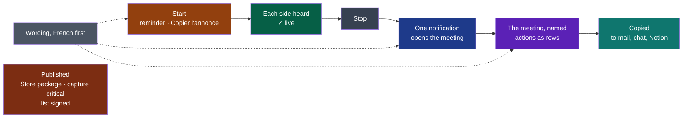

# Cycle 05 — The best day to day

> The framework's words: `.nstack/handbook/glossary.md`.

> Framed on 2026-10-26 on the decider's word: their choice that day, « Cycle 05 + bug tout de
> suite » — a cycle 05 after cycle 04, « le meilleur au quotidien ». It starts on cycle 04's
> `end`, the first day outside it, and is accepted only once cycle 04 is closed: one accepted cycle at a time.
> Its source is the review of 2026-10-26 the decider asked for — [the market](../reviews/2026-10-26-market.md)
> and [the surface](../reviews/2026-10-26-ux.md), each by an independent session — as cycle 04's
> *Later* says. The criteria name symbols, never lines: lines move. The file:line of the sections
> below were read at commit 66b1ff7, by the reviews or the framer, and have moved since (the
> verifier of #445; this page's reviewer, 2026-10-26).

## Goal

Cycle 03 built the window to its boards; cycle 04 brings it to the Mac. The charter's criteria
count weeks of meetings with Wholeheard instead of a bot, and the market moved: botless is now
every leader's default, and a local stack of Whisper and Ollama is a weekend project (market
review §0, §2). What is left to win on is the finish of each day's meeting. The review found
the bones good and named what keeps them from feeling high-end: a meeting has no name, its
result is hard to take away, up to four notifications a meeting, one of which opens a file
manager (UX review, verdict). The decider chose from it, on 2026-10-26: the notifications that
open the meeting in Wholeheard and are fewer; the minutes copied; the French wording; actions as
rows (Qui · Quoi · Pour quand); a meeting's title; the first run — the model card, a live audio
check, the reminder in the small window, « Copier l'annonce »; the informational cost an AI call
reports (OpenRouter's `usage.cost`, never an estimate); and the reminder kept, « Garder, mais
jamais éteint par défaut ». On 2026-10-27 they asked for the version complete enough to publish
« sur les store » and left the choice to the framer (PDR-0004): Windows' Store package, `capture`
`critical` and the list of models signed join the cycle; the cost and the live spike wait. Their standing asks hold for each: modern, high-end, playful, the
easiest, non-intrusive, fluid; no over-engineering; words chosen with care.

**Legend** — one meeting, left to right · amber: D50 · green: D49 · grey: what is there today ·
blue: D44 · violet: D48, with D46 on the same page · teal: D45 · slate: D47, said
everywhere · red: D54–D56, what publishing waits on.

## Deliverables

Each is the shell's but D48, whose minutes are written by the summary, D54, install's package, and
D55, capture's. Ordered by the framer — the review's value over cost (UX review §11), where a deliverable leans on
another, after it: the order to build them in. **Cut first** if the breaker nears: D47's errors, then D49's live check. D54–D56 are not cut:
they are what publishing waits on.
D44, D45, D47 and D50 all touch `words.rs` and the « Copié » status: one session at a time on them.

### D44

- Today: up to four notifications a meeting — the reminder, the stop, the transcript, the minutes
  (`words.rs:175-176, 171`, `main.rs:2188-2195`); « Transcription prête » opens the session's
  folder with `xdg-open` (`tell_opening`, `main.rs:2393-2415`), « Compte rendu prêt » opens
  nothing. The window already shows the stop and the making where the user is (D35: "what the
  user waits for is shown where they are").
- The reminder at the start stays a notification in every case: it is the charter's (C7).
- **Linux only for the click**: elsewhere the toolkit's plugin tells no click (the shell's
  `MANIFEST.yaml`, `notify-rust`; `main.rs:2417`) — a notification there is a notification alone,
  as today. The click on a Mac is *Later*.
- With D47: "session" leaves the notifications' words for "réunion" (UX review §10, `Made::Written`,
  `Said::Failed`).

### D45

- Markdown text, the body only: the code already writes to `navigator.clipboard` for the
  diagnostic (UX review 4.1). Rich text beside it — what a mail pastes as headings — is not
  promised: whether the system's web view takes `text/html` on the three systems is not known
  *(assumption)*, and not tried in this cycle.
- Export, Notion, a file: *Later*, as cycle 02 deferred them (its *Later*).

### D46

- The contract already guarantees the separator: `contracts/minutes/v1`, Actions, "what, who and
  by when, in that order, separated by ` — `". Rendered in `minutes.rs` of the shell; the contract
  unchanged (UX review 4.2).
- Board 2 of D11 drew what · who · when; the market review's recommendation 3 says Qui · Quoi ·
  Pour quand; the decider chose actions as rows (cycle 04's *Later*): see *Open questions*.
- The copy of D45 keeps the items as written.

### D47

- The table of the UX review §10 is a proposal, not decided words: the decider adopts or amends
  it when they accept the cycle (*Open questions*); the market review's §7 is read with it (Compte rendu, Décisions,
  Actions, Points clés, Intervenants).
- The errors handed to the page as English text (`main.rs:414-415, 508, 916-946, 1100-1134`) go
  through an enum said by `words.rs`, as `summarising::Cause` already is (UX review 5.1).
- *Transcript* or *Transcription* in French: see *Open questions*.

### D48

**The title written by the minutes, rather than the review's cheap fix** *(framer, to confirm)*.
The UX review weighed two forms (3.1):

| | The cheap fix | The title of the minutes |
|---|---|---|
| What | The shell shows the first sentence of *Points saillants*, cut at about 90 characters | The summary writes an optional `title` in the front matter, an additive change of `minutes/v1` |
| Modules | shell | contracts, then summary, then shell — one pull request each |
| Gives | A sentence cut short: « La date de l'événement est fixée au jeudi 3 juin, avec le 10 en… » | A name, as every board drew it: « Lancement — calendrier, budget, recrutement » |
| Cost | S | M |

The framer proposes the title: the boards, accepted as criteria, drew names; the contract's pull
request is small and additive; and a name is what a later
search and export would share. The cheap fix stays the fallback if the decider prefers S.

- Additive (`.nstack/handbook/03-contracts.md` §3): no consumer changes to keep working — the
  shell reads the front matter into a table of keys (`minutes.rs:49-53` at 66b1ff7) and `export`
  consumes no contract (its `MANIFEST.yaml`). The contract's page changes in its own pull request,
  never in the consumer's (§7), as `recording/v1`'s `device` did before capture wrote it (#439,
  #441).
- A meeting without minutes keeps its date: renaming it by hand is *Later*.
- Whether the small models Ollama offers write a usable title is not known *(assumption)*: the
  minutes are written without one rather than refused (criterion 2).

### D49

- Board 5 of D11 drew the card, « Summit a besoin d'un modèle… » with *Télécharger le modèle* /
  *Plus tard*; today the 874 MB model is offered only after the first recording, through a
  notification (UX review 1.1, `window.js:1600-1602`). The card reuses `model_fetch` and
  `modelFetch()`.
- The live check rides on what capture already says — `level` about ten times a second for each
  side, `silent` after ten seconds — so capture and its contract are unchanged. It shows on every
  recording, not the first only *(framer, to confirm)*: no state to keep, and a device changed
  since is caught too.
- On a Mac, a tap of what plays that lacks its permission records silence with no error, and no
  interface says whether it was granted (market review §5, [Apple forum 771864](https://developer.apple.com/forums/thread/771864)):
  the check is how the colleague sees it.
- The small window keeps its fixed size (D35); the check takes the room left under *Arrêter*
  (UX review 2.2: about 40 % free). With D50's line it departs from board 6 and D34, which drew the
  time, the levels and *Arrêter* alone: named here, held by criterion 4's screenshots, no new board.

### D50

- The decider's word, 2026-10-26: « Garder, mais jamais éteint par défaut ». The reminder is on
  by default today (`settings.rs:106`) and a setting removes it (charter, open questions,
  2026-10-13): nothing of the charter changes, so no PDR — D50 pins the default with a test and
  shows the reminder where notifications cannot hide it (macOS asks for them; GNOME's *Ne pas
  déranger* holds them back: UX review 1.2, `words.rs:98-106`, `main.rs:1824`).
- « Copier l'annonce »: Notion's consent step, Apple's audible notice and Meet's notice set the
  bar, and *Chamberlain v. Granola* (filed 2026-07-30) is about botless notes with the notice off
  by default (market review §0, §2, recommendation 6). The sentence, the framer's proposal for the
  decider to adopt or amend:
  - FR: « J'enregistre cette réunion pour en faire le compte rendu. Dites-le-moi si vous préférez
    que je ne le fasse pas. »
  - EN: "I'm recording this meeting to write up its minutes. Tell me if you'd rather I didn't."
- Posting it into the call's chat itself is an integration: out of scope.

### D54

**Added on the decider's word, 2026-10-27** (« il nous faut la version complete pour commencer la
publication sur les store … tu tranches »), after [PDR-0004](../../pdr/0004-windows-through-the-microsoft-store.md):
Windows through the Microsoft Store, an MSIX that Microsoft signs. D51 and D52 went to *Later*
to make room, the appetite unchanged — the framer's cut, the decider's to reverse.

- The zip of cycle 04's D53 holds the four programs; the package holds the same, with its
  manifest. The Store signs what it publishes; outside it, the package installs only signed, so
  the run signs it with a certificate of its own, thrown away after.
- Where Wholeheard keeps things on Windows, read when it is built: the meetings go to the
  user's Documents (the shell's default), which a package's removal leaves; its settings and logs
  go to the application data, which Windows redirects into the package's own and removes with it
  ([Advanced Installer, *MSIX file redirection*](https://www.advancedinstaller.com/msix-files-redirection.html),
  PDR-0004's risk). The deb keeps both (D27); keeping the settings too is *Later*.
- The identity in the manifest is the one Partner Center gives once the name is reserved: until
  then, a placeholder the run says is one, and the package is not submitted.

### D55

- PDR-0002, decision 2: `capture` becomes `critical` before the first build published for people
  outside the project. The Store's package is that build (PDR-0004, *Impacts*). The decider settled
  it then; this deliverable carries it out before D54's package is submitted.
- What `critical` costs, from `.nstack/handbook/05-workflow.md` §7: every scenario run again at
  the head, a runbook. The module's code does not change.

### D56

- ADR-0010 deferred the signature to "before the first build published for people outside the
  project": the list read again would then be trusted by strangers' machines. The Store's package
  is that build.
- minisign: the established tool for signing a file with a key pair, its format read by the
  `minisign-verify` crate in Rust *(framer, to confirm when built: the crate's version and
  maintenance)*. The private key is the decider's, made with `minisign -G` and kept outside any
  repository; each change to the list waits on their signing gesture — ADR-0010's accepted cost.
- A key made for the tests holds the refusals; the decider's public key is written into the shell
  the day they give it (*Dependency with a date*).

## Dependency with a date

- **The decider's Partner Center account** (a company's, PDR-0004) and **the name Wholeheard
  reserved** in it, for D54's identity: by 2026-11-09. Missed, the package is made with its
  placeholder and is not submitted.
- **The decider's minisign key**, for D56: `minisign -G`, its public key handed over, by
  2026-11-09. Missed, the shell holds the refusals with the tests' key and offers no list read
  again until it is given.

## Out of scope

The review's "do not build" (market review §4, §8):

- Automatic speaker identification (diarization).
- An assistant during the meeting, live minutes.
- Chat over notes, across meetings.
- Team spaces, seats.
- A CRM, a Slack bot, any integration posting for the user.
- Public links to a meeting or its minutes — never.

And for this cycle:

- The live preview built into the product.
- A notification's click on macOS and Windows.
- A price estimated before a call, a running meter, a monthly total, a table of prices.
- Export to a file or to Notion; rich text promised in the copy.

## Later

- **D51, the cost an AI call reports, and D52, the spike on a live transcript** — framed for this
  cycle on 2026-10-26 (their criteria in this page's history, at #461), moved here on 2026-10-27 to
  make room for publishing (D54–D56).
- The Store's trial on Windows: Wholeheard reads the Store's licence and records no new meeting
  once it ends (PDR-0004, decision 1) — after D54, tried through Partner Center's package flight.
- macOS notarised — Apple's developer programme, the decider's —, a trial and a licence key, a
  merchant of record (PDR-0001); the Mac App Store after a spike on the sandbox (PDR-0004).
- Settings kept when Windows' package is removed, as the deb keeps them.

- The cost of an online transcription (D43), with the minutes' (D51).
- The live preview built, on D52's record and its ADR; SpeechAnalyzer's live results on a Mac.
- Each decision and action linked to its passage, the audio played there (market review,
  recommendation 2): what Granola, which deletes the audio, cannot do.
- Naming the other side by hand, once, everywhere; meeting types as contexts (market review 7, 8).
- A notification's click on a Mac.
- A meeting renamed by hand.
- The rest of the UX review's ranked list: the full window's empty state and a caught `listed`
  failure (3.7), *Démarrer*'s instant feedback (3.3), *Refaire…*'s *Annuler* (4.4), playback
  speed (4.7), search highlighted (4.6), the tray's repair entries (6.3, departs from D34's board).

## Open questions

**Blocking:** none — each below has a default the deliverable is built with.

**Not blocking:**

- ***Transcript* or *Transcription*** in French (D47)? Both reviews say *Transcription*: the
  French word for the text, the one every French product uses, already the step's name in
  Settings (UX review §10, market review §7). Boards 1 and 2 of D11, accepted, say *Transcript*.
  The framer's default: *Transcription*, a departure from the boards the decider settles.
- **The order of an action's cells** (D46): the market review's Qui · Quoi · Pour quand
  (recommendation 3), or board 2's and the contract's, what · who · when? The framer's
  default: Qui · Quoi · Pour quand on screen, without visible headers; the contract's order
  unchanged.
- **The wording table of the UX review §10** (D47): adopted as it is, or amended line by line?
  The framer's default: adopted, with *Transcription* below.
- **The reminder's line for fifteen seconds** (D50), as the UX review proposed (1.2), or the whole
  recording? The framer's default: fifteen seconds, the notification beside it.
- **The title or the cheap fix** (D48): the framer's proposal is the title; the cheap fix is S.
- **The announcement's sentence** (D50): the framer's, above, for the decider to adopt or amend.
- **The live check on every recording** (D49), rather than the first only.

## Closure

<Written at the end.>

**Documents brought current:** <at the closure>
