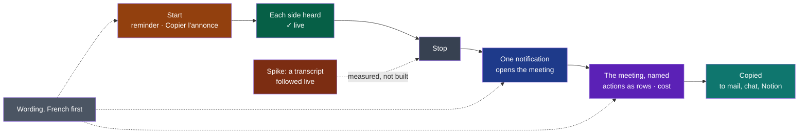

# Cycle 05 — The best day to day

> The framework's words: `.nstack/handbook/glossary.md`.

> Framed on 2026-10-26 on the decider's word: their choice that day, « Cycle 05 + bug tout de
> suite » — a cycle 05 after cycle 04, « le meilleur au quotidien ». It starts the day after
> cycle 04's end, and is accepted only once cycle 04 is closed: one accepted cycle at a time.
> Its source is the review of 2026-10-26 the decider asked for — [the market](../reviews/2026-10-26-market.md)
> and [the surface](../reviews/2026-10-26-ux.md), each by an independent session — as cycle 04's
> *Later* says. Every file:line below is the review's, read at commit 66b1ff7: `main.rs` has
> moved by some fifty lines since, `window.js` by some twenty after line 1600, the content
> unchanged (the verifier of #445); `minutes.rs`, `settings.rs` and `provider.rs` were read at
> 66b1ff7 by the framer.

## Goal

Cycle 03 built the window to its boards; cycle 04 brings it to the Mac. The charter's criteria
count weeks of meetings with Wholeheard instead of a bot, and the market moved: botless is now
every leader's default, and a local stack of Whisper and Ollama is a weekend project (market
review §0, §2). What is left to win on is the finish of each day's meeting. The review found
the bones good and named what keeps them from feeling high-end: a meeting has no name, its
result is hard to take away, up to four notifications a meeting, one of which opens a file
manager (UX review, verdict). The decider chose from it, on 2026-10-26: the notifications that
open the meeting in Wholeheard and are fewer; the minutes copied; the French wording; actions as
rows (Qui · Quoi · Pour quand); a meeting's title; the first run — the model card, a live audio
check, the reminder in the small window, « Copier l'annonce »; the informational cost an AI call
reports (OpenRouter's `usage.cost`, never an estimate); and the reminder kept, « Garder, mais
jamais éteint par défaut ». Their standing asks hold for each: modern, high-end, playful, the
easiest, non-intrusive, fluid; no over-engineering; words chosen with care.

**Legend** — one meeting, left to right · amber: D50 · green: D49 · grey: what is there today ·
blue: D44 · violet: D48, with D46 and D51 on the same page · teal: D45 · slate: D47, said
everywhere · red: D52, a measure only.

## Deliverables

Each is the shell's but D48 and D51, whose minutes are written by the summary, and D52, a measure
of the bench. Ordered by the review's value over cost (UX review §11): the order to build them in.

### D44

- Today: up to four notifications a meeting — the reminder, the stop, the transcript, the minutes
  (`words.rs:175-176, 171`, `main.rs:2188-2195`); « Transcription prête » opens the session's
  folder with `xdg-open` (`tell_opening`, `main.rs:2393-2415`), « Compte rendu prêt » opens
  nothing. The window already shows the stop and the making where the user is (D35: "what the
  user waits for is shown where they are").
- The reminder at the start stays a notification in every case: it is the charter's (C7).
- **Linux only for the click**: elsewhere the toolkit's plugin tells no click (the shell's
  `MANIFEST.yaml`, `notify-rust`; `main.rs:2417`) — a notification there is a notification alone,
  as today. The click on a Mac is *Later*.
- With D47: "session" leaves the notifications' words for "réunion" (UX review §10, `Made::Written`,
  `Said::Failed`).

### D45

- Markdown text, the body only: the code already writes to `navigator.clipboard` for the
  diagnostic (UX review 4.1). Rich text beside it — what a mail pastes as headings — is not
  promised: whether the system's web view takes `text/html` on the three systems is not known
  *(assumption)*; tried during the build, kept if it holds.
- Export, Notion, a file: *Later*, as the charter has it.

### D46

- The contract already guarantees the separator: `contracts/minutes/v1`, Actions, "what, who and
  by when, in that order, separated by ` — `". Rendered in `minutes.rs` of the shell; the contract
  unchanged (UX review 4.2).
- Board 2 of D11 drew what · who · when; the decider's words say Qui · Quoi · Pour quand: see
  *Open questions*.
- The copy of D45 keeps the items as written.

### D47

- The table of the UX review §10 is a proposal, not decided words: the decider adopts or amends
  it when they accept the cycle; the market review's §7 is read with it (Compte rendu, Décisions,
  Actions, Points clés, Intervenants).
- The errors handed to the page as English text (`main.rs:414-415, 508, 916-946, 1100-1134`) go
  through an enum said by `words.rs`, as `summarising::Cause` already is (UX review 5.1).
- *Transcript* or *Transcription* in French: see *Open questions*.

### D48

**The title written by the minutes, rather than the review's cheap fix** *(framer, to confirm)*.
The UX review weighed two forms (3.1):

| | The cheap fix | The title of the minutes |
|---|---|---|
| What | The shell shows the first sentence of *Points saillants*, cut at about 90 characters | The summary writes an optional `title` in the front matter, an additive change of `minutes/v1` |
| Modules | shell | contracts, then summary, then shell — one pull request each |
| Gives | A sentence cut short: « La date de l'événement est fixée au jeudi 3 juin, avec le 10 en… » | A name, as every board drew it: « Lancement — calendrier, budget, recrutement » |
| Cost | S | M |

The framer proposes the title: the boards, accepted as criteria, drew names; the contract's pull
request is one D51 needs anyway, so both fields go in the same one; and a name is what a later
search and export would share. The cheap fix stays the fallback if the decider prefers S.

- Additive (`.nstack/handbook/03-contracts.md` §3): no consumer changes to keep working — the
  shell reads the front matter into a table of keys (`minutes.rs:49-53` at 66b1ff7) and `export`
  consumes no contract (its `MANIFEST.yaml`). The contract's page changes in its own pull request,
  never in the consumer's (§7), as `recording/v1`'s `device` did before capture wrote it (#439,
  #441).
- A meeting without minutes keeps its date: renaming it by hand is *Later*.
- Whether the small models Ollama offers write a usable title is not known *(assumption)*: the
  minutes are written without one rather than refused (criterion 2).

### D49

- Board 5 of D11 drew the card, « Summit a besoin d'un modèle… » with *Télécharger le modèle* /
  *Plus tard*; today the 874 MB model is offered only after the first recording, through a
  notification (UX review 1.1, `window.js:1600-1602`). The card reuses `model_fetch` and
  `modelFetch()`.
- The live check rides on what capture already says — `level` about ten times a second for each
  side, `silent` after ten seconds — so capture and its contract are unchanged. It shows on every
  recording, not the first only *(framer, to confirm)*: no state to keep, and a device changed
  since is caught too.
- On a Mac, a tap of what plays that lacks its permission records silence with no error, and no
  interface says whether it was granted (market review §5, [Apple forum 771864](https://developer.apple.com/forums/thread/771864)):
  the check is how the colleague sees it.
- The small window keeps its fixed size (D35); the check takes the room left under *Arrêter*
  (UX review 2.2).

### D50

- The decider's word, 2026-10-26: « Garder, mais jamais éteint par défaut ». The reminder is on
  by default today (`settings.rs:106`) and a setting removes it (charter, open questions,
  2026-10-13): nothing of the charter changes, so no PDR — D50 pins the default with a test and
  shows the reminder where notifications cannot hide it (macOS asks for them; GNOME's *Ne pas
  déranger* holds them back: UX review 1.2, `words.rs:98-106`, `main.rs:1824`).
- « Copier l'annonce »: Notion's consent step, Apple's audible notice and Meet's notice set the
  bar, and *Chamberlain v. Granola* (filed 2026-07-30) is about botless notes with the notice off
  by default (market review §0, §2, recommendation 6). The sentence, the framer's proposal for the
  decider to adopt or amend:
  - FR: « J'enregistre cette réunion pour en faire le compte rendu. Dites-le-moi si vous préférez
    que je ne le fasse pas. »
  - EN: "I'm recording this meeting to write up its minutes. Tell me if you'd rather I didn't."
- Posting it into the call's chat itself is an integration: out of scope.

### D51

- Today nothing records a cost: `Provider::ask` hands back the answer's text alone
  (`modules/summary/src/provider.rs:165` at 66b1ff7) and the front matter holds `made`,
  `provider`, `model`, `context` (UX review §9).
- OpenRouter returns `usage.cost` in every response, with no parameter — `usage: {include: true}`
  is deprecated ([OpenRouter, *Usage accounting*](https://openrouter.ai/docs/use-cases/usage-accounting),
  read by the market review on 2026-10-26). Its page says "cost in credits" without naming a
  currency: that it is US dollars is an **assumption**, read again at the source when it is built
  (*Open questions*).
- Three pull requests, one module each, in this order: contracts (the page, with D48's `title`),
  summary (reads the cost, writes it), shell (shows it). The deliverable is the summary's, as D42's
  was transcription's.
- The summary reads more of an answer it already receives: no new connection, no new host, the
  key where it is. `security.md` applies to that answer as external input — criterion 2's
  refusal of a cost that does not read.
- No estimate before the call, no running meter, no monthly total: the decider's "never an estimate", and the UX review's §9.3 total is not asked for.

### D52

- The decider's idea of 2026-10-26 (« la possibilité de faire la transcription live, le
  traitement qu'on ne peut pas faire live est celui des minutes »), framed in cycle 04's *Later*:
  a provisional preview while recording, on the machine alone, in the small window and the full
  one; the transcript of record made after the stop as today. Short spans lose words — cycle 01,
  D4: 34.5 % of the words differed heard thirty seconds at a time, 26.7 % whole — so the preview
  never replaces the transcript.
- A measure, not the product: the program lives in the bench (`modules/platform/bench`), nothing
  in the shell, capture or transcription changes. Building the preview is the next framing's, its
  ADR first, if the threshold is met.
- On the decider's Fedora, on devices made for the run while the decider is not on a call; SUMM-RE's
  passages (CC BY-SA 4.0) for the words. Nothing of a real meeting is recorded or published.
- SpeechAnalyzer's own live results on a Mac are not measured here: GitHub's runner offers no
  SpeechTranscriber (cycle 04, D42), and the colleague's hour is cycle 04's.

## Dependency with a date

- **One real call to openrouter.ai**, for D51's sheet: a key of OpenRouter's, with credit, by
  2026-11-11 *(framer, to confirm whose)*. Missed, D51's other scenarios hold and that one waits.

## Out of scope

The review's "do not build" (market review §4, §8):

- Automatic speaker identification (diarization).
- An assistant during the meeting, live minutes.
- Chat over notes, across meetings.
- Team spaces, seats.
- A CRM, a Slack bot, any integration posting for the user.
- Public links to a meeting or its minutes — never.

And for this cycle:

- The live preview built into the product: D52 measures it only.
- A notification's click on macOS and Windows.
- A price estimated before a call, a running meter, a monthly total, a table of prices.
- Export to a file or to Notion; rich text promised in the copy.

## Later

- The live preview built, on D52's record and its ADR; SpeechAnalyzer's live results on a Mac.
- Each decision and action linked to its passage, the audio played there (market review,
  recommendation 2): what Granola, which deletes the audio, cannot do.
- Naming the other side by hand, once, everywhere; meeting types as contexts (market review 7, 8).
- A notification's click on a Mac.
- A meeting renamed by hand.
- The rest of the UX review's ranked list: the full window's empty state and a caught `listed`
  failure (3.7), *Démarrer*'s instant feedback (3.3), *Refaire…*'s *Annuler* (4.4), playback
  speed (4.7), search highlighted (4.6), the tray's repair entries (6.3, departs from D34's board).

## Open questions

**Blocking:** none — each below has a default the deliverable is built with.

**Not blocking:**

- **Tokens beside the cost** (D51)? The reviews disagree: the market review shows them (« 12 480
  jetons », §6), the UX review never — jargon, the log and developer mode at most (§9). The
  framer's default: not shown, written to the log; adding them later is another additive field.
- ***Transcript* or *Transcription*** in French (D47)? Both reviews say *Transcription*: the
  French word for the text, the one every French product uses, already the step's name in
  Settings (UX review §10, market review §7). Boards 1 and 2 of D11, accepted, say *Transcript*.
  The framer's default: *Transcription*, a departure from the boards the decider settles.
- **The order of an action's cells** (D46): the decider's words, Qui · Quoi · Pour quand, or
  board 2's and the contract's, what · who · when? The framer's default: the decider's words, on
  screen; the contract's order unchanged.
- **The unit of `usage.cost`** (D51): OpenRouter's page names credits, not a currency. The
  framer's default: `$` only if OpenRouter's documentation says the credits are dollars when D51 is
  built; otherwise « crédits OpenRouter ».
- **The title or the cheap fix** (D48): the framer's proposal is the title; the cheap fix is S.
- **The announcement's sentence** (D50): the framer's, above, for the decider to adopt or amend.
- **The live check on every recording** (D49), rather than the first only.

## Closure

<Written at the end.>

**Documents brought current:** <at the closure>
