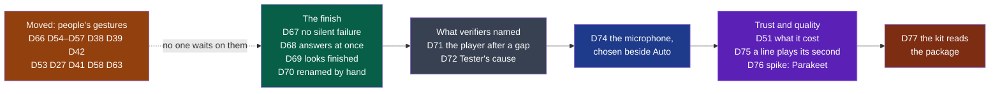

# Cycle 06 — The minutes you can check

> The framework's words: `.nstack/handbook/glossary.md`.

> **Framed on 2026-10-30**, on the decider's word that day: « en analysant le marché et les tendances,
> avance les cycle de maniere pro, ux/ui toujours moderne, highend, ludique fluide et optimale, code
> expert. ce que tu ne PEUX pas realiser en autonomie est reporté dans le cycle suivant. »
> **Accepted by the decider on 2026-10-31**, closing cycle 05 early, on their word that day in the
> session that proposed it: « 05 fermé, D44 à D50 acceptés ; 06 accepté, défauts du cadreur ». Each open question below is settled by its default, the decider
> amending any at will; the dates are that day's, the appetite two weeks. Cycle 05's thirteen
> deliverables left moved here that day. The criteria name symbols, never lines.

## Goal

The market, [read on 2026-10-30](../reviews/2026-10-30-market.md), shows leaders widening away from
the minutes — dictation, briefs, agents — and two pressures on the rest: notice, in court, and
Whisper behind in French on read speech, by its rival's figures. Wholeheard's own ground is narrower and stronger:
the audio stays on the machine, so a line of the minutes may be proved at its second: D75's first criterion finds out whether a local model can say which. If it refutes it, the goal is read as: the player exact after a gap, and the window finished. Beside it, what makes a tool
feel high-end is mostly the absence of small betrayals, and the verifiers of cycle 05 named them.

**Legend** — amber: moved, built, a person's gesture left, which holds nothing else up · green: the shell's
finish · grey: follow-ups a verifier named · blue: the source chooser · violet: minutes and transcript ·
red: the Store. Left to right, the order to build them in.

## Deliverables

Value over cost, from [the market's §6](../reviews/2026-10-30-market.md#6-recommendations-by-value-over-cost)
and the [UX review's §11](../reviews/2026-10-26-ux.md). **Cut first** if the breaker nears: D77, then
D72's transcription half, then D74. Never D67, D70 (the decider's own ask), D71, D75's first criterion or D76's record. **None of the new
waits on a person to be built; D77's kit may, and D74 costs `critical`'s rows if #568 is merged first.** D67–D69 touch
`window.js` and `words.rs`: one session at a time on them.

### Moved from cycle 05

Their criteria are copied as they stand; the state and the pull requests are in
[cycle 05's closure](05-best-of-its-kind-to-use.md#closure); their sections stay there and in
[cycle 04](04-wholeheard-on-macos.md). They moved on the decider's word above. **What needs a person** below gives each its gesture.

### What needs a person

Nothing else in this cycle waits on these. If D55 or D56 is done before the acceptance, its row goes.

| Deliverable | Who | The literal gesture |
|---|---|---|
| D55 | The decider | Once an agent says #568 is green at its head: open [#568](https://github.com/NapkinStack/wholeheard/pull/568) and press *Merge*: its `CODEOWNERS` line is theirs |
| D66, sheet | The decider | Say « S3 et S4 comme proposés », the wording in [#580](https://github.com/NapkinStack/wholeheard/pull/580)'s remark 1, or amend; then an agent merges it |
| D66, trial | The decider | On Fedora: `sudo dnf reinstall ../wholeheard-d66s/dist/install/wholeheard-*.x86_64.rpm` (#580's branch, built there); once #580 is merged, `nstack release` at the root of `main`, then the same from `./dist/install/`. AirPods connected, a WhatsApp Web call with someone. Five times, the call going on: *Démarrer*, say a sentence, *Arrêter*, noting both times to the second. After each *Arrêter*, a few seconds later: `pactl list cards \| grep 'Active Profile'`. After: `journalctl --user -b --since "-30 min" \| grep 'Failure in Bluetooth audio transport'`, its times against yours. `ls -t "$(xdg-user-dir DOCUMENTS)/Wholeheard" \| head -5`, and listen to `local.wav` in each. Answer on [#494](https://github.com/NapkinStack/wholeheard/issues/494): call cut or not, each profile, lines within two seconds or not, your voice heard or not |
| ADR-0015 | The decider | After that trial, say « ADR-0015 acceptée », or what falls. D74 builds on it |
| D56 | The decider | `sudo dnf install minisign`, then, at the root of a checkout of `main`: `minisign -G -p wholeheard-models.pub -s ~/.minisign/wholeheard-models.key`, a passphrase of your own, the private key never in a repository. Give an agent the file `wholeheard-models.pub`. Sign when asked: `minisign -Sm modules/shell/registry/models.json -s ~/.minisign/wholeheard-models.key`, and give an agent `models.json.minisig`: it commits it |
| D57 | The decider | Read [`docs/store/listing.md`](../../store/listing.md); say « l'annonce ne promet rien de faux », or which line does |
| D54, submission | The decider | In [Partner Center](https://partner.microsoft.com/dashboard), with a company's account: reserve the name Wholeheard, give an agent the identity it shows. Read the Store's licence terms beside GPL-3.0; answer the age questionnaire. Say which version submits (open questions) |
| D53, D54, D58 on Windows | The colleague on Windows 11 | [#482](https://github.com/NapkinStack/wholeheard/issues/482), updated first by an agent with the run's link. Unpack `wholeheard-windows-x64-msix`, then in PowerShell, as administrator: `Import-Certificate -FilePath .\Wholeheard-this-run.cer -CertStoreLocation Cert:\LocalMachine\TrustedPeople`, then `Add-AppxPackage .\Wholeheard-<version>-x64.msix` ([Microsoft](https://learn.microsoft.com/en-us/windows/msix/package/create-certificate-package-signing): the store; remove the certificate afterwards). The first run's assistant opens (D58). A real call of five minutes; answer there |
| D38, D39, D42, D58 on a Mac | The colleague on a Mac | [#426](https://github.com/NapkinStack/wholeheard/issues/426), updated first by an agent: open the app, the first run's assistant, ⌘B on the sidebar (D61), record a real call, answer there |
| D27 | The colleague on Ubuntu 24.04, whom the charter's three do not name: the decider says who | [#255](https://github.com/NapkinStack/wholeheard/issues/255): `sudo apt install ./wholeheard_<version>_amd64.deb`, answer there |
| D41 | The decider | [#449](https://github.com/NapkinStack/wholeheard/issues/449): a call on the earbuds, the default on the speaker |
| D63 | The decider | [#463](https://github.com/NapkinStack/wholeheard/issues/463): a real service heard, with their key |

### D67

- A verifier found it wider than D47 had named (#577): `minutes_again`, `transcript_again`,
  `hearing_models`, `settings_saved` for the fold.
- The commands that return nothing cannot fail to the page: the test names them, rather than a rewrite.

### D68

- Prior art: optimistic state on the gesture, the state corrected if the command refuses. `ux.md`'s
  states are read with it.

### D69

- Lucide's five icons (ISC, its notice kept in the repository), inline: the UX review's choice. No board: an amendment of D34's header
  only for *Petite fenêtre*, the UX review's 3.2, named here as a departure for the decider.
- The direction is [Linear's](https://linear.app/now/behind-the-latest-design-refresh): "Don't compete for
  attention you haven't earned". What the review proposed, **nothing more**: not a redesign. Playful is one
  pop and one fade, as it says.

### D70

- The decider's [#504](https://github.com/NapkinStack/wholeheard/issues/504). Kept the way a meeting's
  language is kept (D65): a file of the meeting, as #504 proposes, a `session-audio` expand. A folder is never renamed: others read it.

### D71

- Named by #579 and #580, by reading, never measured: the first thing the oracle does is measure it.
- `session-audio/v2` already says a reader places frames by clock points. No contract change.
- Whether the transcription has the same drift is not known *(assumption: its `tracks.rs` reads the
  points)*: the second criterion finds out. If it is the transcription's, it stops here and is reported: a second module.

### D72

- #577's verifier: « vérifiez son adresse, son nom et sa clé » is said to a service with no times, a
  service down, a quota. `summarising/v1` lists codes, a test's included *(assumption: read, not run)*;
  the shell does not say them, and the transcription's step has no page for them. Expand first, one pull request a module:
  contracts, each step, the shell (`.nstack/handbook/03-contracts.md`).
- Never a parse of the program's English.

### D74

- **Prior Art Gate.** The convention is [Granola's](https://docs.granola.ai/help-center/troubleshooting/transcription-issues):
  *Auto*, then a list where the transcript is. It covers the need: adopted. No device management of ours.
- At the start only: capture's input takes `stop` alone, and a change during a recording would be a new command: *Later*. Built on ADR-0015, whose only proof on a real headset is D66's trial: that gesture first if it comes in time, no formal block.
- Linux only: on macOS and Windows capture has its other adapters, and D66 left them. The list's place
  departs from D34's small window; D49's third criterion is the bar: nothing overflows.
- ADR-0015's rejections stand: a card's profile is never forced, even by hand.

### D51

- **The decider chose it on 2026-10-26**; it went to *Later* on 2026-10-27 to make room for the Store.
  Its criteria are those of [#461](https://github.com/NapkinStack/wholeheard/pull/461), brought to
  `minutes/v3`, ADR-0005 keeping each version frozen. Its section at that commit still holds. See [#503](https://github.com/NapkinStack/wholeheard/issues/503).
- It and D75 share `minutes/v3`: one contract pull request after D75's first criterion is read, merged before either; refuted, v3 holds the cost alone.

### D75

- **Prior Art Gate.** [Notion](https://www.notion.com/help/ai-meeting-notes) cites transcript lines; Granola
  points to the transcript. Those two stop at text; Otter, Fathom and tl;dv jump to a recording's moment from a transcript or a highlight, kept in their cloud. The convention is adopted, its form extended by what
  ADR-0004 already keeps, with nothing to build but a link to a player that exists. The deviation is
  paid by a named value: checking a line in one click, by ear.
- **What is not known** *(assumption)*: whether a small local model gives a time that is right. Hence the
  first criterion, read before anything is frozen (ADR-0005). `qwen3:8b` already ran past 280 s on a short transcript (#571): a run that does not finish is recorded. Below the threshold it is shown
  for none, rather than a link that lies.
- No confidence score, no checking of a claim. The review of 2026-10-26 refused them.
- A line corrected (D62) leaves earlier minutes' times as they were: they point to a time, never to a line.

### D76

- **Prior Art Gate.** [NVIDIA's own figures](https://arxiv.org/html/2509.14128v1) put Parakeet ahead of
  Whisper large-v3 on French read speech; [Meetily](https://github.com/Zackriya-Solutions/meeting-minutes/releases)
  ships it. An engine that can be swapped is already what the step holds (ADR-0003). No tuning: an
  engine's defaults are taken as they are (the decider, 2026-10-17). Whether it stays is an ADR, with its exit.
- `modules/transcription/AGENTS.md`: a bench of read sentences cannot decide; the trial meeting is heard too.
- No sound of the decider's call is sent or published. The record gives counts, a few words at most.
- Nothing enters the shipped program here: a dependency, if ever, is that ADR's (`security.md`).

### D77

- [Microsoft](https://learn.microsoft.com/en-us/windows/uwp/debug-test-perf/windows-app-certification-kit)
  ships the kit in the Windows SDK, with a command line (administrator, `appcert.exe reset` first). The page says both "an active user session" and integration where none is available: whether a
  hosted runner suits is unknown, and a refusal recorded answers the deliverable. Named by D54's verifier.

## Dependency with a date

From the day cycle 06 is accepted, as cycle 05's intervals; a date missed leaves a deliverable where it is at the end date.

- **An agent remakes the forge's builds from `main` and updates #426, #482, #255, #449 and #463 within 48 hours of the acceptance**, their dates with them (#426 and #482 say « by 2026-10-31 », their artifacts expire on 2026-11-05), and again whenever an artifact is about to expire.
- **The colleagues' trials**, and the name of D27's: 14 days after the acceptance.
- **The decider's Partner Center account and the name reserved; the minisign key**: 11 days after.
- **The decider's reading of the Store's terms beside GPL-3.0; the age rating**: 15 days after, or the end date if sooner.
- **D66's trial and ADR-0015**: before D74 is built, if it can be; at the latest the date the decider sets at the closure.

## Out of scope

As cycle 05, the market's refusals beside it (§4):

- Dictation; automatic speaker identification, voiceprints.
- An assistant during the meeting; live minutes; chat over notes across meetings; MCP.
- Team spaces, seats; a CRM, a Slack bot, an integration posting for the user.
- Public links to a meeting or its minutes — never.
- Scoring the minutes' truth; a meter, an estimate or a table of prices.
- Submitting to the Store: it waits on what *What needs a person* names.

## Later

- **Spoken notice**, as [Notion](https://www.notion.com/help/ai-meeting-notes)'s voice message: **against the charter's constraint, a PDR first, the decider's.**
- **D73, a microphone that stopped says why**: `recording/v1`'s optional reason, in no ranking of the market, and capture cannot always tell (#574, #580). **A microphone changed during a recording**, after D74.
- A trial and a licence key, a merchant of record; the Mac App Store after a spike; SpeechAnalyzer's live results (cycle 05's *Later*).
- **D52, the spike on a live transcript**, and what depends on it (cycle 05's *Later*).
- Naming the other side by hand, once, everywhere; meeting types as contexts; export to a file or Notion (market review of 2026-10-26, 7, 8, 9).
- Search highlighted, with a count; playback at 1×, 1,5×, 2× (UX review 4.6, 4.7).
- From the verifiers: a side between -60 and -40 dB says nothing, a second recording's stale first check (#575); a stereo track holding a headset's voice on one channel, at half its level; `Micro changé`, then a gap with no notification, the last word turning false (#580, remark 2); a `# ...` title refusing the answer, `Accord Q3/Q4` leaving the date (#571); the `allow_legacy` and limits mutants (#578).
- From cycle 05's *Later*: the Store's trial; macOS notarised; settings kept when the package is removed; start with Windows; a notification's click on a Mac; the cost of an online transcription; a link to its passage, now D75; a discreet indication of a new device; the tray's repair entries.
- Re-read [RM566322](https://mc.merill.net/message/RM566322) and Apple's EU position before the Store's launch.

## Open questions

**Blocking:** none — each has a default the deliverable is built with.

**Not blocking**, each *(framer, to confirm)*:

- **Closing cycle 05 now, or at 2026-11-19?** Settled: now, D44–D50 accepted on their sheets, the decider's word above.
- **The appetite**: two weeks, modest, thirteen moved and eleven new, the cuts named. Default: two; never stretched.
- **D66's fourth criterion** still names « an optional field », which #579 removed from D66 (*Later* keeps it as D73). Settled by the default: amended at the acceptance to read as `recording/v1` says now. **Its second criterion's window**: a default turning into a headset mid-recording, the switch came 4 of 10 measured. Default: taken knowingly, as already written.
- **The version submitted**: `0.2.0` has a first part the Store refuses. Default: 1.0.0 for the first submission, not before it — a version says what was tried.
- **The reminder's setting** (charter, 2026-10-13: a setting removes it): read again against [*Chamberlain v. Granola*](../reviews/2026-10-30-market.md#3-consent-and-law)? Default: unchanged, a lawyer's reading before strangers install it; changing it takes a PDR.
- **`minutes/v3`, one version for D51 and D75.** Default: yes, a page per version being ADR-0005's price.
- **D75's threshold, 90 %**: the framer's, with no source: a link that lies is what the feature cannot afford. Default: kept; amend at will.
- **D76's threshold**: the framer's, with no source, default as written. It compares only with today's model, `ggml-large-v3-turbo-q8_0`.
- **D27**: its colleague on Ubuntu is not one of the charter's three, and it moves for the fourth time. Default: no name by the date below, it goes to *Later*.
- **D74's list where**: on the microphone's line of the small window. Default: there; Settings none, for the choice is a meeting's.

## Closure

<Written at the end.>

**Documents brought current:** <at the closure>
