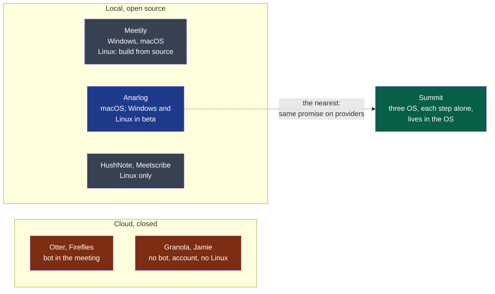

# Discovery

> Started by the engine's `discover` command, run by your agent (`playbooks/discovery.md`).
> One document, a decision at the end of each round.

## 1. Intake

*Confirmed by the decider on 2026-10-12, without correction.*

Summit is first for advanced users and small teams who want to keep control of their data
and of their costs — the professional who cares about confidentiality, the pragmatist who
mixes local and online, the tinkerer who uses one step only. They use it on their own
computer (Windows, macOS, Linux), during a meeting, online or in a room, or afterwards on an
audio file or a text. Their problem: note takers make them pick a side — a convenient but
closed cloud service (subscription, data held by a third party, an imposed AI model, a bot
in the meeting), or a respectful local tool limited to one platform or to one brick. Summit
is a discreet desktop application, living in the system tray and the file context menu, that
chains four independent steps — capture, transcribe, summarise, export — each with its own
provider (a local engine or an OpenAI-compatible service) and usable alone; local by
default, no bot, no account.

**Open questions:**

None left. The language of the project was decided at intake — English everywhere — and is
rule 1 of `docs/project/rules/always.md`.

## 2. Research

Run on 2026-10-12 with the agent runtime's web search and page fetch — the tooling profile
names no research tool yet. *Vendor* marks a figure a company reports about itself or its
market; *secondary* marks a claim not read at its primary source.

**Legend** — red: what the idea reacts against · grey: local tools that cover one platform
or one part · blue: the one product that already covers most of the idea · green: Summit.

| Claim | What it changes for the idea | Source |
|---|---|---|
| **Anarlog (ex-Hyprnote) is MIT, needs no account on its free plan, lets the user pick the transcription engine and the summary model separately — local, own keys, Ollama, LM Studio — and ships Windows and Linux builds in beta** | The idea's central claim — *no product combines Linux, per-step configuration and OS integration* — now rests on the third point alone, and on Linux being first-class rather than beta. This is the finding that most changes the decision | [anarlog.so/about](https://anarlog.so/about/), read 2026-10-12 |
| Meetily is MIT, Windows and macOS; on Linux "build the app bundle from source", a native app "in development". Transcription is local only; cloud summary keys are a Pro feature | Confirms the Linux gap for this one; shows a competitor charging for what Summit gives away — bringing one's own key | [meetily.ai](https://meetily.ai/open-source-ai-note-taker), read 2026-10-12 |
| OpenWhispr runs on macOS, Windows and 64-bit Linux, detects Zoom and Teams calls, transcribes with speaker labels, local or own keys including OpenRouter. Its page does not mention meeting summaries | A second cross-platform product with Linux — a dictation tool growing toward meetings | [docs.openwhispr.com](https://docs.openwhispr.com/), read 2026-10-12 |
| Linux-only local tools exist: HushNote and Meetscribe capture microphone and system audio separately through PipeWire or PulseAudio, transcribe with Whisper, summarise with Ollama | Capturing "me" and "others" as two sources on Linux is done, by small projects: feasible, not novel | [HushNote](https://github.com/peteonrails/hushnote), [Meetscribe](https://www.sourcepulse.org/projects/26636893) — *secondary*, repositories not read |
| Prices of the field: Granola Business $14 per user per month; Jamie €25 and €47 per month; Anarlog Pro $14 per person per month; Meetily Pro $10 per user per month billed annually; MacWhisper Pro about €59 once | Three models: subscription, open core with a hosted paid tier, one-time licence. Summit's "charges nothing" matches none of them | Anarlog and Meetily: their pages above. Granola, Jamie, MacWhisper: *secondary* ([Granola](https://www.usecarly.com/blog/granola-pricing/), [Jamie](https://toolradar.com/tools/jamie/pricing), [MacWhisper](https://www.getvoibe.com/resources/macwhisper-pricing/)) |
| 75% of professionals use an AI note taker in work meetings; 73% of businesses name privacy as the first barrier | If true, the alternative to Summit is rarely "nothing" — it is a tool already installed; and the privacy argument has an audience | *Vendor*: a Fellow.ai survey, repeated by [Laxis](https://laxis.com/blog/state-of-meeting-note-taking-2026). Neither survey was read |
| The share of people who still take notes by hand | — | **Not found** |
| France, Penal Code art. 226-1: recording private or confidential words without consent — up to one year and €45,000; consent is presumed when the recording is made openly and the person could object | C6 and C7 of the idea — always visible, always reminding — are what makes the recording lawful, not a courtesy. "Record automatically" as a default is the risky setting | *Secondary*, publishers' blogs ([Noota](https://www.noota.io/fr/blog/enregistrer-reunion-sans-consentement), [Notta](https://www.notta.ai/fr/blog/rgpd-enregistrement-reunion)); the article itself and the CNIL's guidance were not read |
| United States: *Brewer v. Otter.ai*, N.D. Cal., no. 5:25-cv-06911, filed 15 August 2025 — a participant recorded by another participant's bot, without being asked; more than $5 million sought, consolidated with three other suits | The liability falls on the vendor who records by default. Summit records nothing on its own servers, which moves the question to its user — and to its defaults | [NPR](https://www.npr.org/2025/08/15/g-s1-83087/otter-ai-transcription-class-action-lawsuit), [Fisher Phillips](https://www.fisherphillips.com/en/news-insights/new-lawsuit-highlights-concerns-about-ai-notetakers.html) — *secondary* for the docket |

**Assumptions** — what could not be sourced:

- That users of a local tool accept "a slightly worse result", as the idea's first profile says.
- That a non-technical person can use Summit "once configured" by someone else.
- That being discreet — in the tray and the context menu, never in the user's way — is
  something users want enough to choose a product for it. No product of the table does it,
  which proves a gap, not a demand. *(Reworded on 2026-10-12: the decider's aim is not to
  hide the application, see stage 3.)*
- That Anarlog's Linux beta is unusable in general: one failed installation on Fedora
  (stage 3) is one data point, on one distribution.

**Open questions:**

1. With Anarlog covering most of the promise, what is Summit's reason to exist that a user
   would name — and is it enough to build a product rather than contribute to that one?
2. Who pays for Summit's development, since it charges nothing and selling is out of scope?

## 3. Define

**Users and their problem:** one person, the decider: "c'est mon propre besoin à cette
heure-ci" (2026-10-12). No other user has voiced the problem. The three profiles of the idea
file — the privacy-minded professional, the pragmatist, the tinkerer — are therefore
**assumptions**, not users.

**A need added by the decider at this stage (2026-10-12):** optionally, and where the step
allows it, attach a context — a text or a file — to a step that uses AI. The framer's
reading, not a decision:

- *For it*: it is one idea where the file had three — the custom vocabulary (T5), the
  templates (R4) and the open question on personal notes are each "a context given to a
  step". An agenda or a list of names given to the summary is what makes Granola's result
  better than a raw summary; and it costs little to build.
- *Against it*: a context sent to an online summary is one more thing that leaves the
  machine, so principle 4 applies to it in full — the interface must say it leaves; a long
  file adds to the cost and to the length limit (R7); and "where possible" hides that a
  transcription engine takes a few hundred words of context at most, a summary model a whole
  document.
- *Proposed*: keep it, as one concept that replaces T5 and the notes question rather than a
  fourth feature beside them; decide its place in the first cycle at the framing.

**Constraints:**

- **Who builds and runs it:** the decider alone, with agents. **No budget.** (2026-10-12)
- **Discreet, not hidden** — the decider's correction of "no window" (2026-10-12): the aim
  is that Summit never gets in the user's way, not that it is concealed. A window may exist;
  a user who wants it out of sight can put it there. Principle 5 of the idea file reads
  "non-intrusive", and "no window to keep open" is one way of it, not the rule.
- **Platforms:** Fedora for the decider; Windows for one colleague, macOS for the other —
  the latest version of each system. **The decider tests on Linux only**: Windows and macOS
  are verified by the two colleagues, on their own machines. (2026-10-12)
- **Private first, open source later:** the repository stays private until the software has
  been proven in use; it is opened afterwards. (2026-10-12) Until then the showcase shows
  nothing, and the forge cannot require an approval on a private repository of this plan —
  both accepted for now.
- **Regulation:** France for now; anywhere later, not known in advance. (2026-10-12) So the
  defaults must be lawful where the rule is strictest, not only in France: a recording is
  always visible, the reminder to tell the participants is on by default, and nothing
  records by itself until the user has chosen so.

**What the decider tried (2026-10-12):** asked whether Anarlog or Meetily had been tried and
what was missing — "testé mais l'installation ne fonctionne pas sous Fedora". One
observation, on the decider's own workstation; which of the two was tried was not said. It
agrees with the research: Meetily asks Linux users to build from source, and Anarlog's Linux
build is a beta whose setup script targets Debian and Ubuntu (*secondary*). So the first
reason to build is concrete and narrow: **on this Linux, the nearest product does not
install** — and what the decider would have missed in it once installed is unknown.

**Success signals** — the decider's, 2026-10-12:

| What will be observed | By when |
|---|---|
| The decider uses Summit for **all** their meetings, on Fedora | 2026-10-26, two weeks |
| The decider's colleagues use it on Windows and on macOS: the three platforms, in real use | 2026-10-26 |

**A second purpose, stated by the decider:** the project also serves to make their IT
company known. That answers who carries the cost — the company, as a showcase — and makes
"is it open source?" a question of the first order rather than of the last.

**Open questions:**

1. **Two weeks against the scope.** The idea file's first version spans capture of the
   microphone and of the system's sound on three operating systems, a tray, a context menu, a
   global shortcut, live transcription, a summary, an export to Notion — by one person with
   agents. The framer's reading: the date and that scope do not fit together, and one of the
   two gives way at the framing. Which one is the decider's to say.
2. What "proven" means for opening the repository: the two success signals above, or more?
4. *(for the framing)* Two of the three platforms can be verified only by someone else, on
   their own time: whoever writes the code never sees it run there.

## 4. Shape

*Drafted by the framer on 2026-10-12; read by the decider the same day.*

**Value hypothesis:** a person who cannot install the nearest local note taker on their
system will, once Summit is installed, use it for **every** meeting — and so will two
colleagues on Windows and macOS — because it installs in minutes on the three systems, keeps
everything on the machine by default, lets each step use the provider they choose, and never
gets in their way. They will not go back to what they do today: **bots that join their
meetings** (the decider, 2026-10-12).

What they leave is not nothing, and the hypothesis must beat it: a bot needs no installation,
works the same on every system, and attends a meeting its owner misses. Summit asks for an
installation on each machine and for its user to be present. What it offers against that is
what the idea file says a bot costs — an intruder the other participants see, their words
held by a third party, a subscription, a model nobody chose.

*It is wrong if*, by 2026-10-26: one of the three could not install it without help; or one
of them held a meeting without it after installing it; or one of them went back to the bot.

**Press release** — a placeholder, dated 2026-10-26, the day of the success signals:

> **Summit: meeting notes that stay on your machine, on any desktop.** Summit records a
> conversation, transcribes it and writes its minutes — on Linux, Windows and macOS alike.
> Each of its four steps runs alone and with the provider you choose: a model on your
> machine, or any OpenAI-compatible service with your own key. Nothing leaves your computer
> unless you say so, and Summit tells you what leaves and where to. No bot joins your
> meeting, no account is asked for, and it stays out of your way: a tray icon, a right-click
> on a file, a notification when it is done. *"The local tool I wanted would not install on
> my Linux. This one did, and my colleagues on Windows and Mac use the same."* — imagined,
> from the decider's own account.

**Convinces the decider?** Yes (2026-10-12), read in French, without a change asked.

**No-gos:**

*The decider's, from the idea file:*

- No bot that joins a meeting; no account, no sign-up.
- No cloud synchronisation, no team collaboration.
- No provider imposed, no key supplied by Summit.
- No mobile application.
- No "ask your notes a question" across meetings.
- No sales analysis of calls, no CRM integration.
- Nothing that sells the product: licence, payment, shop.

*The framer's — proposed:*

- **No recording that starts by itself until the user has chosen it, and never one without a
  visible indicator.** The decider records "anywhere, not known in advance": the default must
  hold where the law is strictest.
- **Not a notes editor.** That is what the nearest product is; Summit produces the minutes
  and hands them over.
- **No telemetry**, even opt-in, while the repository is private: nobody can read what would
  be collected.

**Open questions:**

1. Which bots, and what do they cost today? It prices what Summit replaces.
2. Does the added need — a context given to a step — belong in the first version?

## 5. Challenge

**Challenger:** <@human, or the agent session> · <date>

**Pre-mortem:** <the reasons, each tagged with its risk>

**The four risks:**

| Risk | Riskiest assumption | Cheapest test — and the result that refutes it |
|---|---|---|
| Value | | |
| Usability | | |
| Feasibility | | |
| Viability | | |

**Counter-evidence:**

**Flaws in stages 1 to 4:** <each citing its line>

## 6. Decision

<go · clarify · kill; the reasons; for a go, why each objection does not block it, and what
the first cycle carries: spikes, no-gos.>
