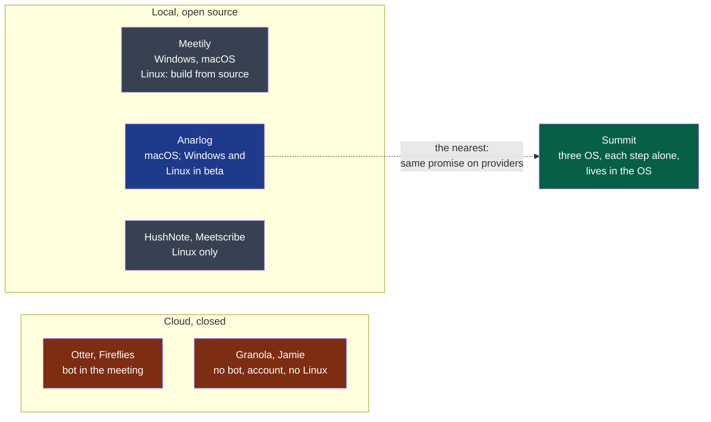

# Discovery

> Started by the engine's `discover` command, run by your agent (`.nstack/playbooks/discovery.md`).
> One document, a decision at the end of each round.

## 1. Intake

*Confirmed by the decider on 2026-10-12, without correction.*

Summit is first for advanced users and small teams who want to keep control of their data
and of their costs — the professional who cares about confidentiality, the pragmatist who
mixes local and online, the tinkerer who uses one step only. They use it on their own
computer (Windows, macOS, Linux), during a meeting, online or in a room, or afterwards on an
audio file or a text. Their problem: note takers make them pick a side — a convenient but
closed cloud service (subscription, data held by a third party, an imposed AI model, a bot
in the meeting), or a respectful local tool limited to one platform or to one brick. Summit
is a discreet desktop application, living in the system tray and the file context menu, that
chains four independent steps — capture, transcribe, summarise, export — each with its own
provider (a local engine or an OpenAI-compatible service) and usable alone; local by
default, no bot, no account.

**Open questions:**

None left. The language of the project was decided at intake — English everywhere — and is
rule 1 of `docs/project/rules/always.md`.

## 2. Research

Run on 2026-10-12 with the agent runtime's web search and page fetch — the tooling profile
names no research tool yet. *Vendor* marks a figure a company reports about itself or its
market; *secondary* marks a claim not read at its primary source.

**Legend** — red: what the idea reacts against · grey: local tools that cover one platform
or one part · blue: the one product that already covers most of the idea · green: Summit.

| Claim | What it changes for the idea | Source |
|---|---|---|
| **Anarlog (ex-Hyprnote) is MIT, needs no account on its free plan, lets the user pick the transcription engine and the summary model separately — local, own keys, Ollama, LM Studio — and ships Windows and Linux builds in beta** | The idea's central claim — *no product combines Linux, per-step configuration and OS integration* — now rests on the third point alone, and on Linux being first-class rather than beta. This is the finding that most changes the decision | [anarlog.so/about](https://anarlog.so/about/), read 2026-10-12 |
| Meetily is MIT, Windows and macOS; on Linux "build the app bundle from source", a native app "in development". Transcription is local only; cloud summary keys are a Pro feature | Confirms the Linux gap for this one; shows a competitor charging for what Summit gives away — bringing one's own key | [meetily.ai](https://meetily.ai/open-source-ai-note-taker), read 2026-10-12 |
| OpenWhispr runs on macOS, Windows and 64-bit Linux, detects Zoom and Teams calls, transcribes with speaker labels, local or own keys including OpenRouter. Its page does not mention meeting summaries | A second cross-platform product with Linux — a dictation tool growing toward meetings | [docs.openwhispr.com](https://docs.openwhispr.com/), read 2026-10-12 |
| Linux-only local tools exist: HushNote and Meetscribe capture microphone and system audio separately through PipeWire or PulseAudio, transcribe with Whisper, summarise with Ollama | Capturing "me" and "others" as two sources on Linux is done, by small projects: feasible, not novel | [HushNote](https://github.com/peteonrails/hushnote), [Meetscribe](https://www.sourcepulse.org/projects/26636893) — *secondary*, repositories not read |
| Prices of the field: Granola Business $14 per user per month; Jamie €25 and €47 per month; Anarlog Pro $14 per person per month; Meetily Pro $10 per user per month billed annually; MacWhisper Pro about €59 once | Three models: subscription, open core with a hosted paid tier, one-time licence. Summit's "charges nothing" matches none of them | Anarlog and Meetily: their pages above. Granola, Jamie, MacWhisper: *secondary* ([Granola](https://www.usecarly.com/blog/granola-pricing/), [Jamie](https://toolradar.com/tools/jamie/pricing), [MacWhisper](https://www.getvoibe.com/resources/macwhisper-pricing/)) |
| 75% of professionals use an AI note taker in work meetings; 73% of businesses name privacy as the first barrier | If true, the alternative to Summit is rarely "nothing" — it is a tool already installed; and the privacy argument has an audience | *Vendor*: a Fellow.ai survey, repeated by [Laxis](https://laxis.com/blog/state-of-meeting-note-taking-2026). Neither survey was read |
| The share of people who still take notes by hand | — | **Not found** |
| France, Penal Code art. 226-1: recording private or confidential words without consent — up to one year and €45,000; consent is presumed when the recording is made openly and the person could object | C6 and C7 of the idea — always visible, always reminding — are what makes the recording lawful, not a courtesy. "Record automatically" as a default is the risky setting | *Secondary*, publishers' blogs ([Noota](https://www.noota.io/fr/blog/enregistrer-reunion-sans-consentement), [Notta](https://www.notta.ai/fr/blog/rgpd-enregistrement-reunion)); the article itself and the CNIL's guidance were not read |
| United States: *Brewer v. Otter.ai*, N.D. Cal., no. 5:25-cv-06911, filed 15 August 2025 — a participant recorded by another participant's bot, without being asked; more than $5 million sought, consolidated with three other suits | The liability falls on the vendor who records by default. Summit records nothing on its own servers, which moves the question to its user — and to its defaults | [NPR](https://www.npr.org/2025/08/15/g-s1-83087/otter-ai-transcription-class-action-lawsuit), [Fisher Phillips](https://www.fisherphillips.com/en/news-insights/new-lawsuit-highlights-concerns-about-ai-notetakers.html) — *secondary* for the docket |

**Assumptions** — what could not be sourced:

- That users of a local tool accept "a slightly worse result", as the idea's first profile says.
- That a non-technical person can use Summit "once configured" by someone else.
- That being discreet — in the tray and the context menu, never in the user's way — is
  something users want enough to choose a product for it. No product of the table does it,
  which proves a gap, not a demand. *(Reworded on 2026-10-12: the decider's aim is not to
  hide the application, see stage 3.)*
- That Anarlog's Linux beta is unusable in general: one failed installation on Fedora
  (stage 3) is one data point, on one distribution.

**Open questions:**

1. With Anarlog covering most of the promise, what is Summit's reason to exist that a user
   would name — and is it enough to build a product rather than contribute to that one?
2. Who pays for Summit's development, since it charges nothing and selling is out of scope?

## 3. Define

**Users and their problem:** one person, the decider: "c'est mon propre besoin à cette
heure-ci" (2026-10-12). No other user has voiced the problem. The three profiles of the idea
file — the privacy-minded professional, the pragmatist, the tinkerer — are therefore
**assumptions**, not users.

**A need added by the decider at this stage (2026-10-12):** optionally, and where the step
allows it, attach a context — a text or a file — to a step that uses AI. The framer's
reading, not a decision:

- *For it*: it is one idea where the file had three — the custom vocabulary (T5), the
  templates (R4) and the open question on personal notes are each "a context given to a
  step". An agenda or a list of names given to the summary is what makes Granola's result
  better than a raw summary; and it costs little to build.
- *Against it*: a context sent to an online summary is one more thing that leaves the
  machine, so principle 4 applies to it in full — the interface must say it leaves; a long
  file adds to the cost and to the length limit (R7); and "where possible" hides that a
  transcription engine takes a few hundred words of context at most, a summary model a whole
  document.
- *Proposed*: keep it, as one concept that replaces T5 and the notes question rather than a
  fourth feature beside them; decide its place in the first cycle at the framing.

**Constraints:**

- **Who builds and runs it:** the decider alone, with agents. **No budget.** (2026-10-12)
- **Discreet, not hidden** — the decider's correction of "no window" (2026-10-12): the aim
  is that Summit never gets in the user's way, not that it is concealed. A window may exist;
  a user who wants it out of sight can put it there. Principle 5 of the idea file reads
  "non-intrusive", and "no window to keep open" is one way of it, not the rule.
- **Platforms:** Fedora for the decider; Windows for one colleague, macOS for the other —
  the latest version of each system. **The decider tests on Linux only**: Windows and macOS
  are verified by the two colleagues, on their own machines. (2026-10-12)
- **Private first, open source later:** the repository stays private until the software has
  been proven in use; it is opened afterwards. (2026-10-12) Until then the showcase shows
  nothing, and the forge cannot require an approval on a private repository of this plan —
  both accepted for now.
- **Regulation:** France for now; anywhere later, not known in advance. (2026-10-12) So the
  defaults must be lawful where the rule is strictest, not only in France: a recording is
  always visible, the reminder to tell the participants is on by default, and nothing
  records by itself until the user has chosen so.

**What the decider tried (2026-10-12):** asked whether Anarlog or Meetily had been tried and
what was missing — "testé mais l'installation ne fonctionne pas sous Fedora". One
observation, on the decider's own workstation; which of the two was tried was not said. It
agrees with the research: Meetily asks Linux users to build from source, and Anarlog's Linux
build is a beta whose setup script targets Debian and Ubuntu (*secondary*). So the first
reason to build is concrete and narrow: **on this Linux, the nearest product does not
install** — and what the decider would have missed in it once installed is unknown.

**Success signals** — the decider's, 2026-10-12:

| What will be observed | By when |
|---|---|
| The decider uses Summit for **all** their meetings, on Fedora | 2026-10-26, two weeks |
| The decider's colleagues use it on Windows and on macOS: the three platforms, in real use | 2026-10-26 |

**A second purpose, stated by the decider:** the project also serves to make their IT
company known. That answers who carries the cost — the company, as a showcase — and makes
"is it open source?" a question of the first order rather than of the last.

**Open questions:**

1. **Two weeks against the scope.** The idea file's first version spans capture of the
   microphone and of the system's sound on three operating systems, a tray, a context menu, a
   global shortcut, live transcription, a summary, an export to Notion — by one person with
   agents. The framer's reading: the date and that scope do not fit together, and one of the
   two gives way at the framing. Which one is the decider's to say.
2. What "proven" means for opening the repository: the two success signals above, or more?
4. *(for the framing)* Two of the three platforms can be verified only by someone else, on
   their own time: whoever writes the code never sees it run there.

## 4. Shape

*Drafted by the framer on 2026-10-12; read by the decider the same day.*

**Value hypothesis:** a person who cannot install the nearest local note taker on their
system will, once Summit is installed, use it for **every** meeting — and so will two
colleagues on Windows and macOS — because it installs in minutes on the three systems, keeps
everything on the machine by default, lets each step use the provider they choose, and never
gets in their way. They will not go back to what they do today: **bots that join their
meetings** (the decider, 2026-10-12).

What they leave is not nothing, and the hypothesis must beat it: a bot needs no installation,
works the same on every system, and attends a meeting its owner misses. Summit asks for an
installation on each machine and for its user to be present. What it offers against that is
what the idea file says a bot costs — an intruder the other participants see, their words
held by a third party, a subscription, a model nobody chose.

*It is wrong if*, by 2026-10-26: one of the three could not install it without help; or one
of them held a meeting without it after installing it; or one of them went back to the bot.

**Press release** — a placeholder, dated 2026-10-26, the day of the success signals:

> **Summit: meeting notes that stay on your machine, on any desktop.** Summit records a
> conversation, transcribes it and writes its minutes — on Linux, Windows and macOS alike.
> Each of its four steps runs alone and with the provider you choose: a model on your
> machine, or any OpenAI-compatible service with your own key. Nothing leaves your computer
> unless you say so, and Summit tells you what leaves and where to. No bot joins your
> meeting, no account is asked for, and it stays out of your way: a tray icon, a right-click
> on a file, a notification when it is done. *"The local tool I wanted would not install on
> my Linux. This one did, and my colleagues on Windows and Mac use the same."* — imagined,
> from the decider's own account.

**Convinces the decider?** Yes (2026-10-12), read in French, without a change asked.

**No-gos:**

*The decider's, from the idea file:*

- No bot that joins a meeting; no account, no sign-up.
- No cloud synchronisation, no team collaboration.
- No provider imposed, no key supplied by Summit.
- No mobile application.
- No "ask your notes a question" across meetings.
- No sales analysis of calls, no CRM integration.
- Nothing that sells the product: licence, payment, shop.

*The framer's — proposed:*

- **No recording that starts by itself until the user has chosen it, and never one without a
  visible indicator.** The decider records "anywhere, not known in advance": the default must
  hold where the law is strictest.
- **Not a notes editor.** That is what the nearest product is; Summit produces the minutes
  and hands them over.
- **No telemetry**, even opt-in, while the repository is private: nobody can read what would
  be collected.

**Open questions:**

1. Which bots, and what do they cost today? It prices what Summit replaces.
2. Does the added need — a context given to a step — belong in the first version?

## 5. Challenge

**Challenger:** a separate agent session · 2026-10-12

**The objection in three lines.** As shaped, this should not be a go. The one reason to
build that stage 3 calls "concrete" — the nearest product does not install on Fedora — was
never established: the product tried is not named, and Anarlog publishes an AppImage that
nobody here has run. Until that hour is spent, Summit is a three-system product built in two
weeks, by one person who can test one system, to replace a download. If the hour fails, what
is justified is a tool for the decider's Fedora — not the three-system product of the press
release, and not for the three profiles nobody has met.

Researched on 2026-10-12 with the agent runtime's web search and page fetch, marked as in
stage 2. Pages were read through a fetch tool that summarises: a quotation below is what
that tool returned, and is worth re-reading at the link before it is relied on.

**Pre-mortem** — it is 2027-10-12, Summit launched a year ago and failed. Why:

1. *(value)* In the third week the decider ran Anarlog's AppImage on Fedora, and it worked.
   Summit had been built against a failed installation of an unnamed product, tried once.
2. *(value)* The two colleagues installed it to oblige, then let it lapse. What they had —
   a bot, or the recap built into Teams, Meet or Zoom — needed no installation, no model to
   download, and took notes in the meetings they missed. Stage 4 lists these advantages and
   then assumes them beaten.
3. *(feasibility)* On 2026-10-26 there was a Fedora prototype. Windows and macOS had been
   compiled and never verified: each round trip with a colleague cost a day, and system
   audio, permissions and the tray differ on each of the three.
4. *(usability)* "Lives in the OS" did not survive the decider's own desktop: stock Fedora
   GNOME shows no tray icon, and the global shortcut did not fire under Wayland. Summit
   became a window, like the notes editor it refused to be.
5. *(usability)* Recording on Linux degraded the call it was recording, as it does today
   for Meetily on Fedora. The decider stopped it during the meetings that mattered.
6. *(value)* All-local minutes in French, on a laptop, arrived late and with actions
   missing or invented. The decider moved the summary online, and "everything stays on the
   machine" stopped being the reason to use it. *Assumption — not measured by anyone here.*
7. *(viability)* The colleague on macOS could not open an unsigned build without a detour
   through the system settings; signing costs money, and there is "no budget".
8. *(viability)* A participant learned afterwards that a call had been recorded. With no
   bot in the room, nothing had told them: the indicator was on the recorder's screen only.
9. *(viability)* The showcase showed nothing: the repository stayed private because the
   software was never "proven", and it was never proven because three people used it.

**The four risks:**

| Risk | Riskiest assumption | Cheapest test — and the result that refutes it |
|---|---|---|
| Value | That nothing existing does the job. For the decider: that Anarlog cannot be installed on Fedora. For the colleagues: that they want a local, bot-less note taker at all — one exists today for both their systems (Meetily, Windows and macOS) and they do not use it | **(a)** The decider downloads Anarlog's x64 AppImage, runs it on Fedora and records one real meeting: one hour, then one meeting. **(b)** The two colleagues install Meetily and are asked to use it for one working week, with nothing built. *Refuted — proposed thresholds:* (a) the AppImage starts and yields minutes of that meeting the decider would keep: then there is no reason to build, only perhaps to contribute; (b) either colleague holds one meeting without it, or returns to the bot within the week: then the second success signal is already lost, for a reason no code of Summit's would change |
| Usability | That the all-local profile gives minutes worth keeping, soon enough, on an ordinary laptop — "un premier compte rendu obtenu en moins de 5 minutes après l'installation", in French | By hand, with no product: one recorded French meeting of about an hour, a local Whisper build and a local model through Ollama, on the decider's laptop; half a day. *Refuted — proposed:* processing takes longer than half the meeting's length; or, of the actions really agreed, more than one in five is missing, wrong or invented; or models and setup take more than 15 minutes before the first result |
| Feasibility | That one person who tests on Linux only can deliver, in two weeks, two-source capture, a tray, a global shortcut and a context menu that behave the same on three systems | A two-day spike that does nothing else: an application that shows a tray icon, answers a global shortcut and writes the microphone and the system's sound to two files — on the decider's stock Fedora, and sent unsigned to the two colleagues. *Refuted — proposed:* after two working days, any one of the three machines has no two-track recording of a real call; or a colleague needed help to open the build; or, on Fedora, the tray icon or the shortcut needs an extension or a setting the user must add |
| Viability | That the product can be distributed, kept working and made to serve the company with "no budget" and a private repository; and that a recorder no participant can see is one its user may lawfully run by default | **(a)** One hour: list what cannot be avoided — signing for macOS and Windows — and the decider says yes or no to paying it. **(b)** The decider writes the two sentences that tell participants they are recorded, and says them at the next three meetings held with people outside the company. *Refuted — proposed:* (a) the answer is no and the spike above showed a colleague could not open the unsigned build; (b) one participant in the three meetings objects, or the decider skips the sentences once — then "the reminder" of C7 is not a safeguard, and the bot-less design needs something the others can see |

**Counter-evidence:**

| Finding | What it contradicts | Source |
|---|---|---|
| Anarlog's download page offers, for Linux, an AppImage (x64 and ARM64), a `.deb`, an APT repository and an Arch PKGBUILD; "Windows and Linux support are in beta". No RPM; Fedora is not named | Stage 3's "the nearest product does not install". An AppImage is not tied to a distribution — *assumption* that this one runs on Fedora: not tried, and no report either way was found | [anarlog.so/download](https://anarlog.so/download/), read 2026-10-12 |
| In Anarlog's repository, the Debian and Ubuntu note concerns the toolchain for building from source, not the installation of the application | Stage 3's "a beta whose setup script targets Debian and Ubuntu (*secondary*)", used there to corroborate the failed installation | [github.com/fastrepl/anarlog](https://github.com/fastrepl/anarlog), read 2026-10-12 |
| The same README: "The team is now building char", a separate application; Anarlog "is not being retired" and stays "maintained". Why the team moved on: **not found** | Cuts both ways. The nearest product has lost its team's first attention, which weakens "contribute to that one"; and the team that knows this market best chose to build something else | Same page |
| Meetily, the other open-source reference, has ten Linux issues open, among them: recording on Fedora 43 makes Teams, Zoom and browser calls choppy while it runs (#433, open since 2026-04-17); a blank window at launch (#435); the system audio device never found (#701); a Fedora build guide missing dependencies (#812) | Stage 2's "feasible, not novel" for Linux capture, and the idea's "ne ralentit pas sensiblement la visio". A project with a team has not made this stable on the decider's own distribution | [Issue #433](https://github.com/Zackriya-Solutions/meeting-minutes/issues/433), read; the others from the [issue list](https://github.com/Zackriya-Solutions/meeting-minutes/issues?q=is%3Aissue+linux), titles only |
| Fedora Workstation shows no tray icons by default: the request to support them, opened on 2021-10-04, was never adopted, and was moved to another tracker on 2026-02-04 still unresolved | Principle 5 and the press release's "a tray icon", on the one system the decider tests. State after the move: not read | [Fedora Workstation issue 246](https://pagure.io/fedora-workstation/issue/246), read 2026-10-12 |
| A widely used global-shortcut library for desktop applications lists "Linux (X11 Only)"; Fedora 43 was planned without a GNOME X11 session. GNOME 48 added a portal for global shortcuts — *secondary* — which each application must adopt | C3 and the "mémo vocal rapide" on Fedora. It binds only if that library is chosen: no stack is decided, and the spike above settles it | [tauri-apps/global-hotkey](https://github.com/tauri-apps/global-hotkey), read; [Fedora change](https://fedoraproject.org/wiki/Changes/WaylandOnlyGNOME), read — the page carries a contradictory note on the release, and whether it shipped was not verified |
| Distributing outside the stores is not free: the Apple Developer Program is "99 USD per membership year"; a free account "will not be able to notarize"; since macOS Sequoia the Control-click bypass for unsigned software is gone (*secondary*). On Windows an unsigned download meets a SmartScreen warning that it "is not trusted" | "No budget", and stage 4's "installs in minutes" and "without help", on the two systems the decider cannot see | [Apple](https://developer.apple.com/programs/whats-included/), [Tauri, macOS](https://v2.tauri.app/distribute/sign/macos/), [Tauri, Windows](https://v2.tauri.app/distribute/sign/windows/), read; [The Hacker News](https://thehackernews.com/2024/08/apples-new-macos-sequoia-tightens.html), *secondary* |
| The meeting tools take notes themselves, without a third-party bot: Teams' intelligent recap, with a Teams Premium or Copilot licence; Google Meet's "Take notes for me", in French among eight languages, on an eligible edition; Zoom's AI Companion, "at no additional cost" on paid plans (*vendor*, *secondary*) | Stage 4 names one thing to beat: "bots that join their meetings". A second alternative needs no installation and puts no intruder in the room, and stage 2 does not list it. It leaves the data with a third party — the one argument Summit keeps against it | [Microsoft Learn](https://learn.microsoft.com/en-us/microsoftteams/intelligent-recap-calls-meetings), [Google Meet Help](https://support.google.com/meet/answer/14754931), read; Zoom: [its 2023 release](https://www.aap.com.au/aapreleases/globenewswire8916139/), excerpt only |
| A study of Whisper found that "roughly 1% of audio transcriptions contained entire hallucinated phrases or sentences", and that 38% of those carried explicit harms. Measured in 2023 on the hosted model and on a corpus that includes speakers with aphasia; the authors say the rate has since fallen (*secondary*) | The idea's first profile — "juriste, consultant, santé" — who "accepte un résultat un peu moins bon". Invented sentences in minutes are not "a little less good" for those trades. How a local model fares in French meetings: **not found** | [Koenecke et al., arXiv 2402.08021](https://arxiv.org/abs/2402.08021), abstract read; [Cornell](https://news.cornell.edu/node/328846), excerpt only |
| Code pénal, art. 226-1, version in force since 2024-03-23: one year and €45,000 for recording, without consent, "des paroles prononcées à titre privé ou confidentiel"; consent is presumed when the act was done "au vu et au su des intéressés" | Stage 2 reads this as "C6 and C7 … are what makes the recording lawful". C6 is an indicator on the recorder's own screen: the people on the other end of the call neither see it nor know. The presumption is exactly what a bot-less recorder does not obtain; only the user saying so does, and C7 can be switched off | [Légifrance](https://www.legifrance.gouv.fr/codes/article_lc/LEGIARTI000042193566), read 2026-10-12. Whether a work meeting falls under "privé ou confidentiel": not researched |
| The CNIL's work programme for 2026, published 2026-04-07, announces work to clarify the conditions for tools of transcription and automatic analysis of voice, "au sein des centres d'appels ou des logiciels de visioconférence notamment". Nothing published yet was found | Stage 3's "the defaults must be lawful where the rule is strictest": in France itself the rule for this kind of tool is not yet written. That a professional who records clients must also inform them under the GDPR is an *assumption* here: the CNIL's own page was not found | [cnil.fr](https://cnil.fr/fr/accompagnement-des-professionnels-le-programme-de-travail-de-la-cnil-pour-2026), read 2026-10-12 |
| Rewind, a Mac application that recorded and transcribed locally, was shut down after Meta bought its company: announced 2025-12-05, capture disabled from 2025-12-19 | Stage 3's "private first, open source later". A closed local recorder lasts as long as its owner wants; for the privacy-minded profile, a private repository is the same promise Rewind made | [9to5Mac](https://9to5mac.com/2025/12/05/rewind-limitless-meta-acquisition/), read — *secondary* for the company's statement |

*Looked for and not found:* an open-source local note taker abandoned or archived by its
authors; a regulator's refusal or sanction of a bot-less desktop recorder; any report, for
or against, of Anarlog running on Fedora; any evidence that users choose a note taker for
living in the tray rather than in a window — stage 2's assumption on this stands unsourced.

**Flaws in stages 1 to 4** — each quoting the line it objects to:

1. *Stage 3:* "which of the two was tried was not said" — and, three lines later, "**on
   this Linux, the nearest product does not install**". The conclusion names a product the
   observation does not. If Meetily was the one tried, the sentence is false as written, and
   it is the foundation of the value hypothesis. Which was it, which file, which error?
2. *Stage 4:* "a person who cannot install the nearest local note taker on their system
   will, once Summit is installed, use it for **every** meeting". The premise is true of
   one person on one attempt, and of neither colleague: Anarlog and Meetily both ship for
   Windows and macOS. For two of the three people the hypothesis is about, its first clause
   does not hold — so why would they switch?
3. *Stage 2, open question 1:* "is it enough to build a product rather than contribute to
   that one?" It is the question the framer itself calls most decision-changing, and stages
   3 and 4 go on to shape a product without an answer. A missing RPM for an MIT project is
   a pull request, not a product.
4. *Stage 4:* "*It is wrong if*, by 2026-10-26". Summit does not exist on 2026-10-12. The
   two weeks are the time to build it and the time to observe it: whatever is observed on
   the 26th, it cannot tell "not wanted" from "not finished". A value hypothesis needs a
   window of use that starts when the product is in hand.
5. *Stage 3:* "The decider uses Summit for **all** their meetings, on Fedora". The person
   observed is the person who built it, and the other two are colleagues asked by the
   builder. Three people, none independent, cannot refute anything about "advanced users
   and small teams" (stage 1). Stage 3 says the profiles are "**assumptions**, not users";
   stage 4's press release still sells "on any desktop".
6. *Stage 4:* "because it installs in minutes on the three systems". This is given as the
   cause of the switch, and it is the least known fact of the document: nobody has built an
   installer, two systems are out of the decider's sight, and signing is unpaid for.
7. *Stage 4:* "They will not go back to what they do today: **bots that join their
   meetings**" — and, in the same stage's open questions, "Which bots, and what do they cost
   today?" The hypothesis claims to beat an alternative it has not identified. Do the
   colleagues use a bot at all, or the recap built into their meeting tool?
8. *Stage 2:* "Capturing "me" and "others" as two sources on Linux is done, by small
   projects: feasible, not novel" — from two repositories marked "not read". Nothing in
   stage 2 looks at capture on macOS or Windows, where the decider cannot test, and Linux
   is the system on which the read evidence shows it failing.
9. *Stage 2:* "C6 and C7 of the idea — always visible, always reminding — are what makes the
   recording lawful, not a courtesy", from sources marked "the article itself and the
   CNIL's guidance were not read". Read, the article presumes consent from what the
   *recorded* persons can see. The framer's proposed no-go — "never one without a visible
   indicator" — repeats the error: visible to whom?
10. *Stage 3:* "That answers who carries the cost — the company, as a showcase" against
    "**No budget.**" and "Until then the showcase shows nothing". The cost has a name and no
    money, and the benefit that justifies it is switched off. What does the company get on
    2026-10-26, and what would it pay for?
11. *Stage 2:* "75% of professionals use an AI note taker in work meetings; 73% of
    businesses name privacy as the first barrier", with "Neither survey was read". An
    unread figure from a vendor of note takers carries the row's conclusion that "the
    privacy argument has an audience". It should weigh nothing.
12. *Stage 3:* "The framer's reading: the date and that scope do not fit together, and one
    of the two gives way at the framing." Stage 4 then dates the press release and the
    refutation to that same day. A contradiction the framer has named is carried into the
    hypothesis rather than put to the decider before it.
13. *Stage 3:* "it costs little to build" — of the context given to a step. Unsourced and
    unestimated, in a document whose scope already exceeds its date.
14. *Stage 3, open questions:* numbered "1.", "2.", "4." — a third question is missing or
    was removed without a trace.

## 6. Decision

**go** — the decider, 2026-10-12, after section 5 was presented to them unchanged, with the
challenger's position that this should not be a go as shaped, and the framer's own
recommendation to clarify first.

**The reasons:** not given. The decider answered "go" and nothing else. This section records
that rather than invent one.

**Why each objection does not block it:** none is answered; each is carried. The table below
was the framer's proposal, and the decider accepted it as a whole on 2026-10-12 ("fais
suivant tes recommandations") — a go carries its objections into the first cycle, it does
not dissolve them.

| Objection of section 5 | Carried into the first cycle as |
|---|---|
| The reason to build was never established: Anarlog's AppImage was not tried on Fedora | **A spike, first**: one hour. It can still end the project, or turn it into a contribution |
| Three systems, a tray, a shortcut and two-source capture, in two weeks, tested on one | **A spike**: the two-day probe of section 5, on the three machines, before any feature |
| An all-local result in French may not be worth keeping | **A spike**: half a day, by hand, with no product |
| A recorder no participant can see | **A no-go to settle in the charter**: what the other participants see or hear, not only the user |
| Signing on macOS and Windows costs money; "no budget" | **A constraint for the charter**: the decider says yes or no to the cost |
| 2026-10-26 cannot tell "not wanted" from "not finished" | **The success signals are re-dated at the framing**, from the day the product is in hand |
| Which product was tried, and with which error | **An open question to the decider**, asked again at the framing |

**No-gos carried:** those of stage 4, the decider's and the framer's three.
